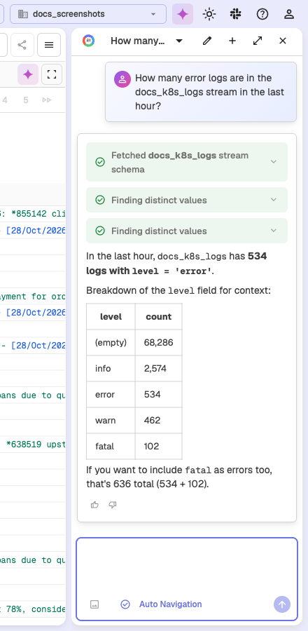
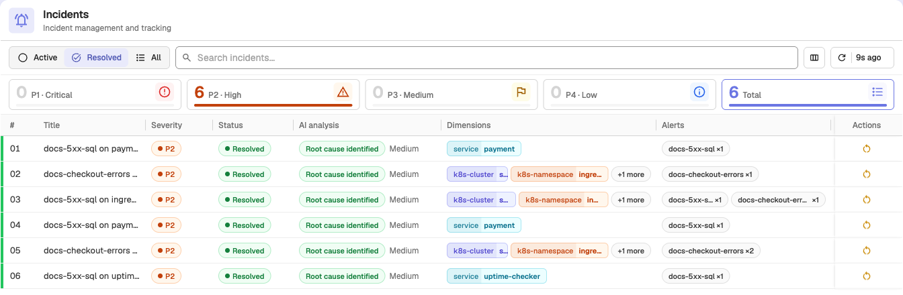
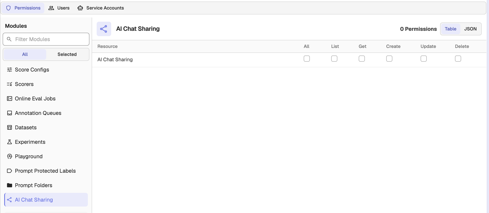

# O2 SRE Agent Setup

## Overview

The O2 SRE Agent is a background service that powers AI-driven features in OpenObserve Enterprise. It handles AI request processing, tool execution, and intelligence for observability workflows.


## Features Enabled by SRE Agent

### AI Assistant
- Natural language querying of logs, metrics, and traces
- Automated SQL/PromQL/VRL query generation
- Resource creation (dashboards, alerts) via chat
- Multi-data source correlation and troubleshooting
- Script generation (Python/VRL)
- Query validation before execution
- Context-aware on the Traces page (picks up the current stream, time range, search mode, and selected trace) and presents summarized tool results for readability

### Custom Toolsets & Skills (Enterprise)

The SRE Agent can be extended with org-scoped custom toolsets that are loaded into the agent's available tools for chat and RCA requests. Supported toolset kinds are MCP, CLI, skill, and generic. Manage them under **Management > AI Toolsets**.

### Incident Management & RCA
- Automated incident detection and grouping
- AI-powered Root Cause Analysis
- Automated RCA reanalysis (append-only delta analysis triggered on incident lifecycle events)
- Alert correlation and event tracking
- Incident lifecycle management

## Prerequisites

1. **OpenObserve Enterprise License** (v0.60.0+)
2. **AI Provider API Key** with available quota (Anthropic, OpenAI, or Google Gemini)
3. **`O2_AI_ENABLED`** set to `"true"` in your OpenObserve configuration (the binary default is `true`, but the Helm chart sets it to `"false"`)

## Configuration Methods

### Method 1: Helm Chart Deployment (Recommended)

If you're deploying OpenObserve using the official Helm charts, the SRE Agent is already included. You just need to enable and configure it.

**Official Helm Charts:**
- [Multi-node (HA)](https://github.com/openobserve/openobserve-helm-chart/tree/main/charts/openobserve)

- [Standalone](https://github.com/openobserve/openobserve-helm-chart/tree/main/charts/openobserve-standalone)

#### Step 1: Add Helm Repository

```bash
helm repo add openobserve https://charts.openobserve.ai
helm repo update
```

#### Step 2: Update Values File

Update your `values.yaml` with the following configuration:

**Minimal Configuration (Direct API - No Gateway):**

```yaml
enterprise:
  enabled: true

  # Required when O2_AI_ENABLED is "true"
  o2ai:
    enabled: true
    config:
      O2_AI_HOST: "0.0.0.0"
      O2_AI_PORT: "8000"
      O2_AI_LOG_LEVEL: "INFO"
      ADK_ENABLE_JSON_SCHEMA_FOR_FUNC_DECL: "true"
      O2_AI_GATEWAY_ENABLED: "false"
      O2_AI_PROVIDER: "anthropic"  # Options: anthropic, openai, gemini
      O2_AI_MODEL: "claude-sonnet-4-6"
      O2_AI_GATEWAY_URL: ""  # Leave empty when not using gateway
      O2_AGENT_URL: ""  # Leave empty - auto-generated
      O2_TOOL_API_URL: ""  # Leave empty - auto-generated
      # MCP validation settings
      O2_MCP_VALIDATION_ENABLED: "true"
      O2_MCP_VALIDATION_RETRY: "true"
      O2_MCP_CONTENT_VALIDATION_ENABLED: "true"
      O2_MCP_CONTENT_VALIDATION_MODE: "hybrid"
      O2_MCP_RESPONSE_VALIDATION_ENABLED: "true"

  # IMPORTANT: Requires o2ai.enabled to be true
  parameters:
    O2_AI_ENABLED: "true"
    O2_AGENT_URL: ""  # Leave empty - auto-generated
    O2_TOOL_API_URL: ""  # Leave empty - auto-generated

# AI API Key (REQUIRED)
auth:
  O2_AI_API_KEY: "your-api-key-here"
```

**Configuration with AI Gateway:**

```yaml
# Enable AI Gateway
aiGateway:
  enabled: true
  gatewayServiceName: "ai-gateway"
  port: 80

enterprise:
  enabled: true

  o2ai:
    enabled: true
    config:
      O2_AI_HOST: "0.0.0.0"
      O2_AI_PORT: "8000"
      O2_AI_LOG_LEVEL: "INFO"
      ADK_ENABLE_JSON_SCHEMA_FOR_FUNC_DECL: "true"
      O2_AI_GATEWAY_ENABLED: "true"  # Auto-set when aiGateway.enabled: true
      O2_AI_PROVIDER: "anthropic"  # Can be omitted when using gateway
      O2_AI_MODEL: "claude-sonnet-4-6"
      O2_AI_GATEWAY_URL: ""  # Auto-configured when aiGateway.enabled: true
      O2_AGENT_URL: ""
      O2_TOOL_API_URL: ""
      O2_MCP_VALIDATION_ENABLED: "true"
      O2_MCP_VALIDATION_RETRY: "true"
      O2_MCP_CONTENT_VALIDATION_ENABLED: "true"
      O2_MCP_CONTENT_VALIDATION_MODE: "hybrid"
      O2_MCP_RESPONSE_VALIDATION_ENABLED: "true"

  parameters:
    O2_AI_ENABLED: "true"
    O2_AGENT_URL: ""
    O2_TOOL_API_URL: ""

auth:
  O2_AI_API_KEY: "your-api-key-here"
```

**With Incidents & RCA:**

```yaml
enterprise:
  enabled: true

  o2ai:
    enabled: true
    config:
      O2_AI_HOST: "0.0.0.0"
      O2_AI_PORT: "8000"
      O2_AI_LOG_LEVEL: "INFO"
      ADK_ENABLE_JSON_SCHEMA_FOR_FUNC_DECL: "true"
      O2_AI_GATEWAY_ENABLED: "false"
      O2_AI_PROVIDER: "anthropic"
      O2_AI_MODEL: "claude-sonnet-4-6"
      O2_AI_GATEWAY_URL: ""
      O2_AGENT_URL: ""
      O2_TOOL_API_URL: ""
      O2_MCP_VALIDATION_ENABLED: "true"
      O2_MCP_VALIDATION_RETRY: "true"
      O2_MCP_CONTENT_VALIDATION_ENABLED: "true"
      O2_MCP_CONTENT_VALIDATION_MODE: "hybrid"
      O2_MCP_RESPONSE_VALIDATION_ENABLED: "true"

  parameters:
    # AI Features
    O2_AI_ENABLED: "true"
    O2_AGENT_URL: ""
    O2_TOOL_API_URL: ""

    # Incidents and RCA
    O2_INCIDENTS_ENABLED: "true"
    O2_INCIDENTS_RCA_ENABLED: "true"
    O2_INCIDENTS_AUTO_RESOLVE_AFTER_MINUTES: "-1"
    O2_INCIDENTS_REANALYSIS_COOLDOWN_MINUTES: "30"  # Minimum minutes between automatic reanalysis runs (user-triggered reanalysis bypasses it)

auth:
  O2_AI_API_KEY: "your-api-key-here"
  # Optional: MCP Authentication
  O2_MCP_USERNAME: "root@example.com"
  O2_MCP_PASSWORD: "SecurePassword123"
```

#### Step 3: Deploy

**Multi-node deployment:**
```bash
helm upgrade --install openobserve openobserve/openobserve \
  -f values.yaml \
  --namespace openobserve \
  --create-namespace
```

**Standalone deployment:**
```bash
helm upgrade --install openobserve openobserve/openobserve-standalone \
  -f values.yaml \
  --namespace openobserve \
  --create-namespace
```

#### Step 4: Verify Deployment

```bash
# Check SRE Agent pod
kubectl get pods -n openobserve | grep o2ai

# View logs
kubectl logs -n openobserve deployment/openobserve-o2ai --tail=50

# Check health
kubectl exec -n openobserve deployment/openobserve-router -- \
  curl -s http://openobserve-o2ai:8000/health
```

### Method 2: Manual Deployment

For deployments not using the official Helm charts. Requires deploying two components separately.

**Docker Image:** `ghcr.io/openobserve/o2-ai:v1.1.0`

#### Step 1: Create Kubernetes Secret

```yaml
apiVersion: v1
kind: Secret
metadata:
  name: o2-sre-agent-secrets
  namespace: openobserve
type: Opaque
stringData:
  ai-api-key: "your-api-key-here"
  # Optional
  mcp-username: "root@example.com"
  mcp-password: "SecurePassword123"
```

```bash
kubectl apply -f secret.yaml
```

#### Step 2: Deploy SRE Agent

```yaml
apiVersion: apps/v1
kind: Deployment
metadata:
  name: o2-sre-agent
  namespace: openobserve
spec:
  replicas: 2
  selector:
    matchLabels:
      app: o2-sre-agent
  template:
    metadata:
      labels:
        app: o2-sre-agent
    spec:
      containers:
      - name: o2-sre-agent
        image: ghcr.io/openobserve/o2-ai:v1.1.0
        ports:
        - containerPort: 8000
          name: http

        env:
        # Server Configuration
        - name: O2_AI_HOST
          value: "0.0.0.0"
        - name: O2_AI_PORT
          value: "8000"
        - name: O2_AI_LOG_LEVEL
          value: "INFO"

        # AI Provider Configuration
        - name: O2_AI_PROVIDER
          value: "anthropic"
        - name: O2_AI_MODEL
          value: "claude-sonnet-4-6"
        - name: O2_AI_API_KEY
          valueFrom:
            secretKeyRef:
              name: o2-sre-agent-secrets
              key: ai-api-key

        # MCP Tool Server URL (points to OpenObserve)
        - name: O2_TOOL_API_URL
          value: "http://openobserve-router.openobserve.svc.cluster.local:5080/api/default/mcp"

        # MCP Validation
        - name: O2_MCP_VALIDATION_ENABLED
          value: "true"
        - name: O2_MCP_CONTENT_VALIDATION_ENABLED
          value: "true"

        # Optional: MCP Authentication
        - name: O2_MCP_USERNAME
          valueFrom:
            secretKeyRef:
              name: o2-sre-agent-secrets
              key: mcp-username
              optional: true
        - name: O2_MCP_PASSWORD
          valueFrom:
            secretKeyRef:
              name: o2-sre-agent-secrets
              key: mcp-password
              optional: true

        resources:
          requests:
            memory: "256Mi"
            cpu: "250m"
          limits:
            memory: "512Mi"
            cpu: "500m"

---
apiVersion: v1
kind: Service
metadata:
  name: o2-sre-agent
  namespace: openobserve
spec:
  type: ClusterIP
  ports:
  - port: 8000
    targetPort: http
    name: http
  selector:
    app: o2-sre-agent
```

```bash
kubectl apply -f deployment.yaml
```

#### Step 3: Configure OpenObserve

Update your OpenObserve deployment configuration:

```yaml
# OpenObserve configuration
enterprise:
  enabled: true
  parameters:
    # AI Features
    O2_AI_ENABLED: "true"
    O2_AGENT_URL: "http://o2-sre-agent.openobserve.svc.cluster.local:8000"
    O2_TOOL_API_URL: "http://openobserve-router.openobserve.svc.cluster.local:5080/api/default/mcp"

    # Optional: Incident Management
    O2_INCIDENTS_ENABLED: "true"
    O2_INCIDENTS_RCA_ENABLED: "true"
```

Restart OpenObserve services to apply changes.

## Environment Variables Reference

For detailed information about all available environment variables and their configurations, refer to the official documentation:

- [SRE Agent Configuration](../administration/configuration/environment-variables.md#sre-agent-configuration)
- [AI Integration](../administration/configuration/environment-variables.md#ai-integration)
- [Incidents and RCA](../administration/configuration/environment-variables.md#incidents-and-rca)

## AI Provider Selection

| Provider | Model | Use Case |
|----------|-------|----------|
| **Anthropic** | `claude-sonnet-4-6` | Best reasoning, complex analysis (Recommended) |
| **OpenAI** | `gpt-4-turbo`, `gpt-4o` | Wide compatibility, strong performance |
| **Google Gemini** | `gemini-1.5-pro` | Cost-effective option |

**Configuration:**
```yaml
O2_AI_PROVIDER: "anthropic"  # or "openai", "gemini"
O2_AI_MODEL: "claude-sonnet-4-6"
O2_AI_API_KEY: "your-api-key"
```

## AI Gateway Configuration

An AI Gateway provides rate limiting, response caching, load balancing, and usage tracking. Use it for production deployments, high query volumes (>100/day), or cost-sensitive environments. Development/testing can skip the gateway for simplicity.

### Configuration Flows

#### Flow 1: OpenObserve Built-in Gateway (Recommended)

Uses the [O2 Envoy Gateway](https://github.com/openobserve/o2-envoy-gateway) for AI request management.

```yaml
aiGateway:
  enabled: true
  gatewayServiceName: "ai-gateway"
  port: 80

enterprise:
  o2ai:
    enabled: true
    # O2_AI_PROVIDER not needed
    # Gateway settings auto-configured
```

#### Flow 2: External/Self-hosted Gateway

```yaml
enterprise:
  o2ai:
    enabled: true
    config:
      O2_AI_GATEWAY_ENABLED: "true"
      O2_AI_GATEWAY_URL: "http://my-gateway.custom.svc.cluster.local:80"
      # O2_AI_PROVIDER not needed
```

#### Flow 3: Direct API (No Gateway)

```yaml
enterprise:
  o2ai:
    enabled: true
    config:
      O2_AI_PROVIDER: "anthropic"
      O2_AI_MODEL: "claude-sonnet-4-6"
      # No gateway configuration
```

## MCP Validation & Security

Model Context Protocol (MCP) handles communication between the SRE Agent and OpenObserve. Validation ensures secure and reliable AI tool execution.

**Recommended for Production:**
- Enable all validation settings (`O2_MCP_VALIDATION_ENABLED: "true"`)

- Use `hybrid` validation mode for balanced security and flexibility
- Configure MCP authentication for multi-tenant environments

**Development:** Can disable validation (`O2_MCP_VALIDATION_ENABLED: "false"`) for faster iteration.

**MCP Authentication** (optional):
```yaml
O2_MCP_USERNAME: "root@example.com"
O2_MCP_PASSWORD: "SecurePassword123"
```

## Using the AI Assistant

### Access

1. Log into OpenObserve
2. Click the **AI Assistant** icon in the top bar and ask a question about your data



3. Navigate to **Reliability > Incidents** in the OpenObserve side menu



### Example Queries

**Log Analysis:**
```
Show me all error logs from the payment service in the last hour
Find authentication failures grouped by IP address
```

**Metrics:**
```
What's causing high CPU usage on the API pods?
Show me latency trends for the checkout endpoint
```

**Resource Creation:**
```
Create a dashboard for monitoring the payment service
Set up an alert for when error rate exceeds 5%
```

**Troubleshooting:**
```
Analyze the root cause of the recent outage
Why is the database connection pool exhausted?
```

## Persistent chat history and sharing

With chat persistence enabled, OpenObserve stores AI Assistant conversations on the server. A chat survives a browser refresh, can be reopened from any device, and keeps running on the server if you close the tab mid-answer. Persisted chats can also be shared with teammates or, optionally, through public links.

### Enable chat persistence

Chat persistence is off by default. To turn it on, set these variables on OpenObserve:

| Environment Variable | Required value | Description |
|----------------------|----------------|-------------|
| O2_AI_CHAT_PERSISTENCE_ENABLED | `true` | Turns on server-side chat persistence. Takes effect only when the AI Assistant is enabled and an SRE Agent URL is configured. |
| O2_AI_INTERNAL_SECRET | a shared secret | Sent to the SRE Agent on persisted chat turns and restores. It must equal the agent's `O2_INTERNAL_API_SECRET`; without it, persisted turns fail with `internal_secret_required`. |

Conversation events are stored in the `_o2_ai_chat_events` stream of each organization.

### Browse and reopen chats

- In the AI Assistant panel, open the chat history dropdown to search your previous chats, reopen one, share it, or delete it.
- On the home page, the **Chats** panel lists the same history.

When you reopen a chat, its transcript is restored from storage. If a turn was still running when you left, it continues on the server and the reply is there when you come back.

### Share a chat

1. Open the chat and click **Share** in the AI Assistant header, or click **Share** next to the chat in the history list.
2. In the **Share chat** dialog, choose:
    - **Mode**: **Snapshot** freezes the chat at the latest finished message (use **Refresh snapshot** to update it later). **Live** always shows the latest finished messages.
    - **Who can view**: **Organization** limits the link to signed-in members of the organization who have access to shared chats. **Public link** lets anyone with the link read the chat without signing in; it appears only when public links are enabled (see [Public links](#public-links)).
    - **Expires**: from **In 1 hour** to **In 1 year**, or **Never**.
    - **Hide tool inputs and outputs**: viewers see the answers and which tools ran, but not the tool data. This is on by default for public links.
3. Click **Create link**, then **Copy link**.

The dialog also lists the chat's **Active links**, where you can switch a link between snapshot and live, show or hide tool data, or **Revoke** it. Deleting a chat revokes all of its links. To see every link you have created, click **Shared by me** in the **Chats** panel on the home page; organization admins can switch to **All in organization** to see every shared chat.

:::warning[Warning]
Unless you hide them, shared chats include every tool input and output from the conversation, and anyone who can open the link can read them.
:::

A recipient opens the link to see a read-only copy of the chat, and can click **Fork into my chats** to continue the conversation in their own history.

### Permissions

Sharing is controlled by the **AI Chat Sharing** permission (`ai_chat_share` in OpenFGA). By default only organization admins can create, list, manage, and open shared chats. To let other users share chats or open organization links, grant **AI Chat Sharing** to a custom role:

1. Go to **IAM** > **Roles** and edit the role.
2. On the **Permissions** tab, select the **AI Chat Sharing** module.
3. Select the operations to allow, then click **Save**:
    - **Create**: create share links.
    - **List**: see a chat's links and the **Shared by me** list.
    - **Get**: open organization links and fork shared chats.
    - **Update** and **Delete**: change and revoke links.



### Public links

Public links are disabled by default; the **Public link** option and the public route exist only when they are turned on:

| Environment Variable | Default | Description |
|----------------------|---------|-------------|
| ZO_PUBLIC_AI_CHAT_ENABLED | false | Allows AI chats to be shared through public, unauthenticated links. Requires chat persistence. |
| ZO_PUBLIC_AI_CHAT_RPM | 60 | Per-IP requests-per-minute limit on the public shared-chat route (`0` disables the limit). |
| ZO_PUBLIC_AI_CHAT_MAX_EXPIRY_DAYS | 90 | Longest expiry a public link may have. Public links must expire; `0` means 90, and the maximum is 365. |

### High availability

With `O2_AI_HA_ENABLED=true`, OpenObserve routes AI requests to SRE Agent replicas registered in NATS instead of `O2_AGENT_URL`. Each persisted chat session is owned by one replica. If that replica goes down, the next turn waits up to `O2_AI_CHAT_OWNER_WAIT_SECS` for another replica to take over, then restores the session's stored history into it so the conversation continues.

### Turn outcomes and limits

Every persisted turn ends as **completed**, **cancelled**, **failed**, **interrupted** (no response from the SRE Agent for 45 seconds), or **deleted**. Active persisted turns are capped on each node: by default 3 per user, 50 per organization, and 200 in total. A request over a limit is rejected with HTTP `429` and the code `turn_limit`.

### Chat persistence tuning

These optional variables tune persistence. The defaults suit most deployments.

| Environment Variable | Default | Description |
|----------------------|---------|-------------|
| O2_AI_CHAT_PERSIST_BATCH_SIZE | 16 | Events per write batch; batches are also cut on the flush interval. |
| O2_AI_CHAT_PERSIST_FLUSH_INTERVAL_MS | 500 | Maximum time (ms) a buffered event waits before it is written. |
| O2_AI_CHAT_PERSIST_FINAL_TIMEOUT_SECS | 30 | How long (s) the final flush may take before the turn is reported as not persisted. |
| O2_AI_CHAT_UI_CHANNEL_CAPACITY | 4096 | Frames the browser may fall behind before it is disconnected from the turn. The turn keeps running on the server. |
| O2_AI_CHAT_MAX_EVENT_BYTES | 1048576 | Largest stored row payload (bytes); a bigger event is split across rows. |
| O2_AI_CHAT_MAX_EVENT_TOTAL_BYTES | 67108864 | Largest event (bytes) a turn persists; a bigger one fails the turn with `event_too_large`. |
| O2_AI_CHAT_MAX_PENDING_EVENTS | 5000 | Cap on events buffered for one turn while writes are failing. |
| O2_AI_CHAT_RETENTION_DAYS | 0 | Retention (days) of the `_o2_ai_chat_events` stream; `0` keeps the organization default. |
| O2_AI_CHAT_TURN_LEASE_WAIT_SECS | 1 | How long (s) a new turn waits for the session's previous turn to release it before answering `409`. |
| O2_AI_CHAT_MAX_TURN_SECS | 3600 | Hard ceiling (s) on one persisted turn, whether or not a browser is connected. |
| O2_AI_CHAT_OWNER_WAIT_SECS | 45 | How long (s) a turn waits for another replica to take over a failed owner's session. Keep it above `O2_AI_REPLICA_HEARTBEAT_TTL`. |
| O2_AI_CHAT_MAX_ACTIVE_TURNS_PER_USER | 3 | Active persisted turns one user may run on a node (`0` = unlimited). |
| O2_AI_CHAT_MAX_ACTIVE_TURNS_PER_ORG | 50 | Active persisted turns one organization may run on a node (`0` = unlimited). |
| O2_AI_CHAT_MAX_ACTIVE_TURNS_PER_NODE | 200 | Active persisted turns one node may run (`0` = unlimited). |

## Troubleshooting

:::accordion[Common issues and fixes]

1. **SRE Agent Pod Not Starting**

    Check pod status:

    ```bash
    kubectl get pods -n openobserve | grep o2ai
    kubectl logs -n openobserve deployment/openobserve-o2ai --tail=100
    ```

    Common causes:

    - Invalid API key
    - Incorrect AI provider name
    - Network connectivity issues

    Verify configuration:

    ```bash
    # Check API key exists
    kubectl get secret -n openobserve openobserve -o jsonpath='{.data.O2_AI_API_KEY}' | base64 -d

    # Check environment variables
    kubectl exec -n openobserve deployment/openobserve-o2ai -- env | grep O2_
    ```

2. **AI Assistant Not Responding**

    Check connectivity:

    ```bash
    # Health check
    kubectl exec -n openobserve deployment/openobserve-router -- \
      curl -s http://openobserve-o2ai:8000/health

    # Check logs
    kubectl logs -n openobserve deployment/openobserve-o2ai --tail=50
    ```

    Common causes:

    - `O2_AI_ENABLED` not set to `"true"`
    - Network policy blocking communication
    - AI provider API rate limiting
    - Service misconfiguration

3. **MCP Tool Execution Failures**

    Verify MCP endpoint:

    ```bash
    # Check O2_TOOL_API_URL
    kubectl exec -n openobserve deployment/openobserve-o2ai -- env | grep O2_TOOL_API_URL

    # Test connectivity
    kubectl exec -n openobserve deployment/openobserve-o2ai -- \
      curl -s http://openobserve-router:5080/api/default/mcp
    ```

    Common causes:

    - Incorrect `O2_TOOL_API_URL` format
    - Wrong organization name in URL
    - Missing MCP credentials
    - Service not reachable

    Correct URL format:

    ```
    http://<service-name>.<namespace>.svc.cluster.local:<port>/api/<org-name>/mcp
    ```

4. **AI Gateway Issues**

    Check gateway:

    ```bash
    # Verify gateway service
    kubectl get svc -n <gateway-namespace> | grep ai-gateway

    # Test connectivity
    kubectl exec -n openobserve deployment/openobserve-o2ai -- \
      curl -s http://ai-gateway:80
    ```

    Common causes:

    - Gateway not deployed
    - Conflicting configuration (both `O2_AI_PROVIDER` and `O2_AI_GATEWAY_ENABLED` set)
    - Wrong gateway URL or port

    Fix:

    - With gateway: Remove `O2_AI_PROVIDER`, set `O2_AI_GATEWAY_ENABLED="true"`
    - Without gateway: Remove all `O2_AI_GATEWAY_*` variables, set `O2_AI_PROVIDER`

5. **Incident Management Not Working**

    Check configuration:

    ```bash
    kubectl get configmap -n openobserve openobserve -o yaml | grep O2_INCIDENTS
    ```

    Required settings (in OpenObserve, not SRE Agent):

    ```yaml
    O2_AI_ENABLED: "true"
    O2_INCIDENTS_ENABLED: "true"
    O2_INCIDENTS_RCA_ENABLED: "true"
    ```
:::

## Best Practices

- **API Key Security**: Store in Kubernetes Secrets; use secret managers (Vault, AWS Secrets Manager) for production; rotate every 90 days
- **MCP Validation**: Enable in production (`O2_MCP_VALIDATION_ENABLED: "true"`); use MCP authentication for multi-tenant setups
- **Network Security**: Apply network policies to restrict traffic; enable TLS for service communication
- **High Availability**: Deploy with 2+ replicas; enable HPA for auto-scaling in production
- **Logging**: Use `INFO` level for production, `DEBUG` only when troubleshooting
- **Cost Optimization**: Use AI Gateway with caching to reduce API calls; choose cost-effective models for simple queries
- **Updates**: Keep SRE Agent image updated; test in non-production environments first


### Support diagnostics

```bash
# Check pod and logs
kubectl get pods -n openobserve | grep o2ai
kubectl logs -n openobserve deployment/openobserve-o2ai --tail=100

# Verify configuration (redact sensitive data)
kubectl get configmap -n openobserve openobserve -o yaml | grep O2_
```


## Next steps

- [Model Context Protocol (MCP)](../integration/ai/mcp/index.md): connect IDEs and agents to OpenObserve through the SRE Agent.
- [AI Integration env vars](../administration/configuration/environment-variables.md#ai-integration): full reference for AI-related settings.
- [Incidents and RCA env vars](../administration/configuration/environment-variables.md#incidents-and-rca): tune incident detection and root cause analysis.


**Need some help?**

- Join our [Community Slack](https://short.openobserve.ai/community) 
- Or [Contact support](https://openobserve.ai/contactus/)
