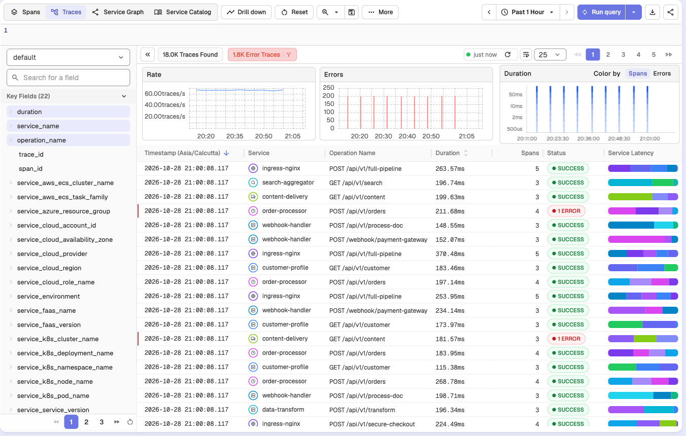
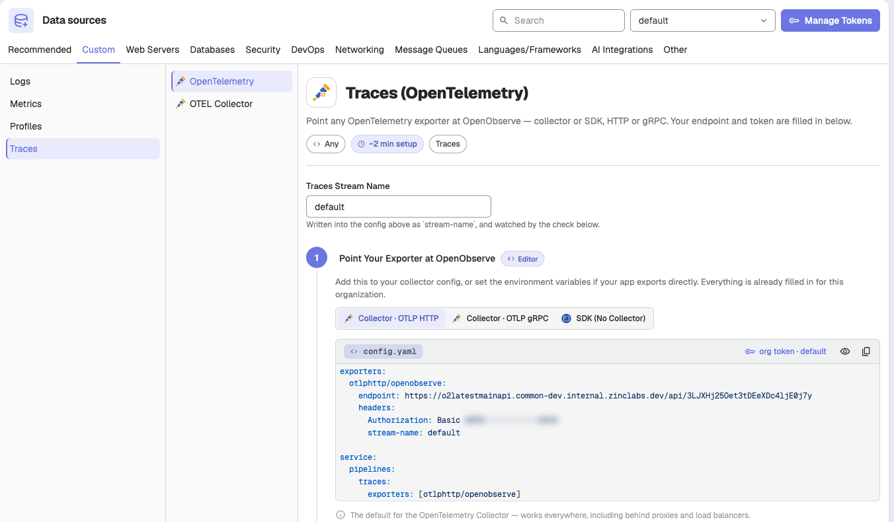
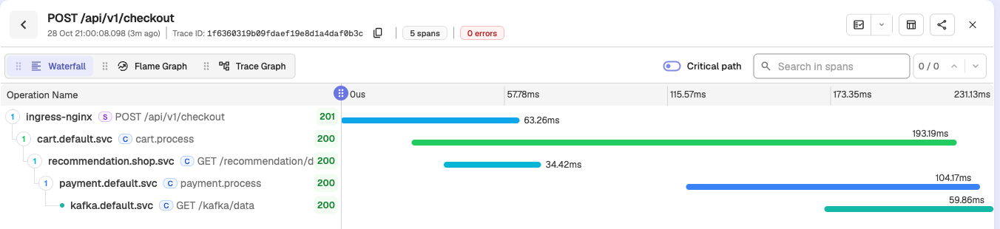
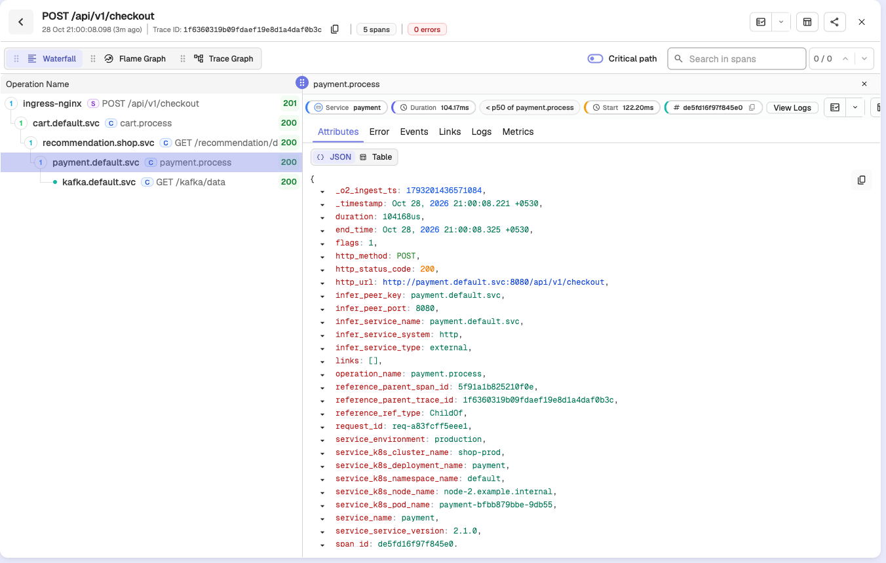
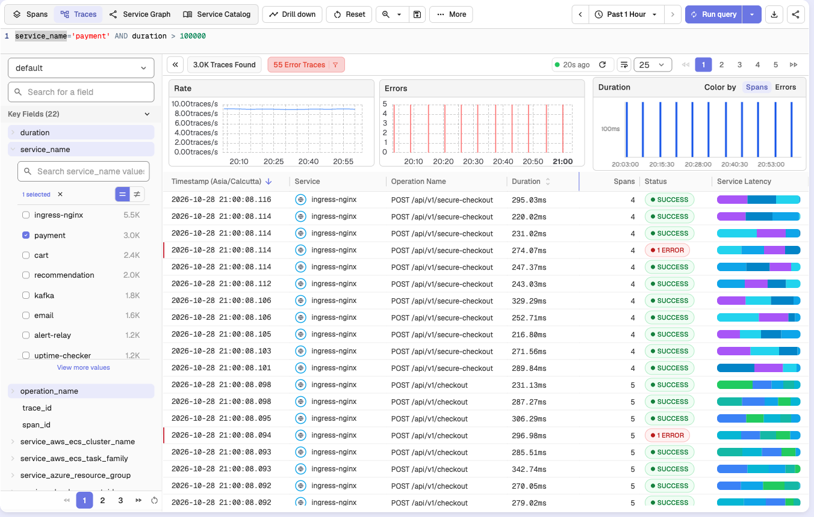
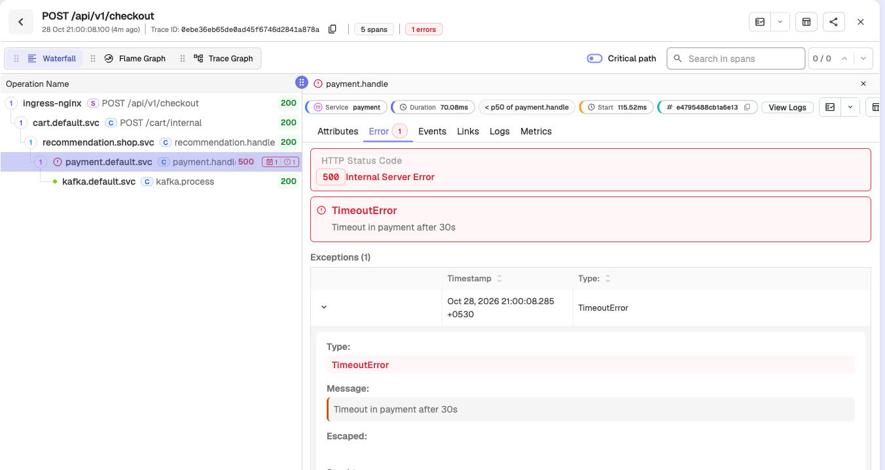
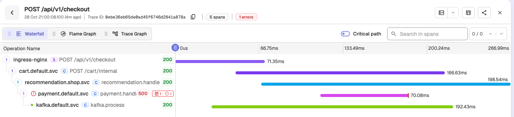
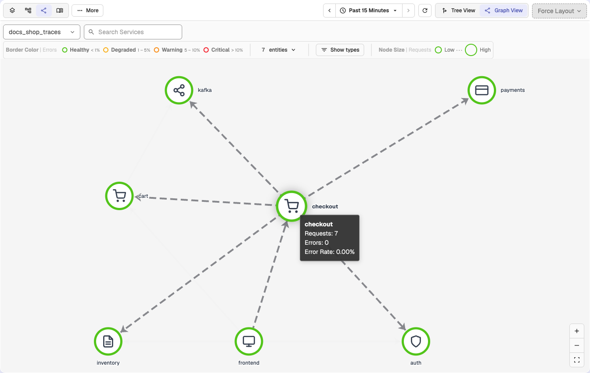
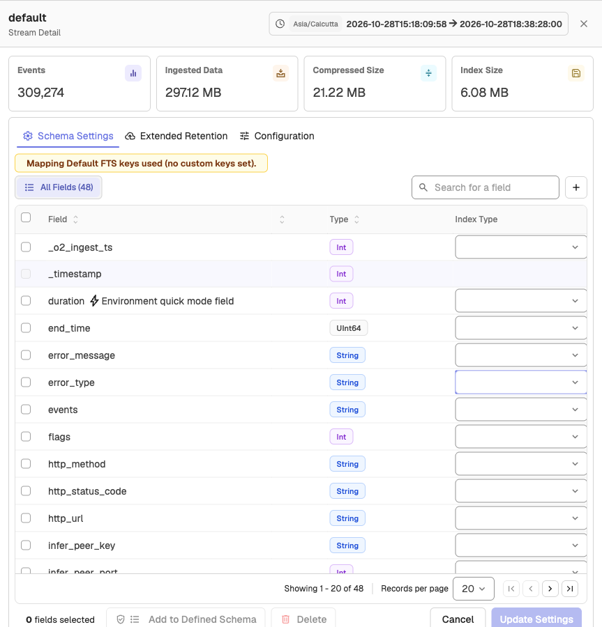

# Distributed Tracing

OpenObserve distributed tracing follows each request as it moves through your microservices. This helps you find slow spots and fix problems in distributed systems.

## Overview

With distributed tracing, you can see the full path of a request across many services. You can see how services depend on each other and find the root cause of slow requests. OpenObserve is built for cloud-native apps. It ingests, links, and analyzes traces at enterprise scale, and queries stay fast.

*Distributed Tracing overview page*

## Key Features

### Trace Ingestion

- **OpenTelemetry Native**: Full support for the OpenTelemetry protocol. Traces are collected automatically.

- **High Throughput**: Ingester nodes scale out in HA mode to handle more spans as volume grows.

### Trace Structure & Data

- **Hierarchical Spans**: See full trace trees that show parent-child links between operations.

- **Rich Metadata**: Capture span attributes, tags, and context in detail.

- **Custom Instrumentation**: Use manual or automatic instrumentation.

### Trace Analysis & Search

- **Advanced Filtering**: Search traces by service, operation, duration, errors, and custom attributes.

- **Performance Profiling**: Find slow operations and bottlenecks across your distributed system.

- **Error Investigation**: Quickly find and study failed requests and exceptions.

### Visualization & Insights

- **Waterfall Views**: See how spans relate and how long each one takes, in an interactive view.

- **Flame Graph**, **Trace Graph** and **DAG**: Other views of a single trace. **DAG** appears for traces with LLM spans.

- **Spans**: Search and list single spans across all traces.

- **Service Graph** (Enterprise): See how your services call each other, with dependencies, throughput and error rates.

- **Service Catalog**: See every service that sends traces, with latency, throughput and error rate.

### Storage & Performance

- **Indexing**: Choose an **Index Type** per field (for example **Full text search** or **Secondary index**) in the stream's **Schema Settings**.

- **Retention Management**: [Flexible retention policies](../user-guide/data-processing/streams/extended-retention.md) keep long-term storage low cost.

### Integration & Standards
- **OpenTelemetry Ecosystem**: Works fully with OpenTelemetry collectors and instrumentation libraries.
- **Jaeger and Zipkin Compatibility**: Ingest traces from Jaeger and Zipkin through the OpenTelemetry Collector.
- **Kubernetes-Friendly:** Runs in Kubernetes through the OpenTelemetry Collector. It can add service metadata to your traces.
- **API Access**: Use REST APIs to read and analyze traces from code.