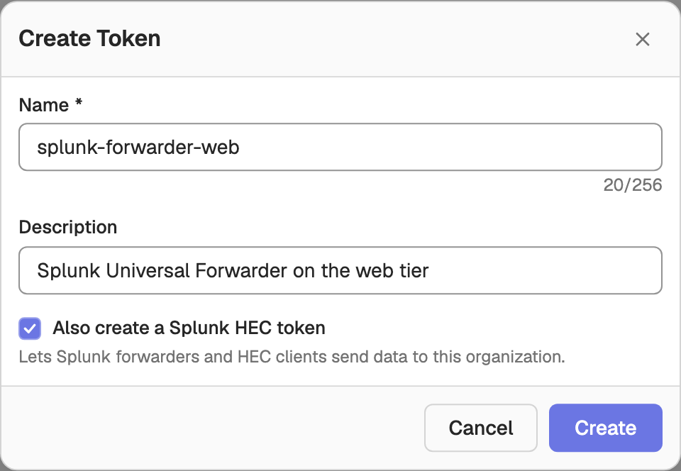
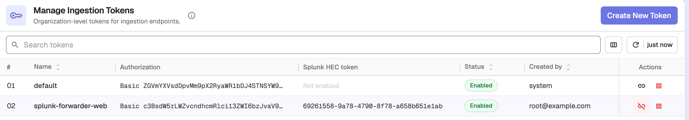
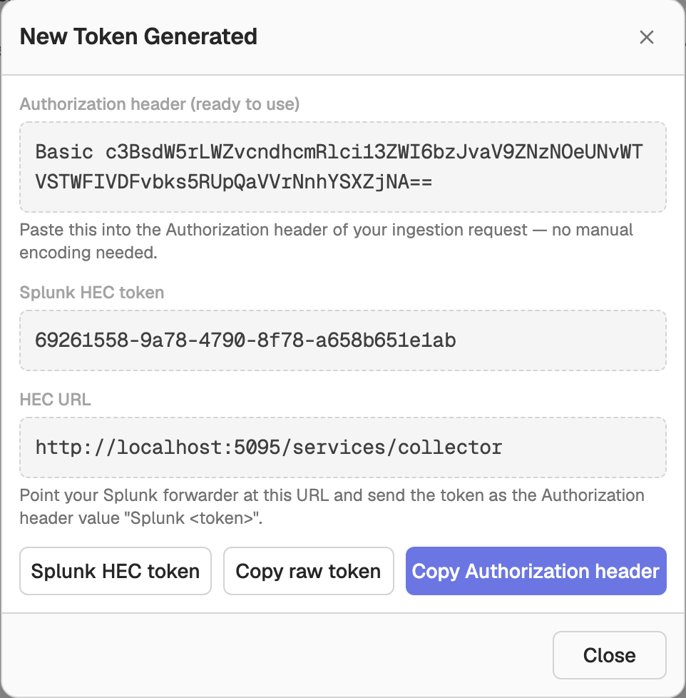

# Splunk HEC Log Ingestion

OpenObserve provides a Splunk-compatible HTTP Event Collector (HEC) endpoint, so Splunk forwarders and other HEC clients can send events to OpenObserve using the standard Splunk HEC protocol. Authentication uses a **Splunk HEC token**, a GUID generated in OpenObserve, instead of an `o2oi_` ingestion token or a user password.

The organization is resolved from the token, so no organization identifier appears anywhere in the request. A Splunk forwarder can point at a bare host without any OpenObserve-specific path.

## Generate a Splunk HEC token

A Splunk HEC token belongs to an [org ingestion token](../../user-guide/account-administration/identity-and-access-management/ingestion-tokens.md). Navigate to **IAM > Ingestion Tokens** and either:

- click **Create New Token** and check **Also create a Splunk HEC token** in the **Create Token** dialog, or
- click the **Generate Splunk token** action (link icon) in the row of an existing token.





The Splunk HEC token is a lowercase hyphenated GUID, for example `7b3d9f2c-4a11-4e55-9c8b-2f6a01c34d90`. It is shown in the **Splunk HEC token** column of the token list. Tokens without one show **Not enabled**.

When you create a token with **Also create a Splunk HEC token** checked, the **New Token Generated** dialog shows the Splunk HEC token together with the **HEC URL** to point your forwarder at.



### Revoke a Splunk HEC token

Click the **Revoke Splunk token** action (broken-link icon) in the token's row and confirm. Forwarders using that Splunk HEC token start receiving `403` errors immediately, and this cannot be undone. You can generate a new Splunk HEC token for the same ingestion token afterwards; it gets a new GUID.

Disabling the underlying ingestion token also stops its Splunk HEC token from authenticating.

## Endpoint

Send `POST` requests to:

| Field | Value |
|---|---|
| Endpoint | `https://<your-openobserve-host>/services/collector` |
| Alias | `/services/collector/event` (identical, accepts the same payload) |
| Health check | `GET /services/collector/health` |

Do not add an organization or `/api/` segment to the path.

The collector is registered like every other route, so a deployment that sets `ZO_BASE_URI` serves it at `<ZO_BASE_URI>/services/collector`. Splunk forwarders append `/services/collector` to a bare host themselves, so they need a deployment without `ZO_BASE_URI`, which is the default.

## Authentication

Send the token in the `Authorization` header using the `Splunk` scheme:

```
Authorization: Splunk <splunk-hec-token>
```

OpenObserve maps the GUID to its org ingestion token and authorizes ingestion through the same org-scoped path as every other ingestion token. The Splunk HEC token is accepted only on the `/services/collector` endpoints; it never authenticates an `/api/` route.

## Example request

```shell
curl https://<your-openobserve-host>/services/collector \
  -H "Authorization: Splunk <splunk-hec-token>" \
  -d '{"event":{"level":"info","log":"test message for openobserve"},"index":"default"}'
```

A successful request answers `{"text":"Success","code":0}`.

## Event payload

Each event is a JSON object. Several events can be sent in one request, concatenated or one per line.

```json
{
  "event": { "level": "info", "log": "test message for openobserve" },
  "index": "application",
  "host": "web-01",
  "source": "/var/log/app.log",
  "sourcetype": "app:json"
}
```

- `event`: the log record, either an object or a string (a string is stored in the `log` field). It is required and must not be empty.
- `index`: the stream to write to. Events without an `index` go to the stream set by `ZO_INGEST_DEFAULT_HEC_STREAM` (default `_hec`).
- `time`: epoch seconds; a fractional value is accepted. When it is missing or not positive, the receipt time is used.
- `host`, `source`, `sourcetype`: stored as columns on the event.
- `fields`: additional key/value pairs to attach. `fields` has the lowest precedence: it can add keys but never overwrite the event body or the envelope metadata.

:::warning[Timestamps outside the ingestion window are discarded]
Events older than `ZO_INGEST_ALLOWED_UPTO` (5 hours by default) or further ahead than `ZO_INGEST_ALLOWED_IN_FUTURE` (24 hours by default) are dropped, and the request still answers code `0`, because a Splunk client does not retry an error. A hardcoded or stale `time` therefore looks like a successful send that stores nothing.
:::

## Health check

`GET /services/collector/health` requires no authentication and answers:

```json
{"text":"HEC is healthy","code":17}
```

## Response codes

The collector returns Splunk's status codes, which differ from the responses of the `/api/{org_id}/_hec` route:

| HTTP status | `code` | `text` |
|---|---|---|
| 200 | 0 | Success |
| 403 | 1 | Token disabled |
| 401 | 2 | Token is required |
| 401 | 3 | Invalid authorization |
| 403 | 4 | Invalid token |
| 400 | 5 | No data |
| 400 | 6 | Invalid data format |
| 400 | 7 | Incorrect index |
| 500 | 8 | Internal server error |
| 503 | 9 | Server is busy |
| 400 | 12 | Event field is required |
| 400 | 13 | Event field cannot be blank |
| 413 | 6 | Request entity too large |

## Splunk Edge Processor

:::warning[Splunk Edge Processor configuration]
- Disable `useACK` on the destination. Indexer acknowledgement is not supported, and a client waiting for one will block.
- Edge Processor forwards the upstream client's token for any data that reached it over HEC, and uses the destination token only when the data carries none. Have upstream clients send this organization's Splunk HEC token, or send to Edge Processor without an `Authorization` header. Getting this wrong looks like total silent data loss, because every request answers `403`.
:::

## Use HTTPS

:::warning[Use HTTPS]
The Splunk HEC token is a bearer credential that can be replayed if sent over plaintext HTTP. Terminate TLS at OpenObserve (`ZO_HTTP_TLS_ENABLED`, disabled by default) or at a trusted proxy in front of it.
:::

## Verify ingestion

Once your forwarder is shipping, open the OpenObserve UI, click **Logs** in the sidebar, and select the stream named by the `index` field (or `_hec`). New entries should appear within a few seconds. If nothing appears, confirm that the `Authorization` header uses the `Splunk` scheme, that the endpoint has no organization or `/api/` segment, and that event timestamps are current.

## Next steps

- [Ingestion Tokens](../../user-guide/account-administration/identity-and-access-management/ingestion-tokens.md): create and manage org-level ingestion tokens.
- [Logs UI](../../user-guide/data-exploration/logs/logs.md): search and explore ingested logs.
- [Other log ingestion options](./index.md): OpenTelemetry, Vector, Fluent Bit, and language SDKs.

**Need some help?**

- Join our [Community Slack](https://short.openobserve.ai/community)
- Or [Contact support](https://openobserve.ai/contactus/)
