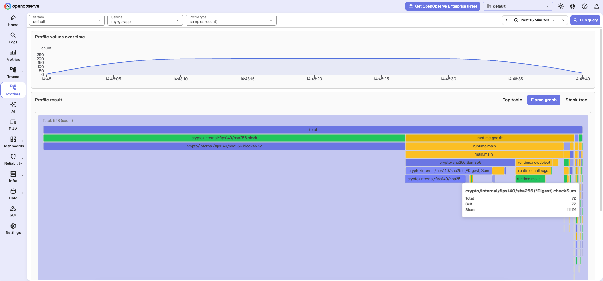
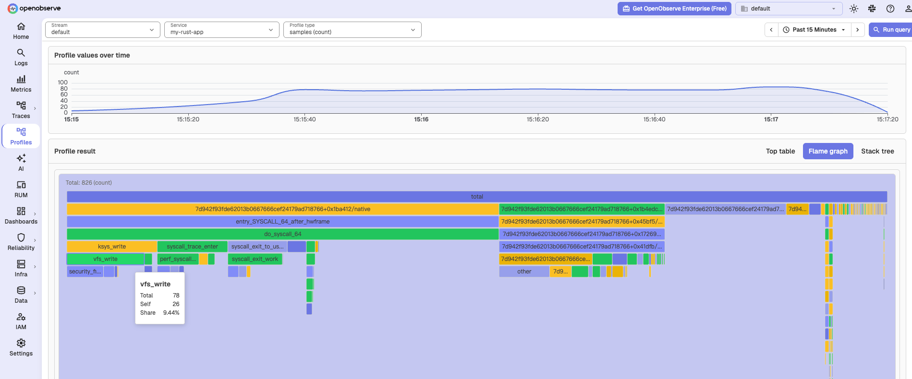

# Zero-Code CPU Profiling with otelcol-ebpf-profiler

[`otelcol-ebpf-profiler`](https://github.com/open-telemetry/opentelemetry-collector-releases/releases) is the Collector distribution that embeds the [eBPF profiler](https://github.com/open-telemetry/opentelemetry-ebpf-profiler) as the `profiling` receiver. It samples on-CPU stacks on a **Linux** host and exports [OTLP Profiles](https://opentelemetry.io/docs/concepts/signals/profiles/). No language SDK and no application restart. Do not use `otelcol-contrib`.

Use it for **Java HotSpot**, **Go**, **Rust**, C/C++, and other supported runtimes. The default `tracers: all` includes the HotSpot unwinder for Java method and JIT frame names. For JVM-specific allocation and lock events, use [async-profiler](./java.md).

## Send profiles

Use [otelcol-ebpf-profiler 0.153.0](https://github.com/open-telemetry/opentelemetry-collector-releases/releases/tag/v0.153.0) on Linux kernel **5.10 or newer**, with root access to load eBPF programs and attach perf events. Both `amd64` and `arm64` packages are available. macOS and Windows need a Linux VM; the profiler cannot sample those host kernels.

Copy the endpoint and `Authorization` header from **Data > Data sources > Custom > Profiles**. Save as `ebpf-profiler-config.yaml`:

```yaml
receivers:
  profiling:
    samples_per_second: 20
    reporter_interval: 60s
    include_env_vars: OTEL_SERVICE_NAME

processors:
  transform/service:
    profile_statements:
      - context: resource
        statements:
          - set(attributes["service.name"], attributes["process.environment_variable.OTEL_SERVICE_NAME"]) where attributes["process.environment_variable.OTEL_SERVICE_NAME"] != nil

exporters:
  otlp_http/openobserve:
    profiles_endpoint: http://<your-openobserve-host>/api/<your-org>/v1/profiles
    headers:
      Authorization: Basic <paste-from-Data-Sources>
      stream-name: default

service:
  pipelines:
    profiles:
      receivers: [profiling]
      processors: [transform/service]
      exporters: [otlp_http/openobserve]
```

The receiver exports collected environment variables as `process.environment_variable.*` attributes. The `include_env_vars` option and transform above map each process's `OTEL_SERVICE_NAME` to `service.name`. Set the variable when launching the application; setting it without this mapping does not name profiles in Collector 0.153.0. Avoid upserting one constant service name for the whole host:

```bash
OTEL_SERVICE_NAME=my-app ./your-app
```

Linux host, run as root:

```bash
sudo ./otelcol-ebpf-profiler --feature-gates=+service.profilesSupport --config=ebpf-profiler-config.yaml
```

### Off-CPU sampling

The configuration above collects on-CPU samples only. To also sample off-CPU waits, add `off_cpu_threshold: 0.1` under `receivers.profiling`. The value is a sampling probability in `[0, 1]`; `0` disables off-CPU profiling. The exported values are sampled wait durations across threads, rather than the application's wall-clock elapsed time. Select the corresponding emitted profile type in OpenObserve.

## Native symbols

`otelcol-ebpf-profiler` does not resolve C/C++/Rust symbols on the host. OpenObserve displays the frames it receives. Kernel frames can still show names (`vfs_write`); userspace stays FileID/native.

The [proposal for an on-host `symtab` tracer](https://github.com/open-telemetry/opentelemetry-ebpf-profiler/pull/1388) was closed without merging. Collector 0.153.0 does not support `symtab`; do not add it to the receiver's `tracers` configuration.

For Rust function names with the released integrations, use [pprof](./rust.md). Keeping an ELF symbol table alone does not enable on-host symbolization in this Collector version.

## Verify in OpenObserve

Wait for at least one `reporter_interval` (60 seconds above), then open **Profiles** and select the stream and service. On-CPU profiles from this version use **`samples` / `count`**; enabling off-CPU collection also emits **`off_cpu` / `nanoseconds`**. Check receiver startup and exporter logs; a running Collector alone does not prove that eBPF probes loaded or that OpenObserve accepted profiles.

Go demo:



Rust demo:



## Next steps

- [otelcol-ebpf-profiler releases](https://github.com/open-telemetry/opentelemetry-collector-releases/releases): Linux `amd64` / `arm64` packages (`otelcol-ebpf-profiler_*_linux_*.tar.gz`).
- [OpenTelemetry eBPF Profiler](https://github.com/open-telemetry/opentelemetry-ebpf-profiler): receiver options.
- [opentelemetry-ebpf-profiler#1388](https://github.com/open-telemetry/opentelemetry-ebpf-profiler/pull/1388): closed on-host symbolization proposal.

**Need some help?**

- Join our [Community Slack](https://short.openobserve.ai/community)
- Or [Contact support](https://openobserve.ai/contactus/)
