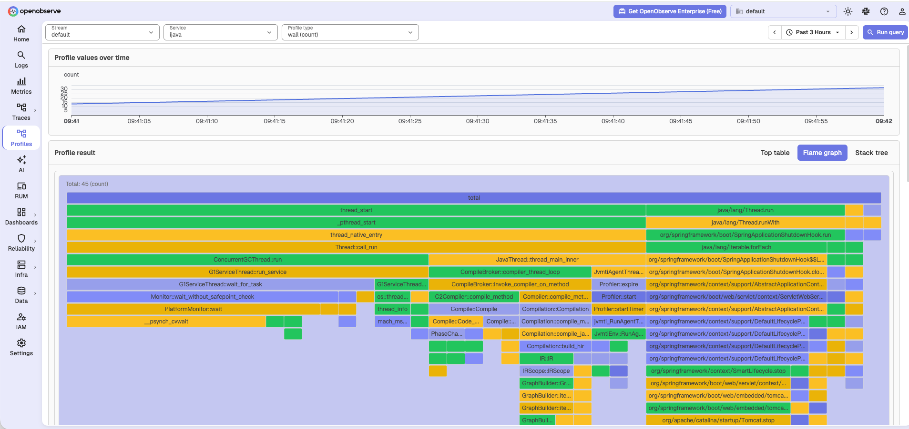
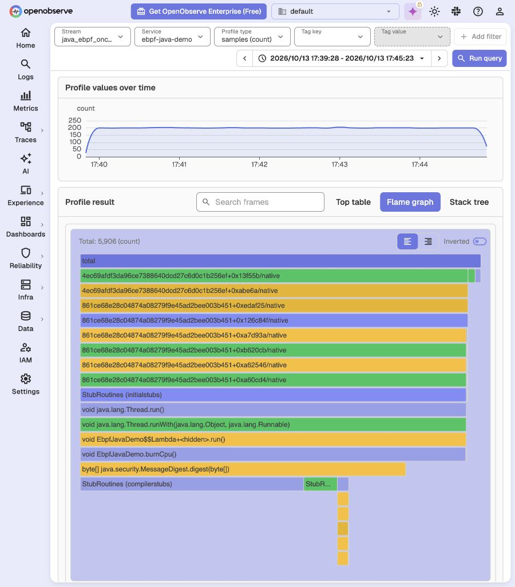

# Java Profiling

Java has two integration paths:

| Path | What it captures | Requirements |
|---|---|---|
| **async-profiler** | CPU, allocation, and lock events from the JVM | Attach the profiler or load its JVM agent |
| **[eBPF profiler](./ebpf.md)** | On-CPU stacks and optional off-CPU thread waits | Linux, root access; no JVM agent |

The async-profiler instructions below support JVM-specific allocation and lock events. For zero-agent Linux sampling, see [Java with eBPF](#java-with-ebpf).

[async-profiler](https://github.com/async-profiler/async-profiler) **4.5** attaches to a JVM and can export [OTLP Profiles](https://opentelemetry.io/docs/concepts/signals/profiles/) (`-o otlp`).

:::note[Experimental OTLP output]
Use async-profiler 4.5 with Collector 0.153.0 for the examples below. Version 4.2 emits an older, incompatible OTLP Profiles schema. The format is experimental; re-test both components when upgrading.
:::

## Send profiles with async-profiler

Run a Collector with the [OTLP Profiles](./otlp.md) configuration. async-profiler writes `-o otlp` to a **local protobuf file**; `-f http://...` does not POST it and fails with `Could not open output file`.

Capture a 60-second CPU profile, then upload it to the Collector:

```bash
PID=8983
asprof -d 60 -e cpu --total -o otlp -f profile.pb "$PID"
curl --fail-with-body \
  -H 'Content-Type: application/x-protobuf' \
  --data-binary @profile.pb \
  http://127.0.0.1:4318/v1development/profiles
```

Replace `8983` with the JVM PID. The Collector adds `service.name` and OpenObserve authorization; the local Collector endpoint above has no authentication. `--total` exports the event's total value, such as time or allocated bytes, instead of sample counts.

For continuous collection, finish each file before uploading it:

```bash
while kill -0 "$PID" 2>/dev/null; do
  asprof -d 60 -e cpu --total -o otlp -f profile.pb "$PID" || break
  curl --fail-with-body \
    -H 'Content-Type: application/x-protobuf' \
    --data-binary @profile.pb \
    http://127.0.0.1:4318/v1development/profiles || break
done
```

### Capture from JVM startup

`-agentpath:lib=options` is one argument. Use `libasyncProfiler.so` on Linux or `libasyncProfiler.dylib` on macOS:

```bash
java -agentpath:/path/to/libasyncProfiler.so=start,event=cpu,total,otlp,file=profile.pb \
  -jar app.jar
```

The file is written when profiling stops or the JVM exits. To upload while the JVM is running, stop and dump with `asprof stop -o otlp --total -f profile.pb "$PID"`, then run the `curl` command above. This captures one window; use the collection loop for repeated uploads.

## Events

| Goal | Flags |
|---|---|
| CPU | `-e cpu` (default) |
| Allocations | `-e alloc` |
| Lock contention | `-e lock` |

See [async-profiler profiling modes](https://github.com/async-profiler/async-profiler/blob/master/docs/ProfilingModes.md) for wall-clock, native memory, and other events (`asprof list`).

:::warning[Do not use `--all` in production]
`--all` turns on CPU, wall, allocation, lock, and native-memory profiling at the same time. Overhead is high. For continuous profiling, pick **one** event from the table above.
:::

## Verify in OpenObserve

Open **Profiles**, select the destination stream and service, choose a profile type and unit, and use a time range covering the capture. Event labels are supplied by the profiler; on macOS, `cpu` sampling can appear as `wall`. Check the Collector logs for export errors even when its receiver returns HTTP 200.



## Java with eBPF

Use the [eBPF profiler configuration](./ebpf.md#send-profiles) with `otelcol-ebpf-profiler` 0.153.0. Its default `tracers: all` includes the HotSpot unwinder, which resolves Java method names and JIT frames. A running JVM can be sampled without attaching async-profiler or restarting it. Java method frames can appear alongside JVM/libc native frames represented by binary identifiers and offsets.

To assign a service name when launching the application:

```bash
OTEL_SERVICE_NAME=your-java-service java -jar app.jar
```

Keep `include_env_vars: OTEL_SERVICE_NAME` and the per-process service-name transform from the eBPF configuration. For a JVM already running without this variable, use the `process_pid` tag filter in OpenObserve to select it.

Select **`samples` / `count`** for on-CPU profiles. Enable `off_cpu_threshold: 0.1` and select **`off_cpu` / `nanoseconds`** for sampled off-CPU waits. These are OS-thread wait durations: JVM runtime threads, sleeps, and blocked monitors can appear in the stacks. Use async-profiler's allocation or lock mode when you need those specific JVM events.



This path was tested on OpenJDK HotSpot 25.0.4.1, x86_64 Ubuntu 26.04, kernel 7.0.0-1006-aws. Check the profiler logs and re-test when changing JDK or Collector versions; other JVM implementations are not covered by this test.

## Next steps

- [OTLP Profiles](./otlp.md): Collector exporter, `Authorization: Basic`, and `service.name`.
- [eBPF profiler](./ebpf.md): whole-host Java on-CPU and off-CPU sampling.
- [async-profiler profiling modes](https://github.com/async-profiler/async-profiler/blob/master/docs/ProfilingModes.md)

**Need some help?**

- Join our [Community Slack](https://short.openobserve.ai/community)
- Or [Contact support](https://openobserve.ai/contactus/)
