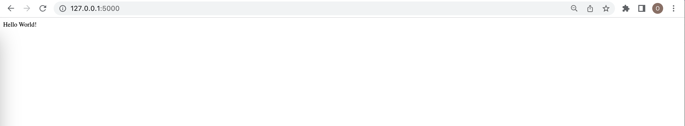
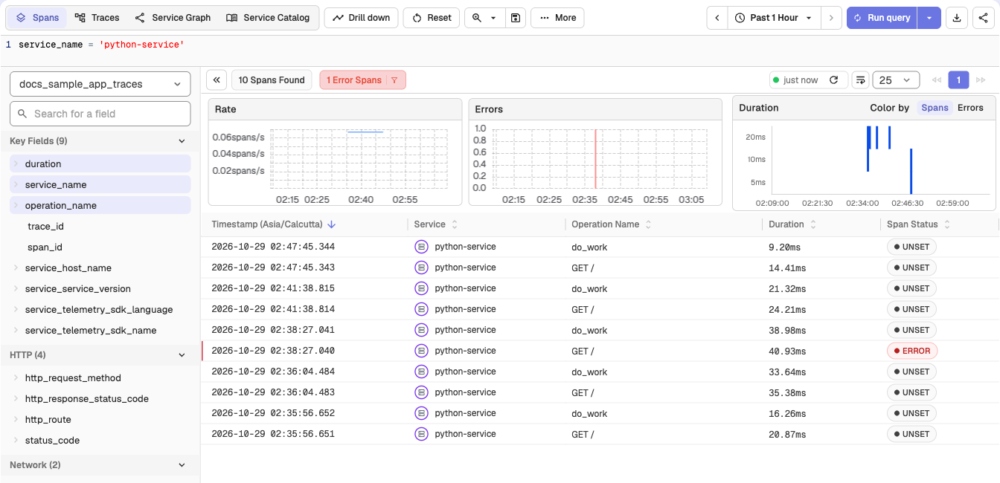
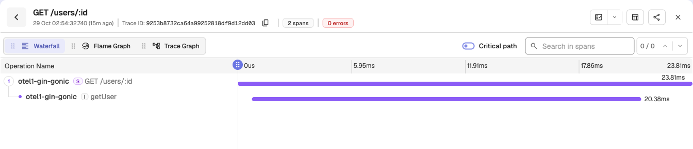
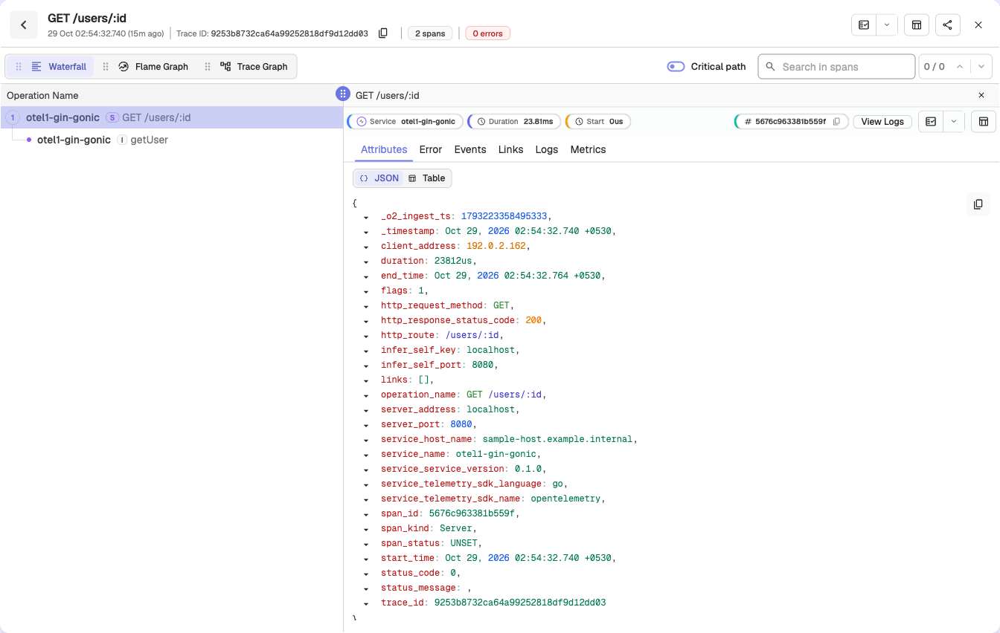

# Python Distributed Tracing - OpenTelemetry APM

Setup distributed tracing for your Python application using OpenTelemetry for Python application performance monitoring (APM) and trace ingestion. Check sample configuration on how to setup OpenTelemetry traces for Python applications.

## Clone

```

git clone https://github.com/openobserve/sample-tracing-python

```

If you don't have Python3 installed, please install it and then follow below steps.

Open `tracing.py` file from that repository. and make changes to the highlighted lines below
```python lineNumbers {18,19}

from opentelemetry import trace
from opentelemetry.sdk.trace import TracerProvider
from opentelemetry.sdk.resources import SERVICE_NAME, Resource
from opentelemetry.sdk.trace.export import BatchSpanProcessor
from opentelemetry.exporter.otlp.proto.http.trace_exporter import OTLPSpanExporter


# Service name is required for most backends
resource = Resource(attributes={
    SERVICE_NAME: "python-service"
})

# create a tracer provider
tracer_provider = TracerProvider(resource=resource)

# create an OTLP trace exporter
url = 'HTTP_Endpoint'
headers = {"Authorization": "Authorization"}

exporter = OTLPSpanExporter(endpoint=url, headers=headers)

# create a span processor to send spans to the exporter
span_processor = BatchSpanProcessor(exporter)

# add the span processor to the tracer provider
tracer_provider.add_span_processor(span_processor)

# set the tracer provider as the global provider
trace.set_tracer_provider(tracer_provider)

```
## Set up credentials

You will get `url` and `Authorization` key from the [OpenTelemetry ingestion settings](https://cloud.openobserve.ai/web/ingestion/custom/traces/opentelemetry).

Replace the `url` and `Authorization` key in the `tracing.py` file.

## Set up the service/application
Follow the steps given in the sample-tracing-python readme and then start server
```
python3 app.py
```
The server is now running, navigate to [http://127.0.0.1:5000](http://127.0.0.1:5000)

Refresh page couple of times to get more traces exported.




Traces are captured, you can check these captured traces here [https://cloud.openobserve.ai/web/traces](https://cloud.openobserve.ai/web/traces).

Filter traces with your service name `python-service`



Click on any trace to check trace data



Trace can have multiple spans, each span represents single operation or task within that trace. Click on any span to check span details.


