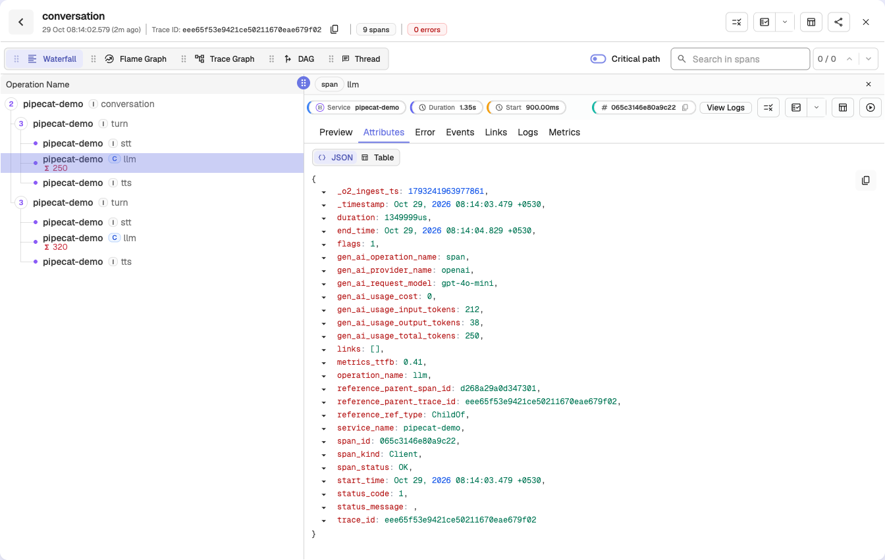

# **Pipecat → OpenObserve**

Capture conversation, turn, and LLM spans with token usage and time to first byte for every Pipecat pipeline. Pipecat is a Python framework for building real-time voice and multimodal AI pipelines. It has built-in OpenTelemetry tracing: point it at an OTLP exporter for OpenObserve and turn tracing on in the `PipelineWorker`.

## **Prerequisites**

* Python 3.11+
* An [OpenObserve](https://openobserve.ai/) account (cloud or self-hosted)
* Your OpenObserve **organisation ID** and **Base64-encoded auth token**
* An OpenAI API key

## **Installation**

```shell
pip install "pipecat-ai[openai,tracing]" opentelemetry-exporter-otlp-proto-http python-dotenv
```

## **Configuration**

Create a `.env` file in your project root:

```
OPENAI_API_KEY=your-openai-api-key
OTEL_EXPORTER_OTLP_ENDPOINT=https://api.openobserve.ai/api/your_org_id/v1/traces
OTEL_EXPORTER_OTLP_HEADERS=Authorization=Basic <your_base64_token>
```

## **Instrumentation**

Call Pipecat's `setup_tracing()` with an OTLP HTTP exporter once at startup, then create the `PipelineWorker` with `enable_tracing=True`. Pipecat creates the spans itself; you do not add manual spans.

The example below runs a text-only pipeline with one LLM call, so it works without a microphone, a speech service, or a transport. In a voice bot, the same two steps add `stt` and `tts` spans next to `llm` in every turn.

```python
from dotenv import load_dotenv
load_dotenv()

import asyncio
import os

from opentelemetry.exporter.otlp.proto.http.trace_exporter import OTLPSpanExporter
from pipecat.frames.frames import EndFrame, LLMContextFrame
from pipecat.pipeline.pipeline import Pipeline
from pipecat.pipeline.worker import PipelineParams, PipelineWorker
from pipecat.processors.aggregators.llm_context import LLMContext
from pipecat.services.openai.llm import OpenAILLMService
from pipecat.utils.tracing.setup import setup_tracing
from pipecat.workers.runner import WorkerRunner

auth_header = os.environ["OTEL_EXPORTER_OTLP_HEADERS"].replace("Authorization=", "")

setup_tracing(
    service_name="pipecat-demo",
    exporter=OTLPSpanExporter(
        endpoint=os.environ["OTEL_EXPORTER_OTLP_ENDPOINT"],
        headers={"Authorization": auth_header},
    ),
)


async def main():
    llm = OpenAILLMService(
        api_key=os.environ["OPENAI_API_KEY"],
        settings=OpenAILLMService.Settings(
            model="gpt-4o-mini",
            system_instruction="You are a helpful assistant. Answer in one sentence.",
        ),
    )

    worker = PipelineWorker(
        Pipeline([llm]),
        params=PipelineParams(enable_metrics=True, enable_usage_metrics=True),
        enable_tracing=True,
        conversation_id="demo-conversation",
    )

    context = LLMContext()
    context.add_message({"role": "user", "content": "Explain distributed tracing."})
    await worker.queue_frames([LLMContextFrame(context), EndFrame()])

    runner = WorkerRunner(handle_sigint=False)
    await runner.add_workers(worker)
    await runner.run()


asyncio.run(main())
```

`setup_tracing()` registers a batch span processor, which sends any remaining spans when the process exits. `enable_turn_tracking` is on by default, so each turn gets its own span.

## **What Gets Captured**

Each conversation produces this span tree:

```
conversation
└── turn
    ├── stt   (voice pipelines only)
    ├── llm
    └── tts   (voice pipelines only)
```

OpenObserve stores the dotted attribute names with underscores.

**`conversation` and `turn` spans**

| Attribute | Description |
| ----- | ----- |
| `conversation_id` | The `conversation_id` you passed, or a generated ID |
| `conversation_type` | `voice` |
| `turn_number` | Turn number within the conversation |
| `turn_duration_seconds` | Turn length in seconds |
| `turn_was_interrupted` | `true` if the user interrupted the bot |

**`llm` span**

| Attribute | Description |
| ----- | ----- |
| `gen_ai_provider_name` | Provider (e.g. `openai`) |
| `gen_ai_request_model` | Model requested (e.g. `gpt-4o-mini`) |
| `gen_ai_operation_name` | `chat` |
| `gen_ai_system_instructions` | System instruction sent to the model |
| `gen_ai_usage_input_tokens` | Input tokens |
| `gen_ai_usage_output_tokens` | Output tokens |
| `input` | Messages sent to the model, as JSON |
| `output` | Text the model returned |
| `metrics_ttfb` | Time to first byte, in seconds |

**`stt` and `tts` spans** carry `gen_ai_provider_name` and `gen_ai_request_model`, plus `transcript` (STT) or `voice_id` and `metrics_character_count` (TTS).

## **Viewing Traces**

1. Log in to OpenObserve and navigate to **Traces**
2. Filter by `service_name = pipecat-demo` to isolate Pipecat spans
3. Open a trace to see the `conversation` span with its `turn` and `llm` children
4. Filter by `operation_name = llm` and sort by duration to find slow model calls
5. Filter by `conversation_id` to follow one conversation



## **Next Steps**

With Pipecat tracing on, every conversation and turn is recorded in OpenObserve. From here you can monitor turn latency and time to first byte, track token usage per conversation, and alert on slow or failed turns.

## **Read More**

- [LiveKit](livekit.md)
- [LLM Observability Overview](../llm-applications.md)
- [Traces Ingestion with Python](../../../ingestion/traces/python.md)
- [Exploring Traces in OpenObserve](../../../user-guide/data-exploration/traces/index.md)
