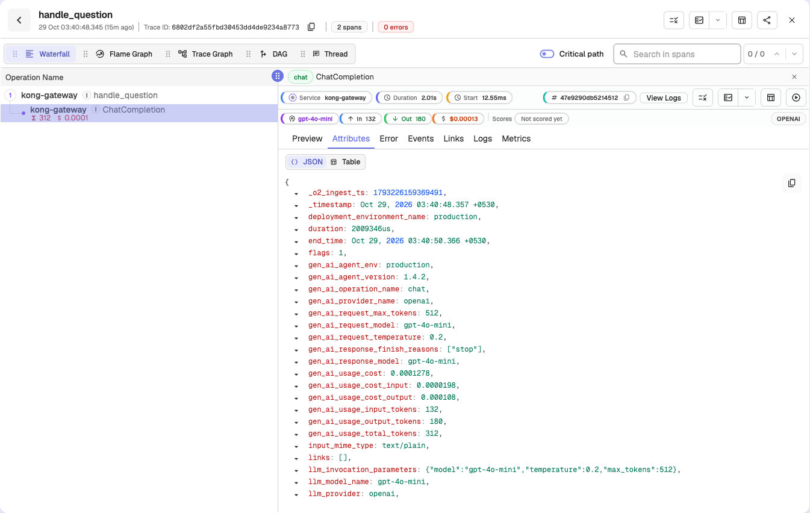

# Kong AI Gateway → OpenObserve

Automatically capture token usage, latency, and model metadata for every request routed through Kong AI Gateway. Kong acts as a transparent OpenAI-compatible proxy, so the standard OpenAI instrumentor captures spans with no additional configuration.

## Prerequisites

* Python 3.9+
* Kong AI Gateway 2.0 or later. If you'd like to set up a gateway, you can use [Kong Konnect](https://konghq.com/products/kong-konnect/register) and follow the quickstart script in Kong's [AI Gateway get started guide](https://developer.konghq.com/ai-gateway/get-started/), which runs the gateway in Docker on your machine.
* [kongctl](https://developer.konghq.com/kongctl/), Kong's command-line tool for managing Konnect configuration
* An [OpenObserve](https://openobserve.ai/) account (cloud or self-hosted)
* Your OpenObserve **organisation ID** and **Base64-encoded auth token**
* An OpenAI API key

## Installation

```shell
pip install openobserve-python-sdk openinference-instrumentation-openai openai python-dotenv
```

## Configuration

Kong AI Gateway connects to OpenAI through two entities: an AI Model Provider that stores your OpenAI API key, and an AI Model that your application calls. Define both in a kongctl configuration file:

```yaml
# kong.yml
ai_gateway_model_providers:
  - ref: openai
    ai_gateway: !lookup {id: !env AI_GATEWAY_ID}
    name: openai
    display_name: OpenAI
    type: openai
    config:
      auth:
        type: basic
        headers:
          - name: Authorization
            value: !secret {source: !env OPENAI_AUTH_HEADER}

ai_gateway_models:
  - ref: gpt-4o-mini
    ai_gateway: !lookup {id: !env AI_GATEWAY_ID}
    name: gpt-4o-mini
    display_name: gpt-4o-mini
    type: model
    formats:
      - type: openai
    capabilities:
      - generate
    config:
      route:
        paths:
          - /v1
    targets:
      - name: gpt-4o-mini
        provider: openai
        config:
          type: openai
```

`!lookup` adds both entities to your existing gateway, and `!secret` reads your OpenAI API key from an environment variable, so the key stays out of the file. The AI Model's `name` is the value your application sends as `model`, and `targets[].name` is the OpenAI model that the gateway calls. With the `generate` capability, the gateway serves chat completions at `/v1/chat/completions`.

The quickstart script prints `export` commands for `AI_GATEWAY_ID` and `KONNECT_TOKEN`. Run them in your terminal (for a gateway you already have, `kongctl get ai-gateways` lists its ID), then set your OpenAI API key and apply the file with kongctl:

```shell
export OPENAI_AUTH_HEADER="Bearer <your-openai-api-key>"
kongctl apply -f kong.yml --auto-approve --pat "$KONNECT_TOKEN"
```

The gateway picks up the new configuration within a few seconds.

:::tip
Add an [AI Auth Strategy](https://developer.konghq.com/ai-gateway/entities/ai-auth-strategy/) to secure the gateway before you expose it beyond your machine.
:::

Create a `.env` file in your project root:

```
OPENOBSERVE_URL=https://api.openobserve.ai/
OPENOBSERVE_ORG=your_org_id
OPENOBSERVE_AUTH_TOKEN=Basic <your_base64_token>
KONG_GATEWAY_URL=http://localhost:8000/v1
```

## Instrumentation

Call `OpenAIInstrumentor().instrument()` **before** creating the OpenAI client. Point the client at the Kong proxy URL. The gateway adds your OpenAI API key to each request, so the client passes a placeholder key.

```python
from dotenv import load_dotenv
load_dotenv()

from openinference.instrumentation.openai import OpenAIInstrumentor
from openobserve import openobserve_init

OpenAIInstrumentor().instrument()
openobserve_init()

import os
from openai import OpenAI

client = OpenAI(
    api_key="unused",  # placeholder: the gateway adds your OpenAI API key
    base_url=os.environ.get("KONG_GATEWAY_URL", "http://localhost:8000/v1"),
)

response = client.chat.completions.create(
    model="gpt-4o-mini",
    messages=[{"role": "user", "content": "Explain distributed tracing in one sentence."}],
    max_tokens=20,
)
print(response.choices[0].message.content)
```

## What Gets Captured

| Attribute | Description |
| ----- | ----- |
| `llm_system` | `openai` |
| `llm_model_name` | Resolved model returned by the API (e.g. `gpt-4o-mini-2024-07-18`) |
| `gen_ai_request_max_tokens` | `max_tokens` value from the request |
| `gen_ai_response_model` | Same as `llm_model_name` |
| `gen_ai_operation_name` | `chat` |
| `llm_token_count_prompt` | Prompt tokens consumed |
| `llm_token_count_completion` | Completion tokens returned |
| `llm_token_count_total` | Total tokens consumed |
| `llm_token_count_prompt_details_cache_read` | Cached prompt tokens |
| `llm_token_count_prompt_details_audio` | Audio prompt tokens |
| `llm_token_count_completion_details_reasoning` | Reasoning tokens |
| `llm_token_count_completion_details_audio` | Audio completion tokens |
| `gen_ai_usage_input_tokens` | Input tokens (mirrors prompt count) |
| `gen_ai_usage_output_tokens` | Output tokens (mirrors completion count) |
| `gen_ai_usage_total_tokens` | Total tokens |
| `gen_ai_usage_cost_input` | Estimated input cost in USD |
| `gen_ai_usage_cost_output` | Estimated output cost in USD |
| `llm_invocation_parameters` | JSON string of model config sent with the request |
| `openinference_span_kind` | `LLM` |
| `operation_name` | `ChatCompletion` |
| `input_mime_type` | `application/json` |
| `output_mime_type` | `application/json` |
| `duration` | End-to-end latency including Kong proxy overhead |
| `span_status` | `OK` on success, `ERROR` on failure |

## Viewing Traces

1. Log in to OpenObserve and navigate to **Traces**
2. Spans appear with `operation_name: ChatCompletion` and `llm_system: openai`
3. Since Kong is a transparent proxy, spans look identical to direct OpenAI calls. Use `service_name` or a custom span attribute to tag Kong traffic separately
4. Use `duration` to measure Kong proxy overhead versus direct API latency



## Next Steps

With Kong AI Gateway instrumented, every proxied request is recorded in OpenObserve. From here you can monitor latency per route, track token usage across consumers, and set alerts on error rates.

## Read More

- [LLM Observability Overview](../llm-applications.md)
- [Traces Ingestion with Python](../../../ingestion/traces/python.md)
- [Exploring Traces in OpenObserve](../../../user-guide/data-exploration/traces/index.md)
- [Building Dashboards](../../../user-guide/analytics/dashboards/index.md)
