# LLM Evaluations

OpenObserve offers two evaluation modes: **Online Evaluations**, which score live traces and spans as they happen, and **Experiments**, which run scorers over a static dataset for offline testing and comparison. Both use LLM-as-a-judge scorers (your own AI provider) or external remote scoring endpoints.

## Overview

| Resource | What it does |
|---|---|
| **Provider** | An LLM API configuration (OpenAI, Anthropic, etc.) used by LLM Judge scorers. |
| **Score Config** | Defines a score's shape (numeric, categorical, or boolean) and its healthy/unhealthy threshold. |
| **Scorer** | The evaluation logic: a prompt template plus a score config. Two types: **LLM Judge** and **Remote**. |
| **Eval Job** | Binds scorers to a stream, defines what to evaluate (span, trace, or session), and how much to sample. |

Activating an eval job runs your scorers against incoming data. Scores land in the `_llm_scores` stream; evaluator telemetry lands in the `_evaluator` stream.

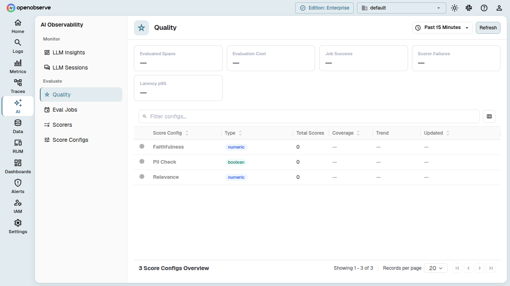

## Enable Online Evaluations

Online Evaluations is available in the Enterprise edition and OpenObserve Cloud, and is enabled by default:

```env
O2_EVAL_ENABLED=true
```

:::note[Renamed setting]
`O2_EVAL_ENABLED` replaces `O2_ONLINE_EVALS_ENABLED`. The old name still works when the new one is not set, but OpenObserve logs a deprecation warning. If both are set, `O2_EVAL_ENABLED` wins.
:::

When disabled, the **AI** menu, **Settings > LLM Providers**, and **Settings > GenAI Agent Mapping** are hidden, and the evaluation API endpoints are not registered.

Other server settings:

| Variable | Default | Description |
|---|---|---|
| `O2_EVAL_SCHEDULER_POLL_INTERVAL_SECS` | `45` | How often the scheduler polls trace streams for trace- and session-scope jobs. |
| `O2_EVAL_TRACE_IDLE_TIMEOUT_SECS` | `30` | Default idle window for trace-scope jobs that don't set their own. Capped at 30 minutes. |
| `O2_EVAL_TRACE_MAX_AGE_SECS` | `1800` | Default max age for trace-scope jobs. |
| `O2_EVAL_SESSION_IDLE_TIMEOUT_SECS` | `1800` | Default idle window for session-scope jobs that don't set their own. Capped at 4 hours. |
| `O2_EVAL_SESSION_MAX_AGE_SECS` | `14400` | Default max age for session-scope jobs. |
| `O2_EVAL_WORKER_THREAD_NUM` | `0` | Worker threads that run scorers. `0` uses half of `ZO_CPU_NUM`. |
| `O2_EVAL_SCHEDULER_MAX_PENDING_MEMORY_MB` | `0` | Memory budget for targets waiting to complete. `0` uses 1% of system memory, between 32 and 512 MB. |

## Providers

A Provider stores the connection details for an LLM API. Providers live under **Settings > Data & AI > LLM Providers**. Click **New Provider** to add one.

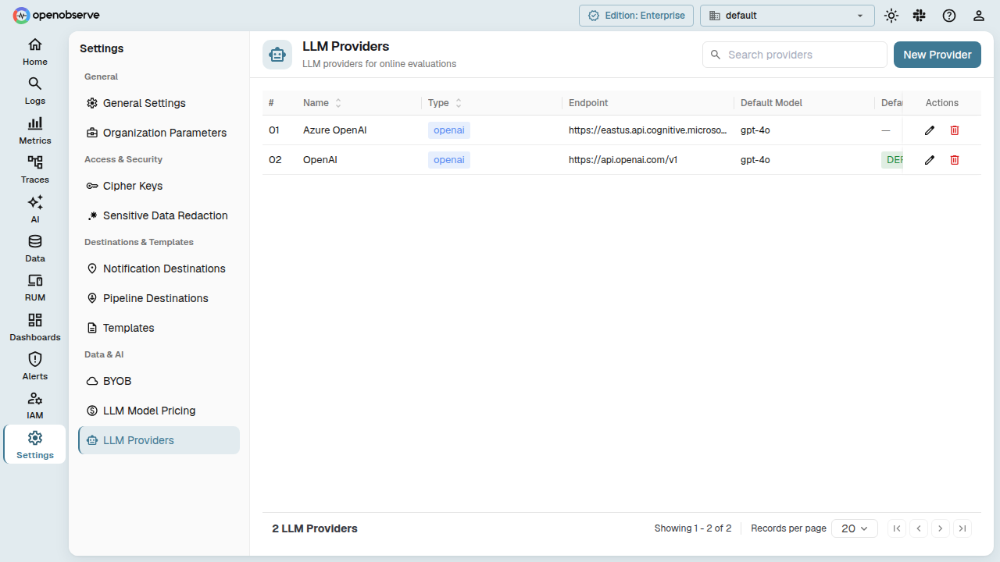

| Field | Description |
|---|---|
| **Name** | Display name. |
| **Provider type** | **OpenAI**, **DeepSeek**, **Anthropic**, **Ollama**, **vLLM**, **OpenAI-compatible**, or **System One (TypeSafe Jev)**. |
| **Default model** | Used when a scorer doesn't specify one. |
| **Available models** | Model IDs this provider offers, for scorer selection. |
| **Base URL** | Request URL. Leave empty to use the provider's default endpoint. Required for **OpenAI-compatible**. |
| **API Key** | Stored encrypted and never read back. Leave blank when editing to keep the existing key. Optional for keyless self-hosted providers. |

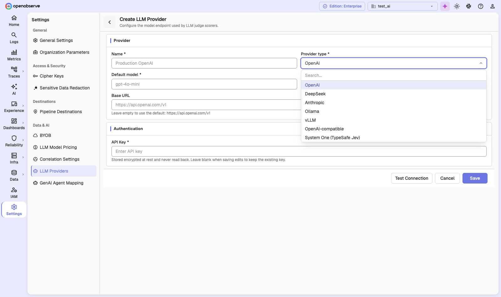

Use **OpenAI-compatible** for any service that implements the OpenAI chat completions API, and **vLLM** for a self-hosted vLLM server (defaults to `http://localhost:8000/v1/chat/completions`). **System One (TypeSafe Jev)** is available to scorers only; it does not appear in the Playground or Experiments.

Click **Test Connection** to check the endpoint and key before you save. To edit or delete a provider, use the actions on its row. Scorers that use a deleted provider fail until you reassign them.

## Score Configs

A Score Config defines what a score looks like and when it's healthy. Navigate to **AI > Evaluate > Score Configs** and click **New score config**.

| Field | Description |
|---|---|
| **Name** | e.g., "Faithfulness", "Accuracy". |
| **Data Type** | `numeric`, `categorical`, or `boolean`. |
| **Numeric Range** | For numeric scores: `{"min": 0.0, "max": 1.0}`. |
| **Categories** | For categorical scores: a list of valid labels. |
| **Healthy Threshold** | e.g., `{"direction": "gte", "value": 0.7}` means scores ≥ 0.7 are healthy. |

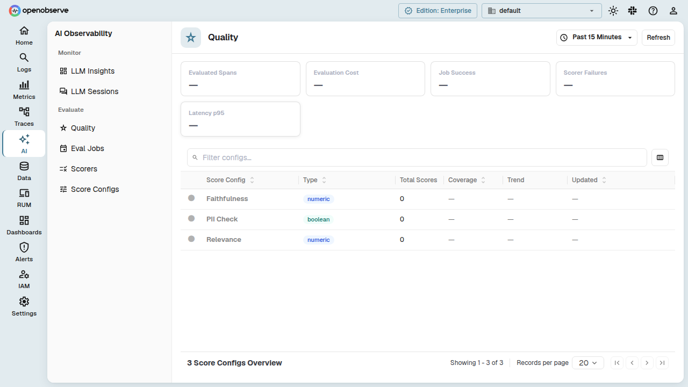

Updating a score config creates a new version; scorers can pin to a specific version or always use the latest.

## Scorers

A Scorer is the evaluation unit: a prompt **template** with `{{variable}}` placeholders, execution parameters, and an optional linked score config. Navigate to **AI > Evaluate > Scorers** and click **New scorer**.

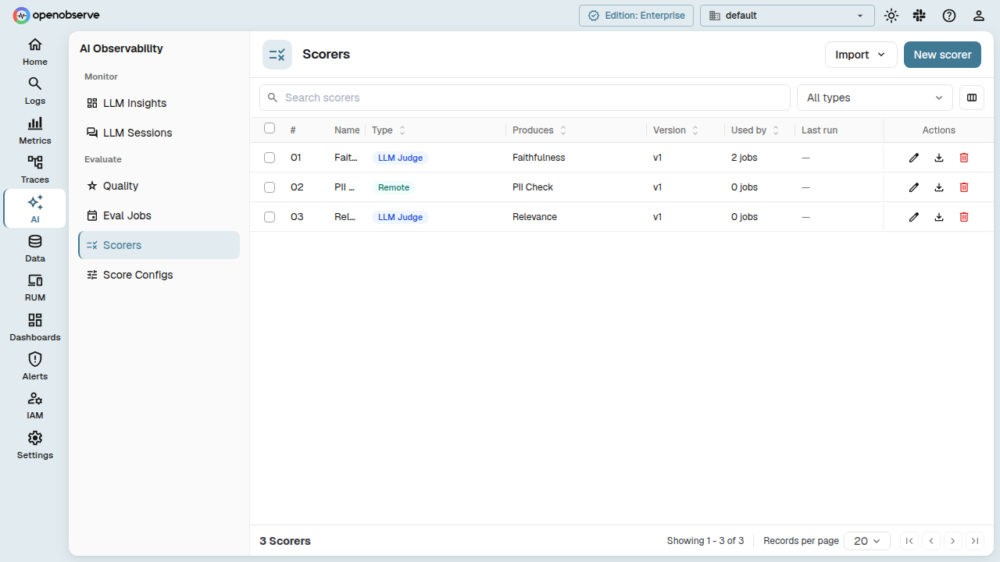

- **LLM Judge**: sends the rendered template to an LLM via a provider. Configure provider, model, temperature, max tokens, timeout, and optional reasoning.
- **Remote**: sends the rendered template as an HTTP request to an external service. Configure endpoint, method, auth (`none`/`bearer`/`basic`/`api_key`), headers, timeout, and retries.

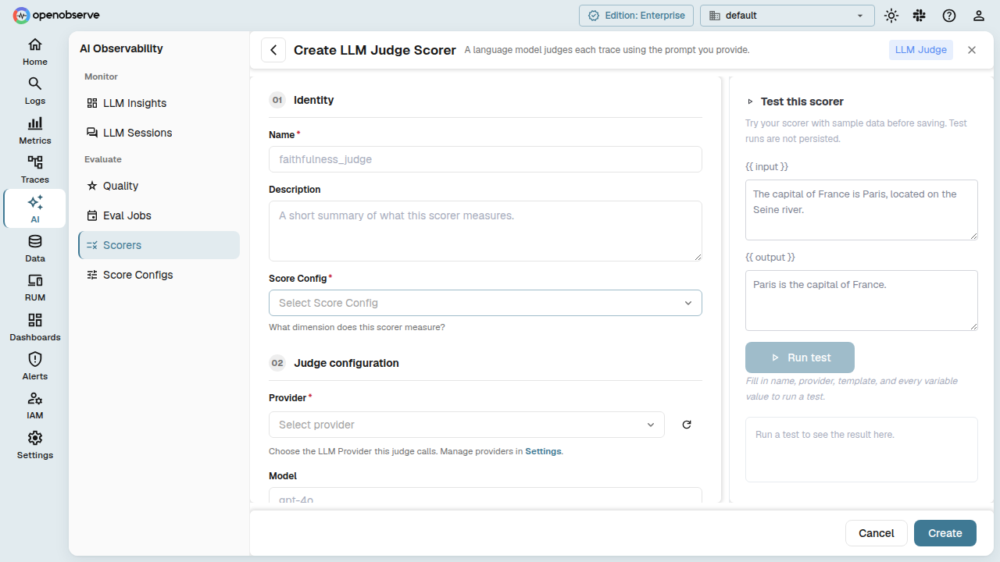

Use the **Test** button on the scorer detail page to try it with sample variable values; you'll see the score, reasoning, model, latency, and token usage.

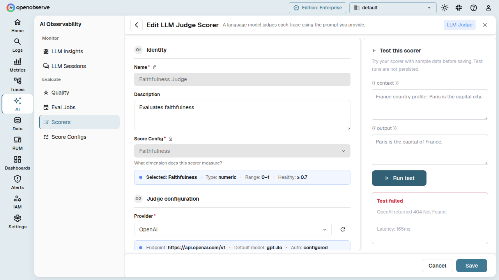

Like score configs, scorers are versioned. Eval jobs can reference a scorer by entity ID (always latest) or pin a specific version. The **Versions** tab in the scorer drawer lists every version, newest first, and tags the active one. Select two versions to compare them: you see a split or unified diff of the template and a table of the fields that changed.

## Eval Jobs

An Eval Job runs scorers against incoming traces at a chosen **target scope**: span, trace, or session. Navigate to **AI > Evaluate > Eval Jobs** and click **New job**. Saving a job checks that you can read the selected stream.

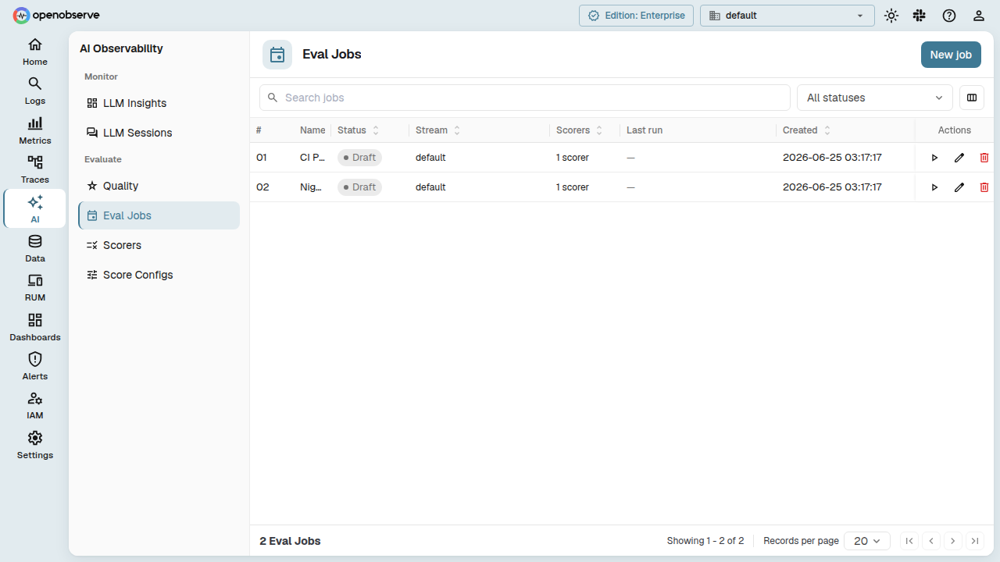

| Field | Description |
|---|---|
| **Stream** | The traces stream to evaluate. |
| **Target Scope** | `span` (score each matching span), `trace` (score a whole trace once complete), or `session` (score an entire conversation). |
| **Filter Condition** | Which spans/traces/sessions are eligible. Besides comparison operators, conditions support `is_null`, `is_not_null`, `is_empty`, and `is_not_empty`. |
| **Scorers** | One or more scorers to run against each target. |
| **Input Mapping** | Maps each scorer's `{{variables}}` to a value source: a system-provided value (like `input`, `output`, `statistics`) or a span attribute. |
| **Sampling Mode** | `all` or `rate` (evaluate a percentage, e.g., `0.1` for 10%). |

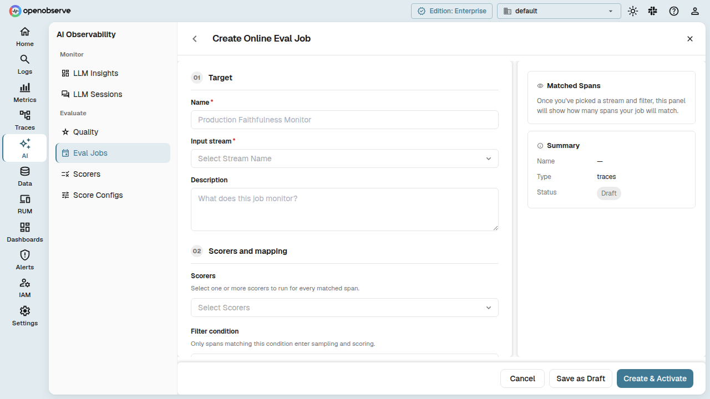

### Target scope

| Scope | What is evaluated | When it runs |
|---|---|---|
| **Span** | Each matching span | Immediately, in real time. |
| **Trace** | A whole trace assembled from its spans | Once the trace is judged complete (see below). |
| **Session** | A full conversation across multiple traces, grouped by session ID | Once the session is judged complete. |

### Trace and session completion

For trace- and session-scope jobs, configure how OpenObserve decides a target is "done":

| Field | Default | Description |
|---|---|---|
| **Idle Window** | 30 sec (trace) / 1800 sec (session) | Time with no new spans before the target is considered complete. |
| **Max Age** | 1800 sec (trace) / 14400 sec (session) | Score the target after this long even if spans are still arriving. |
| **End Signal** | none | An optional filter; when a matching span arrives, evaluate immediately instead of waiting. |

Example end signal (evaluate as soon as a span with `status = "complete"` arrives):

```json
{
  "version": 2,
  "conditions": {
    "filterType": "group",
    "logicalOperator": "AND",
    "conditions": [{
      "filterType": "condition",
      "column": "status",
      "operator": "=",
      "value": "complete",
      "logicalOperator": "AND"
    }]
  }
}
```

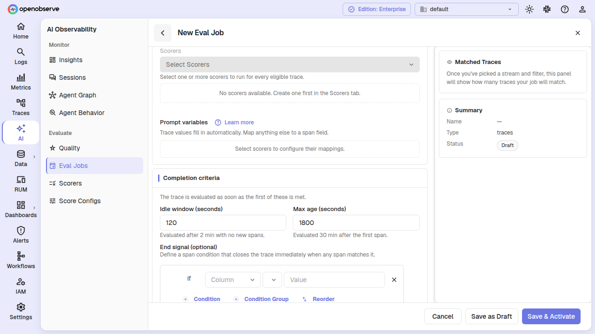

### Span selectors (trace scope)

For trace-scope jobs, a scorer may only need a subset of a trace's spans. A **Span Selector** filters, picks, and limits which spans (and fields) get sent to a given scorer; bind one to any scorer whose template uses `{{ spans }}`.

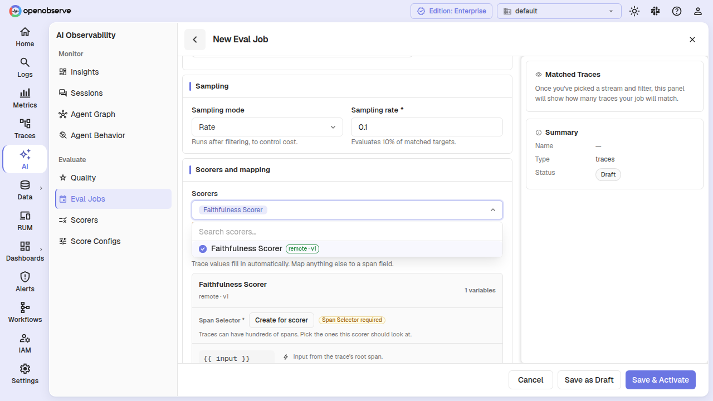

### Input mapping and template variables

Each scorer's `{{variables}}` are mapped to a source in the job form's **Prompt variables** section, either a system-provided value or a span attribute.

For trace/session scope, OpenObserve auto-supplies these as ready-to-use template variables:

| Variable | Scopes | Description |
|---|---|---|
| `input` / `output` | trace, session | For a trace, the LLM input/output messages from the root span. For a session, the user and assistant chat turns. |
| `tool_calls` | trace, session | The tool calls made in the target, for scorers that need tool evidence. |
| `spans` | trace | A compact list of spans (up to 5 by default, or per a bound span selector). |
| `steps` | trace, session | An ordered sequence of LLM calls, tool calls, and other spans. |
| `statistics` | trace, session | Aggregate counts: spans, LLM calls, tool calls, errors, duration, tokens, cost. |

For span-scope jobs, every variable maps to a span attribute instead (e.g. `input` → `{{gen_ai_input_messages}}`).

### Manual evaluation

Trigger an evaluation on demand for a specific trace, span, or session. This is useful for re-testing after changing scorers. From the trace, span, or session detail page, click **Evaluate trace** / **Evaluate span** / **Evaluate session**, then pick which Eval Job to run.

### Job lifecycle

```
draft → active ⇄ paused
          ↓
       degraded → active
          ↓
       archived
```

- **Activate**: starts scoring.
- **Pause**: stops it temporarily.
- **Resume**: restarts it.
- **Archive**: stops it permanently.

Editing an active job's config (filters, sampling, scorers, scope) takes effect immediately. No need to pause first.

### Where scores go

Scores land in the `_llm_scores` stream; evaluator telemetry (latency, tokens, status) lands in the `_evaluator` traces stream. Query both directly for debugging or dashboards.

## Quality Dashboard

**AI > Evaluate > Quality** gives a real-time overview of evaluation health across your score configs, agents, and streams. Drill into a score config to see KPI cards, trend charts, and a runs table, filterable by scope (All/Span/Trace/Session).

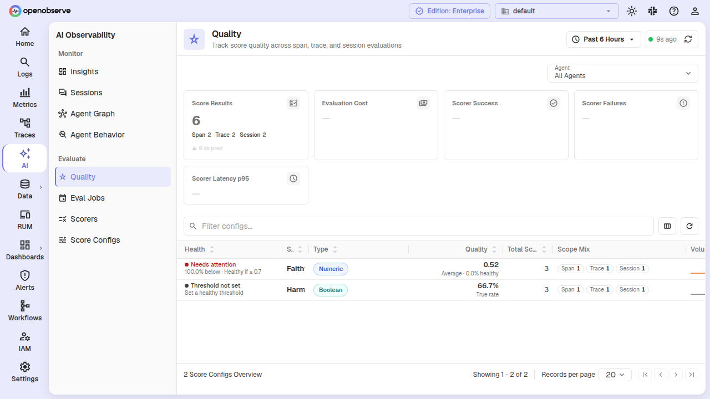

When a scorer fails, click the **Scorer Failures** KPI card to jump to the failing evaluator traces.

### Evaluation runs

The **Evaluation Runs** table lists individual score records: value, health, target identity, agent, and reasoning. Click a row to open its evaluator trace. Filter to all runs or unhealthy only.

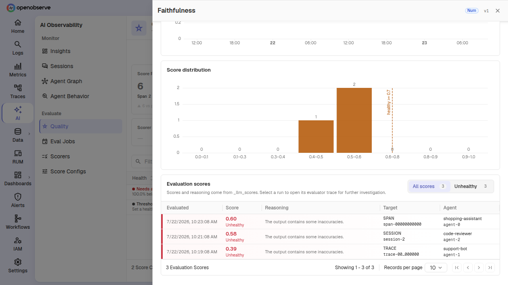

## Gen-AI Agents

OpenObserve auto-discovers **agents** from your trace telemetry (via `gen_ai.agent.name`/`id`, or your own configured attribute fields), so you can scope the Quality, Insights, and Sessions views to a single agent or **All Agents**.

If your telemetry uses non-standard attribute names, map them under **Settings > GenAI Agent Mapping**. Scorer templates can also reference `{{agent_name}}`, `{{agent_id}}`, and `{{pipeline_source_stream_type}}`. See [LLM Monitoring](llm-monitoring.md#how-agents-are-identified) for the attributes OpenObserve checks.

## Experiments

For offline, batch evaluation against a versioned dataset (pinned scorers, trial counts, cost estimates, baseline comparisons), see [LLM Experiments](llm-experiments.md).

## RBAC

Providers, Score Configs, Scorers, and Eval Jobs each have their own permissions (GET, LIST, POST, PUT, DELETE). Assign roles in **IAM > Roles** to control access.

## API Reference

All endpoints are prefixed with `/api/{org_id}`.

| Resource | Key endpoints |
|---|---|
| **Providers** | `GET/POST /providers`, `GET/PUT/DELETE /providers/{id}`, `POST /providers/test` |
| **Score Configs** | `GET/POST /score_configs`, `GET/PUT/DELETE /score_configs/{id}`, `GET /score_configs/{id}/versions` |
| **Scorers** | `GET/POST /scorers`, `GET/PUT/DELETE /scorers/{id}`, `POST /scorers/test`, `POST /scorers/llm_judge/output_schema`, `GET /scorers/{id}/versions` |
| **Eval Jobs** | `GET/POST /eval_jobs`, `GET/PUT/DELETE /eval_jobs/{id}`, `POST /eval_jobs/{id}/activate\|pause\|resume\|archive`, `POST /eval_jobs/{id}/manual_eval` |
| **Gen-AI Agents** | `GET /gen_ai/agents`, `GET/PUT /settings/gen_ai/agent_mapping`, `DELETE /settings/gen_ai/agent_registry` |
| **Experiments** | See the [LLM Experiments API Reference](llm-experiments.md#api-reference). |
