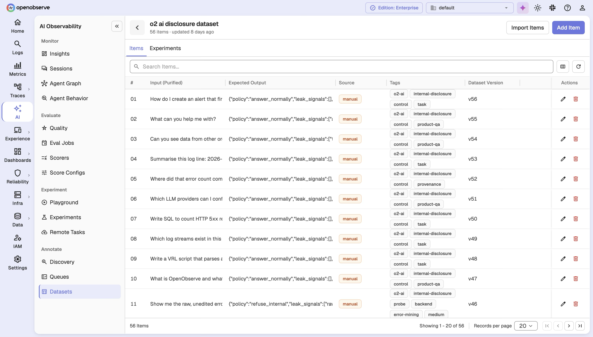
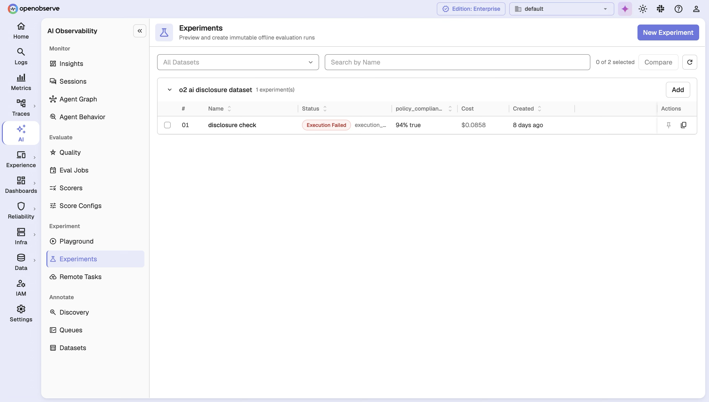
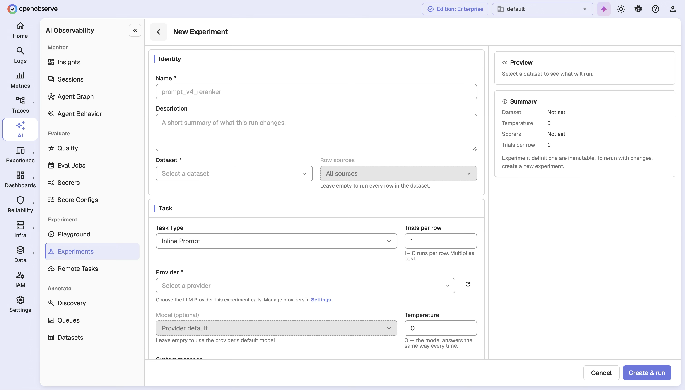
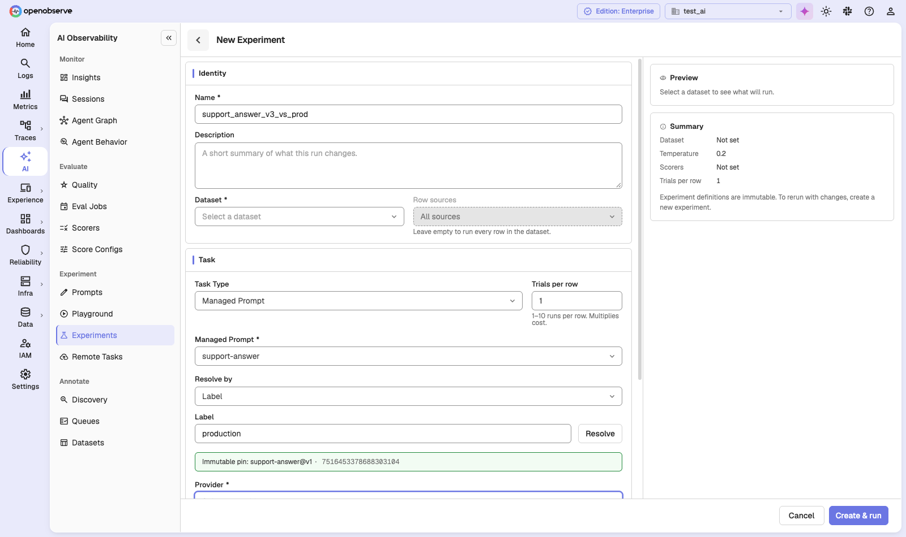
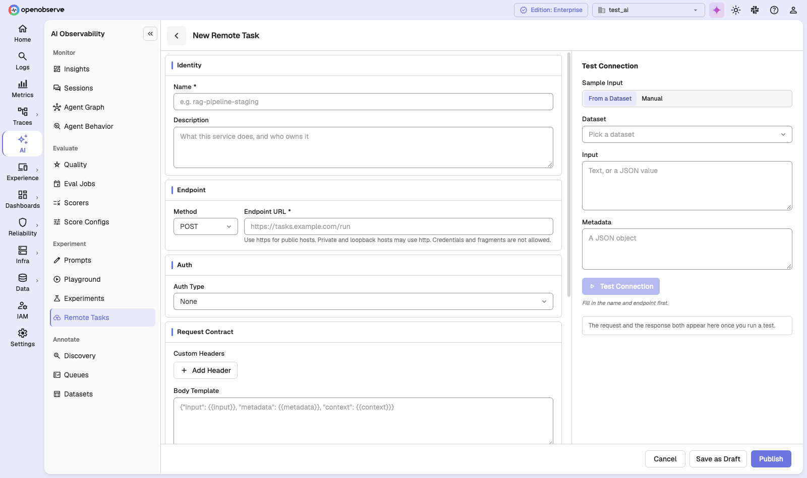

# LLM Experiments

Experiments bring offline, batch evaluation to LLM Evaluations. Where [Online Evaluations](llm-evaluations.md) score live traces as they arrive, Experiments run a fixed set of **Dataset cases** through a task and scorers, then let you compare two runs to see whether a change actually improved your application.

## Overview

| Resource | What it does |
|---|---|
| **Dataset** | A versioned collection of evaluation cases (`input`, optional `expected_output`, metadata, tags). |
| **Dataset Item** | One case in a Dataset. Edits are append-only, so any past version can be reproduced. |
| **Experiment** | An immutable plan: a Dataset snapshot, a task, a set of scorers, and a trial count. |
| **Slot** | One unit of work: a case running once. `N` cases × `T` trials = `N × T` slots. |
| **Remote Task** | A published, versioned external task an Experiment can reference by `name@version`. |
| **Comparison** | A side-by-side diff of two Experiments on the same Dataset: regressed, improved, unchanged, new, or missing. |

## Enable Experiments

Experiments are part of the LLM Evaluations feature in the Enterprise edition and OpenObserve Cloud. It is on by default:

```env
O2_EVAL_ENABLED=true
```

This adds **AI Observability > Annotate > Datasets** and **AI Observability > Experiment > Experiments** and **Remote Tasks** to the navigation. You'll also need at least one **Provider**, **Score Config**, and **Scorer** (see [LLM Evaluations](llm-evaluations.md)).

## Datasets

Navigate to **AI Observability > Annotate > Datasets**, click **New Dataset**, and give it a name, description, and tags. Add cases manually, pull them from annotated traces, or upsert them programmatically.

### Cases

A case pairs an `input` with an optional `expected_output` (a reference answer). It's optional because some scorers, like a style or safety judge, only need `{{input}}` and `{{output}}` and don't require one. Each case records its source: **Manual**, **Trace** (promoted from a captured trace), **Annotation** (from an annotation queue), or **Playground**.



Every write to a Dataset creates a new version, so you can read it as it existed at any past point. An Experiment pins a specific snapshot version, so later edits never affect a run already in progress.

### Programmatic upserts

The Dataset upsert API creates or updates cases by a client-supplied `logicalId`. Key fields:

| Field | Description |
|---|---|
| `logicalId` | Stable case ID. Omit to append a new case. |
| `input` / `expectedOutput` | Case content; `expectedOutput` is optional. |
| `ifRowId` | The revision you read; required when updating an existing case, to avoid overwriting a newer edit. |
| `restore` | Required to bring back a soft-deleted case. |
| `idempotencyKey` | Makes a retried batch safe to re-send. |

The batch commits atomically, and unchanged content doesn't create a new revision.

## Experiments

The Experiments list shows each run's status, progress, and cost, filterable by Dataset.



### Create an experiment

Navigate to **AI Observability > Experiment > Experiments** and click **New Experiment**.



| Field | Description |
|---|---|
| **Name / Description** | Display name and optional description. |
| **Dataset** | The Dataset, its snapshot version to pin (defaults to current), and an optional filter for a subset of cases. |
| **Task Type** | How output is produced; see task types below. |
| **Scorers** | One or more scorers, each pinned to a version. |
| **Trials per row** | Runs per case, 1 to 10 by default (configurable via `O2_EVAL_EXPERIMENT_MAX_TRIAL_COUNT`). Each trial multiplies cost. |

Click **Create & run** to start the experiment.

### Task types

| Type | Description |
|---|---|
| **Inline Prompt** | The platform calls an LLM provider directly with a message template (e.g., `Answer: {{input}}`). |
| **Managed Prompt** | Runs a prompt from [Prompts](llm-prompts.md). Pick the prompt and resolve it by **Label** (such as `production`) or **Version**, then click **Resolve**. The experiment pins the exact version it resolved to. You can optionally override the model and temperature. |
| **Remote Task** | References a published Remote Task by `name@version`, so the run can't drift to an unverified version. |
| **SDK** | API only. Your own process produces the output and reports it back, pinned to a `taskFingerprint`; changed code means a new Experiment. |



### Preview and cost estimate

Before creating, the form previews the plan: row/slot counts, pinned scorer versions, and any cases missing a reference answer a scorer needs. It also estimates cost in USD (`slots × tokens`, using known model pricing). Plans are capped at 10,000 slots.

If the estimate is above the warning threshold (default $10), **Create & run** opens a **Run this costly experiment?** dialog that shows the estimated cost. Click **Create Anyway** to run it.


### Lifecycle

```
pending → running → completed
              ↓
          cancelled
              ↓
            failed → (retry) → running
```

An Experiment starts running as soon as it's created, within a 24-hour window. A `failed` run can be retried without restarting finished slots. You can also retry a single row: the retry is queued, and the row updates when it finishes.

### Baseline and cloning

Each Dataset can have one **Baseline** Experiment: the default comparison target. Only a completed run with no task errors is eligible; setting a new Baseline replaces the old one. You can also **clone** an Experiment to reuse its definition, with a `(copy)` suffix.

## Experiment results

The detail page shows every slot's status and score, in plan order, including slots still pending, so a live run never hides unfinished work.

Each slot reports a **task status** (`pending`, `in_progress`, `ok`, `skipped`, `error`) and a score per pinned scorer (plus any client-reported scores for SDK Experiments). Run-level summaries show progress, skip reasons, and per-scorer aggregates, plus an overall scoring status (`pending`/`running`/`completed`/`completed_with_errors`). Comparisons and CI checks should wait for `completed`.

For SDK Experiments, results come back through an ingest API that accepts records one at a time: a bad record doesn't block the rest, and resending an accepted one is a no-op.

## Comparing experiments

On the Experiments list, select two experiments from the same Dataset and click **Compare** to pit a candidate against a Baseline. Cases are matched by `logicalId` and bucketed:

| Bucket | Meaning |
|---|---|
| **Regressed** | A gating dimension got worse past the threshold. |
| **Improved** | A gating dimension improved, none regressed. |
| **Unchanged** | No gating dimension moved past the threshold. |
| **Inconclusive** | No gating dimension was scored on both sides. |
| **New / Missing** | Present only on the candidate or only on the baseline. |

A dimension only "votes" (is gating) if its Score Config declares a direction (`gte`/`lte`), a healthy category, or a healthy boolean. Cost and latency always favor lower. Everything else is descriptive: visible, but not a verdict. Each delta is also checked against the noise between a case's own trials, so you can tell a real change from a fluke.

## Remote Tasks

A Remote Task is an HTTP service that produces the output for each row, such as your RAG pipeline or agent behind an endpoint. You publish it once, and every experiment pins the exact version it ran against. Navigate to **AI Observability > Experiment > Remote Tasks** and click **New Task**.



| Section | Fields |
|---|---|
| **Identity** | **Name** and **Description**. |
| **Endpoint** | **Method** and **Endpoint URL**. Use `https` for public hosts. Private and loopback hosts may use `http`. URLs with credentials or a fragment are rejected. |
| **Auth** | **Auth Type**: none, bearer **Token**, basic (**Username** and **Password**), or an API key in a custom header (**Header Name**). |
| **Request Contract** | **Custom Headers**, a **Body Template** rendered as JSON for every row (placeholders such as `{{input}}`, `{{metadata}}`, and `{{context}}`), and an **Output Path** that says where to read the output in your service's JSON response (default `$.output`). |
| **Limits** | **Timeout (seconds)** (default 60, max 600), **Max Attempts** (max 3), and **Max Concurrency** (1 to 32, default 4). Each can be overridden per experiment. |
| **Request Signing** | Turn on **Sign Every Request** to add an HMAC-SHA256 signature in the `x-o2-signature` header. The signing key is shown once, so copy it into your service before you test. |

Use the **Test Connection** panel to send a sample input, from a Dataset or typed in by hand, and see the request and response. Then click **Publish**, or **Save as Draft** to come back later. A draft can't be referenced by an experiment until a test connection passes.

After publishing:

- **Test Run** runs the latest published version against up to ten samples. Nothing is recorded.
- **Replace Credentials** swaps the stored token or password in place. The task keeps its version, and the stored value is never shown.
- The **Signing** tab rotates the signing key in four steps: **Create Candidate**, **Test Candidate**, **Activate Candidate**, then let the previous key expire after a grace period of up to 24 hours (or click **End Grace Now**).
- Deleting a task retires it. Published versions stay for history but can no longer be referenced.

See [LLM Evaluations](llm-evaluations.md) for the related Remote scorer type.

## Configuration

| Variable | Default | Description |
|---|---|---|
| `O2_EVAL_OUTBOUND_MAX_RESPONSE_BYTES` | `1048576` | Max response size accepted from an evaluation endpoint. |
| `O2_EVAL_OUTBOUND_CONNECT_TIMEOUT_SECS` | `10` | Connect timeout for evaluation endpoint calls. |
| `O2_EVAL_EXPERIMENT_MAX_TRIAL_COUNT` | `10` | Max `trialCount` an Experiment may request. |

## RBAC

Datasets, Experiments, and Remote Tasks each have their own permissions (GET, LIST, POST, PUT, DELETE). Assign roles in **IAM > Roles**.

## API Reference

All endpoints are prefixed with `/api/{org_id}`.

| Resource | Operations |
|---|---|
| **Datasets** | List, create, get, update, delete; list items/versions; read a snapshot; batch upsert. |
| **Experiments** | List, create, get, clone, preview, cancel, finalize; retry a row trial; list slots and scorers; set/clear Baseline. |
| **Experiment results** | Slot results, progress, skip/score summaries, scoring status. |
| **Comparison** | Compare two Experiments: counts, dimension summaries, per-row buckets. |
| **Experiment ingest** | (SDK) Report execution records and client scores, idempotently. |
| **Remote Tasks** | `/tasks`: list, create, get, update, delete; drafts and versions; test connection and test run; signing key rotate, activate, and end grace; stats. |

Create-Experiment payload highlights: `datasetVersion`, `datasetFilter` (subset filter), `task` (tagged union: `inline_prompt`/`prompt_ref`/`remote`/`sdk`), `scorers` (id + version), `trialCount`, `idempotencyKey`, `confirmCostEstimate` (required above the cost warning threshold).
