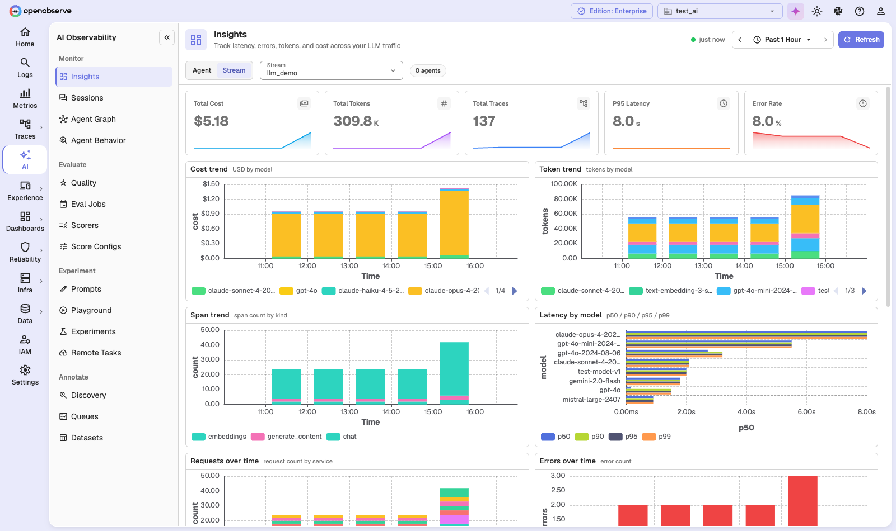
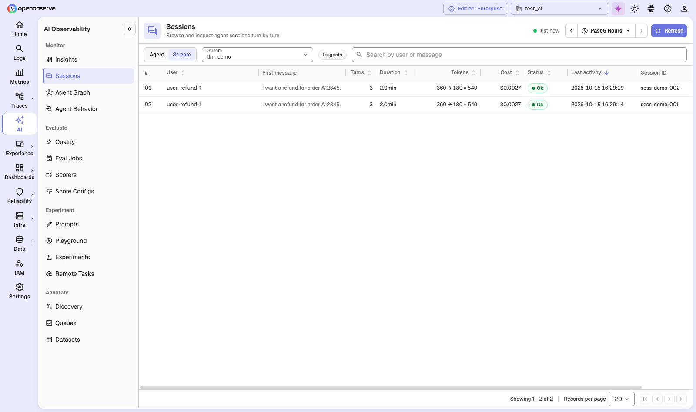
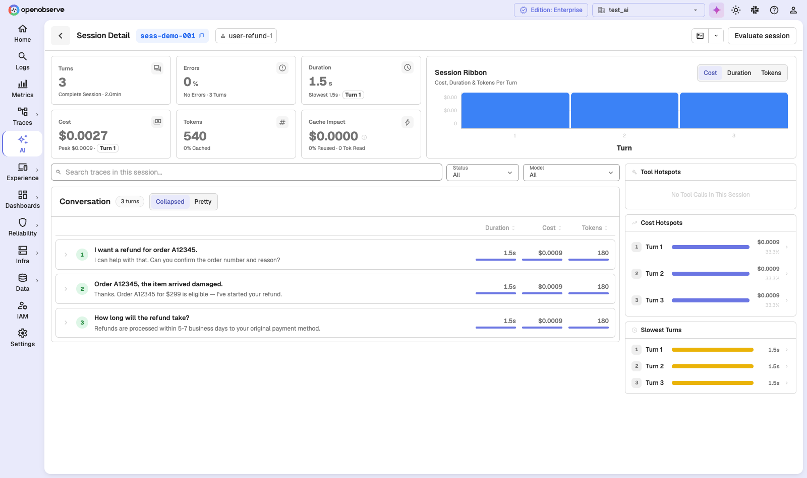
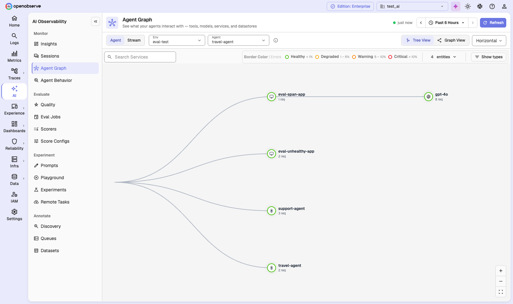
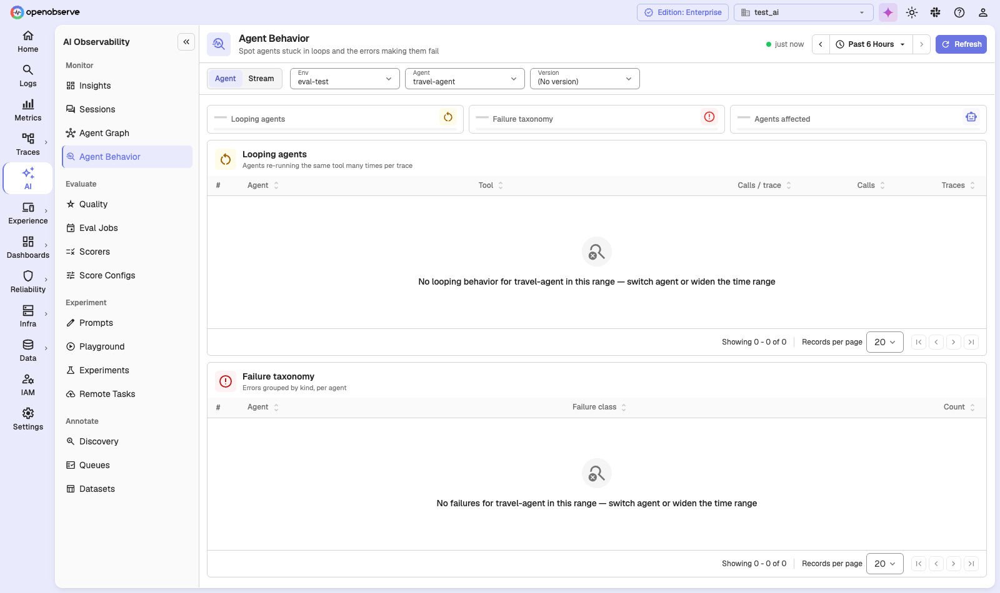

# LLM Monitoring

The **Monitor** section of **AI Observability** gives you a live view of your LLM applications and agents. It turns the GenAI spans you already send to OpenObserve into cost and latency charts, conversation timelines, and an agent topology, with no extra instrumentation.

## Overview

| Page | What it shows | Edition |
|---|---|---|
| **Insights** | Cost, tokens, traces, latency, and errors across your LLM traffic, broken down by model and service. | All editions |
| **Sessions** | Conversations grouped by session, with a turn-by-turn detail view. | All editions |
| **Agent Graph** | The tools, models, services, and datastores each agent calls. | Enterprise and Cloud |
| **Agent Behavior** | Agents stuck in tool-calling loops, and the errors that make them fail. | Enterprise and Cloud |

In the open-source edition, **Agent Graph** and **Agent Behavior** stay in the menu with a lock icon. Opening them shows what the feature does and how to upgrade. In the Enterprise edition, the **AI Observability** menu appears only while `O2_EVAL_ENABLED` is on (the default).

## Prerequisites

- LLM traces in a traces stream, with GenAI attributes such as `gen_ai.request.model` and `gen_ai.usage.*`. See [LLM Applications](llm-applications.md) to instrument your app.
- For **Sessions**, a session or conversation ID on your spans (see [Sessions](#sessions)).
- For agent views, an agent name on your spans (see [How agents are identified](#how-agents-are-identified)).

## Choose what to look at

Every Monitor page starts with the same scope bar. Pick one of two modes:

- **Stream**: pick a traces stream and see all LLM traffic in it. This is the default in the open-source edition.
- **Agent**: pick an **Env**, then an **Agent**, then a **Version**. The page shows only that agent's traffic. This is the default in the Enterprise edition and Cloud. Agent Graph has no **Version** picker, because an agent's topology is the same across versions.

If no agents are found in the selected time range, the page shows **No Agents In This Range** with a **View by Stream** button.

All four pages share one time range, which persists as you move between them. Insights and Sessions also write the range into the URL, so a link you share opens the same view.

:::note[Agent mode is Enterprise and Cloud only]
In the open-source edition, the **Agent** option is visible but locked. Use **Stream** mode.
:::

### How agents are identified

OpenObserve reads agent identity from your span attributes. It checks the standard OpenTelemetry attribute first, then falls back to common alternatives:

| Dimension | Standard attribute (checked first) | Built-in fallbacks |
|---|---|---|
| Agent name | `gen_ai.agent.name` | `agent.name`, `llm.agent.name`, `gcp.vertex.agent.name`, `crewai.task.agent` |
| Agent ID | `gen_ai.agent.id` | `agent.id`, `agent_id`, `llm.agent.id`, `llm.agent_id` |
| Environment | `deployment.environment.name` | `deployment.environment`, `env`, `environment`, `k8s.namespace.name` |
| Version | `gen_ai.agent.version` | `service.version`, `app.version`, `git.commit.sha` |

If your telemetry uses different attribute names, add them under **Settings > Data & AI > GenAI Agent Mapping**. Enter one attribute per line in **Agent name fallback fields**, **Agent ID fallback fields**, **Environment fallback fields**, and **Version fallback fields**, then click **Save**. **Apply defaults** restores the built-in lists. **Clear registry** removes every discovered agent; new matching traces repopulate it during ingestion.

## Insights

Navigate to **AI Observability > Monitor > Insights**. The page answers "what is my LLM traffic costing, and is it healthy?"

The top row has five tiles, each with a sparkline: **Total Cost**, **Total Tokens**, **Total Traces**, **P95 Latency**, and **Error Rate**. Below them are these charts:

| Chart | What it shows |
|---|---|
| **Cost trend** | Cost in USD over time, by model. |
| **Token trend** | Tokens over time, by model. |
| **Span trend** | Span count over time, by kind (for example `chat`, `embeddings`, `generate_content`). |
| **Latency by model** | p50, p90, p95, and p99 latency for each model. |
| **Requests over time** | Request count over time, by service. |
| **Errors over time** | Error count over time. |
| **Spans by model** | Call count per model. |
| **Tokens by model** | Total tokens per model. |
| **Recent errors** | The last 10 failed spans, with time, service, operation, and trace ID. Click a row to open the trace. |

Cost comes from the `gen_ai_usage_cost` field on each span, which [Model Pricing](model-pricing.md) calculates at ingestion.

In **Agent** mode, when the selected agent has at least two versions, click **Compare versions** to see two versions side by side.

## Sessions

A session is one conversation: every trace that shares the same session ID. OpenObserve reads the ID from `gen_ai.conversation.id`, `session.id`, `ai.telemetry.metadata.sessionId`, or Langfuse session metadata.

Navigate to **AI Observability > Monitor > Sessions**.

| Column | Description |
|---|---|
| **User** | The user ID on the session. |
| **First message** | The opening user message. |
| **Turns** | The number of traces in the session. |
| **Duration** | Time from the first to the last turn. |
| **Tokens** | Total tokens. Hover to see the input and output split. |
| **Cost** | Total cost. |
| **Status** | **Ok**, or **Error** if any turn failed. |
| **Last activity** | When the session last received a turn. The list is sorted by this column, newest first. |
| **Session ID** | The session or conversation ID. |

Use **Search by user or message** to find sessions by user ID or by anything said in the conversation. Click any column header except **First message** and **Session ID** to sort the full list, not just the current page.

### Session detail

Click a session to open **Session Detail**.

- **Tiles**: **Turns**, **Errors**, **Duration**, **Cost**, **Tokens** (with the share that was cached), and **Cache Impact**. Hover **Cache Impact** to see the actual cost, the estimated cost without caching, and the net saving.
- **Session Ribbon**: one bar per turn. Switch it between cost, latency, and tokens, and click a bar to jump to that turn.
- **Conversation**: every turn, with the user message and the assistant reply. **Collapsed** view lets you expand a turn to see its LLM calls, tool calls, and a **View Trace** link. **Pretty** view shows the full conversation. Filter turns with **Search traces in this session…**, **Status**, and **Model**.
- **Side rail**: **Tool Hotspots**, **Cost Hotspots**, and **Slowest Turns** point you to the turns worth a closer look.

In the Enterprise edition and Cloud, the header also has **Add To Review Queue**, to send the session to an [annotation queue](llm-annotations-and-datasets.md), and **Evaluate session**, to score it with an [eval job](llm-evaluations.md#manual-evaluation).

## Agent Graph

Navigate to **AI Observability > Monitor > Agent Graph** to see what each agent interacts with: tools, models, services, and datastores.

- **Tree View** (the default) lays the graph out **Horizontal** or **Vertical**. **Graph View** uses a force layout.
- Node size shows request count. The border color shows error rate: **Healthy** (under 1%), **Degraded** (1–5%), **Warning** (5–10%), or **Critical** (over 10%).
- **Show types** filters node types: Services, Datastores, Queues, External, RPC, Agents, Tools, and Models.
- **Search Services** finds a node by name.

The graph is built from pre-aggregated service-graph data, which a background job refreshes. A new agent can take a few minutes to appear.

| Variable | Default | Description |
|---|---|---|
| `O2_SERVICE_GRAPH_ENABLED` | `true` | Builds the service-graph data the Agent Graph uses. |
| `O2_SERVICE_GRAPH_INTERVAL_SECS` | `60` | How often new edges are aggregated. |

## Agent Behavior

Navigate to **AI Observability > Monitor > Agent Behavior** to find agents that misbehave.

- **Looping agents** lists each agent and tool pair with **Calls / trace**, **Calls**, and **Traces**, sorted so agents that call the same tool over and over come first. It is built from `execute_tool` spans.
- **Failure taxonomy** groups errors per agent into classes such as `wrong_tool_call`, `malformed_tool_call`, `context_window_exceeded`, `validation_error`, `rate_limited`, `auth_error`, `tool_timeout`, `incomplete_response`, `mcp_error`, `provider_error`, and `tool_error`. Errors that match no class are `unclassified`.
- The tiles at the top count looping rows, total failures, and **Agents affected**.

Click a row to open **Signal details**, which lists the worst traces and summarizes what the errors say.

:::note[Data is processed hourly]
Agent Behavior is built by a background job that runs every hour by default (`O2_AGENT_SIGNALS_PROCESSING_INTERVAL_SECS=3600`), so the most recent hour may not appear yet.
:::

## Troubleshooting

**Insights or Sessions is empty**

- Widen the time range. The default is the last 15 minutes.
- In **Agent** mode, the selected agent may have no traffic in the range. Click **View by Stream**.
- For Sessions, check that your spans carry a session or conversation ID such as `gen_ai.conversation.id`.

**My agent doesn't appear in the Agent picker**

Check that your spans carry `gen_ai.agent.name` or one of the fallback attributes. If you use a custom attribute, add it under **Settings > Data & AI > GenAI Agent Mapping**.

**Cost shows $0**

Cost is calculated from the model name and token counts. Check that the model is covered in [Model Pricing](model-pricing.md).
