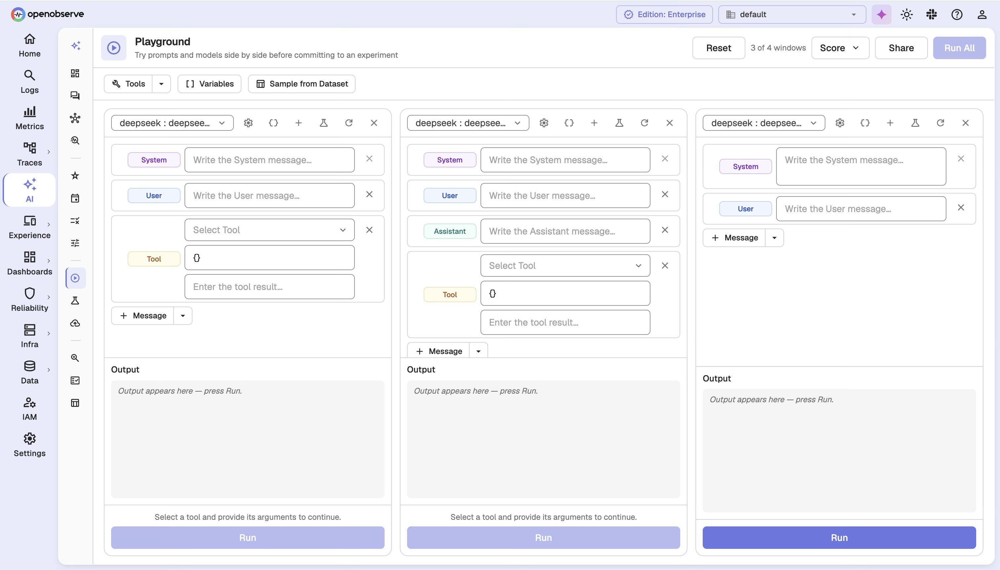
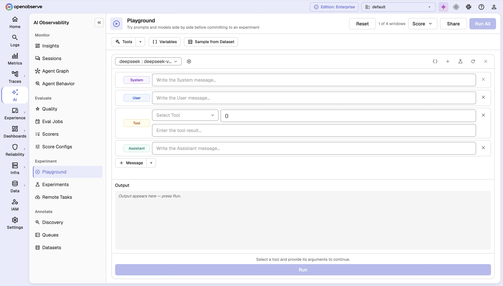
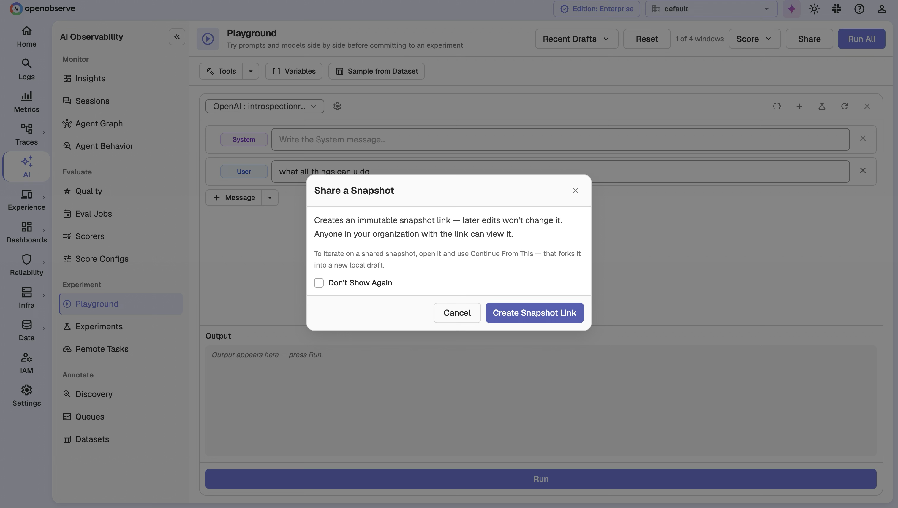

# LLM Playground

The Playground is an interactive workbench for iterating on prompts, models, and scorers before you commit them to a Dataset or an Experiment. Run a model to stream its answer, score the result to read your judge's reasoning, and share a snapshot to capture the whole board.

## Overview

The Playground is a two-dimensional board:

- **Columns are variants**: each column is one prompt configuration, a provider, an optional model, an ordered list of messages, sampling parameters, and optional tools or a response format.
- **Rows are cases**: each row is an input (plus optional expected output and metadata) that every variant runs against.

A **cell** is the intersection of a variant and a case. **Run** a cell to stream the model's answer back live; **score** a cell to run your scorers against it and read each judge's verdict and reasoning.

The Playground doesn't save to the server as you work, so drafts never affect your evaluation analytics. Your recent drafts are kept in your browser only (see **Recent Drafts** below). **Share** is the only action that saves to the server: it copies every column, row, result, and score into a snapshot, which keeps rendering even after the underlying dataset, scorer, or provider changes or is deleted.



## Open the Playground

Navigate to **AI Observability > Experiment > Playground**, or start from something you already have:

- **From a prompt**: on a prompt in [Prompts](llm-prompts.md), click **Open in Playground**. The column loads that prompt version, and a chip such as `support-answer@v3` shows where it came from.
- **From a trace**: open an LLM span in trace details and click **Open in Playground**. The span's messages load into a column marked **From trace span**.


The toolbar holds the board-wide actions: **Recent Drafts** (the last 10 boards in this browser), **Reset**, a counter of variant windows (up to 4), **Score**, **Share**, and **Run All**.

## Build a variant

Each column is a variant. Configure it with:

| Field | Description |
|---|---|
| **Provider** | The LLM provider to call. You can only use providers you have access to. |
| **Model** | Optional model override. Leave empty to use the provider's default model. |
| **Messages** | The prompt as an ordered list of `role` + `content` messages. String content is templated with `{{variables}}`; structured content is passed through untouched. |
| **Parameters** | Sampling parameters. `temperature` and `max_tokens` map to the provider's own fields; any other key is passed through as-is. |
| **Tools** | Tool definitions passed to the provider. If the model calls a tool, the call is shown as the cell's output; nothing is actually executed. |
| **Response Format** | An optional structured-output schema for the provider. |



### Variables

Templates in message content bind variables from the row's input:

- A string input binds `{{input}}`.
- An object input binds each of its fields by name.

Type `{{` in a message to get a list of the variables you can use. The **Variables** menu shows every variable the board uses, lets you set test values, and lets you add new ones. `{{expected_output}}` is never available in task prompts; reference answers only feed scorers.

Only string content is templated. Structured content (multimodal parts and tool results) is passed through as-is, so its structure is never corrupted.

## Add cases

Each row is a case. A case supplies the input every variant renders against, and optionally:

| Field | Description |
|---|---|
| **Input** | A string binds `{{input}}`; an object binds each of its fields by name. |
| **Expected Output** | An optional reference used by scorers that compare output against a gold answer. |
| **Metadata** | Optional extra context made available to scorers as `{{metadata}}`. |

## Run a cell

Running a cell streams the model's answer back live. You first see the exact rendered prompt (with variables filled in), then incremental text as it's generated, and finally the model used, latency, and token usage and cost.

Configuration errors (an inaccessible provider, an unrenderable message, an invalid parameter) are caught before streaming starts. Once streaming begins, an upstream failure, including rate limits and other gateway errors, is surfaced as an error in the stream. Any API key in an upstream error is redacted before it reaches you.

## Score a cell

Scoring a cell runs your scorers against it and returns one verdict per scorer immediately; nothing is saved, so throwaway scores never affect your experiment comparisons. Select the scorers to apply, then run them.

Each result reports one of three outcomes:

| Outcome | Meaning |
|---|---|
| **Scored** | The judge returned a value (`numeric`, `categorical`, or `boolean`) plus reasoning, metadata, the model used, prompt/completion tokens, and latency. |
| **Skipped** | The scorer couldn't judge this cell: `requires_trace` means it needs spans or steps a Playground run never produces; `no_reference` means it needs an expected output the case doesn't supply. |
| **Failed** | The scorer ran and errored. One failed scorer doesn't cost you the other verdicts in the batch. |

Scorers run at their **latest** version in the Playground. Pinning to a specific version happens when you promote a column to an Experiment.

## Tool calls and structured output

When a variant defines **tools**, a model that chooses to call one returns the call (name and arguments) as the cell's output rather than executing anything. This lets you iterate on tool definitions without wiring up an execution environment.

When a variant sets a **response format**, the provider is asked for structured output, and the returned structure is shown as the result. Open **Structured Output** on a column and turn on **Constrain output to a JSON schema** to set one.

Not every provider supports JSON schemas, so the column badge tells you what happens to yours:

| Badge | Meaning |
|---|---|
| **Schema · On** | The provider enforces the schema. |
| **Schema · Approximated by this provider** | The provider only supports a JSON mode, so the output is JSON but isn't strictly checked against your schema. DeepSeek works this way. |
| **Schema · Ignored by this provider** | The provider has no structured-output field. The schema stays on the column but isn't sent, and the model answers in plain text. |

## Share a snapshot

Share captures the entire board, every column, row, result, and score, into an immutable snapshot and returns a short link you can hand to a teammate. The snapshot keeps rendering even after the dataset, scorer, or provider it came from changes or is deleted.

Editing a shared board doesn't update the existing snapshot; it creates a new one. A snapshot is visible only within your organization. To build on a snapshot someone shared with you, open it and click **Continue From This**. You then work on a copy, and the original stays unchanged.



### Limits and retention

- A snapshot may hold up to **4 columns**, **10 rows**, and **1 MB** of data.
- Snapshots expire after a configurable number of days of not being opened; opening one renews the window.
- Each organization is capped at a configurable number of snapshots; over the cap, the least recently opened are purged first.

## Save a prompt or create an experiment

The Playground is a drafting surface for the rest of the LLM evaluations suite. When you're happy with a column:

- Click **Save as Prompt** to store it in [Prompts](llm-prompts.md). Choose **Create a new prompt**, or **Append to an existing prompt** to save it as that prompt's next version.
- Click **Create Experiment** to turn the column into an [Experiment](llm-experiments.md). This is the moment each scorer is pinned to a specific version.

To use cases from a Dataset, click **Sample from Dataset**. The sampled rows fill your variables, such as `{{input}}` and `{{expected_output}}`, so you can run the board against real cases.

## Configuration

The Playground is part of AI Observability in the Enterprise edition and OpenObserve Cloud, and needs `O2_EVAL_ENABLED` (on by default).

| Variable | Default | Description |
|---|---|---|
| `O2_LLM_PLAYGROUND_RUN_TIMEOUT_MS` | `120000` | Per-cell timeout in milliseconds for a Playground run. |
| `O2_LLM_PLAYGROUND_SNAPSHOT_TTL_DAYS` | `180` | Days a shared snapshot survives without being opened. Set to `0` to keep snapshots forever. |
| `O2_LLM_PLAYGROUND_SNAPSHOT_MAX_PER_ORG` | `1000` | Maximum shared snapshots retained per organization. Set to `0` to remove the cap. |

## RBAC

The Playground has its own permissions (GET, LIST, POST, PUT, DELETE). Two things to note:

- **Run** and **Score** require the write grant, even though they save nothing, since both call a provider or judge and spend real money.
- You can only use providers and scorers you have access to.

Assign the appropriate roles in **IAM > Roles** to control Playground access.

## API Reference

All endpoints are prefixed with `/api/{org_id}`.

| Method | Path | Description |
|---|---|---|
| `POST` | `/playground/run` | Run a cell: stream the model's answer back. |
| `POST` | `/playground/score` | Score a cell against one or more scorers. |
| `POST` | `/playground/snapshots` | Share a workbench snapshot. |
| `GET` | `/playground/snapshots/{snapshot_id}` | Read a snapshot (renewing its retention window). |

**Run payload** (a column plus an optional row):

```json
{
  "column": {
    "provider_id": "provider-id",
    "model": "gpt-4o",
    "messages": [
      { "role": "system", "content": "You are a helpful assistant." },
      { "role": "user", "content": "{{input}}" }
    ],
    "params": { "temperature": 0.2, "max_tokens": 256 },
    "tools": [],
    "response_format": null
  },
  "row": {
    "input": "What is the retention default?",
    "expected_output": "14 days",
    "metadata": {}
  }
}
```

**Score payload** (the scorers to run against a subject):

```json
{
  "scorer_ids": ["scorer-1", "scorer-2"],
  "input": "What is the retention default?",
  "output": "Fourteen days.",
  "expected_output": "14 days",
  "metadata": {}
}
```

**Share payload** (the whole workbench by value):

```json
{
  "payload": {
    "columns": [ { "provider_id": "provider-id", "messages": [], "model": "gpt-4o", "params": {} } ],
    "rows": [ { "input": "case 1" } ]
  },
  "parent_snapshot_id": null
}
```
