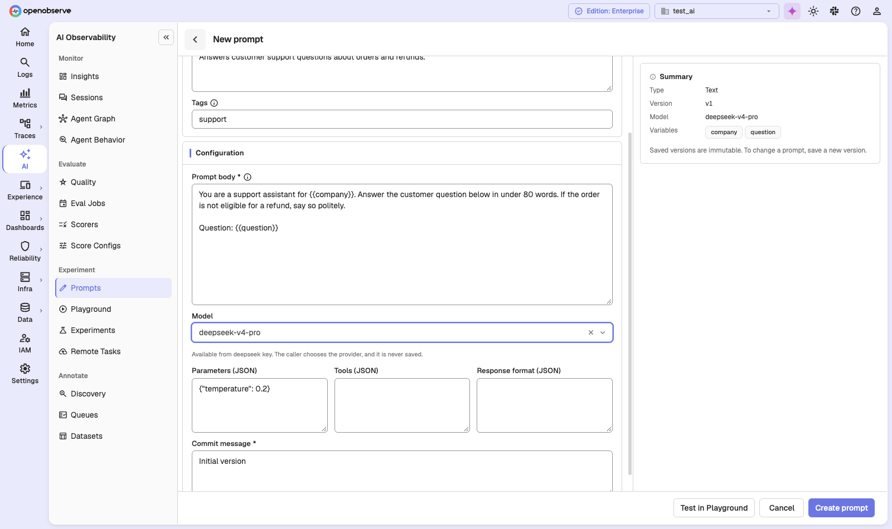
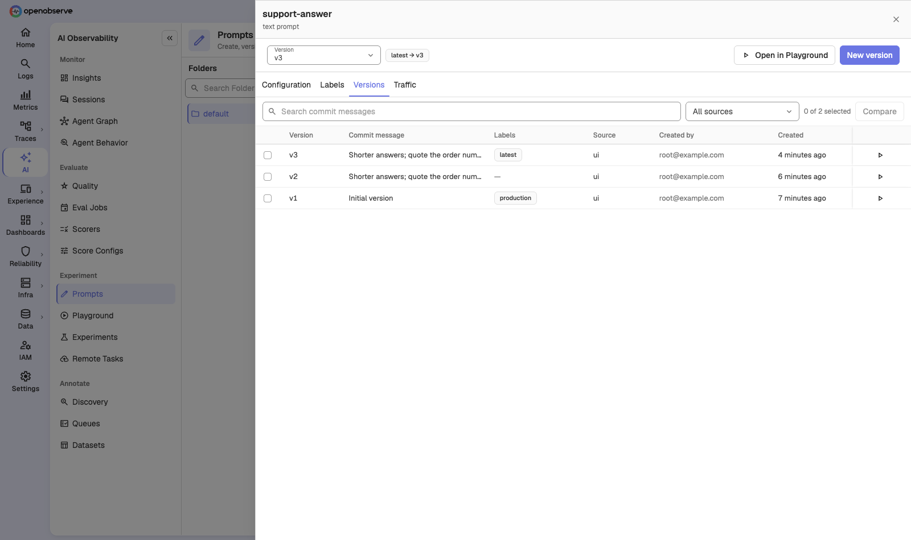
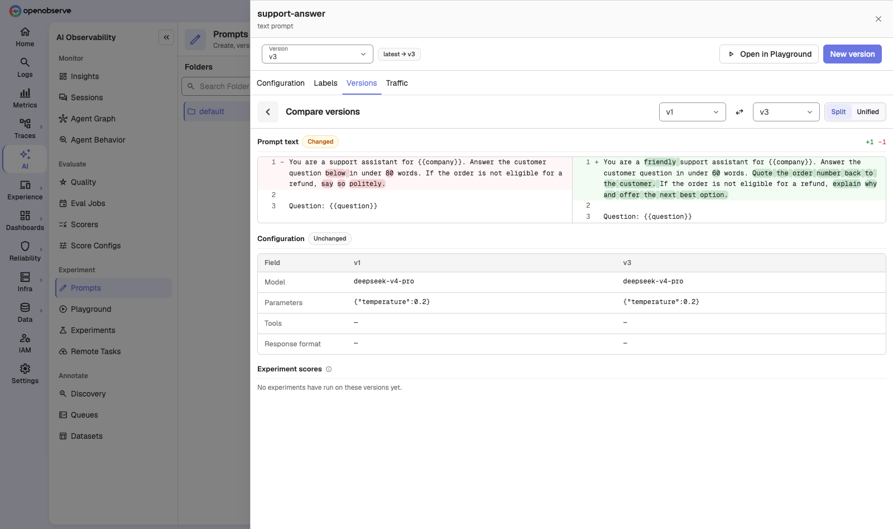
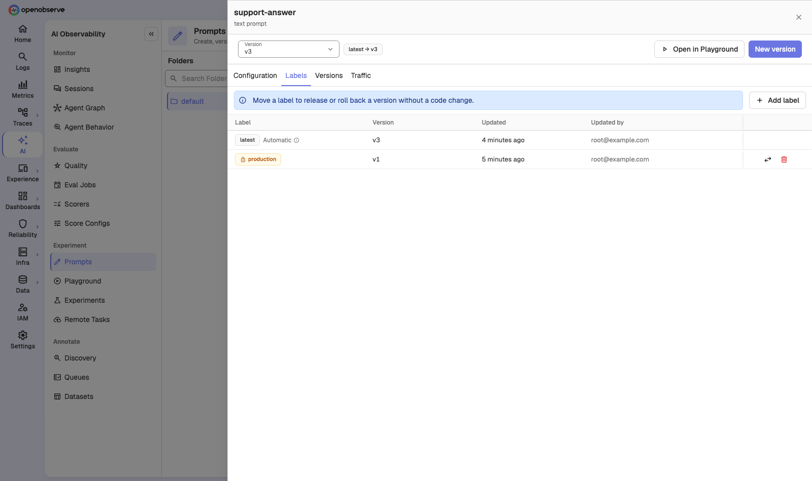
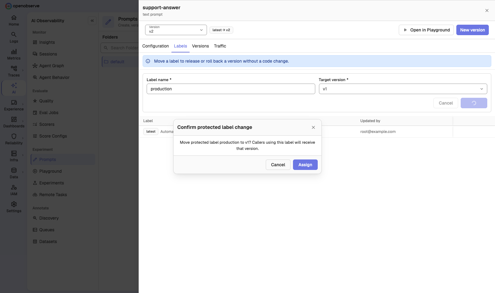
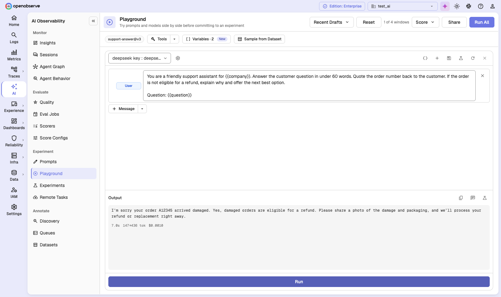
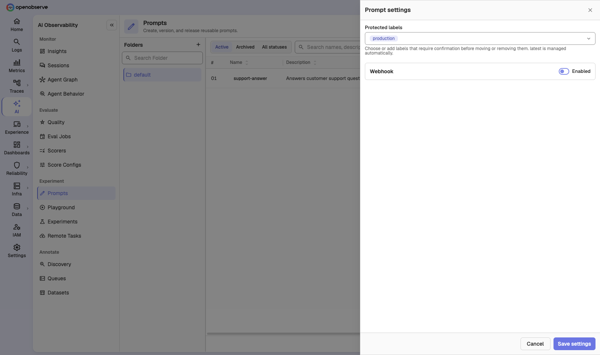

# LLM Prompts

**Prompts** is a registry for the prompts your AI features use. Every save creates a new version that never changes, and **labels** such as `production` point at the version your app should use. To release or roll back a prompt, you move a label. Your app picks up the change without a code deploy.



## Overview

| Concept | What it is |
|---|---|
| **Prompt** | A named template, either **Text** or **Chat** (a list of role and content messages). The name and type can't change after creation. |
| **Version** | An immutable snapshot of the prompt body and its model configuration, numbered `v1`, `v2`, and so on. Each version records a commit message. |
| **Label** | A movable pointer to one version, such as `production` or `staging`. Your app asks for a label, not a version number. |
| **Folder** | Groups prompts and controls who can access them. |

Prompts are available in the Enterprise edition and OpenObserve Cloud.

## Create a prompt

1. Navigate to **AI > Experiment > Prompts** and click **New prompt**.
2. Enter a **Name**. Use lowercase letters, digits, `_`, and `-`, for example `support-answer`.
3. Pick a **Type**: **Text** or **Chat**.
4. Optionally add a **Description** and **Tags**.
5. Write the **Prompt body**. Put variables in double braces, such as `{{question}}`. The **Summary** panel lists the variables it finds.
6. Optionally set the **Model**, **Parameters (JSON)** (for example `{"temperature": 0.2}`), **Tools (JSON)**, and **Response format (JSON)**. The provider is never stored with the prompt; whoever calls the prompt chooses it.
7. Enter a **Commit message** and click **Create prompt**.

Click **Test in Playground** to try the prompt before you save it. If the same content already exists in another version, OpenObserve warns you and lets you save anyway.

## Save a new version

Saved versions can't be edited. To change a prompt, open it and click **New version**. The form starts from the version you were viewing and saves as the next number. Change the body or configuration, enter a **Commit message**, and click **Save version**.

The `latest` label always points at the newest version and moves automatically. You can't move or delete it.

## Review and compare versions

Click a prompt in the list to open its drawer. It has four tabs:

- **Configuration**: the selected version's status, model, prompt text, and parameters.
- **Labels**: which version each label points at.
- **Versions**: every version with its commit message, labels, source (`ui`, `sdk`, `playground`, `ci`, or `agent`), author, and time. Search commit messages or filter by source.
- **Traffic**: calls, errors, latency, and cost for this prompt, from your traces (see [Link prompts to traces](#link-prompts-to-traces)).



To compare two versions, select them on the **Versions** tab and click **Compare**. The diff shows the prompt text in **Split** or **Unified** view, a table of configuration changes, and **Experiment scores** for each version when experiments have run on them.



## Release with labels

Labels decide which version your app gets. To release v3 to production, point the `production` label at v3. To roll back, point it at the previous version.

1. Open the prompt and select the **Labels** tab.
2. Click **Add label**, enter a **Label name**, pick the **Target version**, and click **Assign**. To move an existing label, use the move action on its row.



Apps that resolve by label pick up the change within about 60 seconds.

### Protected labels

Some labels are too important to move by accident. A **protected label** asks for confirmation before it is moved or removed, and only users with the **Prompt Protected Labels** permission can change it. `production` is protected by default.



To change which labels are protected, click the settings icon on the Prompts page and edit **Protected labels**.

## Use a prompt in your app

Fetch a prompt at runtime with the resolve API. By default it returns the version labeled `production`:

```bash
curl -u "user@example.com:password" \
  "https://<your-openobserve-host>/api/<org_id>/prompts/resolve?name=support-answer&label=production"
```

| Parameter | Description |
|---|---|
| `name` | The prompt name. Required. |
| `label` | The label to resolve. Defaults to `production`. |
| `version` | A specific version number. Use either `label` or `version`, not both. |
| `folder` | Optional folder ID. If the prompt lives in a different folder, the response includes a `Warning` header. |

The response contains the prompt (`name`, `promptType`, `labels`, `latestVersion`, and more) and the resolved version (`version`, `payload`, `config`, `commitMessage`, `contentHash`). It also returns an `ETag`; send it back in `If-None-Match` to get a `304 Not Modified` when nothing changed.

Archived prompts still resolve, so archiving a prompt never breaks a running app.

## Link prompts to traces

To see a prompt's real-world traffic, add these attributes to the LLM spans that use it:

| Attribute | Example |
|---|---|
| `gen_ai.prompt.name` | `support-answer` |
| `gen_ai.prompt.version` | `3` |
| `gen_ai.prompt.label` | `production` |

The Langfuse equivalents (`langfuse.observation.prompt.name`, `.version`, and `.label`) also work. The **Traffic** tab then shows calls, errors, error rate, P50 and P95 latency, and cost for the prompt, broken down by label and model, with recent calls and experiment results. Pick the **Trace stream** to read from.

## Test and evaluate prompts

- Click **Open in Playground** on a prompt to load it into the [Playground](llm-playground.md), fill in its variables, and run it against different models.
- In the Playground, click **Save as Prompt** to save a column as a new prompt, or as the next version of an existing one.
- In an [Experiment](llm-experiments.md), pick the **Managed Prompt** task type, then resolve the prompt by label or version. The experiment pins the exact version it resolved to, so later label moves never change its results.



## Organize prompts

- **Folders**: the folder panel on the left groups prompts. Click **+** to add a folder. To move a prompt, use **Move to folder** on its row; all of its versions move with it.
- **Search**: search names, descriptions, tags, and labels in **This folder** or **All folders**.
- **Status**: filter by **Active**, **Archived**, or **All statuses**. **Archive** makes a prompt read-only: you can't add versions or move labels on it. Archiving can't be undone.

## Webhooks

OpenObserve can notify your systems when prompts change, for example to refresh a cache or trigger a CI run.

1. On the Prompts page, click the settings icon to open **Prompt settings**.
2. Turn on **Webhook**, enter the **Endpoint**, and choose the **Subscriptions**: **Version created**, **Label moved**, **Label deleted**, and **Prompt archived**.
3. Click **Save settings**, then set a **Signing secret**. The secret is write-only: it is never shown again.



Each delivery is a JSON body with the event type (`prompt.version.created`, `prompt.label.moved`, `prompt.label.deleted`, or `prompt.archived`), the actor, the prompt, and the version or label change. These headers come with it:

| Header | Description |
|---|---|
| `X-OpenObserve-Event` | The event type. |
| `X-OpenObserve-Delivery` | A unique delivery ID. |
| `X-OpenObserve-Timestamp` | When the delivery was sent. |
| `X-OpenObserve-Signature` | `v1=<hex>`: an HMAC-SHA256 of the timestamp and body, keyed with your signing secret. |

Failed deliveries are retried up to 8 times with growing backoff (capped at one hour), and a `Retry-After` header from your endpoint is respected.

## RBAC

Prompts use three permission resources, assigned in **IAM > Roles**:

| Resource | Controls |
|---|---|
| **Prompts** | Reading, creating, and editing individual prompts. |
| **Prompt Folders** | Access to a folder. Prompts inherit access from their folder, and moving a prompt moves its access with it. Listing prompts across all folders needs list access on Prompt Folders. |
| **Prompt Protected Labels** | Moving or removing a protected label, and changing which labels are protected. Admins always have it; editors need it granted. |

A user who can't read a prompt gets `404` from the resolve API.

## API Reference

All endpoints are prefixed with `/api/{org_id}`.

| Method | Path | Description |
|---|---|---|
| `GET` | `/prompts` | List prompts. Add `includeArchived` or `folder` to filter. |
| `POST` | `/prompts` | Create a prompt with its first version. |
| `GET` | `/prompts/resolve` | Resolve a prompt by `name` and `label` or `version`. |
| `GET` / `PATCH` | `/prompts/{id}` | Get a prompt, or update its description, tags, or folder. |
| `POST` | `/prompts/{id}/archive` | Archive a prompt. |
| `GET` / `POST` | `/prompts/{id}/versions` | List versions, or save a new one. |
| `GET` | `/prompts/{id}/versions/{version}` | Get one version. |
| `GET` | `/prompts/{id}/activity` | Label history. |
| `PUT` / `DELETE` | `/prompts/{id}/labels/{label}` | Move or remove a label. |
| `POST` | `/prompts/match` | Find existing versions with the same content. |
| `GET` / `PUT` | `/prompts/settings` | Read or update protected labels and webhook settings. |
| `PUT` | `/prompts/settings/secret` | Set the webhook signing secret. |

Write requests accept an `Idempotency-Key` header, so retries are safe.
