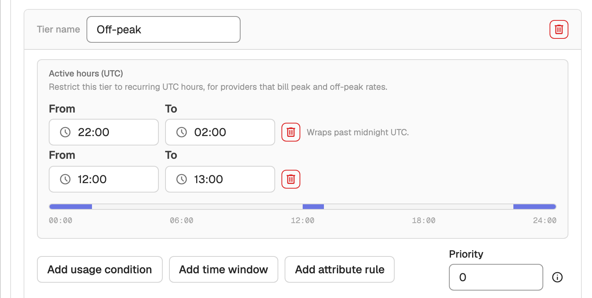
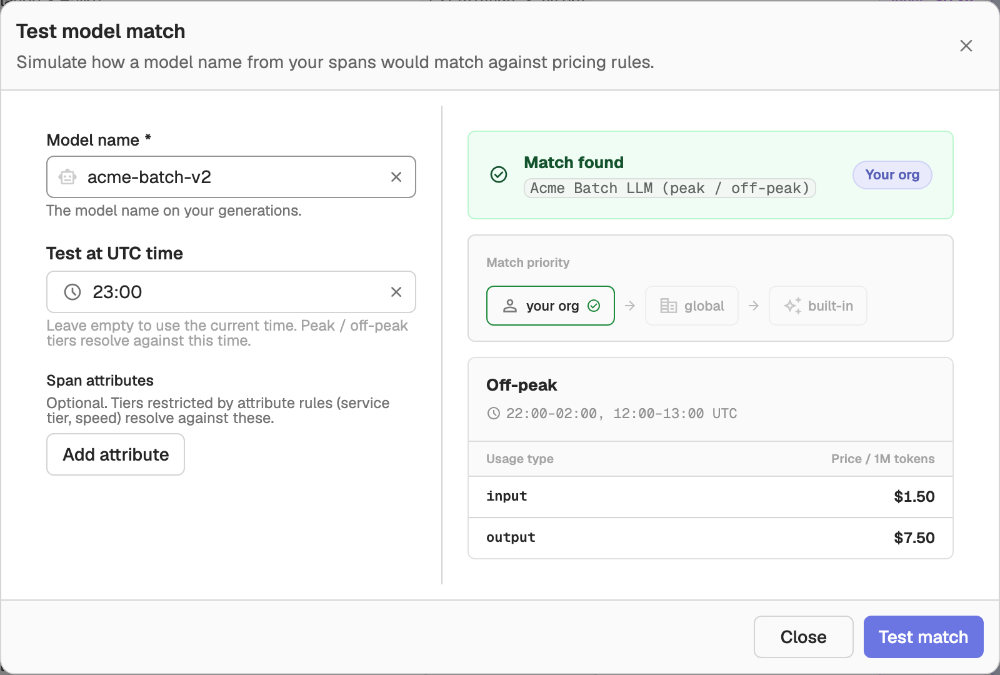

# Model Pricing

Model Pricing lets you define per-organization LLM pricing so OpenObserve can compute token costs directly on your traces. With it enabled, every LLM span is enriched with cost fields derived from the model name and token usage.

## Overview

When you ingest LLM traces, each span carries token usage and a model name. Model Pricing maps that model name to a pricing definition and calculates the cost of the call, writing the result into the cost fields stored on the span.

This feature is for teams running LLM observability who want accurate, up-to-date cost attribution per model, per organization. You can rely on the built-in pricing catalog that OpenObserve maintains, or define your own pricing to match negotiated rates, custom models, or providers not covered by the catalog.

OpenObserve populates the following cost fields on each LLM span when Model Pricing is enabled:

| Field | Type | Description |
|-------|------|-------------|
| `gen_ai_usage_cost_input` | Float64 | Cost of input (prompt) tokens |
| `gen_ai_usage_cost_output` | Float64 | Cost of output (completion) tokens |
| `gen_ai_usage_cost` | Float64 | Total cost of the LLM call |

Spans that use prompt caching also get `gen_ai_usage_cost_cache_read_input`, `gen_ai_usage_cost_cache_creation_input`, `gen_ai_usage_cost_estimated_without_cache`, `gen_ai_usage_cost_cache_read_savings`, and `gen_ai_usage_cost_net_cache_impact`.

OpenObserve only calculates a cost for spans that do not already report one. If your instrumentation sends its own cost attributes, those values are kept.

> **Note**: When Model Pricing is disabled, no cost is calculated: spans keep only the costs they report themselves. The pricing lookup, the periodic sync job, and the **LLM Model Pricing** settings page are all gated behind the enable flag.

## Key features

### Built-in pricing catalog

OpenObserve ships with a built-in catalog of model pricing that is synced periodically from an upstream source. Built-in definitions are read-only.

- View the full built-in catalog without any setup
- Clone a built-in definition to customize it for your organization
- Refresh the catalog on demand from the upstream source

### Custom pricing definitions

Define your own pricing per organization. User-defined pricing takes priority over built-in pricing when both match a model.

- Match incoming model names with a regex pattern (for example, `(?i)^gpt-4o`)
- Define one or more pricing tiers with per-token rates keyed by usage type (`input`, `output`, and others)
- Optionally set a validity start time so historical traces keep their original cost calculations

### Test model match

Before relying on a definition, test how a given model name resolves against your configured pricing, and preview the computed cost for a sample token count.

## Getting started

### Prerequisites

- OpenObserve Enterprise or Cloud. The **LLM Model Pricing** page is not shown in the open-source edition.
- LLM traces being ingested (see [LLM Observability](llm-applications.md))

### Enabling Model Pricing

Model Pricing is controlled by environment variables. The feature is enabled by default.

To turn it off, set:

```shell
ZO_MODEL_PRICING_ENABLED=false
```

The flag controls three behaviors: it shows the **LLM Model Pricing** page in the UI, starts the background sync job that pulls built-in pricing, and enables the pricing lookup during ingestion. When the flag is `false`, OpenObserve calculates no cost for spans that do not report one.

| Setting | Description | Default |
|---------|-------------|---------|
| `ZO_MODEL_PRICING_ENABLED` | Enable model pricing. When `true`, uses pricing definitions and syncs built-in pricing from the source URL. When `false`, no cost is computed for spans that do not report one. | `true` |
| `ZO_MODEL_PRICING_SOURCE_URL` | URL of the built-in LLM model pricing JSON source. | `https://raw.githubusercontent.com/openobserve/sdr_patterns/refs/heads/main/llm_pricing.json` |
| `ZO_MODEL_PRICING_SYNC_INTERVAL_SECS` | Interval in seconds for syncing built-in model pricing from the source URL. | `21600` (6 hours) |

> **Tip**: Restart your OpenObserve instance after changing these variables so the configuration takes effect.

## Managing pricing in the UI

Manage pricing from **Settings** > **Data & AI** > **LLM Model Pricing**. The page is hidden when `ZO_MODEL_PRICING_ENABLED` is `false`.

From this tab you can:

- **List**: Review all pricing definitions, including the read-only built-in catalog, and search by model name.
- **Sync built-in prices**: Trigger an on-demand sync from the configured source URL.
- **Import**: Bring in pricing definitions from a file, JSON, or a URL.
- **New model**: Create custom pricing definitions in the editor, including the match pattern and pricing tiers. Use **Clone to this org** to start from a built-in or global definition.
- **Test model match**: Enter a model name to see which definition it matches and preview the computed cost.

### How matching works

For each LLM span, OpenObserve evaluates pricing definitions by their regex `match_pattern` against the model name. The priority is: your organization's definitions, then global definitions, then built-in ones. Within a matched definition, the first tier is the default; additional tiers apply when their usage condition, UTC time window, and attribute rules are all met. Once any tier uses an attribute rule or a priority, the matching tier with the highest priority wins, then the most specific; otherwise the first matching tier in list order wins.

Per-token rates are keyed by usage type, for example `input` and `output`, and are expressed as the price for a single token (for example, `0.000003` equals $3 per 1M tokens).

### Time-based pricing

For providers that bill peak and off-peak rates, restrict a tier to recurring UTC hours. In the editor, open a non-default tier, click **Add time window**, and set **From** and **To** in 24-hour UTC. A tier can have several windows, and a window whose start is later than its end wraps past midnight (for example, `22:00` to `02:00`). A tier with both a condition and windows applies only when both match.



Windows are resolved against the span's start time; a span without one uses the default tier. Every definition still needs one tier with no condition, time window, or attribute rule as the fallback. To check which rate applies at a given hour, set **Test at UTC time** in the test model match dialog.



## API reference

All endpoints are scoped to an organization (`{org_id}`) and use the `model_pricing` resource for authorization.

| Method | Endpoint | Description |
|--------|----------|-------------|
| `GET` | `/api/{org_id}/llm/models` | List pricing definitions for the organization |
| `POST` | `/api/{org_id}/llm/models` | Create a pricing definition |
| `GET` | `/api/{org_id}/llm/models/{model_id}` | Get a pricing definition by ID |
| `PUT` | `/api/{org_id}/llm/models/{model_id}` | Update a pricing definition |
| `DELETE` | `/api/{org_id}/llm/models/{model_id}` | Delete a pricing definition |
| `GET` | `/api/{org_id}/llm/models/built-in` | Get the read-only built-in pricing catalog |
| `POST` | `/api/{org_id}/llm/models/refresh-built-in` | Refresh built-in pricing from the source URL |
| `POST` | `/api/{org_id}/llm/models/test` | Test how a model name matches and preview its cost |

A pricing definition includes a display `name`, a regex `match_pattern` used to match incoming model names, an `enabled` flag, and a list of pricing `tiers`. A tier restricted to time windows lists them in `utc_windows`, each with a `start_minute` and an `end_minute` in minutes past UTC midnight (`0` to `1440`); the end is exclusive. The test endpoint accepts a `model_name`, an optional `usage` map of token counts (for example, `{"input": 1000, "output": 500}`), and an optional `timestamp` so only definitions valid at that time are considered. The timestamp also selects the time-based tier that applies.

> **Note**: Built-in definitions are read-only. They cannot be created, edited, or deleted directly. Use the refresh endpoint to sync them from the upstream source, and clone a built-in definition if you need to customize it.

## Best practices

- Use anchored, case-insensitive regex patterns (for example, `(?i)^gpt-4o`) to avoid unintended matches across model families.
- Set a validity start time on definitions when rates change, so historical traces retain their original computed costs.
- Use the test model match tool to confirm a new definition resolves as expected before depending on its cost output.

## Troubleshooting

### Cost fields are empty on LLM traces

**Problem**: Traces show token usage but `gen_ai_usage_cost*` fields are zero or missing.

**Solution**:
1. Confirm `ZO_MODEL_PRICING_ENABLED` is not set to `false`.
2. Verify the model name on the span matches a definition's `match_pattern` using the test model match tool.
3. Check that the matched tier defines a per-token price for the usage keys present on the span (for example, `input` and `output`).

### The LLM Model Pricing page is not visible

**Problem**: **LLM Model Pricing** does not appear under **Settings** > **Data & AI**.

**Solution**:
1. Check that you are on Enterprise or Cloud; the open-source edition does not show the page.
2. Ensure `ZO_MODEL_PRICING_ENABLED` is not `false`, and restart the instance after changing it.

### Built-in catalog is out of date

**Problem**: Built-in pricing does not reflect the latest upstream values.

**Solution**:
1. Click **Sync built-in prices** on the **LLM Model Pricing** page, or call `POST /api/{org_id}/llm/models/refresh-built-in`.
2. Confirm `ZO_MODEL_PRICING_SOURCE_URL` points to a reachable source.
3. Review `ZO_MODEL_PRICING_SYNC_INTERVAL_SECS` if you expect more frequent automatic syncs.

## Related

For instrumenting and shipping LLM traces to OpenObserve, see [LLM Observability](llm-applications.md). The cost fields documented there (`gen_ai_usage_cost_input`, `gen_ai_usage_cost_output`, `gen_ai_usage_cost`) are populated by the Model Pricing feature described on this page.
