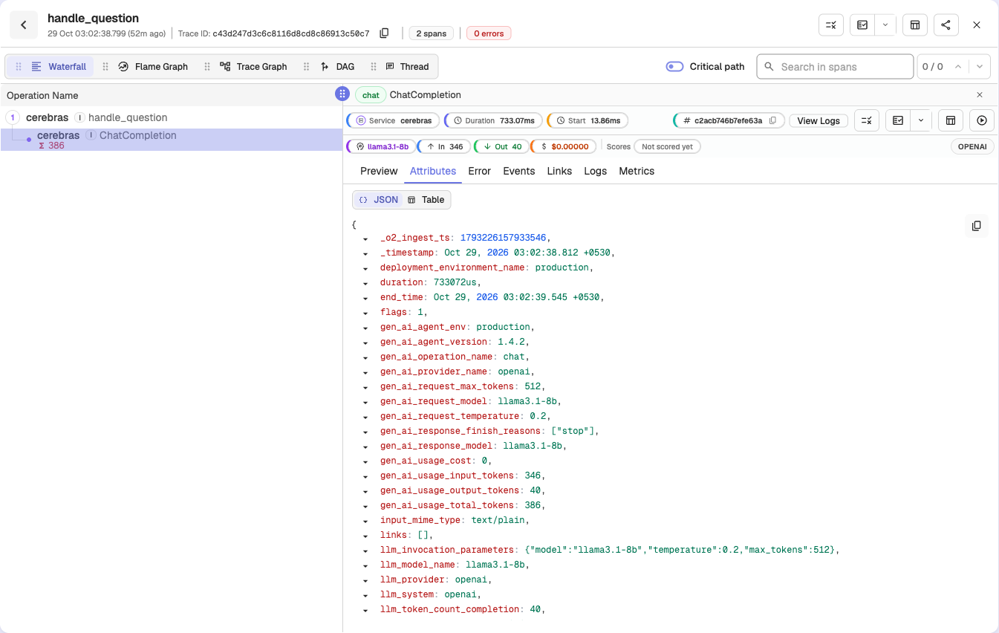

# Cerebras → OpenObserve

Cerebras Inference runs open-weight models such as Llama on Cerebras' own wafer-scale hardware, and teams usually pick it for output speed. Tracing it in OpenObserve shows the latency and token counts your application actually gets on every call. The Cerebras API at `https://api.cerebras.ai/v1` is OpenAI-compatible, so the standard OpenAI instrumentor covers it: only the client's base URL and API key change.

## Prerequisites

* Python 3.9+
* An [OpenObserve](https://openobserve.ai/) account (cloud or self-hosted)
* Your OpenObserve **organisation ID** and **Base64-encoded auth token**
* A [Cerebras](https://cloud.cerebras.ai/) API key

## Installation

```shell
pip install openobserve-python-sdk openinference-instrumentation-openai openai python-dotenv
```

## Configuration

Create a `.env` file in your project root:

```
OPENOBSERVE_URL=https://api.openobserve.ai/
OPENOBSERVE_ORG=your_org_id
OPENOBSERVE_AUTH_TOKEN=Basic <your_base64_token>
CEREBRAS_API_KEY=your-cerebras-api-key
```

## Instrumentation

Call `OpenAIInstrumentor().instrument()` **before** creating the OpenAI client. Point the client at the Cerebras base URL and pass your Cerebras API key.

```python
from dotenv import load_dotenv
load_dotenv()

from openinference.instrumentation.openai import OpenAIInstrumentor
from openobserve import openobserve_init

OpenAIInstrumentor().instrument()
openobserve_init()

import os
from openai import OpenAI

client = OpenAI(
    api_key=os.environ["CEREBRAS_API_KEY"],
    base_url="https://api.cerebras.ai/v1",
)

response = client.chat.completions.create(
    model="llama3.1-8b",
    messages=[{"role": "user", "content": "Explain distributed tracing in one sentence."}],
)
print(response.choices[0].message.content)
```

## What Gets Captured

| Attribute | Description |
| ----- | ----- |
| `llm_model_name` | Model name (e.g. `llama3.1-8b`) |
| `llm_provider` | `cerebras` |
| `llm_system` | `openai` (the client library used) |
| `llm_token_count_prompt` | Tokens in the prompt |
| `llm_token_count_completion` | Tokens in the response |
| `llm_token_count_total` | Total tokens consumed |
| `openinference_span_kind` | `LLM` |
| `operation_name` | `ChatCompletion` |
| `duration` | End-to-end request latency |
| `span_status` | `OK` or error status |

## Viewing Traces

1. Log in to OpenObserve and navigate to **Traces**
2. Click any span to inspect token counts and latency
3. Filter by `llm_model_name` to compare Cerebras model variants



## Next Steps

Since speed is the usual reason to run on Cerebras, a good first dashboard plots `llm_token_count_completion` against `duration` for each `llm_model_name`, which gives the output rate you see in production rather than a benchmark figure. Add an alert on error spans to catch failed requests.

## Read More

- [LLM Observability Overview](../llm-applications.md)
- [Traces Ingestion with Python](../../../ingestion/traces/python.md)
- [Exploring Traces in OpenObserve](../../../user-guide/data-exploration/traces/index.md)
- [Building Dashboards](../../../user-guide/analytics/dashboards/index.md)
