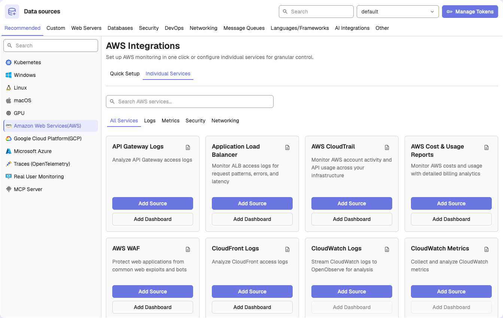

# AWS Monitoring & Cloud Observability Integration

OpenObserve can collect logs, metrics, and events from your AWS services. Use these guides to monitor servers, serverless apps, containers, and other cloud resources in one place. They cover AWS CloudWatch, EC2, Lambda, ECS, RDS, and more.

Each guide shows how to send data from one AWS service. Once the data arrives, you can track the health and speed of your AWS workloads.

## AWS Services Integration Guides

- [Amazon EC2](ec2.md).
- [Application Load Balancer(ALB)](alb.md).
- [Amazon Virtual Private Cloud](vpc-flow.md).
- [Amazon Cognito](cognito.md).
- [AWS Network Firewall](network-firewall.md).
- [AWS Cloudwatch logs](cloudwatch-logs.md).
- [AWS Cloudwatch metrics](cloudwatch-metrics.md).
- [Amazon Relational Database Service (RDS)](rds.md).
- [Amazon Elastic Container Service (ECS)](ecs.md).
- [AWS Route 53](route-53.md).
- [AWS Web Application Firewall (WAF)](waf.md).
- [API Gateway logs](api-gateway.md).
- [Amazon CloudFront](cdn.md).
- [Amazon EventBridge](eventbridge.md).