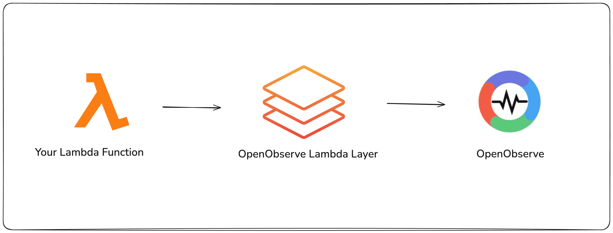
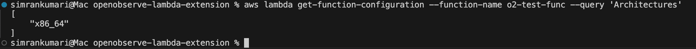
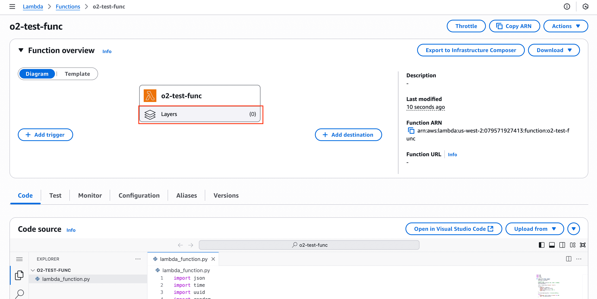
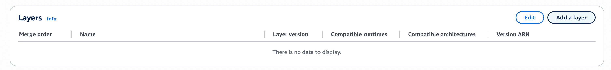
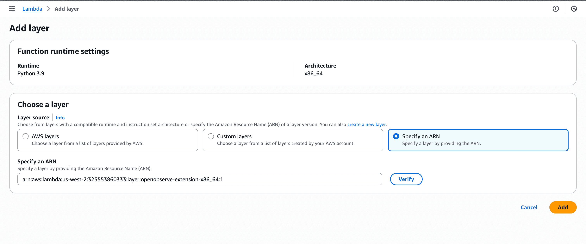
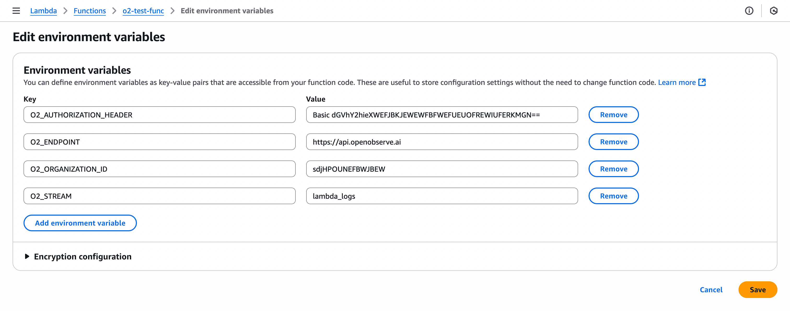
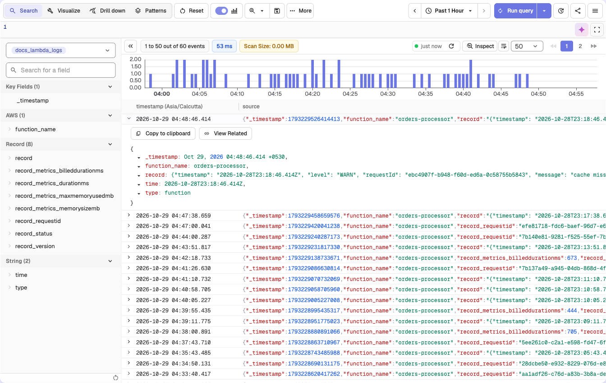
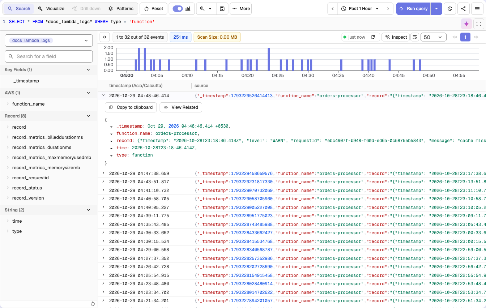

# AWS Lambda Monitoring - Serverless Application Observability

Monitor your AWS Lambda functions by collecting function logs, invocation metrics, and performance data. This guide shows how to stream Lambda logs straight to OpenObserve with the OpenObserve Lambda Extension. The logs skip CloudWatch, which cuts costs and gives you real-time data.

## Overview

The [OpenObserve Lambda Extension](https://github.com/openobserve/openobserve-lambda-extension) runs next to your AWS Lambda function. It forwards the function's logs straight to OpenObserve.
You no longer need to store or process Lambda logs in CloudWatch. Instead, you get log analysis, dashboards, and alerts in one place in OpenObserve.



## Steps to Integrate

:::accordion[Prerequisites]
- An OpenObserve account ([Cloud](https://cloud.openobserve.ai/web/) or [Self-Hosted](../../../getting-started.md#self-hosted-installation)).
- An AWS account with:
    - A Lambda function.
    - IAM permissions to update environment variables and layers.
- The AWS CLI, installed and set up.
:::

:::accordion[Step 1: Check Your Lambda Architecture]
You can check your Lambda architecture using the command:

```
aws lambda get-function-configuration --function-name <function_name> --query 'Architectures'
```

The command returns x86_64 or arm64. Copy the matching ARN for the OpenObserve Lambda Extension layer.

- For x86_64: `arn:aws:lambda:<aws_region_id>:325553860333:layer:openobserve-extension-x86_64:1`
- For arm64: `arn:aws:lambda:<aws_region_id>:325553860333:layer:openobserve-extension-arm64:1`

> Note: Make sure <aws_region_id> matches the region where your Lambda function is deployed. Lambda layers are regional, so an ARN from a different region will not work.
:::

:::accordion[Step 2: Add OpenObserve Lambda Extension Layer]

1. In the AWS Lambda console, open your target function.  

2. Go to **Layers → Add a Layer**.  

3. Choose “Specify an ARN”. Paste the ARN you got in Step 1.

4. Save the changes.  
:::

:::accordion[Step 3: Configure Environment Variables]

1. Go to your Lambda function → Configuration tab → Environment variables.
2. Add these environment variables to your Lambda function:  

| Key                       | Value Example                                |
|---------------------------|----------------------------------------------|
| `O2_ENDPOINT`             | `https://<your-domain>:5080`                 |
| `O2_AUTHORIZATION_HEADER` | `Basic <your-api-key>`                      |
| `O2_ORGANIZATION_ID`      | `<your-org-id>`                              |
| `O2_STREAM`               | `<stream_name>` |

> Note: These are settings for the Lambda extension, not for the OpenObserve server. You can get the endpoint, organization, and `Basic` credentials from the OpenObserve UI. Go to **Data > Data sources > Custom > Logs > OTEL Collector**.



> Security Note: Use AWS Secrets Manager to store credentials like O2_AUTHORIZATION_HEADER securely.
:::

:::accordion[Step 4: Invoke the Function]
Invoke the function to create some logs.
```
aws lambda invoke \
--function-name <function-name>\
response.json
```
:::

:::accordion[Step 5: Verify Logs in OpenObserve]

1. Go to **Logs** in OpenObserve. Select your log stream. 
2. Set a recent time range and click **Run Query**.  
      
3. Use this SQL query to show only logs where type = function:
    ```
    SELECT * FROM "<log-stream>" where type = 'function'
    ```
    
:::


## Troubleshooting

**Not seeing logs in OpenObserve?**

- **Stream mismatch.**  
  Make sure the `O2_STREAM` environment variable matches the stream set in OpenObserve.  

- **Missing or wrong environment variables.**  
  Double-check `O2_ENDPOINT`, `O2_AUTHORIZATION_HEADER`, and `O2_ORGANIZATION_ID`.  

- **Architecture mismatch.**  
  If you use the wrong layer architecture, the function runs but the extension does not load. Check it with `aws lambda get-function-configuration`.  

:::tip[Bypass CloudWatch Logging]

To make sure logs only go to OpenObserve, remove these IAM permissions from the Lambda role:  

- `logs:CreateLogGroup`  
- `logs:CreateLogStream`  
- `logs:PutLogEvents`  
:::


## Next Steps

Once logs are flowing into OpenObserve, you can:  

- **Build [dashboards](../../../user-guide/analytics/dashboards/index.md)** for function latency, memory usage, and errors.  
- **Set up [alerts](../../../user-guide/analytics/alerts/index.md)** for anomalies or failures.  


