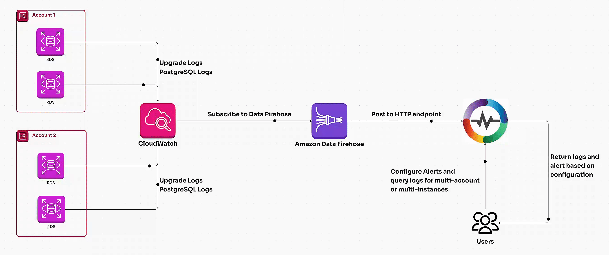
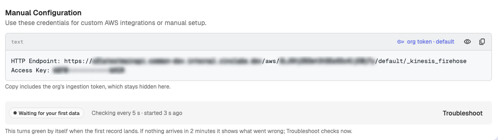
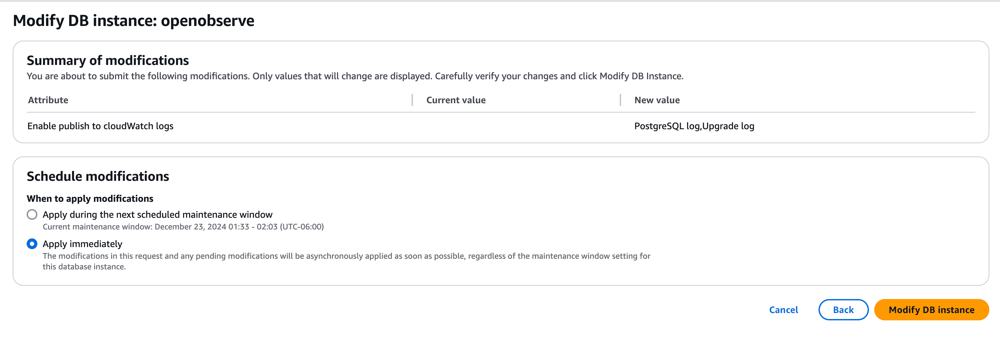
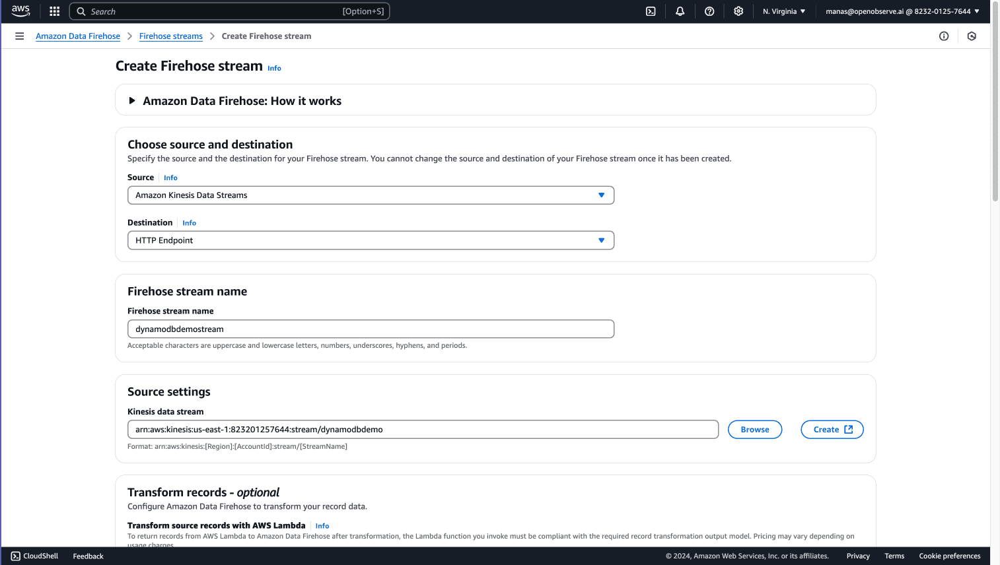
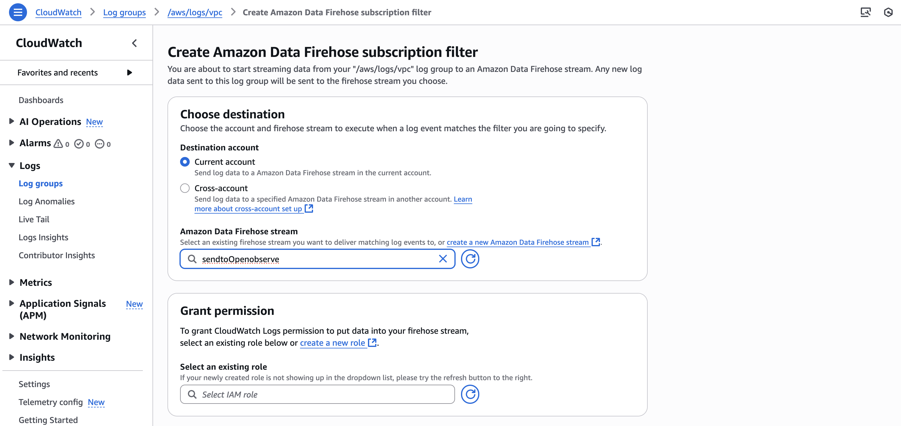
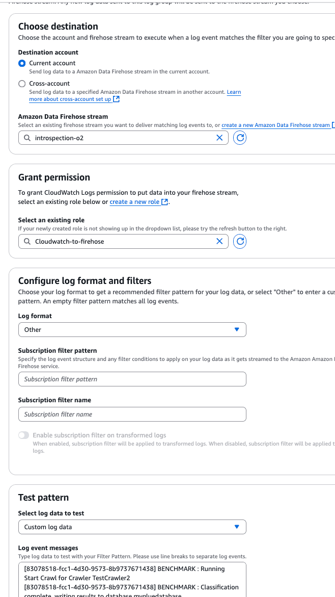
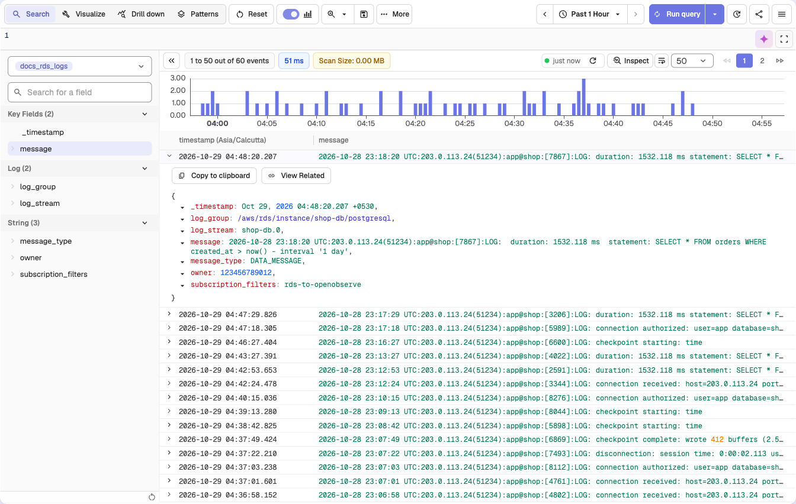

# AWS RDS Database Monitoring - MySQL & PostgreSQL Log Collection

Monitor your Amazon RDS MySQL and PostgreSQL databases with OpenObserve. This guide shows how to stream RDS database logs into OpenObserve. These include slow query logs, general logs, and error logs. The logs travel through CloudWatch Logs and Kinesis Firehose.

## Overview

Amazon RDS can export database logs to CloudWatch Logs. From there, Kinesis Firehose streams them to an OpenObserve HTTP endpoint. You can then watch logs in real time, study database performance, and set alerts on how your database behaves.



## Steps to Integrate

:::accordion[Prerequisites]
- An OpenObserve account ([Cloud](https://cloud.openobserve.ai/web/) or [Self-Hosted](../../../getting-started.md#self-hosted-installation)).
- An Amazon RDS instance with log exports enabled.
- AWS permissions for RDS, CloudWatch Logs, IAM, and Kinesis Firehose.
- An S3 bucket for Firehose backup (recommended).
:::

:::accordion[Step 1: Get OpenObserve Ingestion URL and Access Key]

1. In OpenObserve: go to **Data > Data sources > Recommended > Amazon Web Services(AWS)**. The **Manual Configuration** block shows the HTTP endpoint and Access Key.
2. Copy the ingestion URL and Access Key.



> The endpoint shown ends in `/default/_kinesis_firehose`. Replace `default` with your stream name:
    ```
    https://<your-openobserve-domain>/aws/<org_id>/<stream_name>/_kinesis_firehose
    ```
:::

:::accordion[Step 2: Enable RDS Log Exports]

1. Go to **RDS → Databases → Your DB Instance → Modify**.
2. Scroll to **Log exports**, and enable:
    - `error/mysql`
    - `general/mysql`
    - `slowquery/mysql`
    > Each database engine in Amazon RDS supports different log export options. You'll only see the options your selected engine supports.
3. Save and apply the changes. You can apply them now or during the next maintenance window.


:::

:::accordion[Step 3: Locate RDS Log Groups in CloudWatch]

1. Go to **CloudWatch → Logs → Log groups**.
2. Find a log group like: `/aws/rds/instance/<db-name>/<log_group_name>`.
:::

:::accordion[Step 4: Create a Firehose Delivery Stream]

1. In AWS Kinesis Firehose, create a delivery stream. Set Source to `Direct PUT` and Destination to `HTTP Endpoint`.
2. Enter OpenObserve's HTTP Endpoint URL and Access Key. Set an S3 backup bucket.
3. Give the stream a clear name and create it.


:::

:::accordion[Step 5: Create Log Subscription Filter]

1. In **CloudWatch Logs → Log Groups**, select the RDS log group.
2. Click **Actions → Create subscription filter**.
    
3. Choose:
    - Destination: `Kinesis Firehose`.
    - Delivery stream: select the one you created.
4. Leave the filter pattern blank to capture all logs.
5. Click **Start streaming**.


:::

:::accordion[Step 6: Verify Logs in OpenObserve]

1. Go to **Logs** → select your log stream → Set time range → Click **Run Query**.


:::

:::accordion[Troubleshooting]

**No logs?**

- Check that RDS logs are set up correctly and reaching CloudWatch.
- Confirm the subscription filter is active and points to the correct Firehose stream.
- Make sure the Firehose stream is delivering logs.
- Check the OpenObserve ingestion URL and access key.
- Look in your S3 backup bucket for failed logs.
:::
