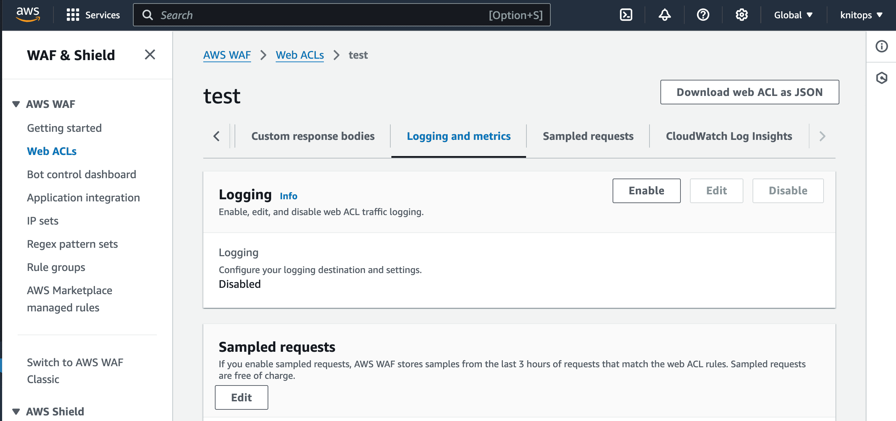
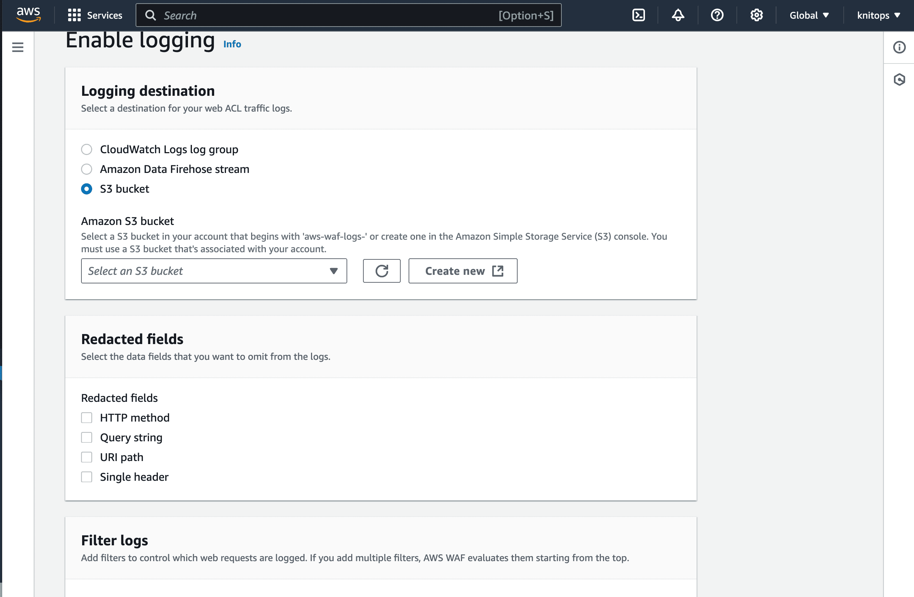
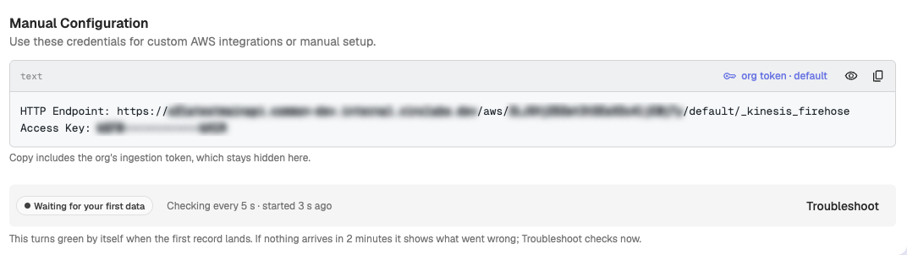
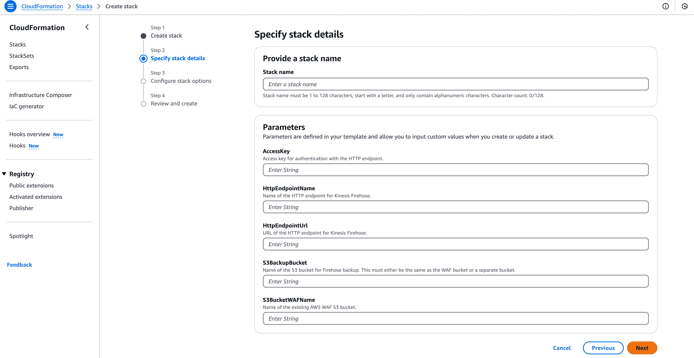
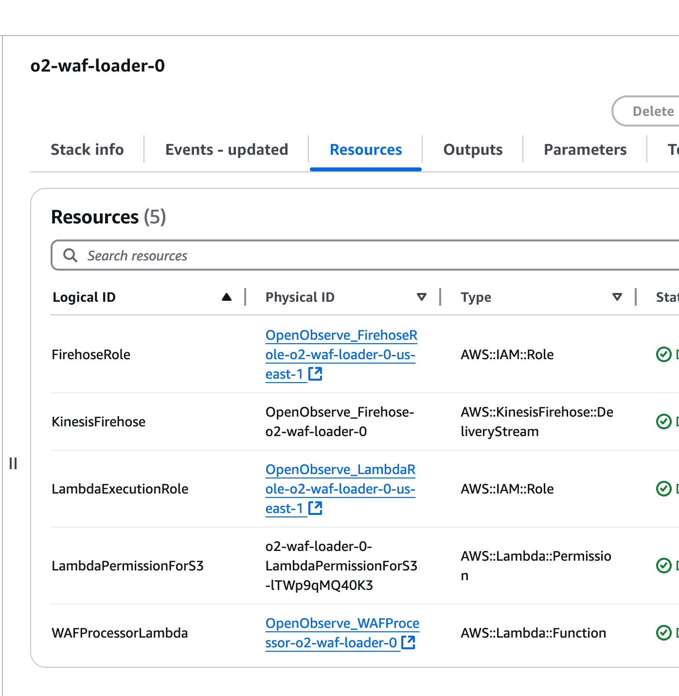
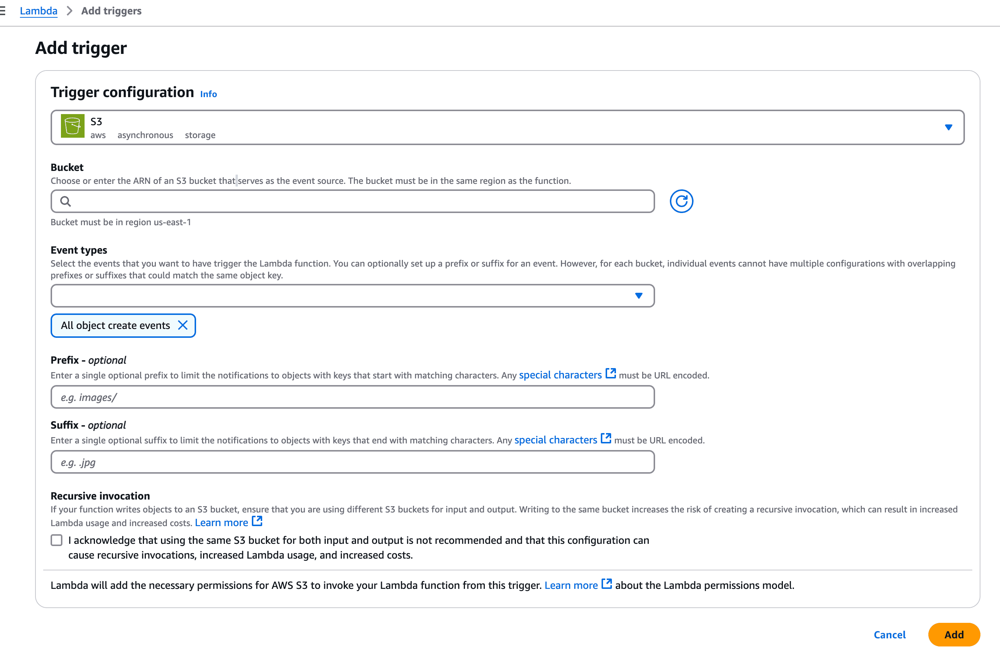
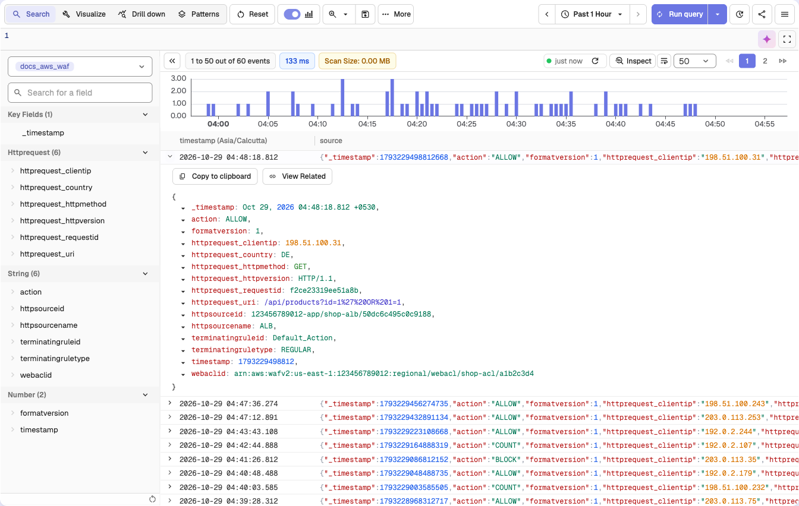

# Integration with AWS WAF via Firehose

This guide shows how to set up AWS WAF to stream logs to OpenObserve. It uses S3, Lambda, and Kinesis Data Firehose.

## Overview

AWS WAF logs record each request checked against your WebACL rules (e.g., `ALLOW`, `BLOCK`, `CAPTCHA` actions). This integration forwards those logs to OpenObserve through Firehose. You can then watch web traffic security and analyze threats in real time.

## Steps to Integrate

:::accordion[Prerequisites]
- An OpenObserve account ([Cloud](https://cloud.openobserve.ai/web/) or [Self-Hosted](../../../getting-started.md#self-hosted-installation)).
- AWS IAM permissions to manage WAF, S3, Lambda, Kinesis Firehose, and CloudFormation.
- An existing AWS WAF WebACL attached to CloudFront, ALB, or API Gateway.
- An S3 bucket to receive WAF logs.
:::

:::accordion[Step 1: Enable WAF Logging to S3]

1. Go to **AWS Console → WAF & Shield**.
2. Select the WebACL you want to log.
3. In the sidebar, click **Logging and metrics → Enable logging**.
    

4. Choose your target S3 bucket. It must be in the same region as the WebACL.

    

> Make sure your S3 bucket has proper permissions to receive logs from AWS WAF.
:::

:::accordion[Step 2: Get OpenObserve Ingestion URL and Access Key]

1. In OpenObserve: go to **Data > Data sources > Recommended > Amazon Web Services(AWS)**. The **Manual Configuration** block shows the HTTP endpoint and Access Key.
2. Copy the HTTP ingestion URL and Access Key.

    

> Example ingestion URL:
> ```
> https://<your-openobserve-domain>/aws/<org_id>/<stream_name>/_kinesis_firehose
> ```
:::

:::accordion[Step 3: Deploy CloudFormation Stack to Set Up Lambda and Firehose]

1. Use the [CloudFormation template](https://github.com/openobserve/cloudformation-templates/blob/main/aws_waf/cloudformation_waf.yaml) from Openobserve Template Repository.
2. Go to **CloudFormation → Create Stack → With new resources (standard)**.
3. Upload the template file.
4. Set these parameters:
    - **OpenObserve Ingestion URL** (the Firehose endpoint from Step 2).
    - **Access Key**.
    - **Source S3 Bucket (WAF Logs)**.
    - **Backup S3 Bucket (Optional)**.
    
5. Finish creating the stack.
6. Check that the IAM roles, Lambda function, Kinesis Firehose, and S3 settings were created.
    

> NOTE: Due to AWS limits, you must add the S3 trigger for Lambda by hand after you create the stack.


:::


:::accordion[Step 4: Verify Log Ingestion in OpenObserve]

1. Go to **OpenObserve → Logs**.
2. Select your stream and click **Run Query**.



> You can also import a [sample AWS WAF dashboard JSON](https://github.com/openobserve/dashboards/tree/main/AWS_WAF) from **Dashboards > Import > Custom**. It charts top IPs, blocked requests, and more.
:::

:::accordion[Troubleshooting]

- No logs visible in OpenObserve.  
    - Confirm that WAF logging is on and logs are being written to the S3 bucket.  
    - Check Lambda logs in **CloudWatch** for errors.  
    - Make sure the Firehose stream is active and the endpoint and credentials are correct.

- CloudFormation stack fails.  
    - Review the error messages. Common issues are invalid S3 bucket names or missing permissions.  
    - Make sure the IAM roles for Lambda and Firehose were created.

- Firehose shows delivery errors.  
    - Check that your OpenObserve ingestion URL includes the correct stream.  
    - Check that your access key is correct.  
    - Confirm that the HTTP endpoint is reachable and accepts Firehose POST requests.
:::


