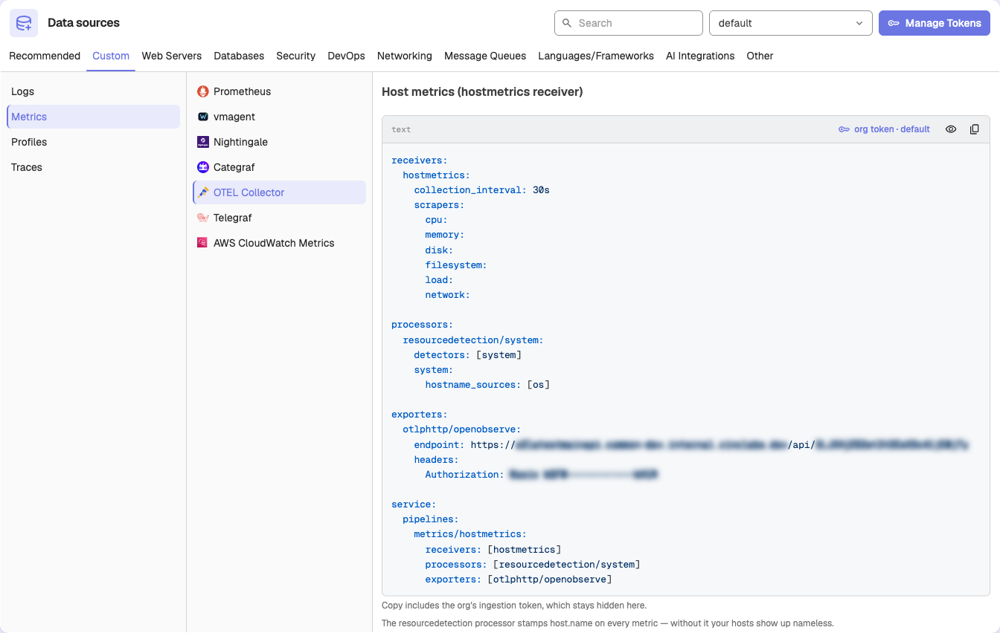
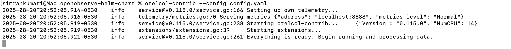
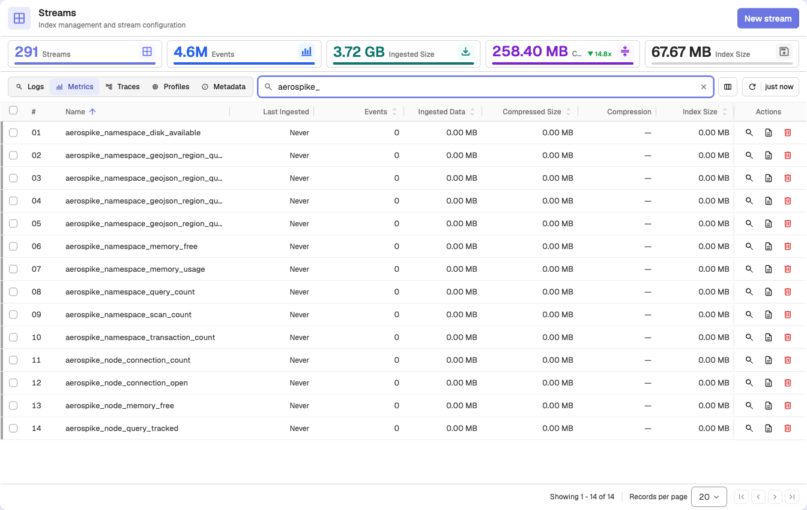
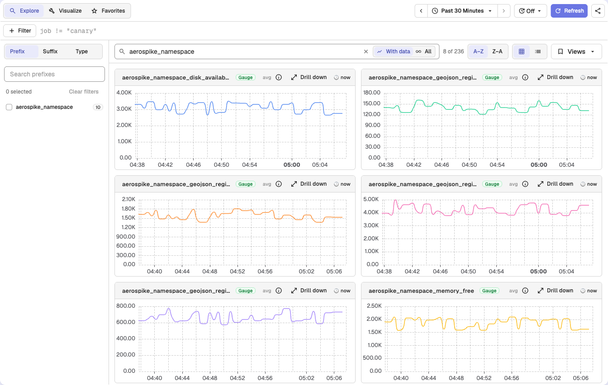

# Aerospike Integration with OpenObserve

This guide provides step-by-step instructions to collect and monitor Aerospike metrics using OpenTelemetry Collector and forward them to OpenObserve.

## Overview

Aerospike is a high-performance, distributed database designed for **low-latency, real-time data processing**. 
By integrating **Aerospike with OpenTelemetry and OpenObserve**, you can: 

- Detect performance bottlenecks  
- Gain insights into resource usage  
- Monitor database health and metrics in real time  

## Steps to Integrate

:::accordion[Prerequisites]
- Running **Aerospike instance(s)**  
- OpenObserve account ([Cloud](https://cloud.openobserve.ai/web/) or [Self-Hosted](../../getting-started.md#self-hosted-installation))  
:::

:::accordion[Step 1: Install OpenTelemetry Collector Contrib]

Download and install the latest release of `otelcol-contrib`:

```bash
curl --proto '=https' --tlsv1.2 -fOL https://github.com/open-telemetry/opentelemetry-collector-releases/releases/download/v0.115.1/otelcol-contrib_0.115.1_darwin_arm64.tar.gz
tar -xvf otelcol-contrib_0.115.1_darwin_arm64.tar.gz
sudo mv otelcol-contrib /usr/local/bin/
otelcol-contrib --version
```

> Replace `v0.115.1` with the latest version for your OS/architecture.
:::

:::accordion[Step 2: Configure the Collector]

Create a file named `config.yaml` with the following configuration:

```yaml
receivers:
  aerospike:
    endpoint: "localhost:3000"

processors:
  batch:
    send_batch_size: 10000
    send_batch_max_size: 11000
    timeout: 10s

exporters:
  otlphttp/openobserve:
    endpoint: https://<your-openobserve-endpoint>/api/<org_id>
    headers:
      Authorization: Basic <your_auth_token>
      stream-name: default

service:
  pipelines:
    metrics:
      receivers: [aerospike]
      processors: [batch]
      exporters: [otlphttp/openobserve]
```

Replace `<your-openobserve-endpoint>`, `<org_id>` and `<your_auth_token>` with your OpenObserve details.


:::


:::accordion[Step 3: Run the Collector]

Start the Collector with your configuration:

```bash
otelcol-contrib --config /path/to/config.yaml
```


:::

:::accordion[Step 4: Visualize in OpenObserve]

1. Open **Data > Streams** in OpenObserve and select your metrics stream.  
     
2. Explore the metrics, run queries , create dashboards for insights
      
:::


## Troubleshooting

:::accordion[Collector not starting]
- Check the logs for misconfigurations:

```bash
journalctl -u otel-collector -f
```
:::

:::accordion[No metrics in OpenObserve]

- Verify Aerospike is running: systemctl status aerospike
- Check if the Aerospike receiver is binding to the correct port (default: 3000).
- Confirm the `Authorization` and `stream-name` values in the exporter are correct.
:::