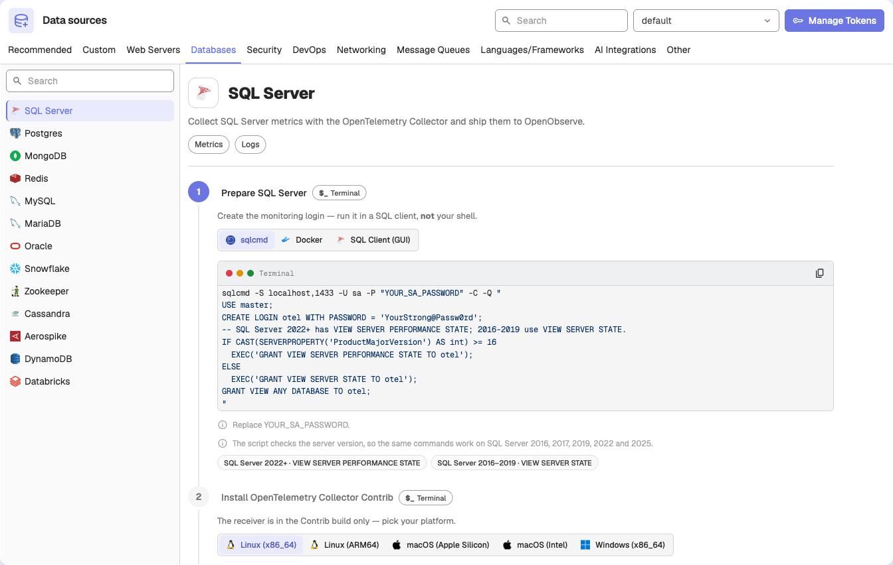

# Database Monitoring & Performance Integration

These guides show how to send database metrics, logs, and performance data to OpenObserve. They cover SQL databases such as MySQL, PostgreSQL, and Oracle. They also cover NoSQL databases such as MongoDB, Redis, Cassandra, and DynamoDB.

Use these integrations to track database health, speed, and slow queries. You see all of it in one place.

## Database Integration Guides

Pick your database to open its guide.

- [PostgreSQL](postgresql.md)
- [Oracle Database](oracle.md)
- [Snowflake](snowflake.md)
- [MySQL](mysql.md)
- [MongoDB](mongodb.md)
- [Redis](redis.md)
- [Amazon DynamoDB](dynamodb.md)
- [Apache Zookeeper](zookeeper.md)
- [Cassandra](cassandra.md)
- [Aerospike](aerospike.md)