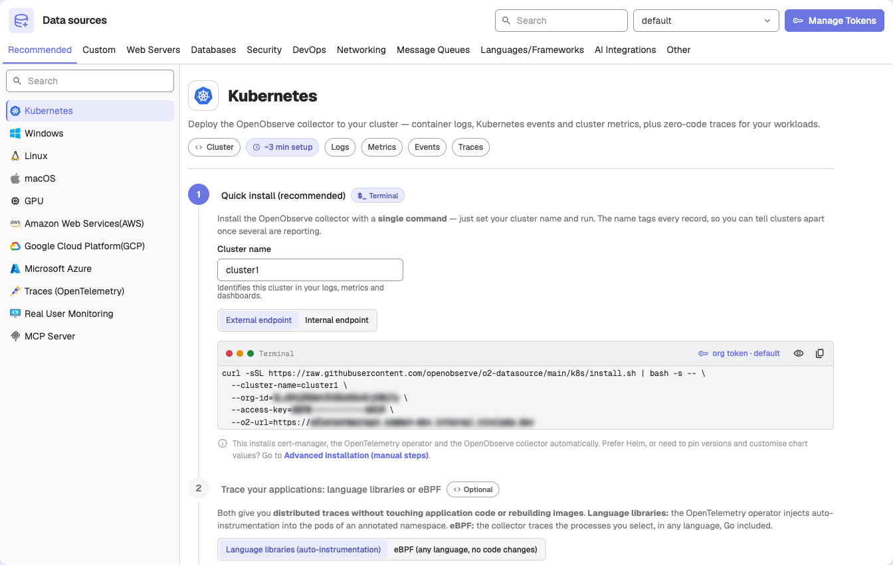

# Monitoring Integrations - Cloud, Infrastructure, AI & Application Observability

These guides show how to send logs, metrics, and traces to OpenObserve. Sources include cloud platforms, servers, databases, AI frameworks, and apps. You can monitor your whole stack in one place.

For example, you can monitor Kubernetes clusters and AWS services. You can trace LLM providers ([OpenAI](ai/providers/openai.md), [Anthropic](ai/providers/anthropic.md), [Gemini](ai/providers/google-gemini.md)) and AI frameworks ([LangChain](ai/frameworks/langchain.md), [CrewAI](ai/frameworks/crewai.md), [LlamaIndex](ai/frameworks/llamaindex.md)). You can also watch databases ([MySQL](database/mysql.md), [PostgreSQL](database/postgresql.md), [MongoDB](database/mongodb.md)), message brokers ([Kafka](message-brokers/kafka.md)), web servers ([NGINX](servers/nginx.md)), and more.

## Available Integration Guides

Pick a category below to find the guide for your tool.

### AI & LLM Observability

- [AI Frameworks](ai/frameworks/index.md): Trace [LangChain](ai/frameworks/langchain.md), [CrewAI](ai/frameworks/crewai.md), [LlamaIndex](ai/frameworks/llamaindex.md), [AutoGen](ai/frameworks/autogen.md), and 30+ more.
- [LLM Providers](ai/providers/index.md): Trace [OpenAI](ai/providers/openai.md), [Anthropic](ai/providers/anthropic.md), [Gemini](ai/providers/google-gemini.md), [Mistral](ai/providers/mistral.md), [Ollama](ai/providers/ollama.md), and more.
- [AI Gateways](ai/gateways/index.md): Monitor [Portkey](ai/gateways/portkey.md), [LiteLLM Proxy](ai/gateways/litellm-proxy.md), [OpenRouter](ai/gateways/openrouter.md), [Kong AI Gateway](ai/gateways/kong-gateway.md), and more.
- [No-Code AI Tools](ai/no-code/index.md): Monitor [n8n](ai/no-code/n8n.md), [Flowise](ai/no-code/flowise.md), [LangFlow](ai/no-code/langflow.md), [OpenWebUI](ai/no-code/openwebui.md), and more.
- [AI Developer Tools](ai/tools/index.md): Connect [Promptfoo](ai/tools/promptfoo.md), [Milvus](ai/tools/milvus.md), [Firecrawl](ai/tools/firecrawl.md), [PostHog](ai/tools/posthog.md), and more.
- [Model Context Protocol (MCP)](ai/mcp/index.md): Query OpenObserve from AI agents and IDEs.

### Cloud

- [AWS](cloud/aws/index.md)
- [GCP](cloud/gcp/index.md)
- [Azure](cloud/azure/index.md)
- [Cloudflare](cloud/cloudflare.md)
- [Vercel](cloud/vercel.md)
- [Heroku](cloud/heroku.md)

### Infrastructure & Systems

- [Kubernetes](system/k8s.md)
- [Linux](system/linux.md)
- [Windows](system/windows.md)
- [Servers](servers/index.md)

### Databases

- [Database Integrations](database/index.md): Monitor [MySQL](database/mysql.md), [PostgreSQL](database/postgresql.md), [MongoDB](database/mongodb.md), [Redis](database/redis.md), and more.

### DevOps & CI/CD

- [DevOps Integrations](devops/index.md): Monitor [Jenkins](devops/jenkins.md), [Ansible](devops/ansible.md), [Terraform](devops/terraform.md), and [GitHub Actions](devops/github-actions.md).

### Messaging & Data Pipelines

- [Message Brokers](message-brokers/index.md): Monitor [Kafka](message-brokers/kafka.md), [RabbitMQ](message-brokers/rabbitmq.md), and [NATS](message-brokers/nats.md).

### Security

- [Security Integrations](security/index.md)