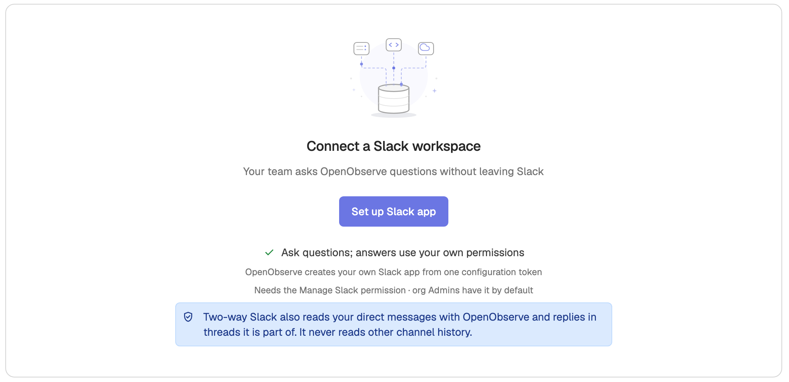
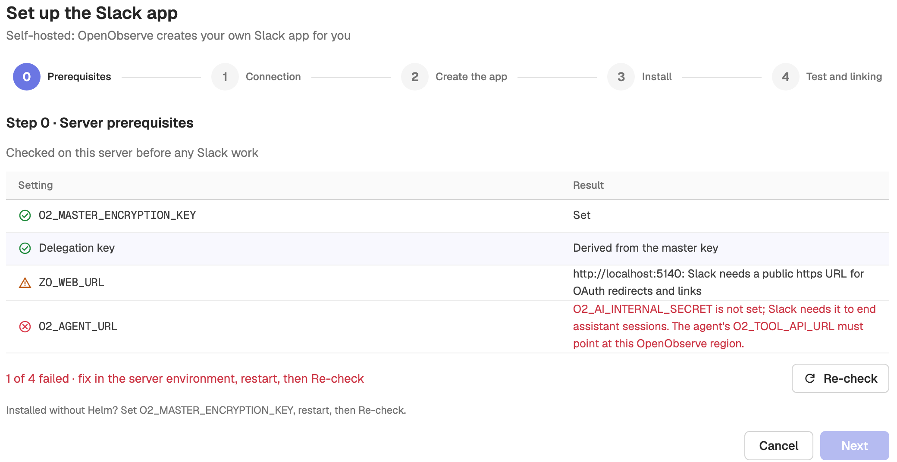

# Slack Integration

The two-way Slack app brings OpenObserve into your Slack workspace. People link their Slack account to their OpenObserve account once, then ask questions about your data from Slack. Answers are read-only and use each person's own OpenObserve permissions. Admins install the app, decide how people are linked, set channel defaults, and manage access from **Settings > Slack**.

Slack webhook alert destinations you already have keep working when you add the app. To send alert notifications to Slack, see [Alert Destinations](../user-guide/account-administration/management/alert-destinations.md).

## Availability

The Slack app is an OpenObserve Enterprise feature and is **off by default**. It turns on only when all of the following hold:

- `O2_SLACK_ENABLED` is set to `true`.
- A master encryption key (`O2_MASTER_ENCRYPTION_KEY`) is set and active, so Slack tokens are stored encrypted.
- The instance is not a super cluster.

Until then no Slack tasks start and the Slack API routes return `404`. The setting is global; there is no per-organization switch. Turning it on or off needs a restart.

:::note[Rollback]
To disable Slack again, set `O2_SLACK_ENABLED=false` and restart. Rolling the binary back across the Slack table migration is not supported.
:::

## Install the app

Installing needs the **Manage Slack** permission, which organization Admins have by default. Open **Settings > Slack** and connect a workspace. The flow depends on your deployment:

- **Cloud**: click **Add to Slack**. Slack opens in a popup, where you pick a channel for alerts and click **Allow**.
- **Self-hosted**: click **Set up Slack app**. A wizard creates your own Slack app in five steps: **Prerequisites**, **Connection**, **Create the app**, **Install**, and **Test and linking**.

### Self-hosted setup wizard

1. **Prerequisites** (**Step 0 · Server prerequisites**) checks the server before any Slack work. Each row shows a pass, warning, or failure, with the environment variable to fix. After you change the environment and restart OpenObserve, click **Re-check**. **Next** stays disabled until no check fails.
    - `O2_MASTER_ENCRYPTION_KEY` is set and active.
    - **Delegation key**: derived from the master key, or set with `ZO_DELEGATION_SIGNING_KEY`.
    - `ZO_WEB_URL` is a public HTTPS URL, which Slack needs for OAuth redirects and account links. An `http://` or `localhost` URL shows a warning.
    - `O2_AGENT_URL`: the AI assistant answers, and `O2_AI_INTERNAL_SECRET` is set.

    

2. **Connection** checks that the server can reach Slack, through `HTTPS_PROXY` and any extra CA bundle set in `O2_SLACK_CA_BUNDLE_PATH`.
3. **Create the app** asks for a **Connection mode**:
    - **Socket Mode** (recommended): OpenObserve opens the connection, so Slack needs no public URL.
    - **HTTP**: Slack calls your public URL. It needs one **Verify** click in Slack.

    Paste an app configuration refresh token (`xoxe-…`) from Slack's **Your App Configuration Tokens** and OpenObserve creates the app from its manifest. Or choose **Set up manually** to open Slack with the manifest pre-filled, then enter the app's client ID, client secret, signing secret, and, for Socket Mode, app-level token.
4. **Install** opens Slack's install screen; click **Allow in Slack**.
5. **Test and linking** runs connection checks and **Test Sign in with Slack**.

### Manage an installed workspace

Once installed, the workspace appears as a card with its connection mode, health status, and the organizations connected to it. From the card you can **Test connection**, **Update credentials**, **Reinstall**, set a **Help contact** that Slack replies name when someone lacks access, **Disconnect this org**, or **Uninstall from workspace**. Disconnecting stops Slack for one organization only. Uninstalling removes the app for every connected organization, needs Admin in each of them, and everyone must link again.

## Link accounts

A Slack user must link their OpenObserve account before they can ask questions. The **Linking** section controls how that happens:

- **Link people automatically**: Slack members with a confirmed email on the listed **Domains** are linked to the OpenObserve user with the same email. Only your company's own domains are accepted; public email domains such as `gmail.com` are rejected. If your organization has a domain mapping, those domains are used and are read-only here.
- **Sign in with Slack**: when linking is off, or a person's email does not match, they click **Link your account** in Slack the first time they ask, and confirm their identity with Slack. Links work once and expire after 30 minutes.
- **Link all matches**: links every Slack member who matches an OpenObserve user but joined before automatic linking was turned on. Each person gets one direct message.

The section shows how many people were linked automatically and how many with **Link your account**. The **Linked people** table lists each link with the method (**Email match**, **Sign in with Slack**, or **Link all**), and lets you **Unlink** a person. People removed from OpenObserve or Slack lose their link within an hour.

Each user can also see and unlink their own Slack links from **Linked accounts** in the user menu at the top right.

## Ask OpenObserve from Slack

Once linked, people ask questions in several ways:

- **`/o2 ask <question>`**: ask privately; the answer arrives in your direct messages.
- **Mention `@OpenObserve` in a channel**: the answer is posted in the message thread.
- **App Home**: the app's **Home** tab shows how your account is linked, an **Unlink** button, and example questions you can ask in one click.

When you belong to several organizations, OpenObserve picks the one that answers in this order: an `in:<org>` word in the question, an OpenObserve link in the question, the thread's organization, an OpenObserve link shared in the thread, the channel default, then your personal default organization. Use **Re-ask in** on an answer to ask the same question in another organization.

Other slash commands:

- **`/o2 org [name]`**: show your default organization, or set it to `name`. It never changes the organization of an existing thread.
- **`/o2 link`** and **`/o2 unlink`**: link or unlink your account.
- **`/o2 help`**: list every command and your link status.

## Configure channels

The **Channel defaults** table sets, per channel, which organization answers when nothing in the question or thread names one, and where answers go:

- **In thread**: the answer is posted in the channel thread.
- **Private only**: the answer is sent by direct message instead.

Questions in a channel without a default go to the earliest connected organization. Private channels appear in the channel picker after you `/invite @OpenObserve` to them.

## Instance workspace (self-hosted)

On a self-hosted instance, an Admin of the `_meta` organization can install a single **instance workspace** that serves every organization on the server, or only selected ones. The **Organizations** section on the `_meta` **Settings > Slack** page controls this: choose **All organizations** (including organizations created later) or **Selected organizations**. `_meta` is always included. Each organization's Admin then maps its own channels and alert destinations.

When you remove an organization from the instance workspace, its channel defaults are removed, its linked people move to another organization they belong to or are unlinked, and its open threads get no more answers. Its alert destinations are not changed.

## Permissions

Access to the Slack settings uses the same role-based access control as the rest of OpenObserve, through the `slack_integration` OpenFGA type. Reading maps to **LIST**, changes to **PUT**, and deletes to **DELETE**. When OpenFGA is disabled, an organization Admin is required.

## Configuration

| Environment variable | Default | Purpose |
| --- | --- | --- |
| `O2_SLACK_ENABLED` | `false` | Enable the two-way Slack app. Requires `O2_MASTER_ENCRYPTION_KEY`. |
| `O2_SLACK_CA_BUNDLE_PATH` | *(empty)* | Extra PEM root certificates for Slack calls, for proxies that re-sign TLS. |
| `O2_SLACK_THREAD_TTL_DAYS` | `7` | Days a Slack thread keeps its assistant session after its last activity. |
| `O2_SLACK_SOCKETS_PER_INSTALL` | `2` | Socket Mode connections per installation. |
| `O2_SLACK_STATUS_INTERVAL_MS` | `3000` | Minimum gap between progress edits of a Slack answer, in milliseconds. |
| `O2_SLACK_SIGNING_SECRET` | *(empty)* | Signing secret of the Cloud Slack app; verifies Slack's HTTP requests. |

## Deploy order

Because Slack depends on both OpenObserve and the AI assistant, deploy in this order:

1. Deploy OpenObserve and OpenObserve Enterprise with Slack off.
2. Deploy the AI assistant, with `O2_INTERNAL_API_SECRET` equal to `O2_AI_INTERNAL_SECRET`.
3. Turn Slack on only after both are deployed. On Cloud, enable it only in the region the Slack app's Request URLs point at.
