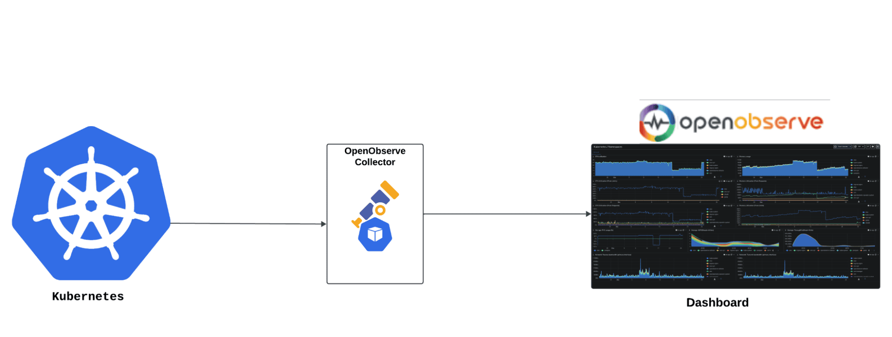
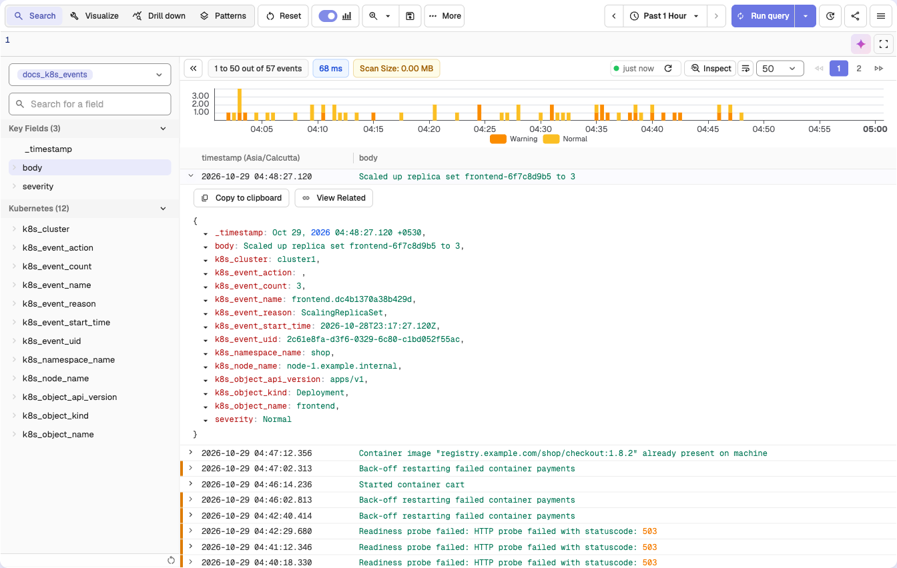
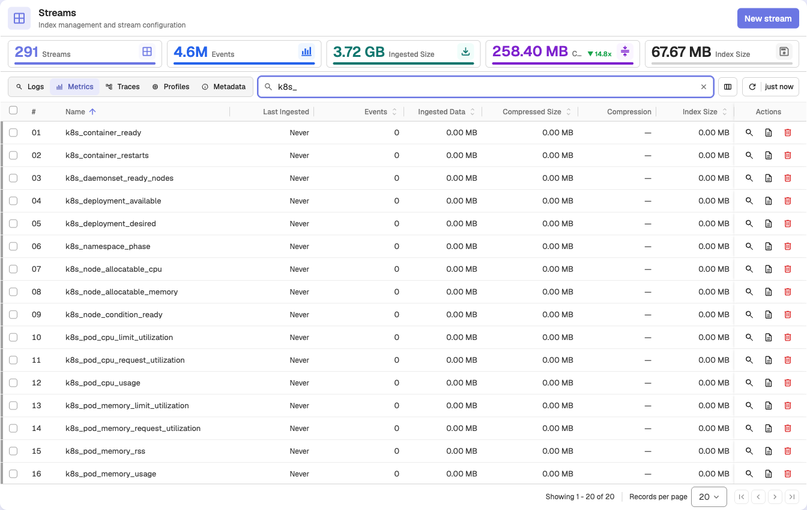
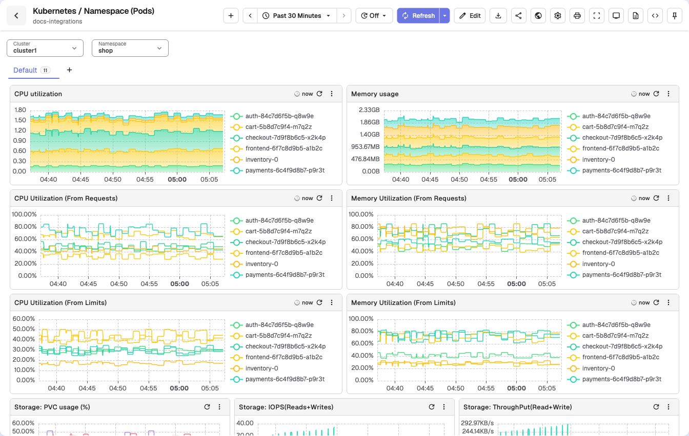

# Kubernetes Monitoring - K8s Cluster & Container Observability

Monitor Kubernetes clusters with comprehensive Kubernetes monitoring for K8s cluster monitoring, container monitoring, pod metrics, and microservices observability. This guide provides step-by-step instructions to integrate Kubernetes monitoring with **OpenObserve** for complete Kubernetes observability, container logs, and K8s metrics collection.

## Overview

Kubernetes monitoring differs from traditional server-based monitoring. Kubernetes cluster monitoring requires insights into **pods, containers, services, microservices interactions, Kubernetes events, container logs, and distributed traces** for effective K8s monitoring.

OpenTelemetry provides a unified way to collect Kubernetes telemetry data, and OpenObserve makes it easy to ingest, store, visualize, and analyze Kubernetes metrics, logs, and traces for comprehensive Kubernetes monitoring and container observability with minimal setup.  



The integration includes:

- **Metrics**: CPU, memory, storage, and network usage across nodes and pods  
- **Logs**: Container logs for troubleshooting  
- **Events**: Kubernetes system events with severity levels  
- **Traces**: Auto-instrumented application traces without heavy manual changes  

## Steps to Integrate

:::accordion[Prerequisites]
- A Kubernetes cluster (Minikube, GKE, EKS, or similar)  
- Helm 3.x installed locally  
- `kubectl` configured for your cluster  
- OpenObserve account ([Cloud](https://cloud.openobserve.ai/web/) or [Self-Hosted](../../getting-started.md#self-hosted-installation))
:::


:::accordion[Step 1: Install Cert-Manager]

Cert-Manager manages TLS certificates in Kubernetes and is required by the OpenTelemetry Operator.  

```bash
kubectl apply -f https://github.com/cert-manager/cert-manager/releases/download/v1.19.0/cert-manager.yaml
kubectl wait --for=condition=Available --timeout=300s \
  -n cert-manager deployment/cert-manager-webhook
```
> The `kubectl wait` command returns once the cert-manager webhook is ready.
:::


:::accordion[Step 2: Add the OpenObserve Helm Repository]

```bash
helm repo add openobserve https://charts.openobserve.ai
helm repo update
```

This makes OpenObserve components available for deployment.
:::


:::accordion[Step 3: Install Prometheus Operator CRDs]

These CRDs are required by the OpenTelemetry Operator for metrics collection.

```bash
kubectl create -f https://raw.githubusercontent.com/prometheus-operator/prometheus-operator/main/example/prometheus-operator-crd/monitoring.coreos.com_servicemonitors.yaml
kubectl create -f https://raw.githubusercontent.com/prometheus-operator/prometheus-operator/main/example/prometheus-operator-crd/monitoring.coreos.com_podmonitors.yaml
kubectl create -f https://raw.githubusercontent.com/prometheus-operator/prometheus-operator/refs/heads/main/example/prometheus-operator-crd/monitoring.coreos.com_scrapeconfigs.yaml
kubectl create -f https://raw.githubusercontent.com/prometheus-operator/prometheus-operator/refs/heads/main/example/prometheus-operator-crd/monitoring.coreos.com_probes.yaml
```
:::


:::accordion[Step 4: Install the OpenTelemetry Operator]

```bash
kubectl apply -f https://raw.githubusercontent.com/openobserve/openobserve-helm-chart/refs/heads/main/opentelemetry-operator.yaml
```

The operator manages the OpenTelemetry Collector and CRDs for telemetry pipelines.
:::


:::accordion[Step 5: Create Namespace for OpenObserve Collector]

```bash
kubectl create ns openobserve-collector
```
:::

:::accordion[ Step 6: Deploy OpenObserve Collector with Helm]

> Use the **pre-filled command** from OpenObserve, which includes your organization and auth token: go to **Data > Data sources > Recommended > Kubernetes** and copy it. That page also offers a one-line quick-install script.

Install the OpenObserve Collector in your cluster:

```bash
helm --namespace openobserve-collector \
install o2c openobserve/openobserve-collector \
--set k8sCluster=cluster1  \
--set exporters."otlphttp/openobserve".endpoint=<O2_ENDPOINT>/api/<org_id> \
--set exporters."otlphttp/openobserve".headers.Authorization="Basic <BASE64_AUTH>" \
--set exporters."otlphttp/openobserve_k8s_events".endpoint=<O2_ENDPOINT>/api/<org_id> \
--set exporters."otlphttp/openobserve_k8s_events".headers.Authorization="Basic <BASE64_AUTH>" \
--create-namespace
```

Replace `<O2_ENDPOINT>` depending on your setup:

| Setup             | Endpoint                                                                           |
| ----------------- | ---------------------------------------------------------------------------------- |
| Local OpenObserve | `http://localhost:5080`                                                            |
| In-cluster O2     | `http://<helm-release-name>-openobserve-router.<namespace>.svc.cluster.local:5080` |

This deployment configures the OpenObserve Collector to:

- Collect metrics from your cluster
- Collect events from your cluster
- Collect logs from your cluster
- Enable auto-instrumentation traces
:::

:::accordion[Step 7: Auto-Instrumentation for Traces]

OpenTelemetry supports automatic application instrumentation. Add annotations to your pods or namespaces:

-  Java : 
    ```
    instrumentation.opentelemetry.io/inject-java: "openobserve-collector/openobserve-java"
    ```
- .NET
    ```
    instrumentation.opentelemetry.io/inject-dotnet: "openobserve-collector/openobserve-dotnet"
    ```
-  NodeJS
    ```
    instrumentation.opentelemetry.io/inject-nodejs: "openobserve-collector/openobserve-nodejs"
    ```
- Python
    ```
    instrumentation.opentelemetry.io/inject-python: "openobserve-collector/openobserve-python"
    ```
- Go (eBPF)
    ```
    instrumentation.opentelemetry.io/inject-go: "openobserve-collector/openobserve-go"
    instrumentation.opentelemetry.io/otel-go-auto-target-exe: "/path/to/container/executable"
    ```
:::

:::accordion[Step 8: Verify logs in OpenObserve]

1. Go to **Logs** in OpenObserve → select the `k8s_events` stream → set the **time range** → **Run Query** to check for Kubernetes events.
    
2. Go to **Data > Streams** and filter by metrics to find the Kubernetes metrics streams
    
:::


:::tip[Pre-Built Dashboards]
You can import dashboards from the [OpenObserve community repository](https://github.com/openobserve/dashboards/tree/main/Kubernetes(openobserve-collector)) with **Dashboards > Import > Custom** for quick insights:

* **Namespace (Pods) Dashboard** – resource consumption by pods  
* **Namespaces Dashboard** – cluster-wide resource allocation  
* **Events Dashboard** – system events and severities  
* **Node (Pods) Dashboard** – node-level pod performance  


:::


## Troubleshooting

**Collector pods not running**

* Check namespace: `kubectl get pods -n openobserve-collector`
* Review pod logs: `kubectl logs <pod-name> -n openobserve-collector`

**No data in OpenObserve**

* Verify Helm values include the correct OpenObserve URL and auth token
* Ensure network connectivity from cluster → OpenObserve endpoint

**Auto-instrumentation not working**

* Confirm pod annotations are applied
* Make sure language-specific auto-instrumentation images are available

