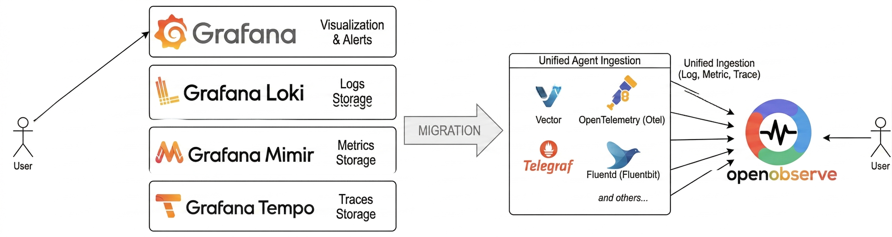
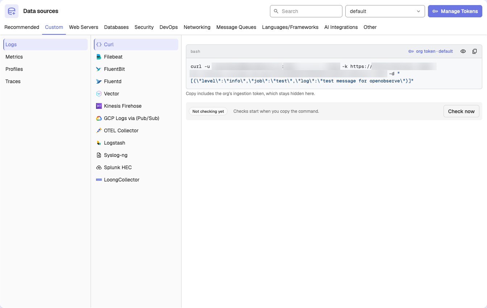

# Migrate from Grafana (LGTM Stack) to OpenObserve

Many teams run their observability stack on LGTM. That means Loki for logs, Grafana for dashboards, Tempo for traces, and Mimir (or Prometheus) for metrics. If you want to move to OpenObserve, this guide walks you through the whole migration. It goes signal by signal and data source by data source.

## Table of Contents

1. [Overview](index.md): Why migrate and what changes.
2. [Architecture & Terminology](architecture.md): How the stack maps across.
3. [Migrating Metrics](metrics.md): Move from Mimir or Prometheus remote write.
4. [Migrating Traces](traces.md): Move from Tempo.
5. [Migrating Logs](logs.md): Move from Loki.
6. [Migrating Dashboards & Alerts](dashboards-and-alerts.md): Move Grafana dashboards and Alertmanager rules.

---

## Why Migrate?

The LGTM stack is a solid observability setup. But running it means you operate 4–6 separate distributed systems. Each has its own storage, scaling model, config format, and upgrade cycle. Over time, that work adds up.

### Multiple systems, multiple problems

Each component in the LGTM stack is its own distributed system:

- **Loki:** Stores logs in chunks with a custom index.
- **Mimir:** A horizontally-scaled Prometheus backend with its own series cardinality model.
- **Tempo:** Uses a completely different storage layout for traces.

Each one needs its own capacity planning, tuning, and monitoring. Yes, you need to monitor your monitoring. When something breaks at 3am, you need to know which of four systems is the culprit.

### Storage fragmentation

Your logs, metrics, and traces live in three different backends. To link data across signals, you must switch query languages:

| Signal | Query Language |
|---|---|
| Logs | LogQL |
| Metrics | PromQL |
| Traces | TraceQL |

You can jump from a log line to its trace and then to the related metric spike. But it is clunky. Each step has a different UI, a different syntax, and a different mental model.

### Scaling is per-component

Each system scales in a completely different way:

- **Loki:** Bottlenecks on ingestion streams and chunk storage.
- **Mimir:** Bottlenecks on series cardinality and query concurrency.
- **Tempo:** Bottlenecks on trace storage and block compaction.

You end up as an unwilling expert in four different distributed systems.

## What OpenObserve Changes

OpenObserve replaces the separate systems with one. The table below compares the two setups.

| | LGTM Stack | OpenObserve |
|---|---|---|
| **Components to run** | 4–6 (Loki + Mimir + Tempo + Grafana + Alloy + object storage) | 1 binary or 1 Helm chart |
| **Storage backends** | Separate per signal | Single unified store (local disk, S3, GCS, Azure Blob) |
| **Storage cost** | High — separate storage per signal | Up to 140x lower storage costs |
| **Query languages** | LogQL + PromQL + TraceQL | SQL + PromQL (for metrics) |
| **Built-in visualization** | No — Grafana is a separate deployment | Yes — UI included |
| **OpenTelemetry support** | Requires per-component config | Native single OTLP endpoint for all signals |
| **Operational complexity** | High — each component has its own failure modes | Low — one system to monitor, upgrade, and scale |

## Before You Start

Before changing any configs, note what you're running:

- **Data sources:** What is sending data? Examples include OTel Collector, Prometheus, Grafana Agent/Alloy, Telegraf, Fluent Bit, Vector, app SDKs, and cloud integrations.
- **Active signals:** Which signals are in use? For example: metrics to Mimir, logs to Loki, and traces to Tempo.

## Set Up OpenObserve

Before you migrate each signal, get OpenObserve running:

::::tabs
:::tab[OpenObserve Cloud]

Sign up at [cloud.openobserve.ai](https://cloud.openobserve.ai). There is no infrastructure to manage.

After you log in, go to **Data > Data sources**. There you'll find your ingestion credentials and endpoint URLs.

:::
:::tab[Self-Hosted]

Download OpenObserve for your platform from the [downloads page](https://openobserve.ai/downloads/).

After you install it, open the UI at `http://localhost:5080`. Go to **Data > Data sources** to find your ingestion credentials and ready-to-use config snippets.
:::
::::

## Next Steps

- [Architecture & Migration Path](architecture.md): How the stack maps across and which terms change.
- [Migrating Metrics](metrics.md): Move from Mimir or Prometheus remote write.
- [Migrating Traces](traces.md): Move from Tempo.
- [Migrating Logs](logs.md): Move from Loki.
- [Migrating Dashboards & Alerts](dashboards-and-alerts.md): Move Grafana dashboards and Alertmanager rules.
