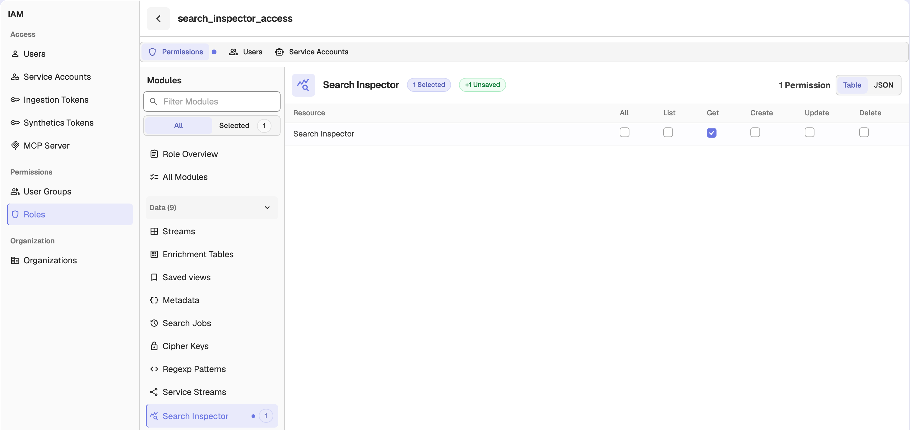

## Search Inspector
The Search Inspector in OpenObserve helps you identify what happens during a search operation.

:::note[Enterprise]
The Search Inspector endpoint is available only in OpenObserve Enterprise.
:::

## How to Use It
Make a request to the following endpoint to get profiling information for one search:
```
GET /api/{org_id}/search/profile?trace_id={trace_id}
```
`trace_id` is required: it is the trace ID of the search you want to inspect. The response returns structured metadata about that search execution.

## Why Use the Search Inspector
- To find out why a search is slow and which part is causing the delay
- To see how a search is processed step by step, including WAL, storage, and execution phases
- To trace how the query moved across nodes, using OpenTelemetry for distributed tracking
- To view all search metadata in one place, including role, timing, and component context
- To debug reliably using logs that show durations in human-readable format and clear size metrics

## Access Control

The Search Inspector requires a dedicated `search_inspector` permission. Access depends on your role:

- The **Root User** and organization **Admins** can use the Search Inspector automatically. No extra grant is needed.
- **Editors**, **Viewers**, and other users get access only through a custom role that grants the `search_inspector` permission. Without it, requests to the profile endpoint are denied.

To grant the permission:

1. From the **IAM** panel, select **Roles** and click the edit icon on the custom role you want to grant access to.
2. On the **Permissions** tab, under **Modules**, expand **Data** and select **Search Inspector**.
3. Select the **Get** checkbox for the **Search Inspector** resource. **All** also grants it.
4. On the **Users** tab, add the users who need access, if they are not already assigned to the role.
5. Click **Save**.



The **Search Inspector** permission is module-level. Granting it authorizes the profile endpoint for the entire organization; it cannot be scoped to individual streams.

## Org Scoping and Security

The Search Inspector is scoped to the organization in the request path:

- It returns only traces owned by that organization. A trace belonging to another organization is answered as if it does not exist, so trace IDs cannot be probed across organizations.
- The `trace_id` query parameter is required and accepts only letters, numbers, and dashes; a missing or invalid value is rejected with a bad-request error.

In the OpenObserve UI, Search Inspector entry points hide automatically for users without the `search_inspector` permission.

## Setup

The Search Inspector is turned off by default. To turn it on, set `ZO_SEARCH_INSPECTOR_ENABLED=true` (see [Environment Variables](../../../administration/configuration/environment-variables.md)). Once it is on, the Search Inspector records search executions automatically in the background, and users with the `search_inspector` permission can query the endpoint for real-time details.
