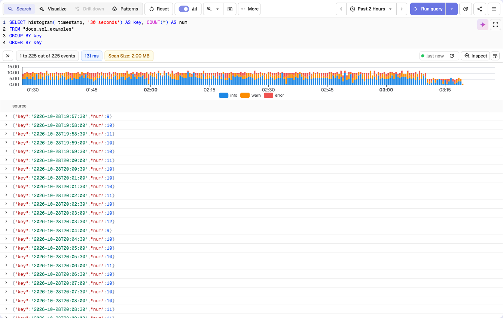

Aggregate functions compute a single result from a set of input values. For usage of standard SQL aggregate functions such as `COUNT`, `SUM`, `AVG`, `MIN`, and `MAX`, refer to [PostgreSQL documentation](https://www.postgresql.org/docs/).

## Function index

| Function | Purpose |
|---|---|
| [`histogram`](#histogram) | Group records into fixed time buckets |
| [`summary_percentile`](#summary_percentile) | Percentile of values that come with occurrence counts |
| [`sequence_depth`](#sequence_depth) | How many steps of an ordered sequence a group completes |
| [`sequence_step_times`](#sequence_step_times) | Time from the first step to each later step |
| [`sequence_step_match`](#sequence_step_match) | Window function: marks the rows that are step k of a sequence |

For `approx_topk` and `approx_topk_distinct`, see [Approximate aggregate functions](approximate-aggregate/index.md).


## `histogram`
**Syntax**: histogram(field) or histogram(field, 'interval')
**Description:** <br>
Use the `histogram()` function to divide your time-based log data into fixed intervals and apply aggregate functions such as `COUNT()` or `SUM()` to analyze time-series patterns. This helps visualize trends over time and supports meaningful comparisons.<br><br>
**Syntax:** <br>
```sql
histogram(timestamp_field, 'interval')
```

- `timestamp_field`: A valid timestamp field, such as _timestamp.
- `interval`: A fixed time interval in readable units such as '30 seconds', '1 minute', '15 minutes', or '1 hour'.

**Histogram with aggregate function** <br>
```sql
SELECT histogram(_timestamp, '30 seconds') AS key, COUNT(*) AS num
FROM "docs_sql_examples"
GROUP BY key
ORDER BY key
```
**Expected Output**: <br>

This query divides the log data into 30-second intervals. 
Each row in the result shows:

- **`key`**: The start time of the 30-second bucket.
- **`num`**: The count of log records that fall within that time bucket.
<br>


:::note[Note]
- If you do not specify an interval, the backend automatically determines a suitable value.
- To ensure consistent bucket sizes and avoid unexpected behavior, it is recommended to always define the interval explicitly.
:::

## `summary_percentile`

**Syntax**: `summary_percentile(value, count, percentile)`

**Description**:

- Returns the `percentile` of `value`, where each row stands for `count` occurrences of `value`.
- Use it on pre-aggregated data, such as a stream that stores one row per latency value with a count, where `approx_percentile_cont` would treat every row as one occurrence.
- `percentile` is a fraction from `0.0` to `1.0`, for example `0.95` for p95.
- The result is one of the input values (no interpolation), with the same type as `value`.

**Example**:
```sql
SELECT service_name, summary_percentile(latency_ms, CAST(hits AS BIGINT), 0.95) AS p95_ms FROM "api_latency_buckets" GROUP BY service_name
```
In a stream where each row holds a `latency_ms` value and the number of requests (`hits`) that took that long, this query returns the 95th percentile latency per service.

:::note[Gotchas]
- `count` must be a 64-bit integer. Cast it with `CAST(hits AS BIGINT)` if the field has another type.
- `percentile` must be a literal decimal. `95` or a column fails the query; use `0.95`.
- `NaN` values are skipped.
:::

## Sequence functions

The sequence functions find ordered sequences of events within a group, such as the steps of a funnel within a user session. The Product Analytics funnels in RUM are built on them.

All three take the same core arguments:

- `window`: the largest allowed time from the first step to the last step, in the units of `ts`. `0` means no limit. Must be a literal.
- `ts`: the event time as an integer, for example `_timestamp` (microseconds).
- `c1, ..., cN`: 1 to 20 boolean conditions, one per step, in order. A condition may repeat.

Each step must be strictly later than the step before it. Events with the same timestamp never advance the sequence by more than one step.

### `sequence_depth`

**Syntax**: `sequence_depth(window, ts, c1, ..., cN)`

**Description**:

- Aggregate function. Returns the number of leading steps that the group's events complete in order: `0` when no event matches `c1`, `N` when the whole sequence completes within `window`.

**Example**:
```sql
SELECT session_id, sequence_depth(1800000000, _timestamp, view_url LIKE '%/cart', view_url LIKE '%/checkout', view_url LIKE '%/order-confirmed') AS depth FROM "_rumdata" WHERE type = 'view' GROUP BY session_id
```
This query returns, per session, how far the visitor got through cart, checkout, and order confirmation within 30 minutes (1,800,000,000 microseconds). To build a funnel, count the sessions per depth:

```sql
SELECT depth, COUNT(*) AS sessions FROM (SELECT session_id, sequence_depth(1800000000, _timestamp, view_url LIKE '%/cart', view_url LIKE '%/checkout', view_url LIKE '%/order-confirmed') AS depth FROM "_rumdata" WHERE type = 'view' GROUP BY session_id) GROUP BY depth ORDER BY depth
```

### `sequence_step_times`

**Syntax**: `sequence_step_times(window, ts, c1, ..., cN)`

**Description**:

- Aggregate function. Returns an array with one entry per condition: the shortest time from the first step to that step, in the units of `ts`.
- The first entry is `0`. Steps never reached are `NULL`, so the number of non-null entries equals `sequence_depth`.

**Example**:
```sql
SELECT session_id, sequence_step_times(0, _timestamp, view_url LIKE '%/cart', view_url LIKE '%/checkout') AS step_times FROM "_rumdata" WHERE type = 'view' GROUP BY session_id
```
`step_times[2]` (1-based) is the time in microseconds from the cart view to the checkout view, or `NULL` if the session never reached checkout.

### `sequence_step_match`

**Syntax**: `sequence_step_match(window, k, ts, c1, ..., cN) OVER (PARTITION BY unit)`

**Description**:

- Window function. Returns `true` on each row that matches condition `k` and is step `k` of an in-order sequence: steps 1 to `k` matched in order within `window`. Later steps do not need to happen.
- `k` is a literal from `1` to the number of conditions.
- Use it to look at the events at a given step, for example which pages visitors saw at the checkout step.

**Example**:
```sql
SELECT * FROM (SELECT _timestamp, session_id, view_url, sequence_step_match(0, 2, _timestamp, view_url LIKE '%/cart', view_url LIKE '%/checkout') OVER (PARTITION BY session_id) AS is_step_2 FROM "_rumdata" WHERE type = 'view') WHERE is_step_2
```
This query returns the checkout views that came after a cart view in the same session.

:::note[Gotchas]
- `window` and `k` must be non-negative integer literals. A column or expression fails the query.
- `window` uses the units of `ts`. With `_timestamp`, one minute is `60000000`.
- `sequence_depth` and `sequence_step_times` also work as window functions with `OVER (PARTITION BY ...)`.
- More than 20 conditions fail the query.
:::
