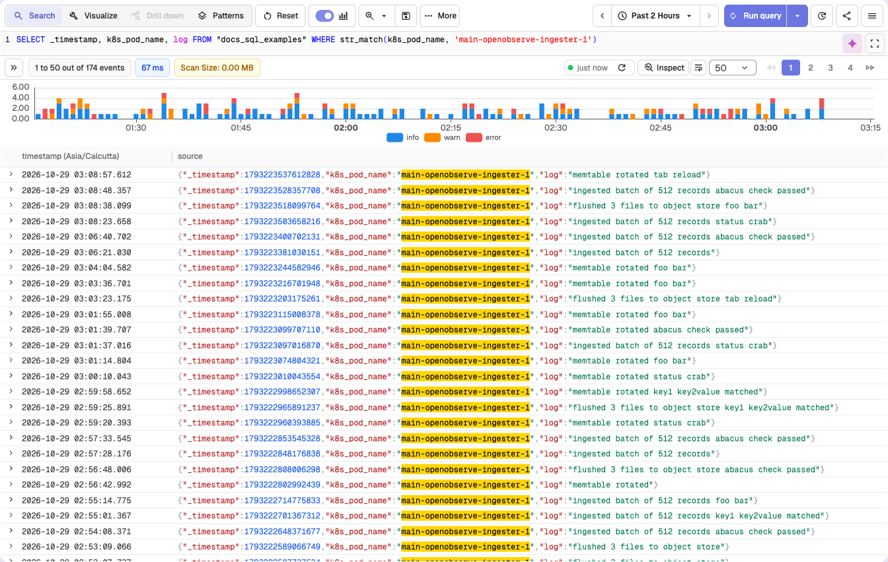
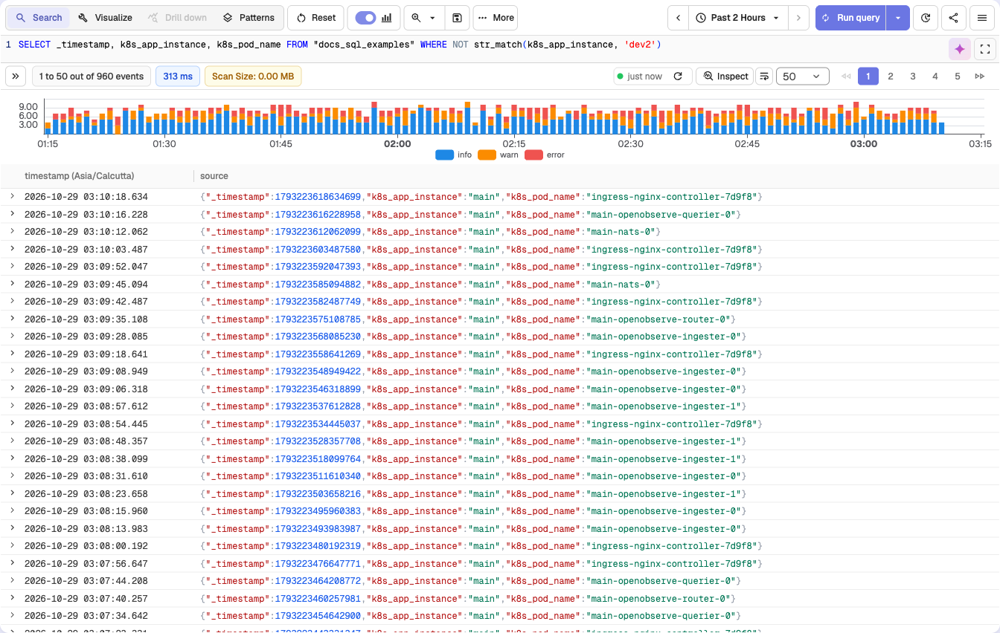
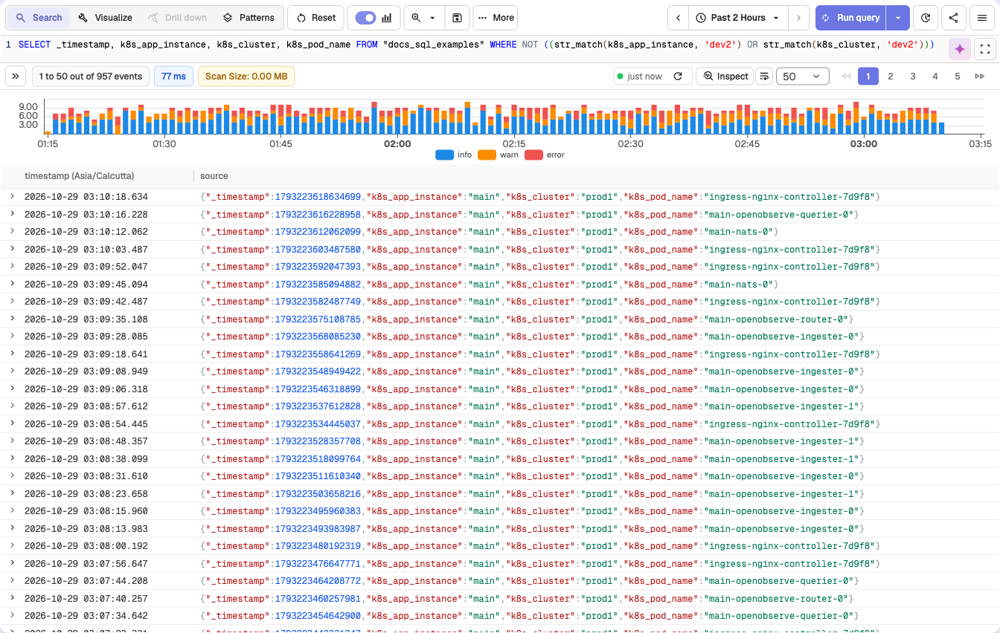
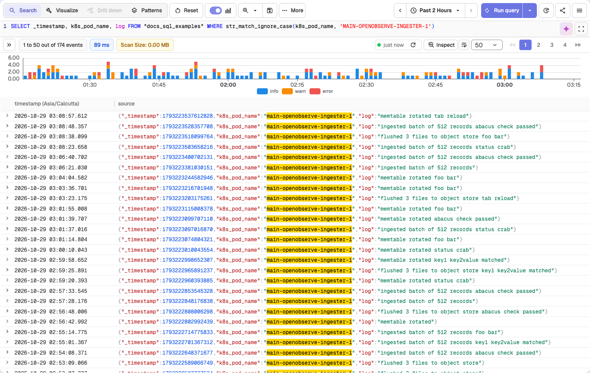
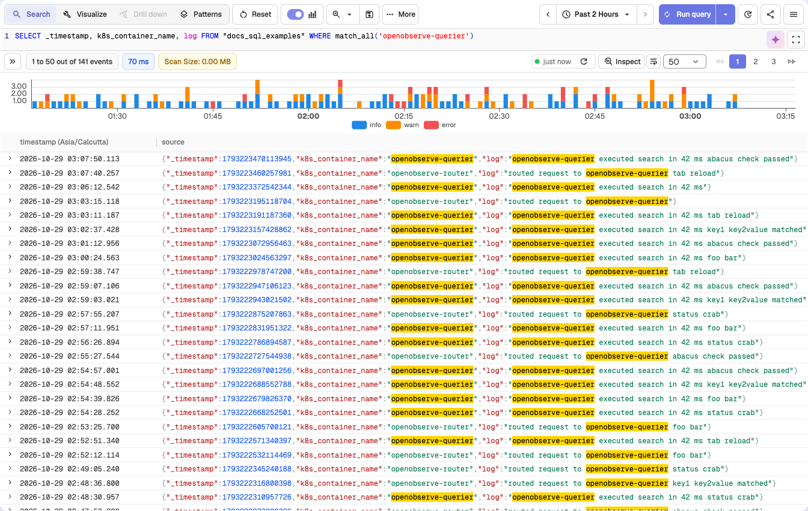
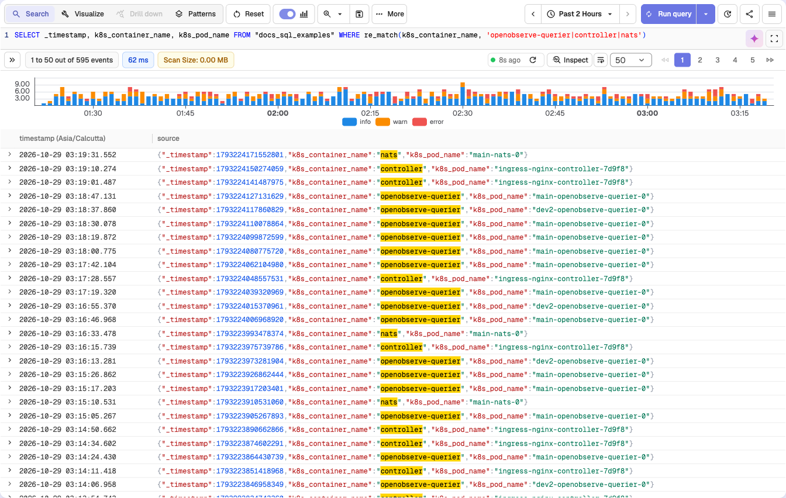
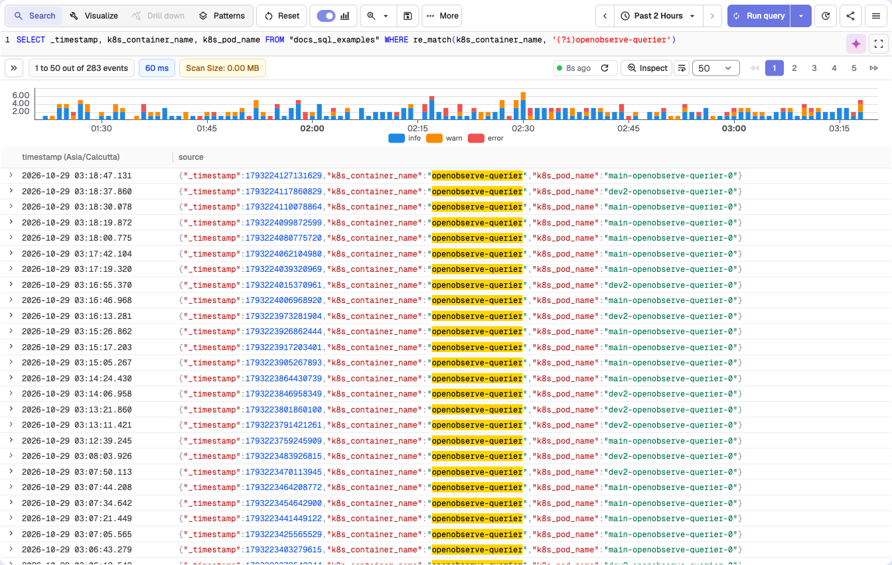
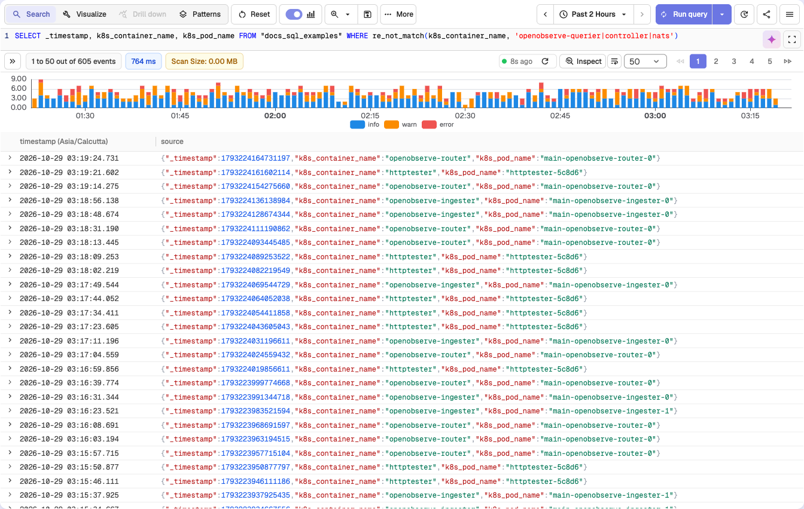

# Full-text search functions

The full-text search functions allow you to filter records based on keyword or pattern matches within one or more fields. This page lists the full-text search functions supported in OpenObserve, along with their usage formats, descriptions, and examples.

## Function index

| Function | Purpose |
|---|---|
| [`str_match`](#str_match) | Case-sensitive exact-string match on a single field |
| [`NOT str_match`](#not-str_match) | Inverse of `str_match` |
| [`str_match_ignore_case`](#str_match_ignore_case) | Case-insensitive match on a single field |
| [`match_all`](#match_all) | Case-insensitive keyword search across all full-text-indexed fields |
| [`NOT match_all`](#not-match_all) | Inverse of `match_all` |
| [`re_match`](#re_match) | Regular-expression match on a single field |
| [`re_not_match`](#re_not_match) | Inverse of `re_match` |
| [`match_field`](#str_match) | Alias of `str_match` |
| [`match_field_ignore_case`](#str_match_ignore_case) | Alias of `str_match_ignore_case` |
| [`fuzzy_match`](#fuzzy_match) | Typo-tolerant match on a single field |
| [`fuzzy_match_all`](#fuzzy_match_all) | Typo-tolerant keyword search across all full-text-indexed fields |
| [`match_all_hash`](#match_all_hash) | Finds records that hold the hash of a value redacted with Sensitive Data Redaction |

## `str_match`

**Syntax**: `str_match(field, 'value')`

**Alias**: `match_field(field, 'value')` *(available in OpenObserve 0.15.0 and later)*

**Description**:

- Filters logs where the specified field contains the exact string value.
- The match is case-sensitive.
- Only logs that include the exact characters and casing specified will be returned.

**Example**:
```sql
SELECT _timestamp, k8s_pod_name, log FROM "docs_sql_examples" WHERE str_match(k8s_pod_name, 'main-openobserve-ingester-1')
```
This query filters logs from the `docs_sql_examples` stream where the `k8s_pod_name` field contains the exact string `main-openobserve-ingester-1`. It does not match values such as `Main-OpenObserve-Ingester-1`, `main-openobserve-ingester-0`, or any case variation.



## `NOT str_match`

**Syntax**: `NOT str_match(field, 'value')`

**Description**:

- Filters logs where the specified field does NOT contain the exact string value.
- The match is case-sensitive.
- Only logs that do not include the exact characters and casing specified will be returned.
- Can be combined with other conditions using AND/OR operators.

**Example**:
```sql
SELECT _timestamp, k8s_app_instance, k8s_pod_name FROM "docs_sql_examples" WHERE NOT str_match(k8s_app_instance, 'dev2')
```


**Combining multiple NOT conditions with AND:**
```sql
SELECT _timestamp, k8s_app_instance, k8s_cluster, k8s_pod_name FROM "docs_sql_examples" WHERE (NOT str_match(k8s_app_instance, 'dev2')) AND (NOT str_match(k8s_cluster, 'dev2'))
```


**Combining NOT conditions with OR:**
```sql
SELECT _timestamp, k8s_app_instance, k8s_cluster, k8s_pod_name FROM "docs_sql_examples" WHERE NOT ((str_match(k8s_app_instance, 'dev2') OR str_match(k8s_cluster, 'dev2')))
```


## `str_match_ignore_case`

**Syntax**: `str_match_ignore_case(field, 'value')`

**Alias**: `match_field_ignore_case(field, 'value')` *(available in OpenObserve 0.15.0 and later)*

**Description**:

- Filters logs where the specified field contains the string value.
- The match is case-insensitive.
- Logs are returned even if the casing of the value differs from what is specified in the query.

**Example**:
```sql
SELECT _timestamp, k8s_pod_name, log FROM "docs_sql_examples" WHERE str_match_ignore_case(k8s_pod_name, 'MAIN-OPENOBSERVE-INGESTER-1')
```
This query filters logs from the `docs_sql_examples` stream where the `k8s_pod_name` field contains any casing variation of `main-openobserve-ingester-1`, such as `MAIN-OPENOBSERVE-INGESTER-1`, `Main-OpenObserve-Ingester-1`, or `main-openobserve-ingester-1`.



## `match_all`

**Syntax**: `match_all('value')`

**Description**:

- Filters logs by searching for the keyword across all fields that have the Index Type set to Full Text Search in the [stream settings](../../user-guide/data-processing/streams/schema-settings.md).
- This function is case-insensitive and returns matches regardless of the keyword's casing.

:::note[Inverted index support]
Inverted index generation is controlled by the environment variable `ZO_ENABLE_INVERTED_INDEX`, which is `true` by default. You can configure the fields to use the Inverted Index by updating the [stream settings](../../user-guide/data-processing/streams/schema-settings.md) in the user interface or through the [setting API](../api/stream/setting.md).

The `match_all` function searches through inverted indexed terms, which are internally converted to lowercase. Therefore, keyword searches using `match_all` are always case-insensitive.
:::

**Example**:
```sql
SELECT _timestamp, k8s_container_name, log FROM "docs_sql_examples" WHERE match_all('openobserve-querier')
```
This query returns all logs in the `docs_sql_examples` stream where the keyword `openobserve-querier` appears in any of the full-text indexed fields. It matches all casing variations, such as `OpenObserve-Querier` or `OPENOBSERVE-QUERIER`.



### More pattern support

The `match_all` function also supports the following patterns for flexible searching:

| Pattern | Example | Description |
|---|---|---|
| Prefix | `match_all('ab*')` | Matches keywords that start with `ab` |
| Postfix | `match_all('*ab')` | Matches keywords that end with `ab` |
| Contains | `match_all('*ab*')` | Matches keywords that contain `ab` anywhere |
| Phrase prefix | `match_all('key1 key2*')` | Matches phrases where the last term uses prefix matching |

## `NOT match_all`

**Syntax**: `NOT match_all('value')`

**Description**:

- Filters logs by excluding records where the keyword appears in any field that has the Index Type set to Full Text Search in the stream settings.
- This function is case-insensitive and excludes matches regardless of the keyword's casing.
- Provides significant performance improvements when used with indexed fields.

:::warning[Only Full Text Search fields are evaluated]
`NOT match_all` only searches fields configured as Full Text Search fields. Other fields in the record are not evaluated.
:::

**Example**:
```sql
SELECT * FROM "docs_sql_examples" WHERE NOT match_all('foo')
```
This query returns all logs in the `docs_sql_examples` stream where the keyword `foo` does NOT appear in any of the full-text indexed fields. Fields not configured for full-text search are ignored.

**Combining NOT match_all with NOT str_match**:
```sql
SELECT * FROM "docs_sql_examples" WHERE (NOT str_match(f1, 'bar')) AND (NOT match_all('foo'))
```
This query returns logs where field `f1` does NOT contain `bar` AND no full-text indexed field contains `foo`. In other words, it excludes records that match either condition.

**Using NOT with OR conditions**:
```sql
SELECT * FROM "docs_sql_examples" WHERE NOT (str_match(f1, 'bar') OR match_all('foo'))
```
This query returns logs where BOTH conditions are false: field `f1` does NOT contain `bar` AND no full-text indexed field contains `foo`. In other words, it excludes records that match either condition.

## `re_match`

**Syntax**: `re_match(field, 'pattern')`

**Description**:

- Filters logs by applying a regular expression to the specified field.
- The function returns records where the field value matches the given pattern.
- This function is useful for identifying complex patterns, partial matches, or multiple keywords in a single query.
- You can use standard regular expression syntax as defined in the [Regex documentation](https://docs.rs/regex/latest/regex/).

**Example**:
```sql
SELECT _timestamp, k8s_container_name, k8s_pod_name FROM "docs_sql_examples" WHERE re_match(k8s_container_name, 'openobserve-querier|controller|nats')
```
This query returns logs from the `docs_sql_examples` stream where the `k8s_container_name` field matches any of the strings `openobserve-querier`, `controller`, or `nats`. The match is case-sensitive.



To perform a case-insensitive search:

```sql
SELECT _timestamp, k8s_container_name, k8s_pod_name FROM "docs_sql_examples" WHERE re_match(k8s_container_name, '(?i)openobserve-querier')
```
This query returns logs where the `k8s_container_name` field contains any casing variation of `openobserve-querier`, such as `OpenObserve-Querier` or `OPENOBSERVE-QUERIER`.



## `re_not_match`

**Syntax**: `re_not_match(field, 'pattern')`

**Description**:

- Filters logs by applying a regular expression to the specified field and returns records that do not match the given pattern.
- This function is useful when you want to exclude specific patterns or values from your search results.

**Example**:
```sql
SELECT _timestamp, k8s_container_name, k8s_pod_name FROM "docs_sql_examples" WHERE re_not_match(k8s_container_name, 'openobserve-querier|controller|nats')
```
This query returns logs from the `docs_sql_examples` stream where the `k8s_container_name` field does not match any of the values `openobserve-querier`, `controller`, or `nats`. The match is case-sensitive.



## `fuzzy_match`

**Syntax**: `fuzzy_match(field, 'value', distance)`

**Description**:

- Returns records where any word in `field` is within `distance` edits (Levenshtein distance: one insert, delete, or change of a character per edit) of `value`.
- The field is split into words the same way the full-text index splits text, and every word is lowercased before the comparison.
- `distance` is an integer, for example `1` or `2`.

**Example**:
```sql
SELECT _timestamp, log FROM "docs_sql_examples" WHERE fuzzy_match(log, 'timeout', 1)
```
This query returns logs whose `log` field contains `timeout`, or a word one edit away from it, such as `timout` or `timeouts`.

:::note[Gotchas]
- Pass `value` in lowercase. The words from the field are lowercased, but `value` is not, so `fuzzy_match(log, 'Timeout', 0)` never matches.
- `fuzzy_match` reads the field value of every record in the time range. It does not use the full-text index, so keep the time range short on large streams.
- A large `distance` on a short word matches almost anything: `fuzzy_match(log, 'err', 2)` also matches `ear`, `her`, and `error`.
:::

## `fuzzy_match_all`

**Syntax**: `fuzzy_match_all('value', distance)`

**Description**:

- Typo-tolerant version of [`match_all`](#match_all): returns records where any full-text-indexed field contains a word within `distance` edits of `value`.
- When the stream has an inverted index, the search runs on the index. Otherwise each full-text-indexed field is checked with `fuzzy_match`.

**Example**:
```sql
SELECT _timestamp, k8s_container_name, log FROM "docs_sql_examples" WHERE fuzzy_match_all('querier', 1)
```
This query returns logs where a full-text-indexed field contains `querier` or a near spelling such as `querer` or `queriers`.

:::note[Gotchas]
- On the index path, `distance` must be `0`, `1`, or `2`. Larger values fail the query.
- Use a single lowercase word. `fuzzy_match_all` does not support the `*` prefix or contains patterns of `match_all`.
- The stream needs at least one Full Text Search field, or the query returns an error.
:::

## `match_all_hash`

**Syntax**: `match_all_hash('value')`

**Description**:

- Finds records where a full-text-indexed field contains the hash of `value`, as written by the **Hash** action of [Sensitive Data Redaction](../../user-guide/account-administration/management/sensitive-data-redaction.md).
- OpenObserve computes the MD5 hash of `value` and searches for it, so you can look up a card number or email address that is no longer stored in clear text.

**Example**:
```sql
SELECT _timestamp, log FROM "docs_sql_examples" WHERE match_all_hash('4111-1111-1111-1111')
```
This query returns records containing a hashed value such as `[REDACTED:907fe4882defa795fa74d530361d8bfb]`.

:::note[Gotchas]
- `value` must be exactly the original text. Case and spacing count, because a different input gives a different hash.
- Only Full Text Search fields are searched, as with `match_all`.
:::

## Next steps


- [SQL functions reference](index.md): full list of functions you can use in queries.
- [Example queries](../../user-guide/data-exploration/example-queries.md): copy-paste filters and SQL to try.
- [Stream schema settings](../../user-guide/data-processing/streams/schema-settings.md): configure which fields are full-text indexed.

**Need some help?**

- Join our [Community Slack](https://short.openobserve.ai/community) 
- Or [Contact support](https://openobserve.ai/contactus/)
