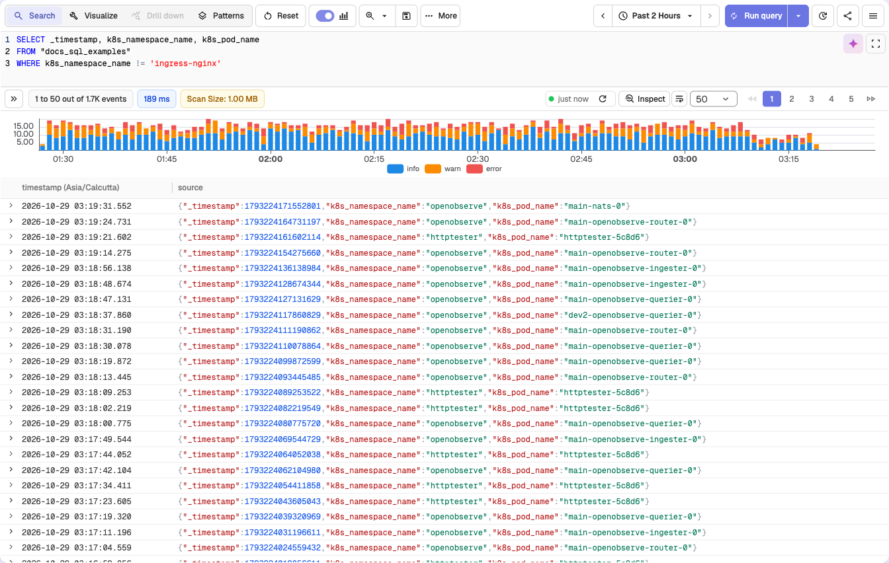
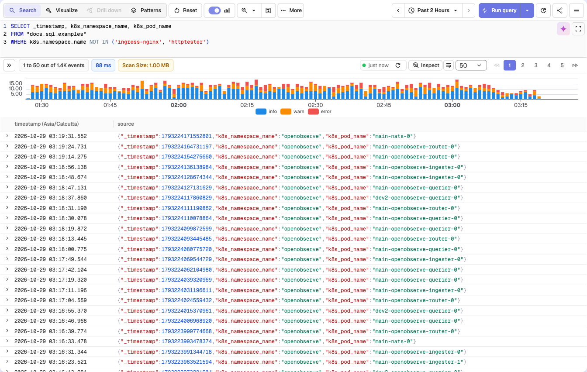

Secondary index functions allow you to filter and optimize queries using fields that are configured as secondary indexes in stream settings.

## `!=` (Not Equal)
**Syntax**: `field_name != 'value'` <br>
**Description**:

- Filters records where the specified indexed field does not match the given value.
- The comparison is case sensitive for string fields.
- OpenObserve uses the secondary index to exclude the specified value before scanning data. No extra setting is needed.
<br>

**Example**:
```sql
SELECT _timestamp, k8s_namespace_name, k8s_pod_name
FROM "docs_sql_examples"
WHERE k8s_namespace_name != 'ingress-nginx'
```


This query returns logs from the `docs_sql_examples` stream where the `k8s_namespace_name` field is any value other than `ingress-nginx`. Note that `k8s_namespace_name` is configured as a secondary index.

## NOT IN
**Syntax**: `field_name NOT IN ('value1', 'value2')` <br>
**Description**:

- Filters records where the specified indexed field does not match any value in the provided list.
- The comparison is case sensitive for string fields.
- OpenObserve uses the secondary index to exclude all listed values before scanning data. No extra setting is needed.
<br>

**Example**:
```sql
SELECT _timestamp, k8s_namespace_name, k8s_pod_name
FROM "docs_sql_examples"
WHERE k8s_namespace_name NOT IN ('ingress-nginx', 'httptester')
```


This query returns logs from the `docs_sql_examples` stream where `k8s_namespace_name` is not any of the listed namespaces. Note that `k8s_namespace_name` is configured as a secondary index.