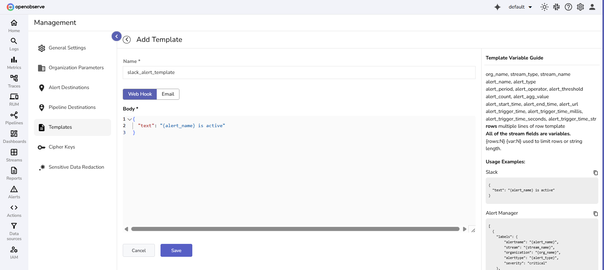
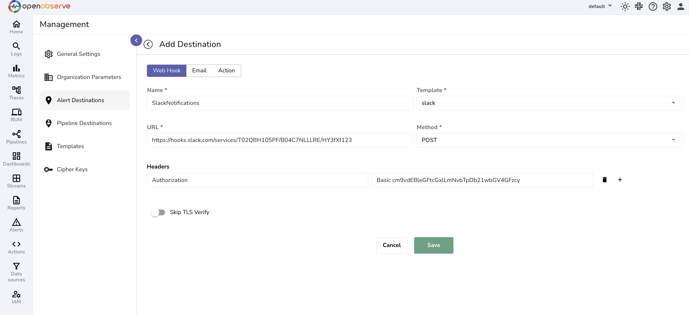
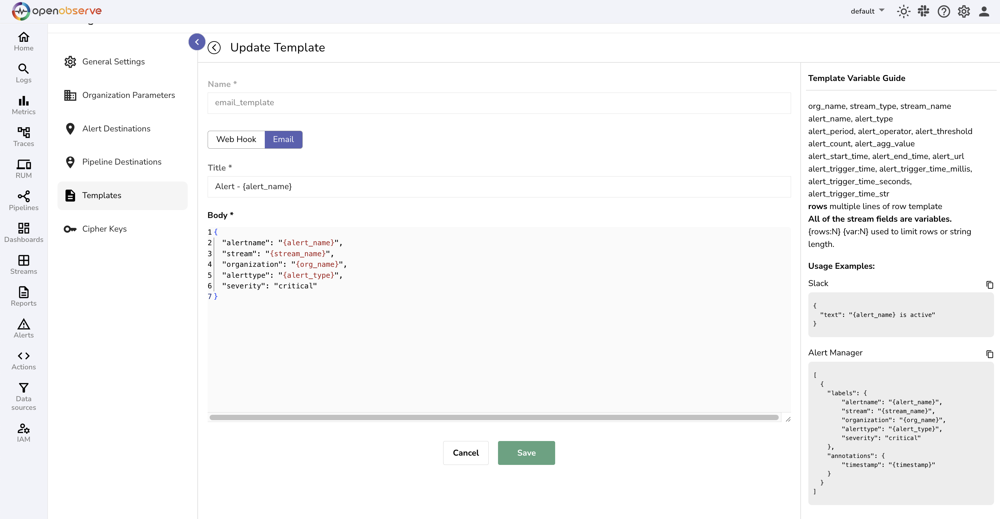
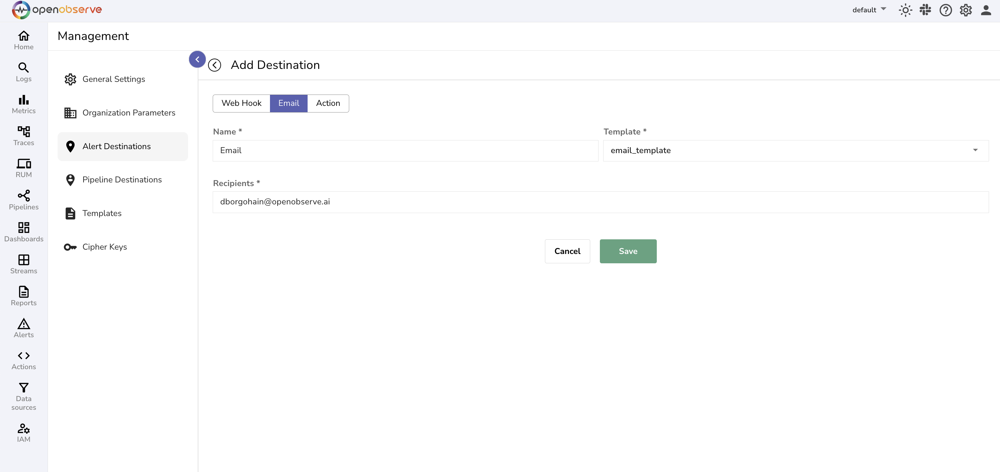
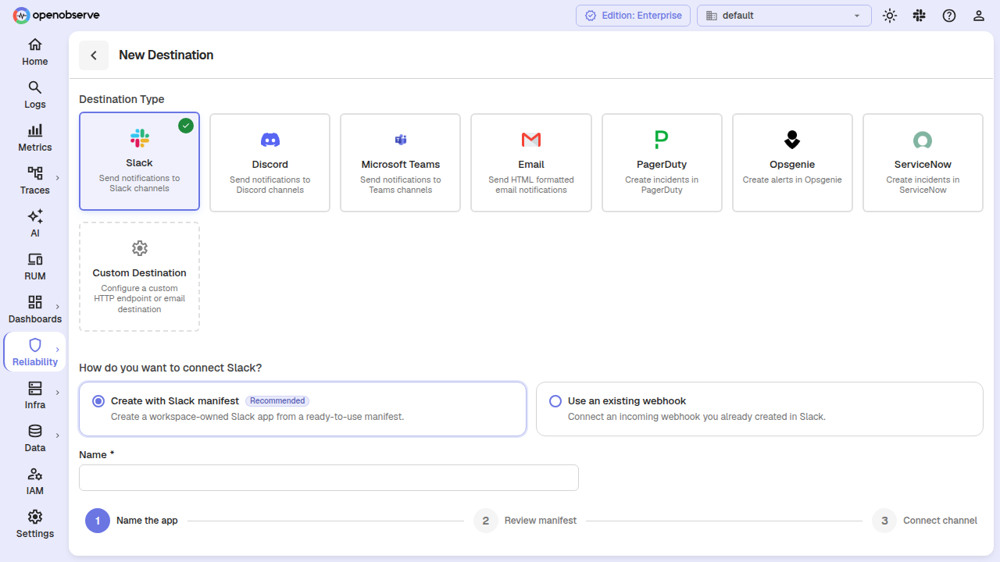
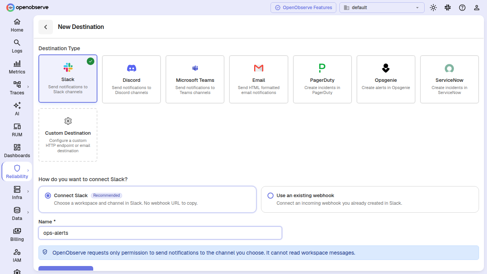
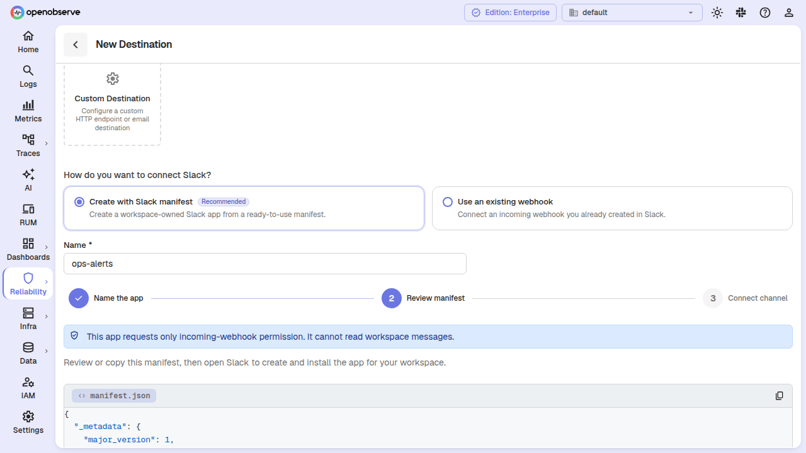
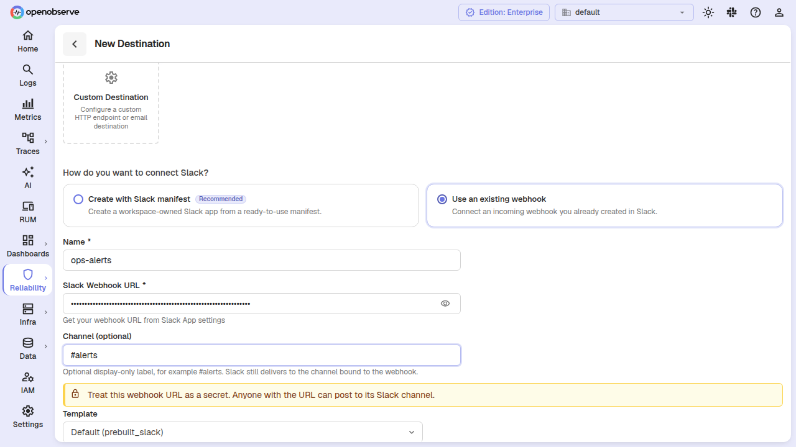

In OpenObserve, **Destinations** define how and where alert notifications are delivered when an alert is triggered. Destinations are reusable. You can assign a destination to one or more alerts to manage notifications efficiently.

## Configure Alert Destinations 

The **Destinations** section provides the following configuration options. Select a destination type to view configuration instructions.

:::::tabs
::::tab[Webhook]
## Webhook
When the alert gets triggered, OpenObserve will send alert data to an external system using an HTTP POST request. Use this option to integrate with services that support webhook ingestion. You can customize the request payload using templates to match the format expected by the target system. 

:::accordion[View use cases.]
You can use this destination to:

  - Create incident tickets in **Jira Service Management** or **ServiceNow**.
  - Send notifications to **Slack** or **Microsoft Teams channels**.
:::

:::warning[Private and local network addresses are blocked by default]
For SSRF protection, OpenObserve blocks Webhook URLs pointing to loopback or private network addresses, such as a self-hosted Ntfy server on your LAN. In a self-hosted deployment, set `ZO_SKIP_SSRF_CHECKS=true` to allow any private address, or `ZO_SSRF_ALLOW_LOOPBACK=true` for loopback only. See [Network and Communication](https://openobserve.ai/docs/administration/configuration/environment-variables/#network-and-communication).
:::

### Prerequisites
:::accordion[Set up an alert template.]
This allows you to define the content and layout of the alert message.

1. In OpenObserve, go to **Management > Templates**.
2. Click **Add Template** to create a new template. 
3. In the template creation screen:
  

    - Enter a name for the template.
    - Select **Webhook** as the template type.
    - Fill in the **Body** fields.

    Body Example:
    ```                  
      {
        "text": "{alert_name} is active"
      }

    ```
:::

**Steps to configure webhooks as alert destination** 

1. Go to **Management > Alert Destinations**. 
2. In the **Add Destination** page, click **Webhook**.
3. Fill in the following details:
   

    - **Name**: Enter a descriptive name for the Webhook destination. For example, SlackNotifications. Note that characters such as `,`, `:`, `?`, `/`, `#`, and `spaces` are not allowed.
    - **Template**: Choose a predefined alert message template from the dropdown menu.
    - **URL**: Specify the Webhook endpoint URL where notifications will be sent. For example, `https://hooks.slack.com/services/T02QBH105PF/B04C7NLLLRE/HY3fXf123`
    - **Method**: Select the HTTP method (`POST`, `GET`, or `PUT`) depending on the Webhook's requirements.
    - **Headers (Optional)**: Add custom headers in key-value format. For example, authentication tokens or content type. For example, 
        ```
        Key: Authorization  
        Value: Basic cm9vdEBleGFtcGxlLmNvbTpDb21wbGV4GFzcy  
        ```
    - **Skip TLS Verify**: Enable this option if the endpoint uses self-signed certificates or if you want to bypass SSL verification.
6. Click **Save** to create the Webhook destination.
::::
::::tab[Email]
## Email
When the alert gets triggered, OpenObserve will send alert notifications to one or more email addresses using SMTP. Use this option when email is the preferred channel for receiving alerts. You must configure the email delivery settings under your OpenObserve SMTP setup. The alert payload can be formatted using a predefined template.

:::accordion[View use cases.]
  You can use this destination to:

  - Notify on-call team members or distribution lists.
  - Route alerts to incident mailboxes used by helpdesk.
:::

### Prerequisites

:::accordion[1. Set up an email account for sending alerts.]
To send email alerts using Gmail SMTP, you must create an App Password. Follow these steps:

1. Sign in to your Gmail account.
2. Go to **Google Account Settings** > **Security**.
3. Under **Signing into Google**, enable **2-Step Verification** (if not already enabled).
4. After enabling 2-Step Verification, go to the **App Passwords**.
5. In the **App Passwords** page, enter a name for your app, such as SMTP, and click **Create**.
6. Copy the generated App Password and store it securely. You will need it during configuration.

**Test Your Gmail SMTP Configuration** <br>
Use an online tool such as [Mailmeteor’s SMTP Test Tool](https://mailmeteor.com/smtp-test) to verify your configuration. <br>To test:

1. Go to Mailmeteor's SMTP Test Tool and select the email provider.
2. The tool fills in the SMTP server as `smtp.gmail.com` and port `587`.
3. Enter your Gmail address and the **App Password** you created earlier.
4. Click **Test Configuration**. 

If successful, you will receive a test email in your inbox. This confirms your Gmail SMTP configuration is working.
:::

:::accordion[2. Configure environment variables to enable email alerts through SMTP in OpenObserve.]
Choose your deployment type and configure the environment variables accordingly:

- **For Single Node Deployment**: You need to pass SMTP configuration parameters when starting OpenObserve. Below is the command to configure OpenObserve to send email alerts via Gmail:

```yml lineNumbers
ZO_SMTP_ENABLED=true \
ZO_SMTP_HOST="smtp.gmail.com" \
ZO_SMTP_PORT=587 \
ZO_SMTP_USER_NAME="your-gmail-address@gmail.com" \
ZO_SMTP_PASSWORD="your-app-password" \
ZO_SMTP_FROM_EMAIL="your-gmail-address@gmail.com" \
ZO_SMTP_ENCRYPTION="starttls" \
ZO_ROOT_USER_EMAIL="root-user-email" \
ZO_ROOT_USER_PASSWORD="root-user-password" \
./openobserve

```
Replace the placeholders with your actual credentials and email addresses.

- **For High Availability (HA) deployment**: Configure the above environemnt variables in the values.yaml file
- **For Cloud**: No additional configuration required. 
:::

:::accordion[3. Set up an alert template.]
This allows you to define the content and layout of the alert message.

1. In OpenObserve, go to **Management > Templates**.
2. Click **Add Template** to create a new email template. 
3. In the template creation screen:
  

    - Select **Email** as the template type.
    - Enter a name for the template.
    - Fill in the **Title** and **Body** fields.

    Title Example:
    ```
    [Alert: {alert_name}] - Severity: {alert_type}
    ```
    Body Example:
    ```
    {
      "alertname": "{alert_name}",
      "stream": "{stream_name}",
      "organization": "{org_name}",
      "alerttype": "{alert_type}",
      "severity": "critical"
    }
    ```
:::
:::accordion[4. Ensure that the recipient is part of the appropriate organization]
1. From the left-nevigation menu, go to **IAM** (Identity and Access Management) > **Users**.
2. Click **Add User**.
3. Enter the user’s email address, role, password, and name.
4. Click **Save**. 
:::
  After the user is added, they become eligible to receive email alerts.

### Steps to configure emails as alert destination 


  1. Go to **Management** > **Alert Destinations**. 
  2. In the **Add Destination** page, click **Email**.
  3. Enter a name for the destination.
  4. Select an email template to define the alert content.
  5. Enter the recipient’s email address.
  6. Click **Save**.

This creates the email as alert destination. 
::::
::::tab[Slack]
## Slack
When the alert gets triggered, OpenObserve sends the notification to a Slack channel through an incoming webhook. When you select the **Slack** destination type, OpenObserve asks **How do you want to connect Slack?** and offers the methods available on your deployment:

- **Connect Slack**: Cloud only. Authorize OpenObserve in Slack and pick a workspace and channel. There is no webhook URL to copy.
- **Create with Slack manifest**: Enterprise self-hosted only. Generate a ready-to-use Slack app manifest and install the app in your workspace.
- **Use an existing webhook**: All deployments. Paste an incoming webhook URL you already created in Slack. This is the only method in the open-source edition.

The recommended method is selected by default: **Connect Slack** on Cloud and **Create with Slack manifest** on self-hosted Enterprise.



### Connect Slack (Cloud)
OpenObserve requests only the `incoming-webhook` scope, so it can post to the channel you choose but cannot read workspace messages. The Slack access token is exchanged on the server and never reaches the browser; only the channel-bound webhook URL is stored with the destination.



1. Go to **Management > Alert Destinations** and click **Add Destination**.
2. Select the **Slack** destination type.
3. Keep **Connect Slack** selected, enter a name for the destination, and click **Connect Slack**.
4. In the Slack window that opens, choose a workspace and channel, then allow access.
5. When the connection completes, the destination shows the workspace and channel, and the webhook URL is filled in for you.
6. Click **Save**.

To connect a different workspace or channel later, click **Reconnect Slack**.

:::accordion[Server configuration for Connect Slack]
The Connect Slack flow uses a Slack app configured on the OpenObserve server through these environment variables:

| Variable | Description |
| --- | --- |
| `O2_SLACK_CLIENT_ID` | Client ID of the Slack app used for alert-destination OAuth. If empty, the flow is disabled. |
| `O2_SLACK_CLIENT_SECRET` | Client secret of the Slack app. If empty, the flow is disabled. |
| `O2_SLACK_REDIRECT_URL` | Slack OAuth callback URL. Defaults to `{ZO_WEB_URL}{ZO_BASE_URI}/web/slack/oauth/callback`. |
:::

### Create with Slack manifest (Enterprise)
On self-hosted Enterprise deployments, you create a Slack app owned by your workspace from a generated manifest. The manifest requests only the `incoming-webhook` permission, so the app cannot read workspace messages.



1. Go to **Management > Alert Destinations** and click **Add Destination**.
2. Select the **Slack** destination type and keep **Create with Slack manifest** selected.
3. Enter a name for the destination and a **Slack app name** (up to 35 characters), then click **Continue**.
4. Review or copy the generated manifest, then click **Open Slack setup**. Slack opens with the manifest pre-filled.
5. In Slack, create and install the app, and choose a channel.
6. In the Slack app settings, open **Incoming Webhooks**, copy the **Webhook URL**, and paste it into the destination.
7. Click **Save**.

### Use an existing webhook
If you already created an incoming webhook in Slack, connect it directly.



1. Go to **Management > Alert Destinations** and click **Add Destination**.
2. Select the **Slack** destination type and choose **Use an existing webhook**.
3. Enter a name for the destination.
4. Paste the **Slack Webhook URL**, for example `https://hooks.slack.com/services/...`.
5. Optionally, enter a **Channel** label, such as `#alerts`. The label is for display only; Slack still delivers to the channel bound to the webhook.
6. Click **Save**.

:::warning[Treat the webhook URL as a secret]
Anyone with the webhook URL can post to its Slack channel. The URL is masked in the form; click the eye icon to reveal or hide it.
:::

After you set up the destination, use **Test** to send a test message to the channel. For Slack destinations, a successful test also shows Slack's response.
::::
:::::
     
