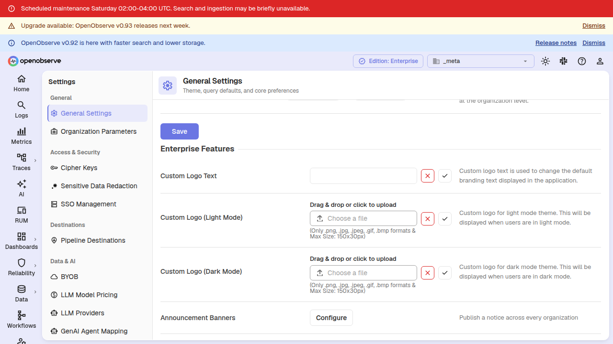
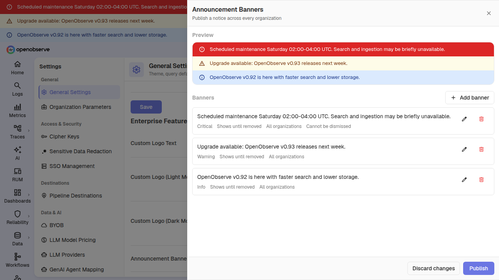
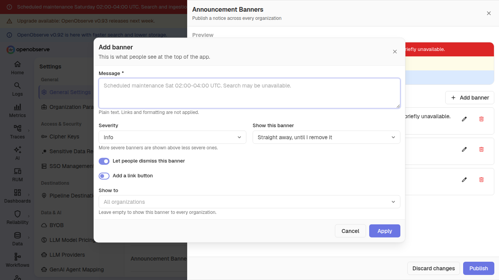
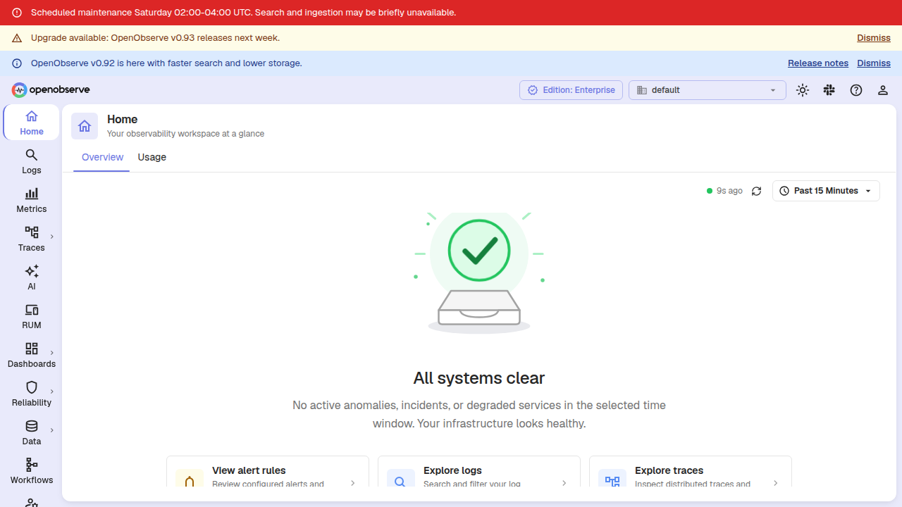

Announcement banners let you publish a single operator-authored notice that appears at the top of the app for everyone in your OpenObserve deployment. Use them for scheduled maintenance windows, release notes, policy reminders, or promotions.

Banners are authored once from the **`_meta` organization** and are read by every organization they target. Each banner can be scoped to specific organizations, scheduled to appear during a window, and dismissed by users.

> **Note:** This feature requires OpenObserve Enterprise.

## Configure announcement banners

Announcement banners are configured from the **`_meta`** organization. Open **Settings**, then select **Announcement banners** (under **General**).

The **Announcement banners** page shows which banners are **Live right now**, followed by the list of configured banners with their **Message**, **Severity**, **Status** (**Live**, **Scheduled**, **Ended**, or **Live · hidden**), **Schedule**, and **Show to** audience.

Select **Add banner** to create a banner. Use the row actions to **Edit banner**, **Duplicate banner**, or **Remove banner**.

The banner editor has three sections and a live **Preview** in light and dark mode:

| Section | Fields |
| --- | --- |
| **Message** | **Message**: the notice shown to users, up to 300 characters. Supports **bold**, _italic_, `code` and links; links must start with `http://` or `https://`. **Link buttons**: use **Add link button** to add a call-to-action with **Button text** (under 30 characters) and a **Button link** that starts with `http://` or `https://`. |
| **Style** | Pick the banner's style: **Info**, **Warning**, **Critical**, **Promotion**, a saved style, or **Custom**. **Custom** lets you choose the **Icon**, **Text size** and **Background color** (light and dark mode), mark it **Treat as critical**, and **Save as style** for reuse. |
| **Audience and schedule** | **Show to**: **All organizations** or **Only these organizations**. **Starts**: **When I publish** or **At a set time**. **Ends**: **When I remove it**, **After a while** (1 hour, 4 hours, 1 day, 1 week, or a custom span such as `30m`, `2h`, `3d` or `1w`), or **At a set time**. **Let people dismiss this banner** adds a **Dismiss** button; when editing, **Show again to people who dismissed it** brings it back for everyone. |

The save button reads **Publish now** when the banner goes live immediately and **Schedule** when it starts later.

## Schedule a banner

Combine **Starts** and **Ends** to cover every window you need:

- **When I publish** + **When I remove it**: the banner shows immediately and stays until you remove it.
- **When I publish** + **After a while**: the banner shows immediately for a duration such as `2h`. The window is anchored to when you publish, so editing an unrelated field later does not silently extend it.
- **At a set time** for the start, the end, or both: the banner appears at a start time and disappears at an end time.

For a scheduled window, the start instant is inclusive and the end instant is exclusive: a banner scheduled for `02:00–04:00` is visible at exactly `02:00` and gone at exactly `04:00`. Times are entered in your own timezone, and the editor shows when the banner will be up and in which zone.

## Severity and ordering

When several banners are active, they stack in severity order — **Critical** first, then **Warning**, then **Info**, then **Promotion**. Within the same severity, banners keep their order.

A **Promotion** banner is automatically hidden while a **Critical** banner is showing, so a webinar ad never appears beside an outage notice. Promotions return once the critical banner is gone.

## Preview

The **Preview** in the editor shows the banner in light and dark mode. Links are disabled in the preview. While a critical banner is live, a promotion's preview says it is hidden, just as it is in the app.

## How banners appear to users

Active banners render as full-width bars directly above the toolbar on every page of the app.

Each banner shows its message and, when configured, a call-to-action button and a **Dismiss** button. Users who dismiss a banner stay dismissed across sessions; if an operator edits the banner's message, it reappears for everyone.

Banners poll for updates every few minutes and also refresh exactly at a scheduled start or end boundary, so a banner set for `02:00` appears at `02:00` rather than somewhere in the following minutes. Timing follows the server clock, so users with a skewed device clock still see the banner flip at the correct instant.

## Permissions and API

Authoring is restricted to the **`_meta`** organization and requires a settings permission. Reading is open to every member of every organization, so the banners render for all users regardless of role. The per-banner organization allowlist is applied server-side, so one organization never receives another organization's notice text or identifiers.

The following endpoints are available:

| Method | Path | Description |
| --- | --- | --- |
| `GET` | `/api/{org_id}/announcements` | Banners active right now for this organization, most severe first, plus the server clock and the next instant the set changes. |
| `GET` | `/api/{org_id}/announcements/config` | The authored banner JSON for editing. **`_meta` organization only.** |
| `PUT` | `/api/{org_id}/announcements/config` | Replace the banner configuration. **`_meta` organization only.** The body is validated and normalized before storage; an empty banner list removes every banner. |
