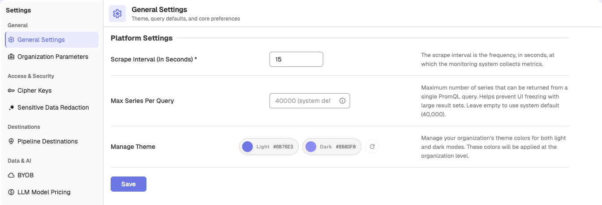
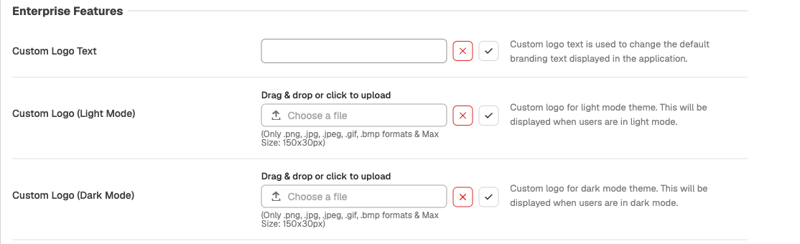

## General settings
This page explains how to use the settings available under General Settings in OpenObserve. These settings allow you to configure scrape interval, theme colors, and Enterprise branding. 

## What you can do in general settings
General settings provides the following configuration options:

- Scrape interval
- Max series per PromQL query
- Theme configuration for light and dark modes
- Enterprise branding features such as custom logo text and custom logo
- Enable Usage Stream

:::note[Note]
`_meta` organizations can access all settings. Regular organizations see only the options allowed for their specific license and permissions.
:::

### Scrape interval
> This setting is available for all organizations.

The scrape interval defines how often the monitoring system collects metrics. Enter the number of seconds in **Scrape Interval (In Seconds)** and select **Save**.

### Max series per query
**Max Series Per Query** sets the maximum number of series a single PromQL query can return, which keeps the UI responsive with large result sets. Leave it empty to use the system default (40,000).

### Enable Usage Stream
**Enable Usage Stream**: when enabled, OpenObserve writes this organization's usage/billing data into its own `usage` stream so you can view per-organization ingestion and usage locally. Turn it on in **Settings > Organization Parameters**.

### Theme configuration
The **Manage Theme** section lets you manage the default colors for light mode and dark mode for your organization. When you save these values, they are applied across the UI for all users in the organization.

You can set the following fields:

- **Light Mode** color
- **Dark Mode** color

Select **Save** to apply the changes.

### Theme configuration using environment variables
You can also configure the default theme colors at the system level. These values become the initial defaults for all organizations.

- `ZO_DEFAULT_THEME_LIGHT_MODE_COLOR`: Sets the default color used in light mode. Default: empty (the application default color is used).
- `ZO_DEFAULT_THEME_DARK_MODE_COLOR`: Sets the default color used in dark mode. Default: empty (the application default color is used).

If these variables are set, the UI loads these colors automatically unless overridden by an organization through the General Settings page.

### Enterprise branding
Enterprise branding options appear in the **Enterprise Features** section, only in the `_meta` org when Enterprise features are enabled.

 

**Custom Logo Text**
Use this field to replace the default OpenObserve text shown in the header. Enter the required text and save the changes.
 

**Custom Logo**
Upload custom branding logos to replace the default OpenObserve logo in the header. You can upload one logo for light mode and one for dark mode; each is shown when users are in that theme.

- Supported file formats: PNG, JPG, JPEG, GIF, BMP
- Maximum dimensions: 150 by 30 pixels

After uploading the file, select the save icon to apply the logo.