This document explains how to configure and manage regex patterns to redact, hash, and drop sensitive data in OpenObserve.

:::info[Availability]
This feature is available in Enterprise Edition and Cloud. Not available in Open Source.
:::

## Overview 
The **Sensitive Data Redaction** feature helps prevent accidental exposure of sensitive data by applying regex-based detection to values ingested into streams and to values already stored in streams. Based on this detection, sensitive values can be either **redacted**, **hashed**, or **dropped**. This ensures data is protected before it is stored and hidden when displayed in query results. You can configure these actions to run at ingestion time or at query time.

Sensitive Data Redaction applies to log streams and trace streams. During trace ingestion, span attributes are flattened into top-level fields, so field-level patterns apply to them the same way they apply to log fields. Associate patterns with a trace stream's fields from the stream settings, the same way you do for a log stream. The examples in this guide use log streams.

**Ingestion time**

> **Note**: Use ingestion time redaction, hash, or drop when you want to ensure sensitive data is never stored on disk. This is the most secure option for compliance requirements, as the original sensitive data cannot be recovered once it is redacted, hashed, or dropped during ingestion.

- **Redact**: Sensitive data is masked before being stored on disk.
- **Hash**: Sensitive data is replaced with a [searchable](#search-hashed-values-using-match_all_hash) hash before being stored on disk.  
- **Drop**: Sensitive data is removed before being stored on disk.

**Query time**
> **Note**: If you have already ingested sensitive data and it is stored on disk, you can use query time redaction or drop to protect it. This allows you to apply sensitive data redaction to existing data.

- **Redaction**: Sensitive data is read from disk but masked before results are displayed.
- **Hash**: Sensitive data is read from disk but masked with a [searchable](#search-hashed-values-using-match_all_hash) hash before results are displayed.
- **Drop**: Sensitive data is read from disk but excluded from the query results.

:::note[Where to find]
To access the **Sensitive Data Redaction** interface:

1. Select the appropriate organization from the organization selector.
2. Select **Settings** > **Sensitive Data Redaction** (under **Access & Security**). 

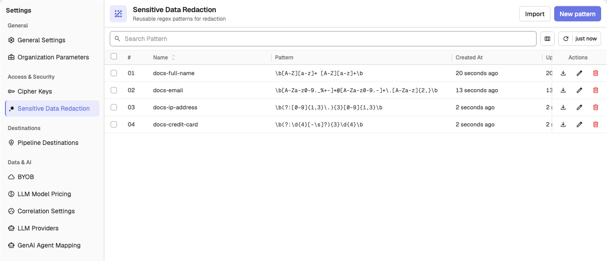

This opens the Sensitive Data Redaction interface, where you can view, create, and manage regex patterns available to the selected organization.
:::

:::note[Who can access]
`Root` users have full access to both pattern creation and pattern association by default. For other users, permissions are controlled via the **Regexp Patterns** and **Streams** module in the **IAM** settings, using [role-based access control (RBAC)](../identity-and-access-management/role-based-access-control.md).

**Pattern Creation:**

- Users need permissions on the **Regexp Patterns** module to create, view, edit, or delete regex patterns.
- You can control access at both the module level (all regex patterns) and the individual pattern level for precise control.

**Pattern Association:**

- To associate patterns with stream fields, users need List permission on **Regexp Patterns** AND edit permission on **Streams** modules. 
:::

:::warning[Important note]
- Regex patterns can only be applied to fields with UTF8 data type.
- The stream must have ingested data before you can apply regex patterns. Empty streams will not show field options for pattern association.
:::


## Create regex patterns

**To create a regex pattern:**

:::accordion[Step 1: Discover sensitive data]
### Step 1: Discover sensitive data
Identify which fields may contain sensitive data. 

1. From the left-hand menu, select **Logs**. 
2. In the stream selection dropdown, select the stream. 
3. Select an appropriate time range and click **Run query**. 
This shows the records for the selected time range. 
<br>
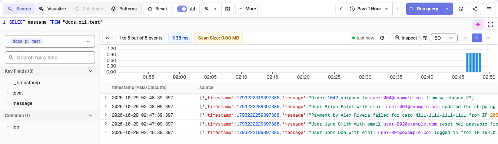

**Look for common sensitive patterns.**

| Sensitive Data Category | Examples | Common Fields |
|-----------|----------|---------------|
| **Personal Information** | Names, emails, phone numbers | `message`, `user_info`, `contact` |
| **Financial Data** | Credit cards, SSNs, bank accounts | `payment_info`, `transaction_data` |
| **Authentication** | API keys, tokens, passwords | `headers`, `auth_data`, `debug_info` |
| **Network Data** | IP addresses, MAC addresses | `client_ip`, `network_info` |

**Example Sensitive Data in Logs:**<br>
```json
{
"message": "User John Doe with email john.doe@company.com logged in from IP 192.168.1.100. SSN: 123-45-6789. Credit Card: 4111-1111-1111-1111",
"timestamp": "2025-07-30T10:30:00Z"
}
```
:::
:::accordion[Step 2: Create and test regex patterns]
### Step 2: Create and test regex patterns
To create regex patterns, navigate to **Settings** > **Sensitive Data Redaction** and click **New pattern**. 

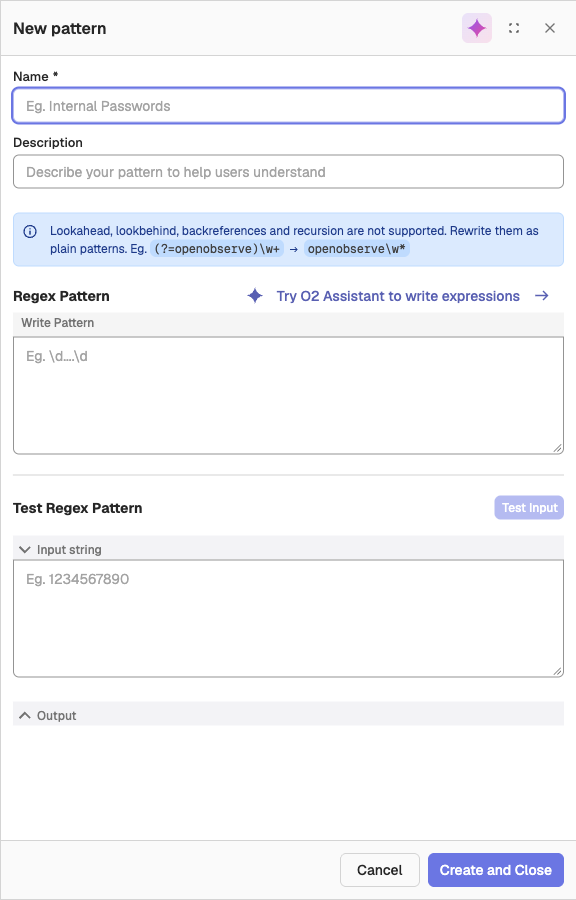

In the pattern creation form, enter the following details: 

1. **Name**: Enter a clear, descriptive name. For example, Email Detection. 
2. **Description:** (Optional)  Explain what the pattern is intended to detect.
3. **Regex Pattern**: Paste or write the regular expression you want to use. Refer to the following **common patterns**. Lookahead, lookbehind, backreferences and recursion are not supported. 
4. **Test Regex Pattern**: Enter an **Input string** and click **Test Input** to validate that the regex works as expected.
5. Click the **Create and Close** button to save the pattern. 

**Common Patterns**

| Type | Pattern | Example |
|------|---------|---------|
| **Email** | `\b[A-Za-z0-9._%+-]+@[A-Za-z0-9.-]+\.[A-Z\|a-z]{2,}\b` | `user@company.com` |
| **Full Name** | `\b[A-Z][a-z]+ [A-Z][a-z]+\b` | `John Doe` |
| **Phone (US)** | `\+?1?[-.\s]?\(?[0-9]{3}\)?[-.\s]?[0-9]{3}[-.\s]?[0-9]{4}` | `+1-555-123-4567` |
| **Credit Card** | `\b(?:\d{4}[-\s]?){3}\d{4}\b` | `4111-1111-1111-1111` |
| **SSN (US)** | `\b\d{3}-?\d{2}-?\d{4}\b` | `123-45-6789` |
| **API Key** | `\b[A-Za-z0-9]{32,}\b` | `sk_live_1234567890abcdef` |
| **IP Address** | `\b(?:[0-9]{1,3}\.){3}[0-9]{1,3}\b` | `192.168.1.100` |
| **Password Field** | `(?i)password[\"':\s=]+[\"']?([^\"'\s,}]+)` | `password: "secret123"` |

**Example** <br>
The following screenshots illustrate the pattern creation process:

1. Review the logs that include PII.
<br>
The `message` field in the `pii_test_stream` contains names, email addresses, IP addresses, SSNs, and credit card numbers.
<br>
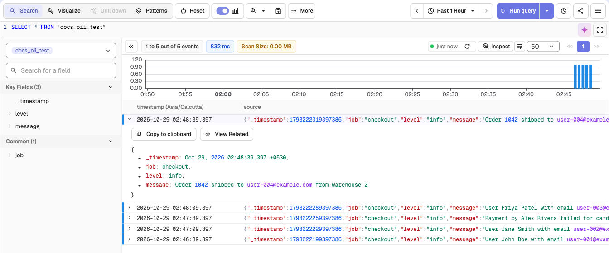
2. Create and test the regex patterns.
<br>
**Full Name**: 
![New pattern panel for a full-name regex, tested with the output showing [REDACTED]](../../../images/full-name-regex-v2.png)
<br>
**Email Addresses**:
![New pattern panel for an email regex, tested with the output showing [REDACTED]](../../../images/email-regex-v2.png)
:::

## Apply regex patterns 
Once your patterns are created and tested, you can apply them to specific fields in a stream to redact or drop sensitive data during ingestion or at query time.
<br>
**To apply a pattern to a field:**

:::accordion[Step 1: Go to the stream field]
### Step 1: Go to the stream field
1. From the left-hand menu, go to **Data** > **Streams**.
2. Locate the stream where you want to apply regex patterns and select **Stream Details** from the **Actions** column.
3. In the **Schema Settings** tab, locate the field that contains sensitive data. 

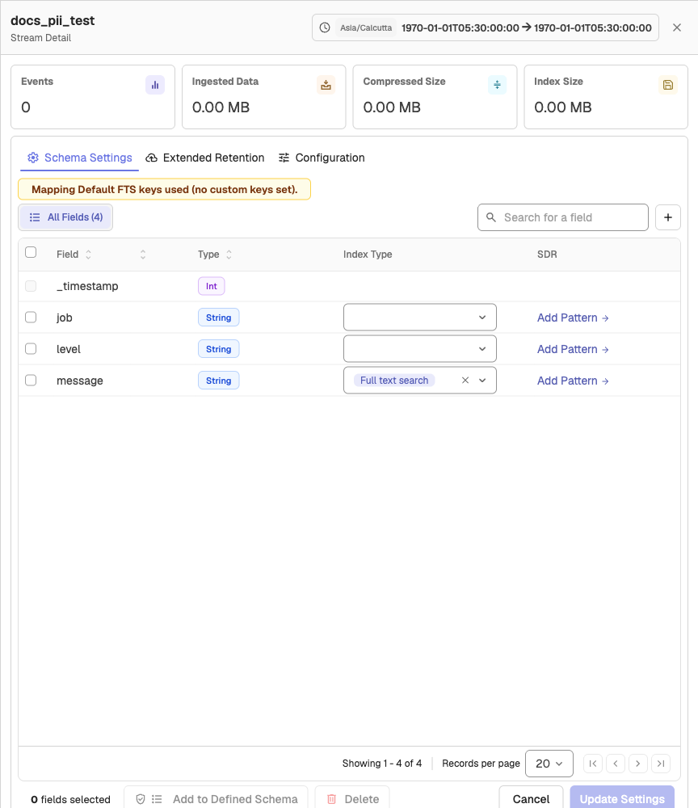
:::

:::accordion[Step 2: Add pattern]
### Step 2: Add pattern
1. Select **Add Pattern** for the target field. This opens the pattern panel, where you can view already applied patterns and add new ones.
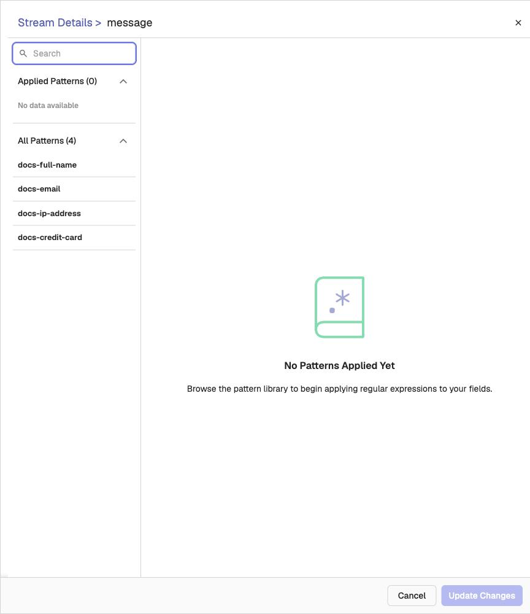
2. From the **All Patterns** section, select a pattern you want to apply. 
 
<br>
After selecting a pattern, a detail view appears.
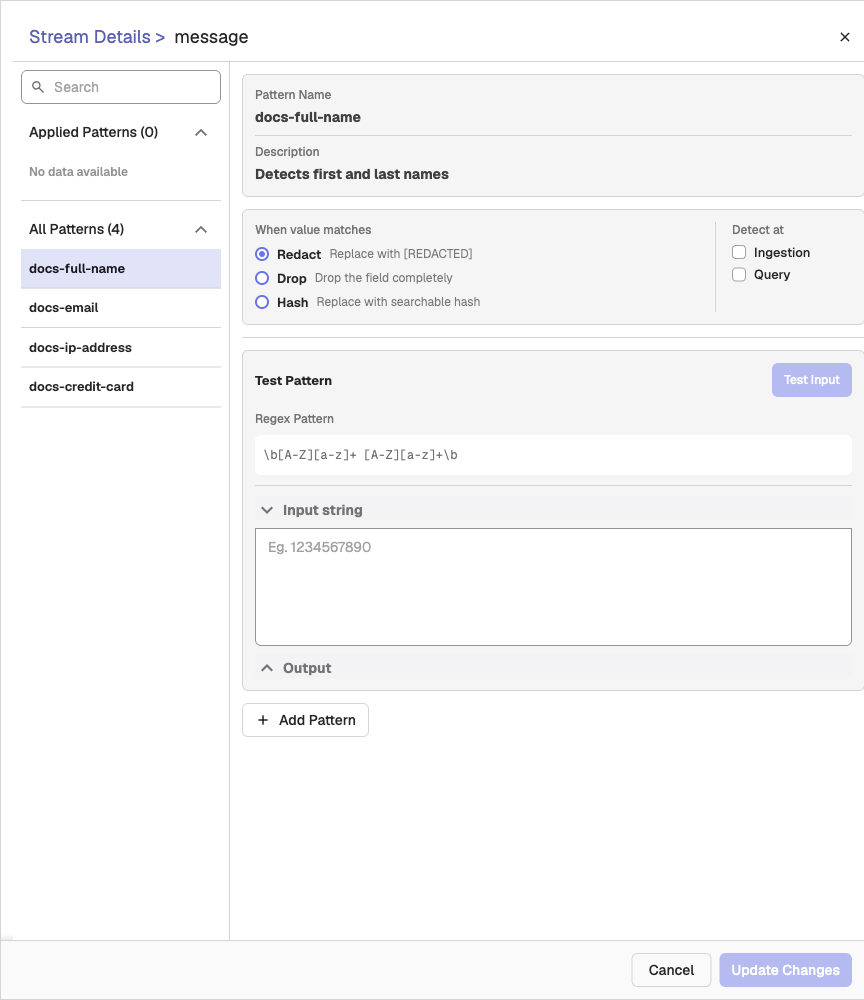
:::

:::accordion[Step 3: Choose whether to Redact, Hash, or Drop]
### Step 3: Choose whether to Redact, Hash, or Drop
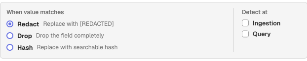

When applying a regex pattern, you must choose one of the following actions in the pattern details screen:

**Redact**:

- Replaces only the matching portion of the field value with `[REDACTED]`, while preserving the rest of the field.  
- Use this when the field contains both sensitive and non-sensitive information and you want to retain the overall context.

**Hash**:

- Replaces the matched sensitive value with a **searchable hash** while keeping its position within the field.  


**Drop**:

- Removes the entire field from the log record if the regex pattern matches.  
- Use this when the entire field should be excluded from storage or analysis.

Select the appropriate action. 
:::

:::accordion[Step 4: Choose when the action needs to be executed]
### Step 4: Choose when the action needs to be executed
In the pattern details screen, select when the chosen action (redact, hash, or drop) should be executed, at ingestion time, query time, or both.

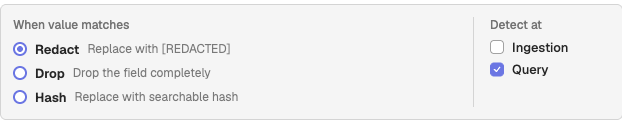

**Ingestion**: 

- The data is redacted, hashed, or dropped before it is written to disk.  
- This ensures that sensitive information is never stored in OpenObserve.  
- Example: If an email address is redacted at ingestion, only the masked value `[REDACTED]` will be stored in the logs.

**Query**:  

- The data is stored in its original form but is redacted, hashed, or dropped only when queried.  
- This allows administrators to preserve the original data while preventing exposure of sensitive values during searches.  
- Example: An email address stored in raw form will be hidden as `[REDACTED]` in query results.  

You can select one or both options depending on your security and compliance requirements.
**If neither ingestion time nor query time is selected, no redaction or drop is applied.**
:::

:::accordion[Step 5: Add pattern and update changes]
### Step 5: Add pattern and update changes

1. To add the regex pattern to Applied Patterns, click **Add Pattern**. 
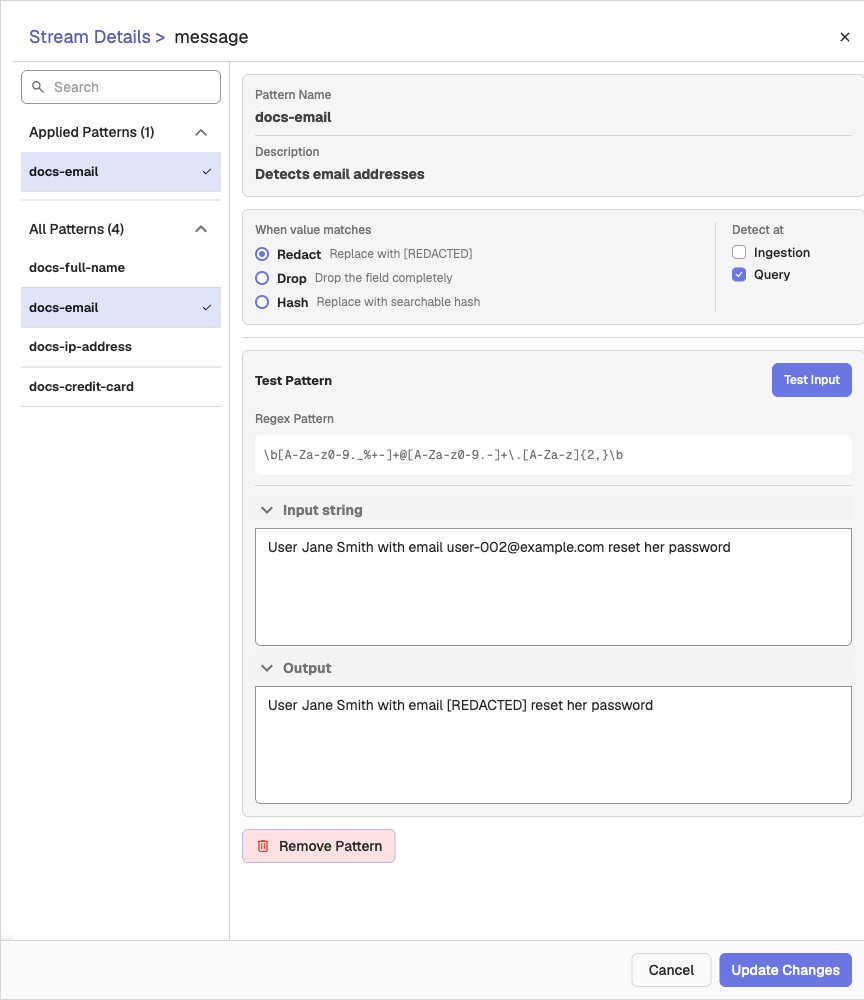
2. Select **Update Changes**.
:::

:::accordion[Step 6: (Optional) Apply multiple patterns]

You can apply multiple patterns to the same field, as shown below:
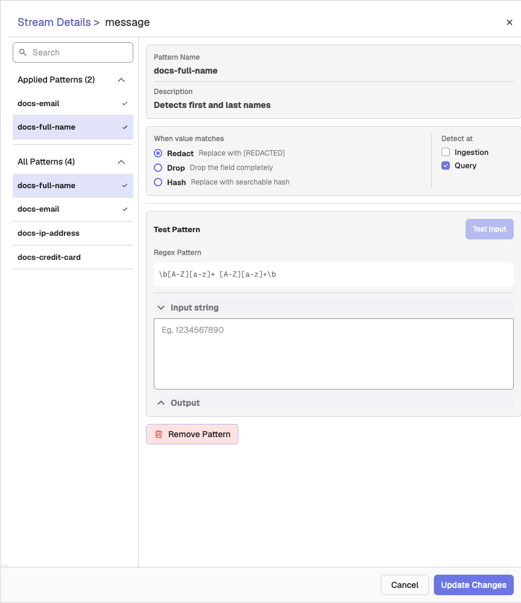 
All applied patterns will appear in the left-hand panel with check marks.
:::

:::accordion[Step 7: Save configuration]
### Step 7: Save configuration
When finished, click **Update Changes** to save the configuration. This activates the regex rules for the selected field.
:::


## Test Redact, Hash and Drop operations


:::accordion[Test 1: Redact at ingestion time]
### Redact at ingestion time
**Pattern Configuration**:
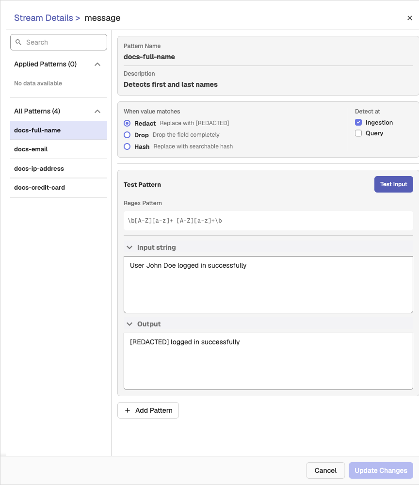

**Test Steps**:

1. From the left-hand menu, select **Logs**. 
2. Select the `pii_test` stream from the dropdown.
3. Ingest a log entry containing a full name in the message field. 
```bash
$ curl -u example@example.com:FNIB8MWshsuhyehH -k https://example.zinclabs/api/default/pii_test/_json -d '[{"level":"info","job":"test","message":"User John Doe logged in successfully"}]'
{"code":200,"status":[{"name":"pii_test","successful":1,"failed":0}]}
```
4. Set the time range to include the test data.
5. Click **Run query**.
6. Verify results:
![Logs result where the name was stored as [REDACTED]](../../../images/redact-at-ingestion-time-result-v2.png)

**Key points:**

- The name "John Doe" is replaced with [REDACTED].
- The rest of the message field remains intact.
- This is the actual stored value on disk.
:::


:::accordion[Test 2: Drop at ingestion time]
### Drop at ingestion time
**Pattern Configuration**:
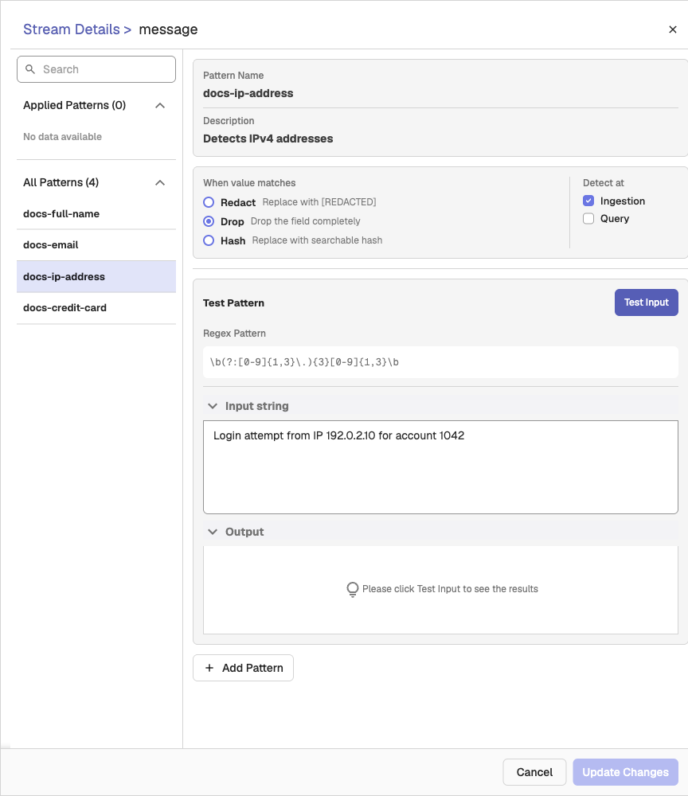

**Test Steps:**

1. From the left-hand menu, select **Logs**. 
2. Select the `pii_test` stream from the dropdown.
3. Ingest a log entry containing an IP address in the message field. 
```bash
$ curl -u example@example.com:FNIB8MWshsuhyehH -k https://example.zinclabs/api/default/pii_test/_json -d '[{"level":"info","job":"test","message":"Connection from IP 192.168.1.100 established"}]'
{"code":200,"status":[{"name":"pii_test","successful":1,"failed":0}]}
```
4. Set the time range to include the test data.
5. Click **Run query**.
6. Verify results:
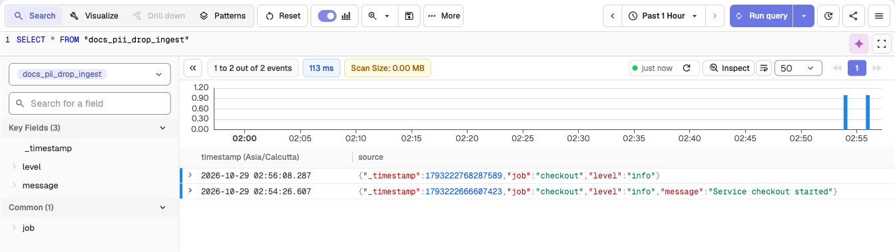

**Key points:** 

- The entire message field is missing from the stored record. 
- Other fields remain intact. 
- This demonstrates field-level drop at ingestion. 
:::

:::accordion[Test 3: Hash at ingestion time]
### Hash at ingestion time
**Pattern Configuration**:
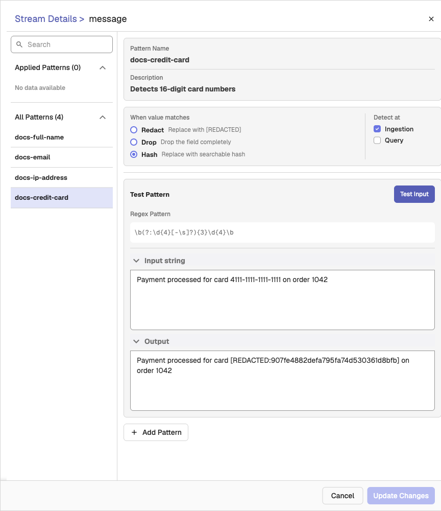

**Test Steps:**

1. From the left-hand menu, select **Logs**. 
2. Select the `pii_test` stream from the dropdown.
3. Ingest a log entry containing a card details in the logs field. 
```bash
$ curl -u example@example.com:FNIB8MWshsuhyehH -k https://example.zinclabs/api/default/pii_test/_json -d '[{"job":"test","level":"info","log":"Payment processed with card 4111-1111-1111-1111"}]'
```
4. Set the time range to include the test data.
5. Click **Run query**.
6. Verify results:
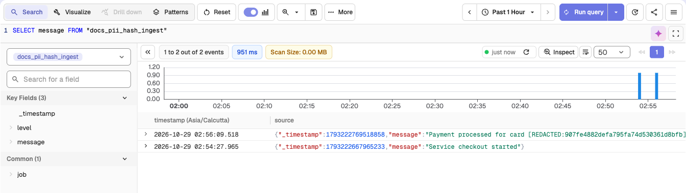
:::

:::accordion[Test 4: Redact at query time]
### Redact at query time
**Pattern Configuration**:
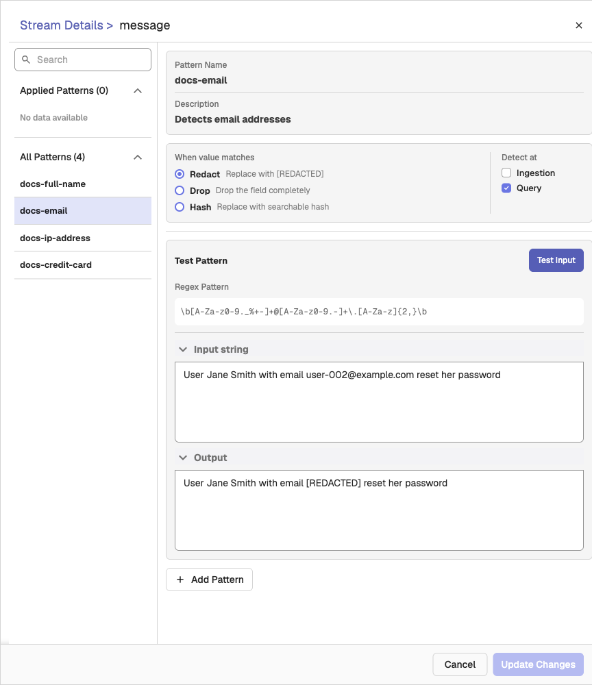

**Test Steps:**

1. From the left-hand menu, select **Logs**. 
2. Select the `pii_test` stream from the dropdown.
3. Ingest a log entry containing an email addresses in the message field. 
```bash
$ curl -u example@example.com:FNIB8MWshsuhyehH -k https://example.zinclabs/api/default/pii_test/_json -d '[{"level":"info","job":"test","message":"Password reset requested for john.doe@company.com"}]'
{"code":200,"status":[{"name":"pii_test","successful":1,"failed":0}]}

```
4. Set the time range to include the test data.
5. Click **Run query**.
6. Verify results:
![Logs results where email addresses show as [REDACTED] at query time](../../../images/redact-at-query-time-result-v2.png)

**Key points:** 

- Original data is preserved on disk.
- Email address appears as [REDACTED] in query results.
- Useful for compliance while maintaining data for authorized access.
:::


:::accordion[Test 5: Drop at query time]
### Drop at query time
**Pattern Configuration**:
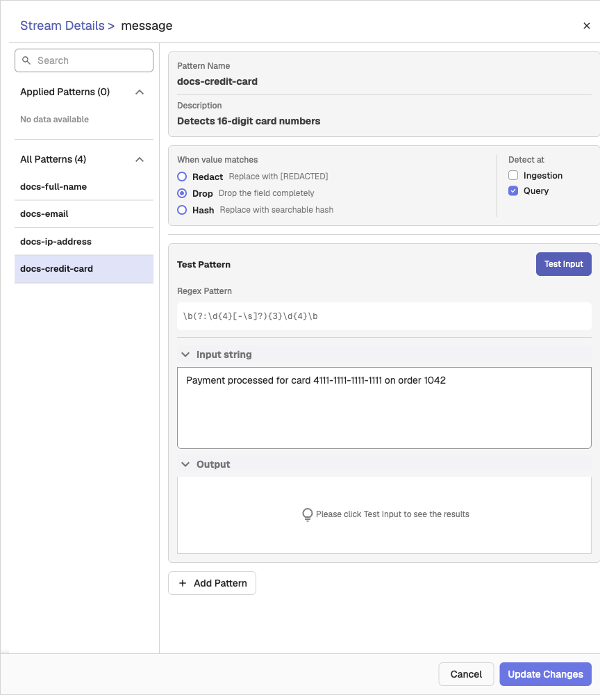

**Test Steps:**

1. From the left-hand menu, select **Logs**. 
2. Select the `pii_test` stream from the dropdown.
3. Ingest a log entry containing credit card details in the message field. 
```bash
$ curl -u example@example.com:FNIB8MWshsuhyehH -k https://example.zinclabs/api/default/pii_test/_json -d '[{"level":"info","job":"test","message":"Payment processed with card 4111-1111-1111-1111"}]'
{"code":200,"status":[{"name":"pii_test","successful":1,"failed":0}]}
```
4. Set the time range to include the test data.
5. Click **Run query**.
6. Verify results:
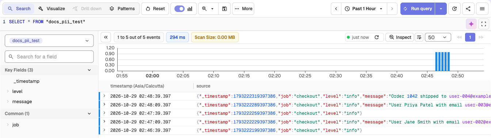

**Key points:** 

- Original data is preserved on disk.
- The `message` field with the credit card details gets dropped in query results.
- This demonstrates field-level drop at query time. 
:::

:::accordion[Test 6: Hash at query time]
### Hash at query time
**Pattern Configuration**:
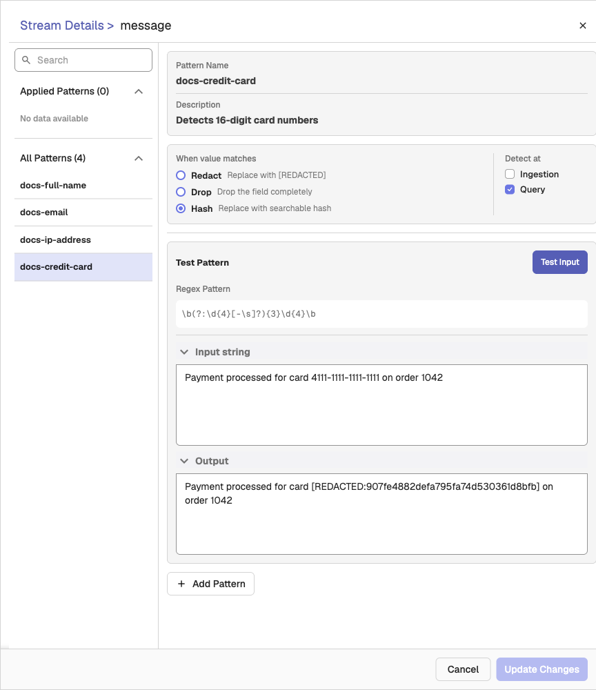

**Test Steps:**

1. From the left-hand menu, select **Logs**. 
2. Select the `pii_test` stream from the dropdown.
3. Ingest a log entry containing a card details in the logs field. 
```bash
$ curl -u example@example.com:FNIB8MWshsuhyehH -k https://example.zinclabs/api/default/pii_test/_json -d '[{"job":"test","level":"info","log":"Payment processed with card 4111-1111-1111-1111"}]'
```
4. Set the time range to include the test data.
5. Click **Run query**.
6. Verify results:
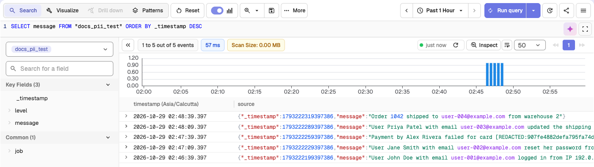
:::

## Search hashed values using `match_all_hash`
The `match_all_hash` user-defined function (UDF) complements the SDR Hash feature. It allows you to search for logs that contain the hashed equivalent of a specific sensitive value.
When data is hashed using Sensitive Data Redaction, the original value is replaced with a searchable hash. You can use `match_all_hash()` to find all records that contain the hashed token, even though the original value no longer exists in storage. <br>
**Example**: 
```sql
match_all_hash('4111-1111-1111-1111')
```
This query returns all records where the SDR Hash of the provided value exists in any field.
In the example below, it retrieves the log entry containing
[REDACTED:907fe4882defa795fa74d530361d8bfb], the hashed version of the given card number.

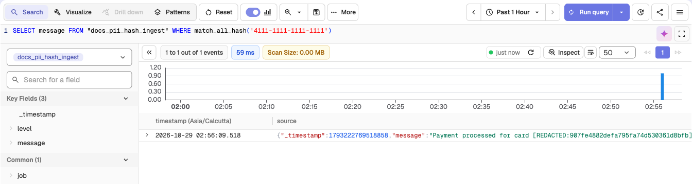


## Import patterns from built-in library
OpenObserve provides a built-in library of 147+ pre-configured regex patterns that can be imported directly into your organization. These patterns cover common sensitive data types and security-related formats, allowing you to quickly implement data protection without writing regex patterns from scratch.
<br>

**To import patterns from the built-in library:**

:::accordion[Step 1: Navigate to the Import section]
### Step 1: Navigate to the Import section

1. Go to **Settings** > **Sensitive Data Redaction**.
2. Click the **Import** button in the top-right corner.
3. The **Import Pattern** screen opens with three tabs:
    - **Built-in Patterns**: Pre-configured patterns from OpenObserve's pattern library
    - **File Upload / JSON**: Import patterns from a JSON file
    - **URL Import**: Import patterns from a URL
4. Select the **Built-in Patterns** tab.

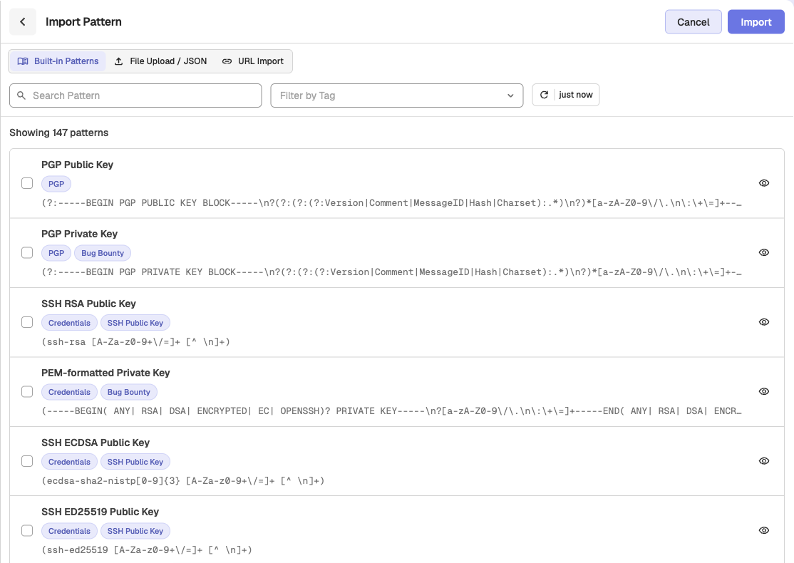
:::

:::accordion[Step 2: Browse and search patterns]
### Step 2: Browse and search patterns

The built-in patterns library displays 147 patterns. You can:

- **Search patterns**: Use the search bar to find patterns by name
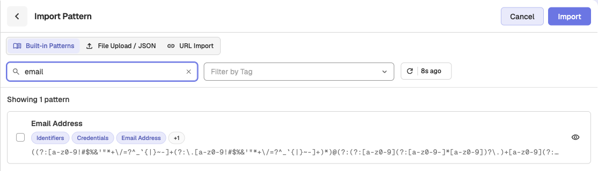
- **Filter by tags**: Use the "Filter by Tag" dropdown to narrow patterns by category 
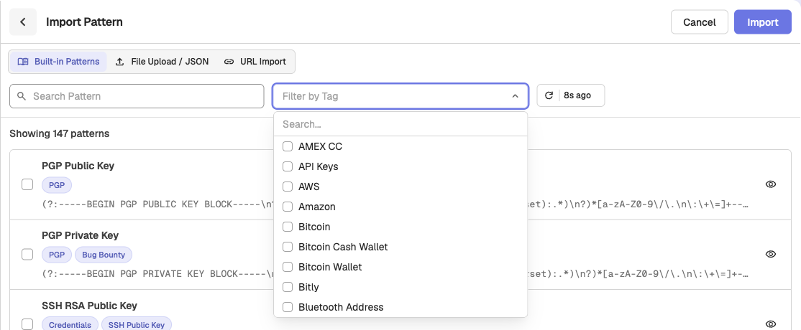
- **Refresh**: Click the **Refresh** button to pull the latest patterns from the GitHub repository
:::

:::accordion[Step 3: View pattern details]
### Step 3: View pattern details

To view details about a pattern before importing:

1. Click the eye icon next to any pattern in the list.
2. A detail panel displays:

    - **Description**: What the pattern detects
    - **Pattern**: The actual regex expression
    - **Tags**: Categories the pattern belongs to
    - **Rarity**: How commonly this pattern is used
    - **Valid Examples**: Sample data that matches this pattern

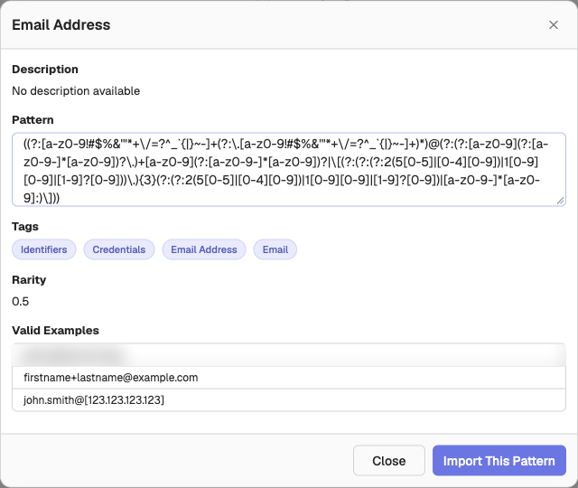

This helps you verify the pattern will match your expected data format before importing.
:::

::::accordion[Step 4: Select and import patterns]
### Step 4: Select and import patterns

1. **Select patterns**: Check the box next to each pattern you want to import. You can select multiple patterns at once.
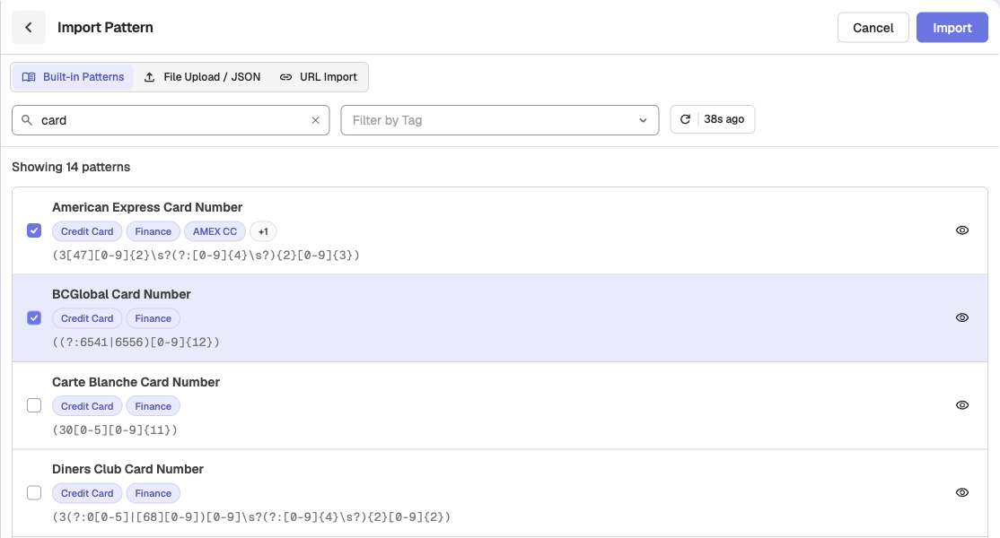
2. **Import**: Click the **Import** button in the top-right.
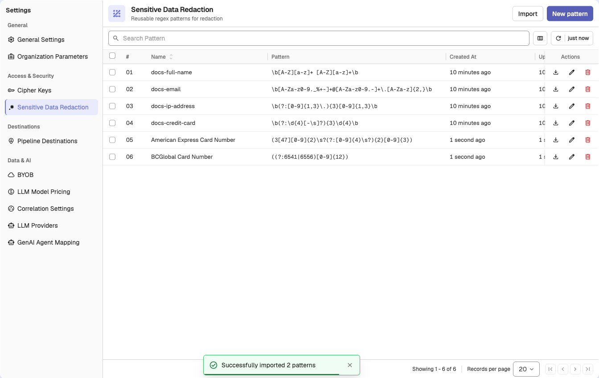

After importing patterns, you can edit, export, and delete the patterns. 
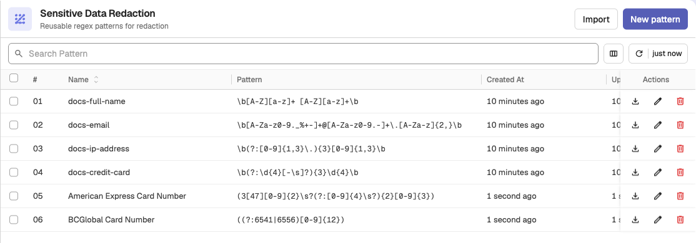

:::warning[Duplicate handling]
The system does not allow you to import the same pattern more than once to avoid duplicates. 
:::
::::


## Limitations

- **Pattern Matching Engine**: OpenObserve uses the Intel Hyperscan library for regex evaluation. All Hyperscan limitations apply to pattern syntax and matching behavior.
- **Field Type Restrictions**: Regex patterns can only be applied to fields with a UTF8 data type. Other field types are not supported.
- **Data Requirements**: Patterns can only be applied after the stream has ingested data. Empty streams will not show any fields in the Stream Settings tab for pattern association.
- **Performance**: Complex patterns can slow ingestion, but overall performance remains faster than VRL-based redaction. 

## Troubleshooting
| **Issue**                                                | **Cause**                             | **Solution**                                                                              |
| -------------------------------------------------------- | ------------------------------------- | ----------------------------------------------------------------------------------------- |
| The Add Pattern option is not visible in Stream Details. | The field is not of UTF8 type.        | Check the field type in the Stream Details view. Only UTF8 fields support regex patterns. |
| Pattern does not apply.                                  | Configuration changes were not saved. | Ensure that you selected **Update Changes** after applying the pattern.                   |


