# Advanced Alert Configuration

This page covers advanced alert features: warning thresholds alongside critical thresholds, per-group multi-alert evaluation, priority and tags for triage, pending periods to delay firing, and SLO-based alerting.

## Multi-level thresholds

For scheduled alerts, you can define a **warning** threshold in addition to the **critical** threshold. The warning level provides an early signal without triggering the same urgency as critical. It appears in the alert history and on the alerts list as a separate severity axis alongside the firing outcome.

### Count-based alerts

In count-based alerts (the default "total events" mode), click **Add warning** to add an optional **Warning if** threshold below the **Critical if** threshold. The operator is shared between warning and critical — the warning value must be strictly less severe than the critical value:

- For `>=` / `>`: warning must be **smaller** (e.g. critical=100, warning=50)
- For `<=` / `<`: warning must be **larger** (e.g. critical=10, warning=25)
- `=` / `!=` / `Contains` do not support a warning level

When the evaluation exceeds the critical threshold, the alert fires at `critical`. When it crosses only the warning threshold, it fires at `warning`. The alert's `notify_on_warning` field controls whether a warning-level match sends a notification. It defaults to `true`; the form has no control for it, so set it to `false` through **Edit Alert JSON** or the API. When it is `false`, warnings still update state and appear in the UI but do not page anyone.

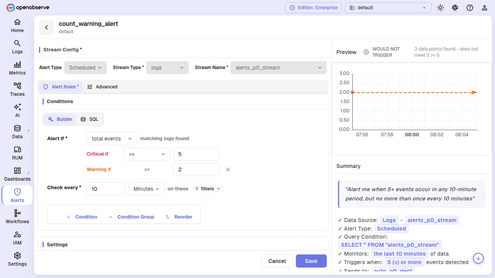

### Aggregation alerts

Aggregation alerts (measure mode with avg, sum, min, max, etc.) take the same optional **Warning if** threshold through **Add warning**. The **Critical if** value remains the critical threshold; the warning value must be strictly less severe and shares the same operator and column.

The SQL `HAVING` clause widens to admit the warning band, then OpenObserve classifies each group in Rust so the two bands stay independent. A group at warning does not inflate the critical count.

The **Having groups** count in the **Conditions** section also accepts an optional warning count — for example, "critical when at least 5 groups cross the critical value, warning when at least 2 groups cross the warning value."

### PromQL alerts

PromQL alerts take the same optional **Warning if** threshold through **Add warning**. The operator is shared. The PromQL expression widens to evaluate at the less severe threshold, then each series is re-classified against both bands in Rust. Under **Alert aggregation**, choose **Multi alert (per series)** (`promql_multi_alert`) to evaluate each series independently, using the series' full label set as the group key — the PromQL counterpart to aggregation multi-alerts.

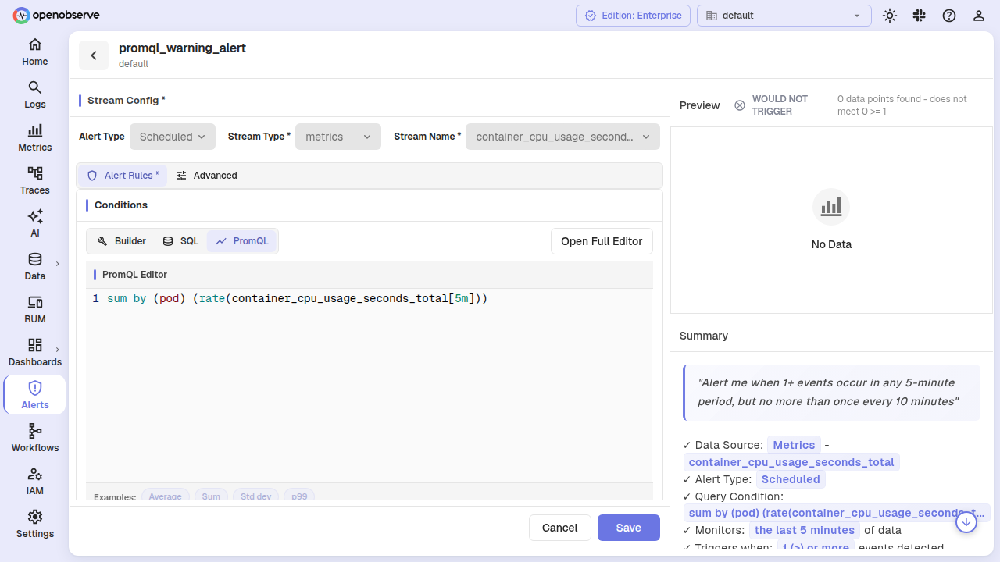

## Multi-alerts (per-group evaluation)

When an aggregation alert uses **Group by**, you can opt into per-group evaluation by choosing **Multi alert** under **Alert aggregation**. Each unique group-by combination gets its own level, state row, and notification path, instead of the alert collapsing every group into a single verdict. **SQL** query-type alerts support the same per-group evaluation, deriving their groups from the query's own `GROUP BY` clause (see [SQL multi-alerts](#sql-multi-alerts) below).

### Enabling multi-alert

Once **Group by** has at least one field, the **Alert aggregation** choice appears with **Simple alert** and **Multi alert**. Choose **Multi alert**. The operator must be orderable (`>=`, `>`, `<=`, `<` — not `=` or `!=`).

When enabled, the alert evaluates the condition per group. Each group's aggregate value is classified against critical and warning thresholds independently, and each group alerts, recovers, and notifies on its own.

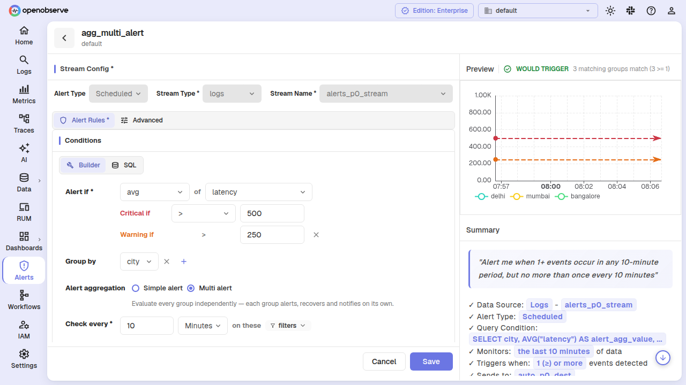

### Group state and lifecycle

When a group's level changes (e.g. from `ok` to `critical`), OpenObserve records a **transition** in a durable table so history survives group reaping. The scheduler tracks every group in the `alert_states` table, up to a configurable cap (`ZO_ALERT_MAX_GROUPS`, default 500).

Groups that disappear from evaluation results do not immediately resolve. A group must be unseen for `K` times the alert's evaluation frequency (`ZO_ALERT_GROUP_DISAPPEARANCE_K`, default 3) before it is resolved to `ok`. After resolution, the state row is retained for a grace period (`ZO_ALERT_GROUP_REAP_GRACE_SECS`, default 3600 seconds) and then deleted. Transition history is kept regardless.

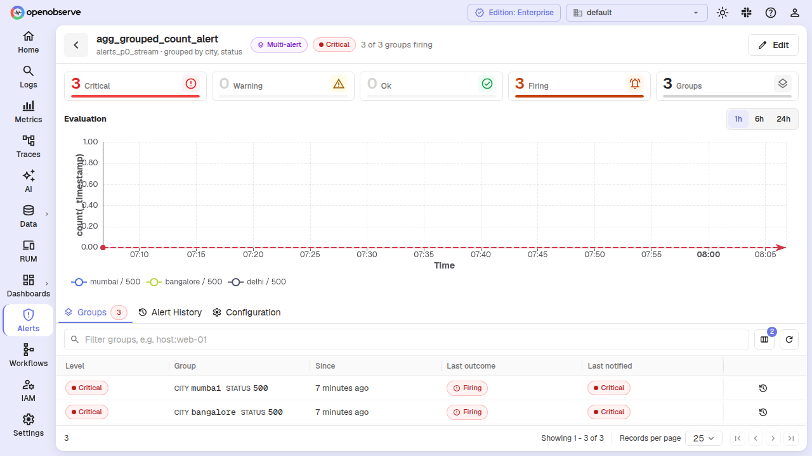

### Viewing group details

On the alerts list, the **Groups** column shows how many groups are firing out of how many were observed. Click the alert to open its detail page, then select the **Groups** tab to see the per-group breakdown — most severe first, with level, last outcome, and when the group was last seen.

From a group row, open its history and switch between the **Evaluations** and **Level changes** views to see every level and outcome change with timestamps and observed values.

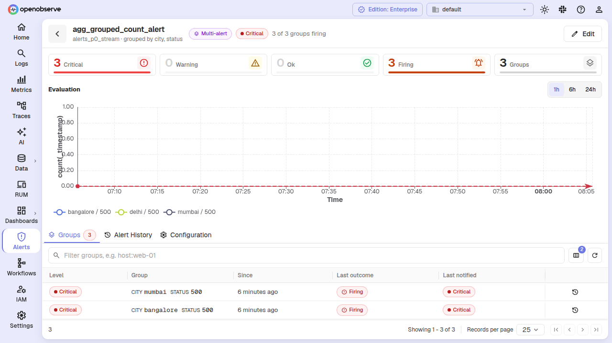

### SQL multi-alerts

**SQL** query-type alerts can opt into per-group evaluation too. Unlike the builder — where you pick the **Group by** fields yourself — a SQL multi-alert derives its groups from the query's own `GROUP BY` clause, and compares a single aggregate value column from the query's output.

#### Enabling SQL multi-alert

In SQL mode, the **Alert aggregation** choice always appears above the condition row. Leave it on **Simple alert** to alert on the total number of returned rows (**Alert if No. of events**), or switch to **Multi alert** to classify each group independently.

When you choose **Multi alert**, the condition row becomes **Alert if [column]**:

- **Column**: a dropdown listing the query's resolved output columns (the columns your SQL actually projects). Select the aggregate value column the alert should compare.
- **Critical if**: the operator and threshold applied to that column.
- **Warning if** (optional): a less-severe threshold that shares the critical operator.

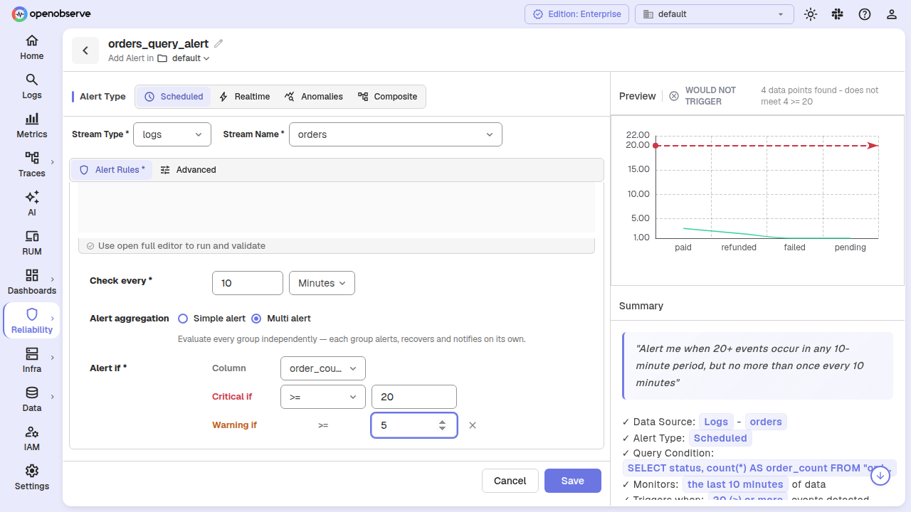

#### Grouping and validation

A SQL multi-alert does not expose a **Group by** picker — the groups are the fields in your query's `GROUP BY` clause. On save, OpenObserve verifies that:

- the query has at least one `GROUP BY` field;
- every group-by field is present in the projections, without an alias; and
- the selected **Column** is one of the query's output columns.

If any of these checks fail, saving is rejected with a `400` error describing the missing or aliased field.

#### HAVING clause warning

If your SQL includes a `HAVING` clause, OpenObserve shows a warning banner: *Having clause in query will apply before the filters of alert if condition*. The clause filters your result set before the multi-alert's **Alert if** condition evaluates it, so a group that fails the `HAVING` filter never reaches the threshold check.

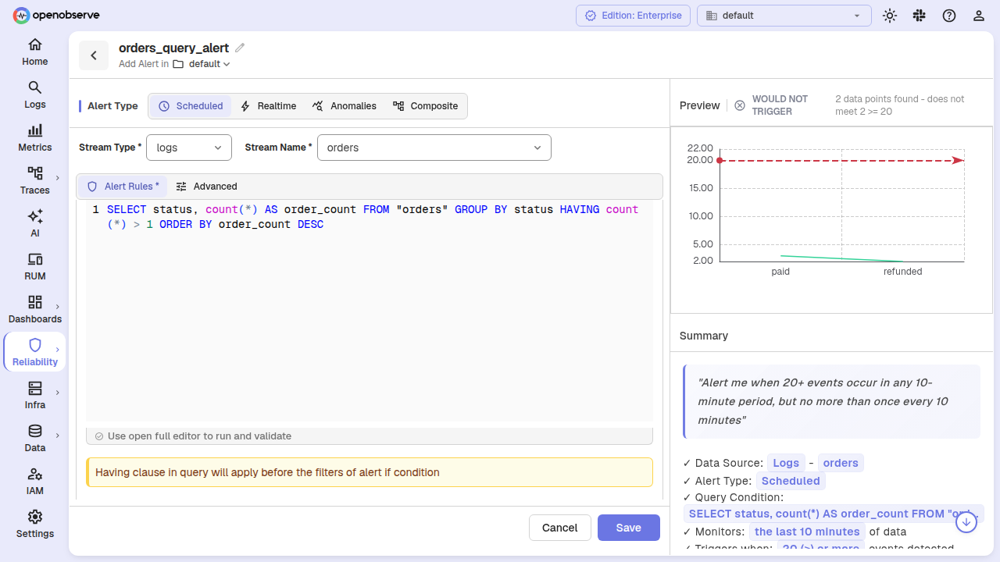

#### Group-count gate

As with builder multi-alerts, the group-count gate is pinned to **at least 1 group** — the alert fires whenever any single group crosses the threshold.

## Alert priority

Assign a **Priority** (P1 through P5, P1 = most urgent) to any scheduled, real-time, or anomaly detection alert. Priority is display-and-propagation metadata — it does not influence evaluation, silence, delivery, or incident severity.

### Setting priority

In the alert creation or edit form, open the **Advanced** tab and select a priority from the **Priority** dropdown. Clear it to return to **Unset**.

### Filtering and sorting by priority

On the alerts list page, the **Priority** column is sortable: click its header. Unset priority sorts last in either direction.

The list API can also filter by priority (OR semantics — `?priority=1&priority=2` returns P1 or P2). Alerts with no priority are excluded whenever a filter is active — "show me the P1s" does not surface unprioritized alerts.

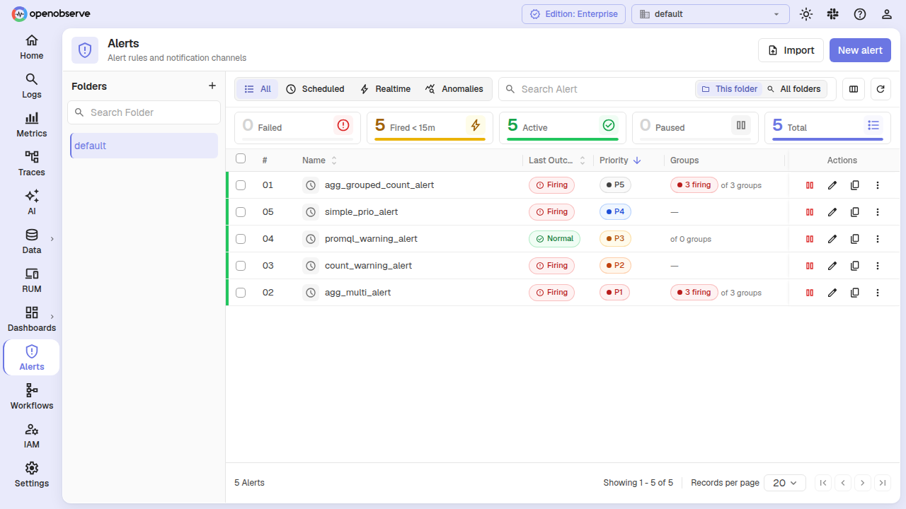

## Alert tags

**Tags** are free-form selection labels (e.g. `prod`, `service:checkout`) that make alerts searchable and filterable. Tags are normalized to lowercase on save and validated for allowed characters.

### Adding tags

On the alert form's **Advanced** tab, add one or more **Tags**. Tags are case-normalized automatically — `PROD` and `prod` resolve to the same tag. Invalid characters are rejected at save time with a validation error.

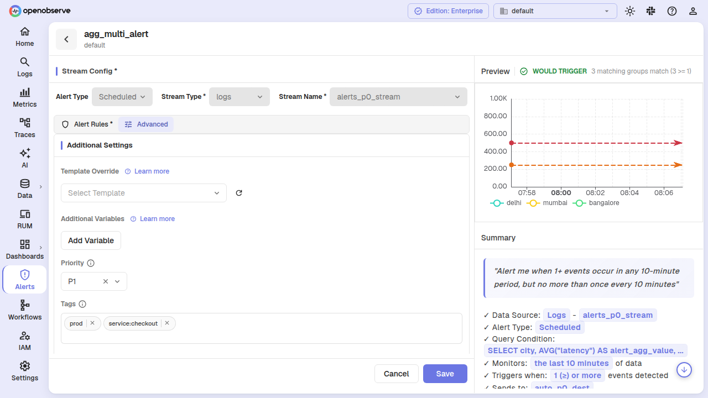

### Filtering by tags

On the alerts list, the **Tags** column shows each alert's tags. The list API accepts `?tags=prod,service:checkout` to return only alerts that carry **every** listed tag (AND semantics). An invalid tag token is retained rather than silently dropped — a request for a tag that no alert carries returns an empty result, not every alert.

### Tags facet

The tags facet endpoint (`GET /v2/{org}/alerts/tags`) returns distinct tags with occurrence counts across the alerts the caller can see. It supports an optional `?prefix=` parameter for autocomplete and a `?folder=` parameter to scope to one folder. The response is authorization-aware: it only returns tags from alerts the caller has permission to list.

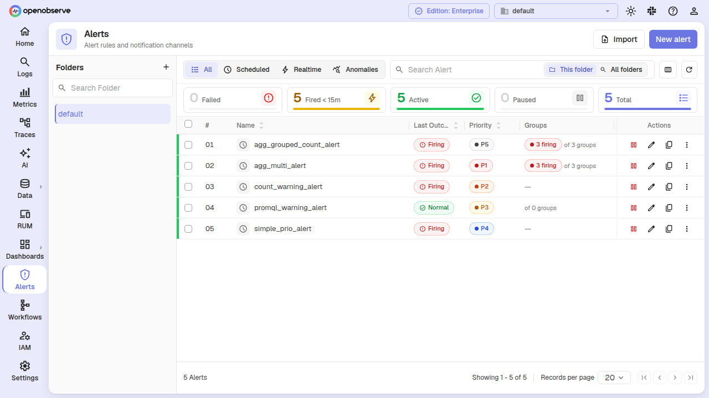

## Pending period (hold before firing)

The **Hold for** setting adds a pending period to scheduled and composite alerts. When a condition first matches, the alert does not fire immediately. Instead it enters a **pending** state, and the condition must keep matching for the configured period before the alert transitions to **firing** and sends a notification.

This prevents flapping: a condition that trips on one bad interval and then recovers never pages anyone, because the alert only fires after the condition has held for the full pending period.

### Configure the pending period

In the **Settings** section of the alert form (on the **Alert Rules** tab for scheduled alerts), set **Hold for** to a number and pick a unit, **Minutes** or **Hours**:

- Leave it blank or `0` to fire immediately (the default).
- A value greater than `0` means the condition must hold that long before the alert fires.

The tooltip on the info icon next to the label reads: *"Wait this long before firing, so a condition has to hold rather than trip on one bad interval."*

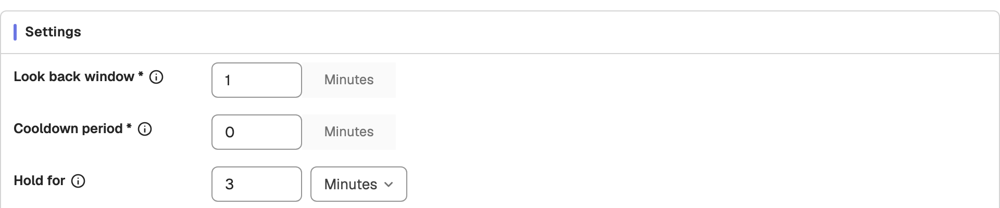

For scheduled alerts, if the pending period is not a multiple of **Check every**, OpenObserve shows a warning that the alert may wait up to one extra evaluation interval before firing. This is only a hint; it does not block saving.

In the API, the value is the alert's `pending_period_sec` field, in seconds.

### How the pending state works

When a condition matches and the pending period has not yet elapsed:

- The alert's last outcome becomes `pending`, alongside `firing`, `normal`, `error`, `notify_failed`, and `succeeded`.
- Notifications are suppressed while the alert is pending.
- Once the condition has held for the full pending period, the alert transitions to `firing` and notifies. If the condition recovers during the pending period, the alert returns to `normal` without ever notifying.

### Where the pending period appears

- **Alert form summary**: the summary panel in the alert form adds a **Hold for** line (for example "Hold for: 10 minutes before firing"), and the plain-English sentence ends with ", after holding for 10 minutes". A value of `0` reads as "Fires immediately".
- **Alert detail page**: the **Configuration** tab lists **Hold for** next to **Check every** and the cooldown period.

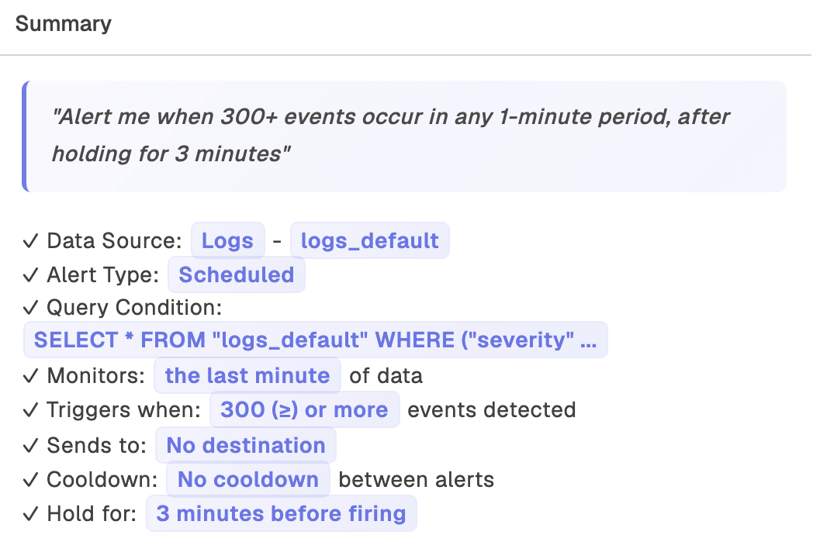

- **Alert history**: on the alert's detail page, the **Alert History** tab marks each pending evaluation with a blue **Pending** status. In the example below, the condition matched for three minutes of **Pending** evaluations before the alert started **Firing**. Alert history timelines also count pending evaluations in their own blue **Pending** bucket, separate from firing, OK, error, and skipped evaluations.

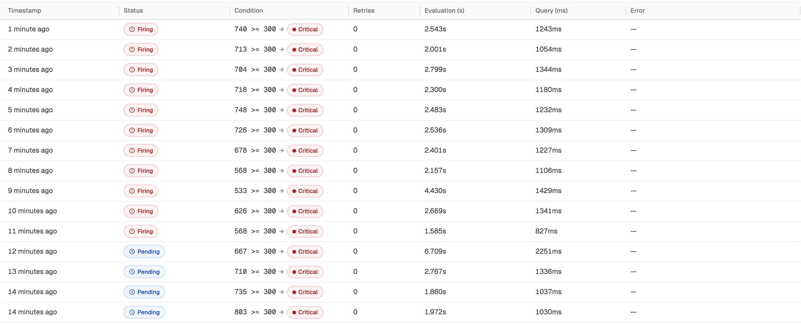

### Constraints

- The pending period must be `0` or greater. A negative value is rejected with a validation error.
- Real-time alerts do not support a pending period. The form does not show the field and saves `0`; an API request that sets a non-zero value on a real-time alert is rejected.

## Run state on the alerts list

The alerts list includes live run state for each alert, enriched from the durable `alert_states` table:

- **Last Outcome** column: `firing`, `pending`, `normal`, `error`, `notify_failed`, or `succeeded` — the result of the last evaluation
- Level: `ok`, `warning`, or `critical` — a separate severity axis from the outcome. An alert can be `firing` at `warning`. The list API also returns how long the alert has been at its current level

For multi-alerts, the **Groups** column shows the firing and observed group counts (`groups_firing`, `groups_observed`), with a `≥` marker when the count is a lower bound (the group page was full, and groups beyond the cap were never seen).

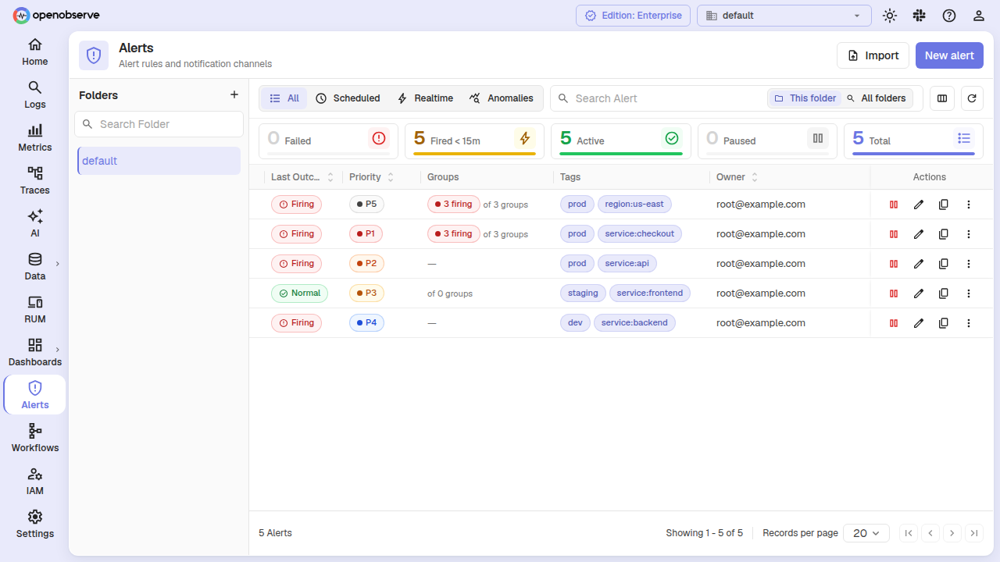

## Enhanced alert history

Alert history entries now carry value context so each row reads standalone:

- **Level**: the severity of the matched threshold (`critical` or `warning`)
- **Actual value**: the value that was compared (row count or aggregate)
- **Threshold value**: the threshold that matched
- **Threshold operator**: e.g. `>=`
- **Group label**: which group produced the value, for multi-alerts and grouped queries
- **Value is lower bound**: `≥` marker for legacy capped count fetches

Outcome values are normalized across the retention window: `firing`, `pending`, `normal`, `error`, `notify_failed`, and `succeeded` replace the older `completed` / `condition_not_met` vocabulary.

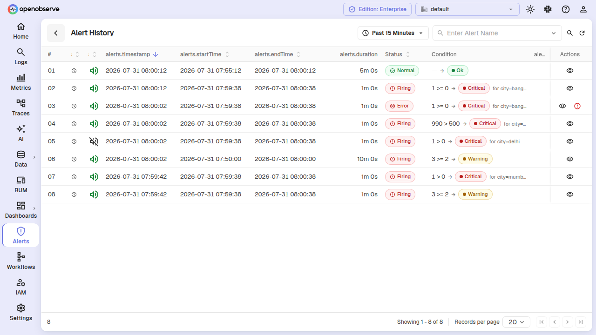

## SLO alerts

SLO alerts read precomputed SLO status rather than running a query directly. You create them on the SLO's own page, on its **Alerts** tab, not from the alert form; each one is bound to that SLO. The SLO's burn rate or error budget is evaluated externally, and the alert fires based on the SLO's computed status. See [SLO Alerts](../slos/slo-alerts.md).

SLO alerts use a dedicated `QueryType::Slo`. Their deduplication identity is the SLO itself (plus its group key when grouped), not columns of a result row — there is no SQL, PromQL, or condition list to draw column names from.

SLOs are available in all editions and need no feature flag. SLO CRUD endpoints live under `/api/{org}/slos` and share the alert folder namespace. On the alerts list, SLO alerts carry an **SLO** badge, and they cannot be cloned from the list.

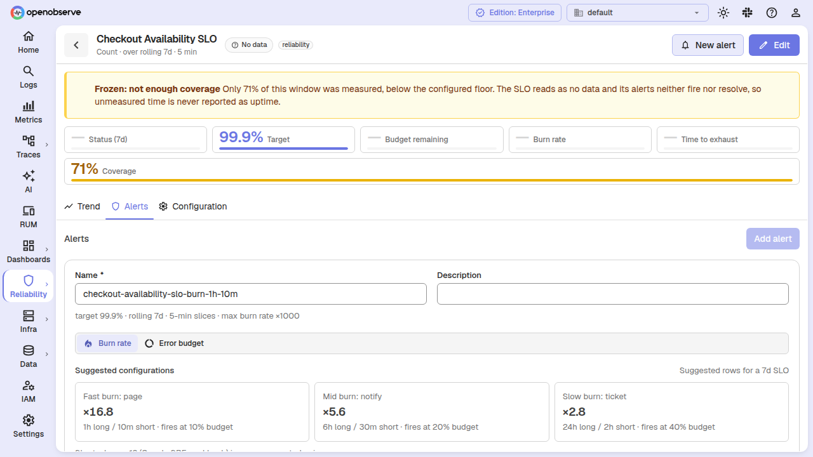

## New configuration

| Variable | Default | Description |
|----------|---------|-------------|
| `ZO_ALERT_MAX_GROUPS` | `500` | Max per-group state rows per multi-alert. `0` = unlimited. |
| `ZO_ALERT_GROUP_DISAPPEARANCE_K` | `3` | A group unseen for K x the alert's frequency is resolved to `ok`. |
| `ZO_ALERT_GROUP_REAP_GRACE_SECS` | `3600` | How long a resolved group's state row is retained before deletion. |
| `ZO_ALERT_MAX_GROUP_NOTIFICATIONS_PER_EVAL` | `0` | Cap on per-group notifications per evaluation. `0` = unlimited. |
| `ZO_ALERT_GROUP_SWEEP_INTERVAL` | `60` | How often the group lifecycle sweep runs, in seconds. `0` disables it. |
| `ZO_ALERT_HYBRID_COUNT_THRESHOLD` | `100` | Count-based alerts exceeding this row sentinel use a `COUNT(*)` decision query. |

## API endpoints

### Group state and history

- **`GET /api/v2/{org}/alerts/{id}/groups`** — Lists per-group state rows for a multi-alert, most severe first, with pre-cap group counts for the "N of M groups firing" chip. Returns empty for alerts that have not opted into per-group evaluation.

- **`GET /api/v2/{org}/alerts/{id}/groups/transitions`** — Returns level/outcome transitions for a multi-alert, newest first. Accepts optional `?group_key=` to scope to one group and `?limit=` (default 100, max 1000).

### Tags facet

- **`GET /api/v2/{org}/alerts/tags`** — Returns distinct tags with occurrence counts across the alerts the caller can see. Accepts `?prefix=` for autocomplete, `?limit=` (default 100, max 1000), and `?folder=` for scoping. Authorization-aware — only returns tags from visible alerts.

### List filters and sorting

The existing `GET /api/v2/{org}/alerts` endpoint accepts new query parameters:

- `?priority=1,2` or `?priority=1&priority=2` — filter by priority (OR semantics)
- `?tags=prod,service:checkout` — filter by tags (AND semantics)
- `?sort_by=priority|name` — sort column
- `?sort_order=desc` — sort direction

