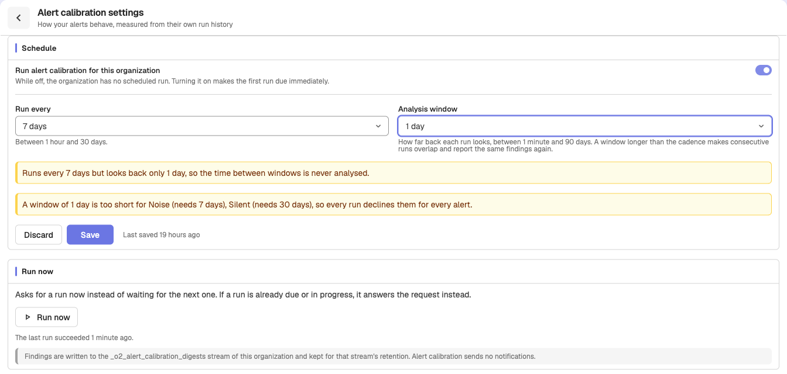
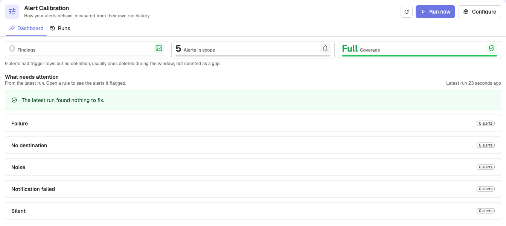
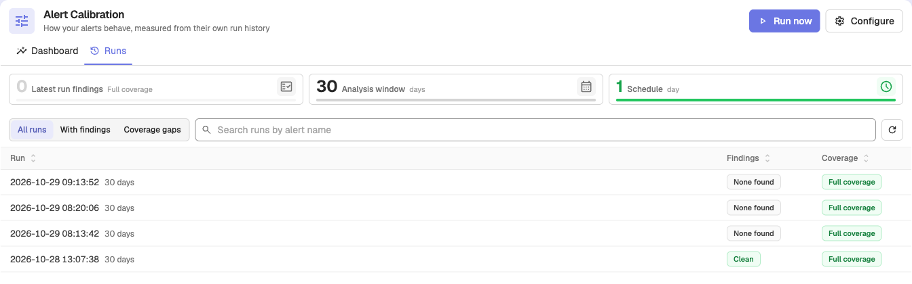

Alert Calibration is a scheduled health check for your alerts. It reads how each alert behaved over a time window (how often it fired, failed, or delivered its notification) and lists the alerts that need attention, with a suggested fix for each. It only suggests: nothing is changed automatically, and it sends no notifications.

:::note[Note]
Alert Calibration is available in OpenObserve Enterprise and Cloud editions. The feature is in beta.
:::

To open it, go to **Reliability > Alert Calibration**.

## Turn it on

Alert Calibration runs per organization. Until an organization has settings, the page says **Alert calibration is not running for this organization**.

1. Go to **Reliability > Alert Calibration** and click **Configure**.
2. Turn on **Run alert calibration for this organization**.
3. Set **Run every**, between 1 hour and 30 days. The default is 1 day.
4. Set **Analysis window**, how far back each run looks, between 1 minute and 90 days. The default is 30 days.
5. Click **Save**.

The first run is due as soon as you save with it turned on. Click **Run now** to bring the next run forward at any time. If a run is already due or in progress, the request joins it rather than starting another.

The form warns you about two settings that waste runs:

- **Run every** longer than **Analysis window**: the time between windows is never analyzed.
- **Analysis window** shorter than a rule needs (see the table below): every run declines that rule for every alert.

A window longer than the cadence is allowed, but consecutive runs overlap and report the same findings again.

## What it checks

Each run applies these rules to every alert with run history in the window:

| Rule | Flags an alert that | Needs at least | Suggested fix |
|---|---|---|---|
| **Failure** | Fails to evaluate repeatedly: at least 5 errors and 10% of its evaluations | 1 day | **Fix alert query** |
| **No destination** | Fires but has no destination to notify | 1 hour | **Attach destination** |
| **Noise** | Fires often (20 or more times), returns to normal within about 5 minutes on average, and never led to an incident | 7 days | **Raise threshold**, **Lengthen evaluation window**, **Enable deduplication** |
| **Notification failed** | Fires, but its notifications keep failing to deliver: at least 3 failures and 5% of deliveries | 1 day | **Repair destination** |
| **Silent** | Evaluated at least 500 times, with errors in under 10% of them, and never fired, not even while muted by a downtime | 30 days | **Review for deletion** |
| **Scheduler lag** | (Cluster-wide) Alert evaluations started late or were skipped | none | **Scale the alert scheduler**: raise `ZO_ALERT_SCHEDULE_CONCURRENCY`, add alert nodes, or turn on `ZO_SCHEDULER_PER_MODULE_PULLERS` |

**Scheduler lag** looks at the whole cluster, so it is shown only in the `_meta` organization.

A rule also skips an alert with too few samples in the window. These skipped pairs are counted as **Declined**: a declined rule did not judge the alert, so it is not a clean result.

## Read the results

The page has two tabs.

### Dashboard

The **Dashboard** tab sums up the latest run: **Findings**, **Alerts in scope**, and **Coverage**. Under **What needs attention**, each rule lists the alerts it flagged. Click **Open alert** to edit an alert, or **View evidence** to open the run's details.

### Runs

The **Runs** tab lists every run with its **Findings** and **Coverage**, and a **Findings trend** chart. Filter by **All runs**, **With findings**, or **Coverage gaps**, or search runs by alert name.

Click a run to open its digest:

- **Findings**: one card per flagged alert, with the rule, severity (**High**, **Medium**, **Low**), confidence, the **Evidence** (for example **Firings**, **Mean time to normal**, **Error ratio**, **Top error**), and **Proposed actions**.
- **Alerts in scope**, **Declined**, and **Window**.
- **View in Logs** opens the run's records in Logs.

### Coverage

Each run reports how much of the window it could see:

| Coverage | What it means |
|---|---|
| **Full coverage** | The run read every alert's history for the window. |
| **Coverage gap** | Part of the data was missing or truncated. Counts are a minimum, and no finding does not mean the alert is fine. |
| **Measured nothing** | The organization has alerts, but no alert ran in the window. |

An alert deleted during the window, or one with no runs in it, is not counted as a gap.

## Where the results are stored

Each run writes its findings to the `_o2_alert_calibration_digests` logs stream of the organization. The records follow that stream's retention, and you can query them in **Logs** like any other stream.

The findings are built from the alert run history in the `triggers` stream, described in [Alert History](alert-history.md).

## Configuration

| Environment variable | Default | Description |
|---|---|---|
| `O2_ALERT_CALIBRATION_ENABLED` | `true` | Turns Alert Calibration on for the deployment. When `false`, no organization runs it, the menu item is hidden, and its API answers 404, whatever each organization's settings say. |
| `ZO_SCHEDULER_ALERT_CALIBRATION_INTERVAL` | `0` | Poll interval in seconds for the Alert Calibration scheduler. Used only when `ZO_SCHEDULER_PER_MODULE_PULLERS=true`. `0` uses `ZO_ALERT_SCHEDULE_INTERVAL`. |

In Enterprise with role-based access control, access is granted through the `alert_calibration` permission resource.

## Next steps

- [Alert History](alert-history.md): the run history Alert Calibration reads.
- [Alerts overview](index.md): edit an alert to apply a suggested fix.
- [Alert Library](alert-library.md): add ready-made alerts.

**Need some help?**

- Join our [Community Slack](https://short.openobserve.ai/community)
- Or [Contact support](https://openobserve.ai/contactus/)
