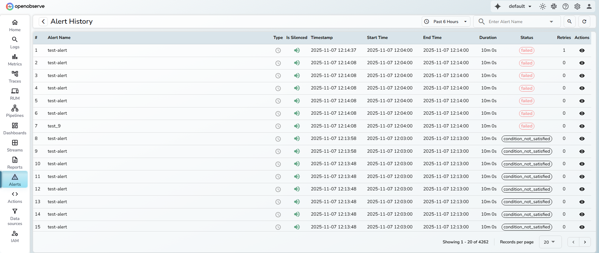
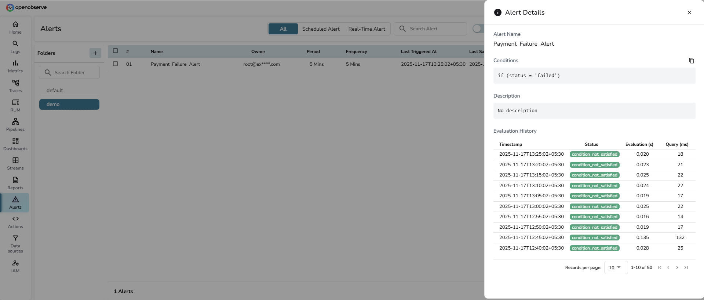
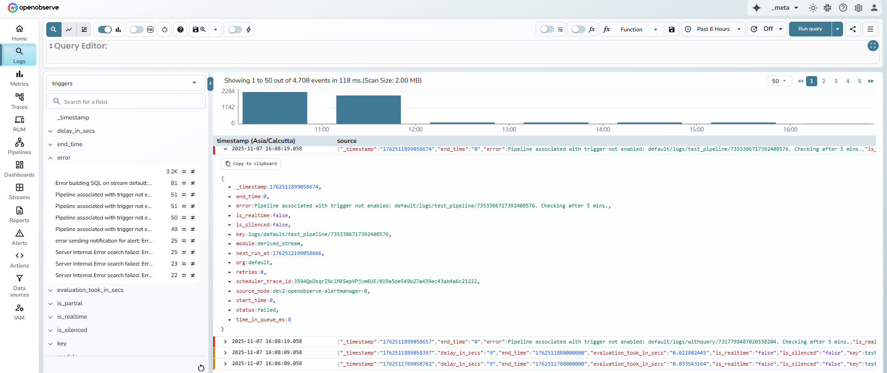

This guide provides information about how the Alert History feature in OpenObserve works, where the data originates from, who can access it, how to interpret the Alert History table, and how to debug failed or skipped alerts.

## Overview 
OpenObserve records alert evaluation events in a dedicated stream called `triggers`. Each organization has its own `triggers` stream. When an alert is evaluated, the evaluation result is written to the triggers stream inside that organization. OpenObserve also writes a copy of the same event to the `triggers` stream in the `_meta` organization for organization level monitoring.

> An evaluation is the system checking whether the alert’s condition is true. For scheduled alerts, this check happens at the set frequency. For real time alerts, the check happens whenever new data arrives. The condition defines what should trigger the alert. 
A trigger happens when the evaluation finds the condition to be true. This creates a firing event and can send a notification if one is set.

:::note[Who can access it]
Any user who has permission to view, update, or delete alerts can also access Alert History. Users do not need access to the `_meta` organization to view alert history for their own organization. Access to the `_meta` organization is only required when administrators need to review alert evaluation events across all organizations.
:::

:::note[Note]
Evaluation events always go to the organization's own `triggers` stream, with a copy in the `_meta` organization. The former `ZO_USAGE_REPORT_TO_OWN_ORG` setting was removed, and no configuration is needed.
:::

## How to interpret the Alert History table

Each row represents one alert evaluation.

- **Alert Name**: The name of the configured alert.
- **Type**: Indicates whether the alert is Scheduled or Real-time.
- **Is Silenced**: Shows whether the alert was silenced during evaluation.
- **Timestamp**: Time when the scheduler picked up the alert for evaluation.
- **Start Time** and **End Time**: The time range of data evaluated.
- **Duration**: How long the alert condition remained true.
- **Status**: The result of the alert evaluation.
- **Retries**: Number of times the system retried alert delivery when the destination did not acknowledge it. The system retries up to three times.   **Note**: The environment variable `ZO_SCHEDULER_MAX_RETRIES` defines how many times the scheduler retries a failed execution.
- **Condition**: The condition that was evaluated.
- **Dedup**: Whether the notification was grouped by [deduplication](scheduled-alerts.md#deduplication).
- **Actions**: Opens the **Alert Execution Details** view, which includes:

    - **Evaluation Time**: The time taken to complete the alert evaluation.
    - **Query Time**: The time taken by the alert's search query.
    - **Source Node**: The node that processed the alert. Useful for debugging distributed environments.
    - **Error Details**: The error message captured when the evaluation or delivery failed.

- **Status values**:
    
    - **firing**: The alert condition was met and the alert triggered.
    - **normal**: The evaluation ran and the condition was not met.
    - **pending**: The condition matched, but the alert is waiting out its [Hold for](advanced-alert-configuration.md#pending-period-hold-before-firing) period.
    - **notify_failed**: The condition matched, but delivering the notification failed.
    - **error**: The evaluation itself failed, for example a query error or timeout.
    - **suppressed**: The condition matched inside a [downtime](downtimes.md), so nothing was delivered.
    - **skipped**: The evaluation did not run, for example because the scheduled window was missed due to a delay and the system evaluated the next aligned window.

    Records written by older versions can still show `completed`, `failed`, or `condition_not_satisfied`. OpenObserve reads them as `firing`, `error`, and `normal`.

- **Alert detail page**: Clicking an alert in the Alerts list opens its detail page. The **Alert History** tab shows that alert's evaluations with **Timestamp**, **Status**, **Condition**, **Retries**, **Evaluation (s)**, **Query (ms)**, and **Error** columns, for the last **1h** (default), **6h**, or **24h**. The **Configuration** tab shows the alert's settings.

## How to debug a failed alert
This process applies only to users who have access to the `_meta` organization.

1. From the organization selector, switch to `_meta`.
2. Go to **Logs**.
3. From the stream dropdown, select `triggers`.
4. Set the required time range and select Run query.
5. Locate the error log for the failed alert.
6. Identify the `scheduler_trace_id` field.  
    **Example:**  
    `scheduler_trace_id: 358zJCLiWVdApBSBXM50YYnIwgA/019a5d91932174c3bab84fff2785f73f`  
    The trace ID is the part after the slash: `019a5d91932174c3bab84fff2785f73f`
7. Copy this trace ID.
8. Switch back to your organization.
9. Go to **Logs**.
10. In the SQL editor, search using the trace ID. 
    For example, 
    `match_all('019a5d91932174c3bab84fff2785f73f')`
    This displays all logs related to that alert evaluation.
11. Review the logs to identify the failure cause, such as query issues, destination errors, timeouts, or node resource problems.
12. Use the **Source Node** field from the **Alert Execution Details** view to locate the node that processed the alert and check its introspection logs if needed.

## Why you might see a skipped status
A **skipped** status appears when a scheduled alert runs later than its expected window.  
For example, an alert configured with a 5-minute period and 5-minute frequency is scheduled to run at 12:00 PM.  It should normally evaluate data from 11:55 to 12:00.
If the scheduler experiences a delay and runs the job at 12:05 PM, it evaluates the current aligned window (12:00 to 12:05) instead of the earlier one.  The earlier window (11:55 to 12:00) is marked as skipped to indicate that evaluation for that range did not occur because of delay in job pickup or data availability.

