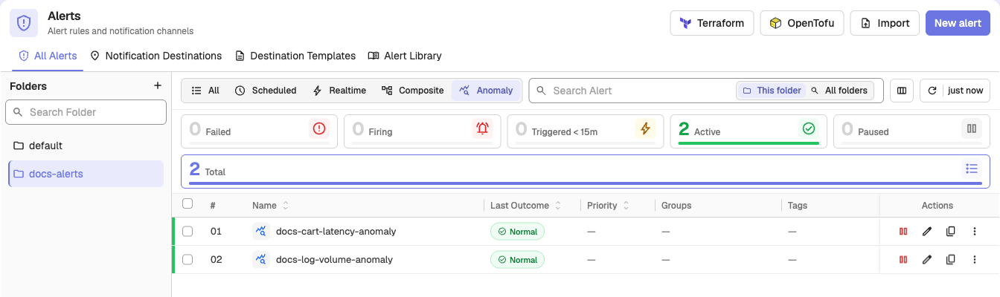
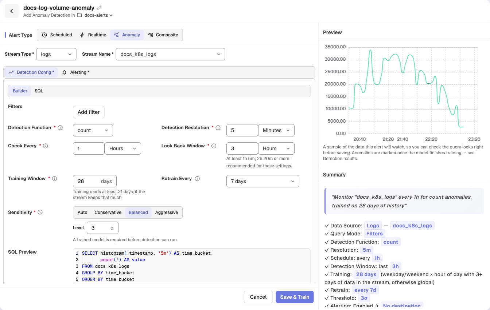
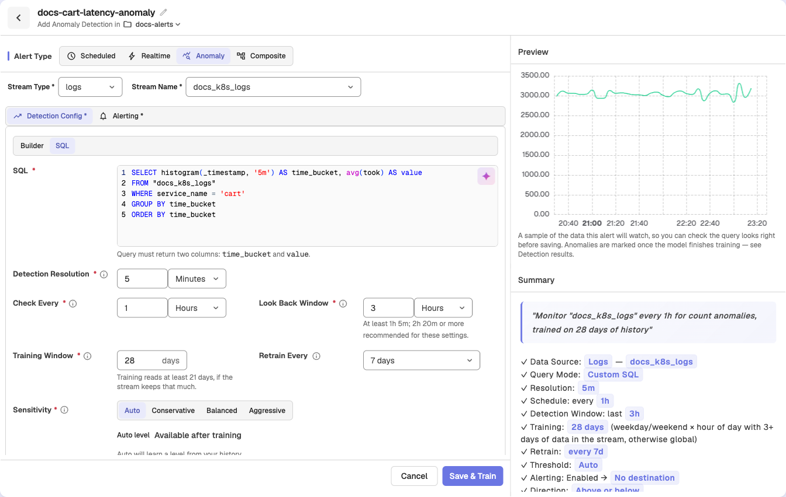
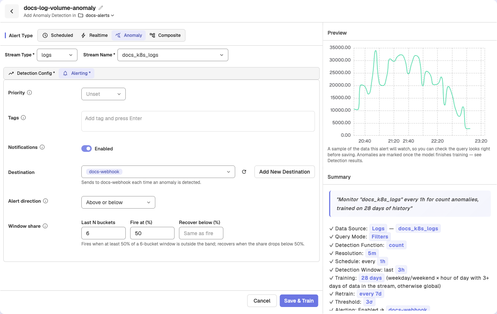
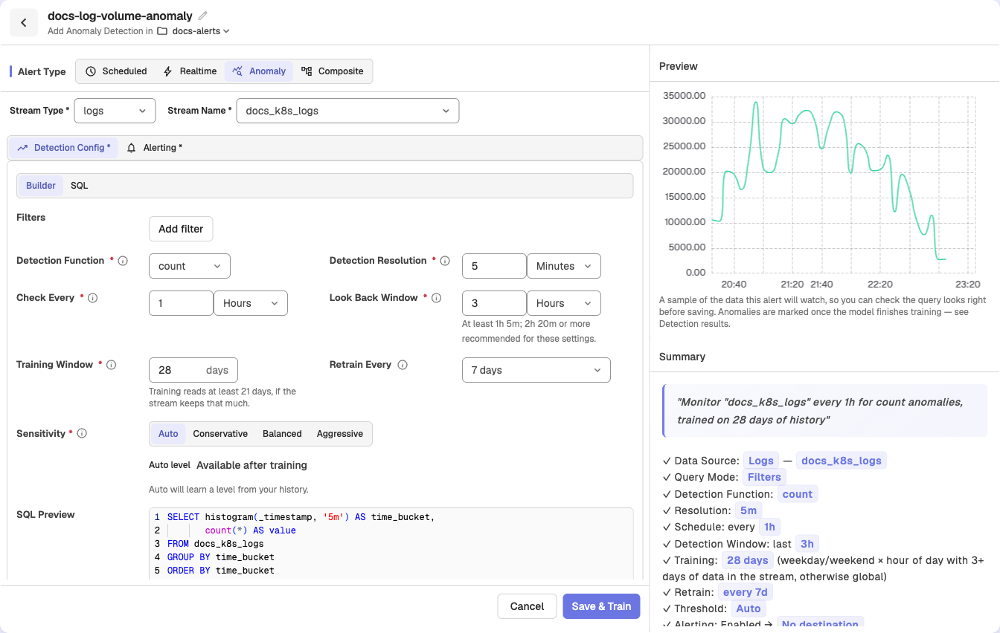
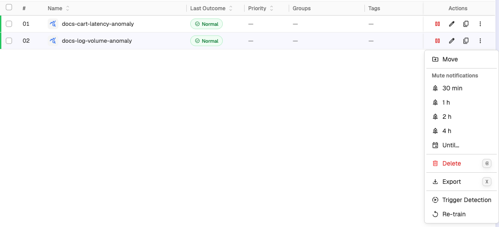

# Anomaly Detection

Anomaly Detection automatically identifies unusual patterns in your data streams using machine learning, alerting you to deviations before they become incidents.

## Overview

Traditional threshold-based alerts require you to define exact conditions for every scenario. Anomaly Detection learns your data's normal behavior from history and builds an expected value band for each time slot. Each detection bucket is compared with a band of expected ± level × σ, where σ is the typical spread for that slot, and a bucket outside the band is flagged as anomalous — no manual threshold tuning required.

Configure a detection rule on any logs, metrics, or traces stream. OpenObserve trains a model on your historical data, then runs periodic detection to surface anomalies and optionally send notifications.

:::note[Note]
Anomaly Detection is available in OpenObserve Enterprise (self-hosted) and OpenObserve Cloud.
:::

## Getting started

**Prerequisites:**

- OpenObserve Enterprise edition or OpenObserve Cloud
- At least one data stream with historical data for model training

**To access anomaly detection:**

1. In the left navigation, go to **Reliability > All Alerts**
2. Click the **Anomaly** tab in the filter bar
3. The list displays all anomaly detection rules for the current organization

The alerts list can be filtered by type using the tabs: **All**, **Scheduled**, **Realtime**, **Composite**, and **Anomaly**. The **Anomaly** tab is hidden when an operator turns the feature off with `O2_ANOMALY_DETECTION_DISABLED=true`.

## Key features

### Model training and retraining

OpenObserve trains a model on historical data from your selected stream. You set the **Training Window** in days; training reads at least 21 days of history when the stream keeps that much. The expected band follows your data's seasonality:

- **3 or more days of data**: one band per weekday/weekend × hour of day
- **Less data**: one band covers every hour
- **Detection resolution coarser than 1 hour**: always one band

Automatic retraining keeps the model current. Set a retraining interval (1, 7, or 14 days) or choose **Never** to train once and retrain manually.

### Detection configuration

The **Detection Config** tab provides a full configuration wizard:

- **Query mode** — choose **Builder** (visual filter-based) or **SQL** (custom query returning `time_bucket` and `value` columns)
- **Detection function** — aggregate data using `count`, `avg`, `sum`, `min`, `max`, `p50`, `p95`, or `p99`
- **Detection resolution** — granularity of data bucketing (e.g., 5 minutes)
- **Check every** — how often the detection job runs
- **Look back window** — how far back each detection run queries

In **SQL** mode, the query editor replaces the visual builder. Your query must return exactly two columns: `time_bucket` and `value`.

### Sensitivity tuning

The **Sensitivity** setting controls the band width. Choose **Auto** to use the level found during training, or one of the presets **Conservative**, **Balanced**, or **Aggressive**. You can also enter a custom **Level** from 1 to 10. A wider band (higher level) sends fewer alerts; a narrower one sends more. Sensitivity changes apply without retraining.

Some rules use an alert budget instead of a band width. Their **Sensitivity** presets cap delivered alerts (Conservative: 1 per week, Balanced: 1 per day, Aggressive: 4 per day), or you can set your own count **per day** or **per week**. Detection still scores every bucket; once the budget is spent, further alerts are suppressed until it refills.

After a rule is saved, its detail page has a **Charts** tab that plots the values with the expected band.

### Alerting and notifications

The **Alerting** tab configures what happens when anomalies are detected:

- **Notifications** — enable or disable alert notifications
- **Destination** — choose one or more destinations (Slack, email, webhook, etc.)
- **Alert direction** — **Above or below**, **Above only**, or **Below only**: which side of the band can send an alert. Missing data always alerts.
- **Window share** — alert only when enough recent buckets fall outside the band: **Fire at (%)** of the **Last N buckets**, recovering below **Recover below (%)**
- **Priority** and **Tags** — triage metadata, as for other alerts

:::info[Info]
Anomaly detection results are always written to the `_anomalies` stream, even when notifications are disabled. You can query this stream directly for analysis.
:::

### Status lifecycle

Each anomaly detection rule progresses through a status lifecycle:

| Status | Description |
|--------|-------------|
| **Waiting** | Initial state — awaiting first training |
| **Training** | Model training in progress (spinner visible) |
| **Ready** | Model trained and detection running on schedule |
| **Failed** | Training failed — hover over the status badge to see the error |

## Create an anomaly detection rule

1. Go to **Reliability > All Alerts**, open the **Anomaly** tab, and click **New alert**.

    

2. Enter a name, select the **Stream Type** (Logs, Metrics, or Traces) and **Stream Name**.

3. On the **Detection Config** tab, configure your query:
    - In **Builder** mode, add filters and select a detection function
    - In **SQL** mode, write a query that returns `time_bucket` and `value` columns

4. Set the **Detection Resolution**, **Check Every** interval, and **Look Back Window**.

5. Set the **Training Window** (days of historical data) and **Retrain Every** interval.

6. Choose a **Sensitivity**.

7. Switch to the **Alerting** tab to enable notifications and select destinations.

8. Click **Save & Train** to create the rule and start model training.

:::tip[Tip]
Start with a training window of 7–14 days for best seasonality detection. Use a shorter window (1–3 days) for fast-changing data patterns.
:::

## Manage anomaly detection rules

From the **Anomaly** tab, use the row actions and the three-dot (**More actions**) menu on each row:

- **Pause** / **Start** — temporarily stop or restart detection without deleting the model
- **Re-train** — trigger manual retraining (replaces the existing model once complete)
- **Trigger Detection** — run detection now
- **Edit** — modify the detection configuration, schedule, or alerting settings. When training failed, the form header shows a **Retry** button that retrains the model and re-runs detection
- **Clone alert** — create a copy of the rule; the clone starts untrained with counters reset
- **Move**, **Export** — move the rule to another folder, or download it as JSON
- **Delete** — permanently remove the rule and its trained model
