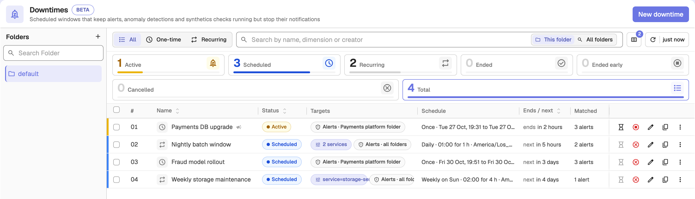
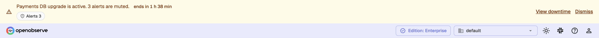

A downtime is a scheduled maintenance window that keeps your monitoring running but stops the notifications while you work. During a downtime, the alerts, anomaly detections, synthetics checks and SLOs it covers keep evaluating and keep their history. They just don't notify anyone, page anyone or start workflows.

:::note[Note]
Downtimes are available in OpenObserve Enterprise and Cloud editions. The feature is in beta.
:::

To open downtimes, go to **Reliability > Downtimes**.



The list shows each downtime's status, targets, schedule, the time it ends or next starts, and how many items it currently matches. Filter it by **One-time** or **Recurring**, or search by name, dimension or creator.

## What a downtime covers

A downtime applies to one or more of these modules:

| Module | What it mutes |
|--------|---------------|
| **Alerts** | Scheduled and real-time alert notifications |
| **Anomaly detections** | Anomaly alert notifications |
| **Synthetics checks** | Synthetics failure notifications |
| **SLOs** | SLO breach and burn-rate alerts, with an optional score correction |

Each module can be narrowed further, so a single downtime can silence exactly the resources it should. A downtime applies to every item that matches its targets and condition during its schedule.

## Create a downtime

1. Go to **Reliability > Downtimes** and click **New downtime**.
2. Click the name at the top to rename the downtime. The name is optional: if you leave it blank, OpenObserve generates one from the first narrowing and the schedule, for example `service=payments · weekly`.
3. Under **Applies to**, choose the modules to silence.
4. Fill in the **Targets**, **Schedule** and **Advanced** tabs, described below.
5. Click **Save**.


While you edit, the **Summary** pane describes in plain words what the downtime will do, and the **Preview** pane lists the items that match right now.

If no folder, item, tag or condition narrows a module, OpenObserve asks you to confirm before saving, because the downtime would mute every item of that module in the organization.

### Targets

Each chosen module gets a target card. Start with the folders, then add optional blocks to narrow further:

- **Folders**: all folders, or up to 50 specific folders.
- **Specific items**: up to 200 items, chosen from the selected folders.
- **Tags** (synthetics checks only): up to 16 `key:value` tags. A check must carry every tag to match.

For example, an **Alerts** target with a single folder silences only the alerts in that folder. The same target with **All folders** and no other narrowing silences every alert in the organization.

The **Alerts** target also sets what happens to incidents during the window:

- **Created and muted** (default): incidents open as usual but notify nobody until the window ends.
- **Not created**: no incident opens during the window. The first firing after the window opens one and notifies.

### Dimension condition

For modules that carry a dimension identity (alerts, anomaly detections and SLOs), you can add one optional **Dimension condition** on the **Targets** tab. It matches on the organization's semantic field groups, such as `service`, `env` or `host`. The condition combines `key = value` and `key != value` pairs. All pairs must match; use an **OR** group for alternatives:

```
service = payments AND (host = db-1 OR host = db-2)
```

The condition follows these rules:

- At most **32** pairs, with groups nested at most **3** levels deep.
- Every way to satisfy the condition must include at least one `=` pair, so `!=` pairs alone cannot silence everything.
- A value may end in `*` to match a prefix, such as `db-*`. A lone `*`, or a `*` anywhere else in the value, is not allowed.

Synthetics checks have no dimensions, so the condition does not apply to them. Narrow checks with tags, folders or specific items instead.

### SLO correction mode

For **SLOs**, choose how the window affects the SLO score:

- **Exclude the window** (default): time inside the window counts neither as good nor as bad, and burn-rate alerts on these SLOs do not fire for it.
- **Count the window as good**: time inside the window counts as fully good. Use this only when your SLO contract treats planned maintenance as uptime.

### Schedule

The **Schedule** tab defines when the downtime is in force. Choose one of three repeat modes:

- **Once**: a single window with a start date and time and an end date and time.
- **Daily**: repeats every day at a local start time, for a set duration.
- **Weekly**: repeats on the days you select, at a local start time, for a set duration.

Recurring schedules take a **Starts at** time in `HH:MM` form, a **Duration** such as `90m` or `1h 30m`, and an optional **Repeat until** date. Every schedule has a **Timezone**, so a window follows local clock time in that [IANA timezone](https://en.wikipedia.org/wiki/List_of_tz_database_time_zones) rather than UTC. A window can cross midnight.

A window must last between **1 minute** and **7 days**, and cannot be longer than the time between repeats. For example, a weekly schedule on Monday and Wednesday repeats every 2 days at the shortest, so its window is capped at 2 days.

Daylight-saving transitions are handled automatically. On a spring-forward day a full-day window is 23 hours long; on a fall-back day it is 25. Windows never overlap or leave a gap across a time change.

### Notifications

The **Notify** section on the **Schedule** tab lets the downtime tell your team about itself. Select up to **10** alert destinations and choose which events send a message:

- **When it starts**: one message as each window begins.
- **Before it ends**: a reminder ahead of the end. Set **Remind before the end** to between 1 minute and the window length; the default is 10 minutes.
- **When it ends**: one message as each window closes.
- **When it is cancelled**: sent at once when someone ends or calls off the downtime.
- **When it is extended**: sent at once with the new end.

Use **Send test** to check that the destinations receive messages.

### Reason and banner

On the **Advanced** tab:

- **Reason** is optional and limited to 1,000 characters. It is shown in the list, on the detail page and in the **Muted** tooltip, so use it to tell your team why the maintenance is happening.
- **Show a banner to everyone in the org while this downtime is active** displays an organization-wide banner. The banner shows the downtime name, how many items of each module are muted and the time left, for example *"Staging teardown is active. 23 alerts and 5 synthetics checks are muted."* It never names an individual alert. A banner is available only for windows of at most 7 days.



## Mute items from a list

To mute items quickly without opening the downtime form, select them in the alert list or the synthetics checks list and click **Mute**, or choose **Mute notifications** from a row's menu. Pick a duration (**30 min**, **1 h**, **2 h**, **4 h** or **Custom**) and the folder to file the downtime in. OpenObserve creates a one-time downtime for the selected items. A muted item shows a **Muted** chip with the time left.

## Manage downtimes

Click a downtime to open its detail page, which shows its windows, the items it affects, the notifications it has suppressed and, if configured, the log of its own notifications. From the list or the detail page you can:

- **Extend** an active downtime. For a recurring downtime, the schedule stays as it is and OpenObserve creates a one-time downtime that continues from the end of the current window.
- **End now** to stop an active window early. Notifications resume at once.
- **Cancel downtime** to call off a scheduled or recurring downtime. It stays in the list for history.
- **Edit**, **Duplicate**, **Move to folder** or **Delete** it. Deleting also removes its history.

## Status lifecycle

A downtime moves through the following states:

| Status | Meaning |
|--------|---------|
| **Scheduled** | The window has not started yet. |
| **Active** | The current window is in force and notifications are suppressed. |
| **Ended** | Every window has run its course. |
| **Cancelled** | Cancelled before the window started, or between recurring windows. |
| **Ended early** | Ended in the middle of a window, which was cut short. |

## Incidents during a downtime

With the default **Created and muted** incident mode, an alert that fires during a downtime opens a muted incident and pages nobody. The incident shows which downtime muted it. The first firing after the window ends sends the delayed opened notification, and normal incident handling resumes.

## Anomaly detection behavior

A muted anomaly detection run spends no cooldown and no alert budget. The model keeps training and scoring; only the notification is suppressed, and the run is recorded as suppressed by the downtime.

## Downtime folders

Downtimes are organized into folders, with a **default** folder in each organization. Folders let you group maintenance windows and control who can manage them, the same way you organize alerts and dashboards.

## Permissions

Downtimes are governed by role-based access control through two resources:

- **Downtimes**: individual downtime entries.
- **Downtime Folders**: the folders that contain them.

Grants on a downtime folder flow down to the downtimes inside it. A downtime folder limits who manages a downtime, not what it silences.

To silence something, a user also needs access to what the downtime targets:

- To target specific folders, the user must be able to list each of those folders.
- To target **All folders** of a module, the user needs the organization-wide list permission on that module's folders, for example **Alert Folders** for alerts.
- To target specific items, the user must be able to read each item.

## Configuration

Downtimes are enabled by default and tuned with these environment variables:

| Variable | Default | Description |
|----------|---------|-------------|
| `O2_DOWNTIMES_ENABLED` | `true` | Enables alert downtimes. |
| `O2_DOWNTIMES_BANNER_ENABLED` | `true` | Shows the org-wide banner for downtimes that turn it on. |
| `O2_DOWNTIMES_MAX_PER_ORG` | `500` | Maximum number of downtimes an organization can hold. |
| `O2_DOWNTIMES_RETENTION_DAYS` | `90` | Days an ended or cancelled downtime is kept. Values below 90 are raised to 90. |
| `O2_DOWNTIMES_REPLICATION_ENABLED` | `false` | Replicates downtimes and incident un-mutes across a super cluster. |

### Super cluster replication

Downtimes are region-local by default. Turn on `O2_DOWNTIMES_REPLICATION_ENABLED` only after every region in the super cluster runs a build that supports downtimes, because older regions cannot read the replicated messages. In a super cluster, the region where a downtime was created sends that downtime's own notifications.
