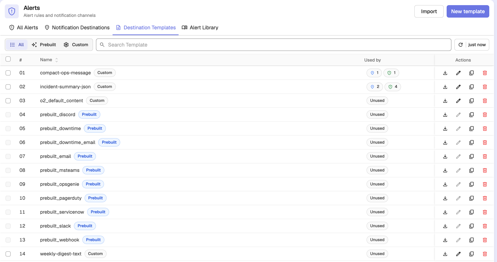
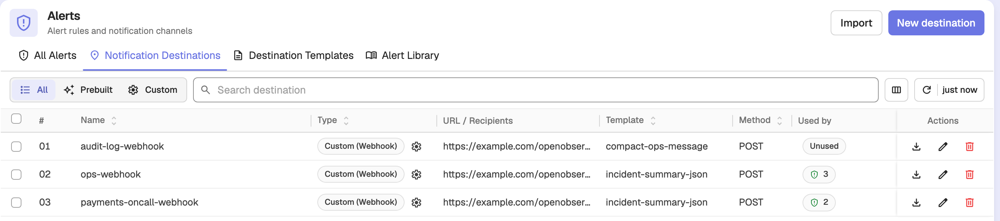
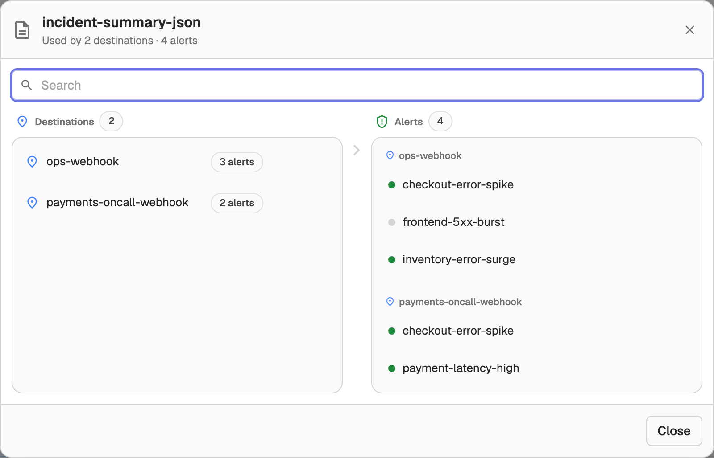
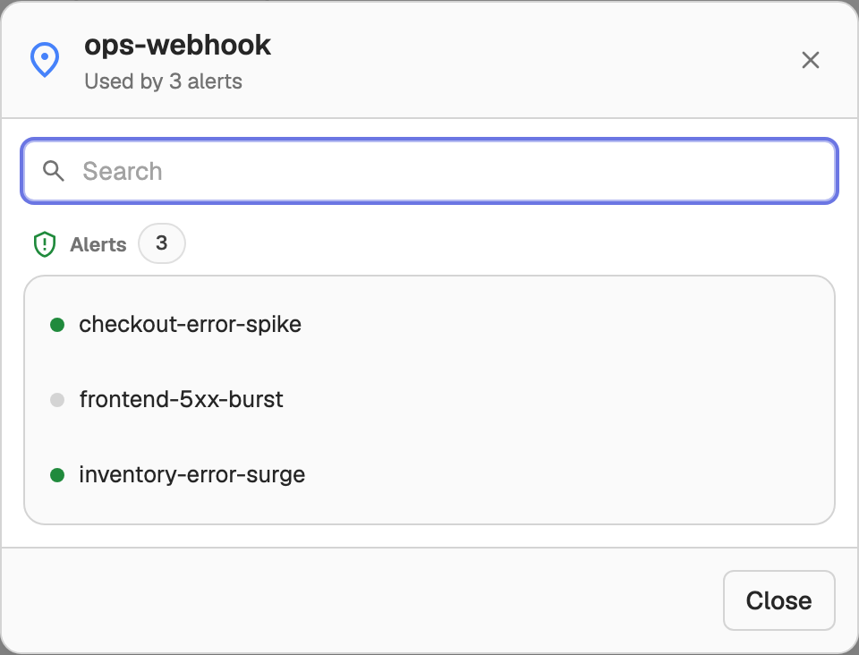

# Notification Dependencies

OpenObserve links **templates**, **destinations**, and **alerts** by name into a notification chain. The **Used by** view shows that linkage, so you can see what depends on a template or destination before you change or delete it, and act on the related entities in place.

## How the chain is linked

```
Template ──► Destination ──► Alert
  └────────────────────────► Alert   (alert-level template override)
```

- An **alert** sends notifications to one or more destinations.
- A **destination** has a default template.
- An **alert** can override the destination's template with its own.

A destination can also be used by other features, such as composite alerts, pipelines, synthetic checks, and alert downtimes. The **Used by** view counts these too.

## See where an entity is used

The **Used by** column appears on two lists:

- **Management > Templates**
- **Management > Alert Destinations**

Each row has a clickable **Used by** cell. While the dependency data loads, the cell shows a neutral graph icon. Once it has loaded, the cell shows a count badge per kind of dependent entity; hover a badge to see what it counts. Instead of badges, the cell can show one of two chips:

- **Unused**: nothing references the entity.
- **Missing**: the entity is referenced by name but does not exist.

### Templates list

A template row shows its downstream usage in delivery order: the number of destinations that use the template, then the number of alerts that depend on it, either through those destinations or through an alert-level override.



### Alert Destinations list

A destination row shows how many alerts send to it, plus a badge for each other kind of entity that uses it (for example, pipelines or composite alerts).



## Open the dependency dialog

Click a **Used by** cell to open the dependency dialog. Its header shows the entity's name and a summary, such as *Used by 2 destinations · 3 alerts* for a template or *Used by 3 alerts* for a destination. An entity with no dependents shows *Not used*.

- **Template**: the dialog has two lanes. The **Destinations** lane lists the destinations that use the template. The **Alerts** lane groups the alerts that send to those destinations into one box per destination. Alerts that override their template with this one appear under a separate **Uses this template directly** section.

  

- **Destination**: the dialog lists the alerts that send to the destination. Any other entities that use it, such as pipelines or composite alerts, are listed below in one section per kind.

  

While the dependency data loads, the dialog shows **Building dependency graph…**. If loading fails, it shows an error banner instead.

## Search and navigate the chain

The **Search** box filters the dialog's contents. For a template, search keeps the **Destinations** and **Alerts** lanes in sync: a destination stays visible when its own name matches or when one of its alerts matches.

When a template feeds many destinations, these interactions keep the destination-to-alert link readable:

- Hover a destination to highlight its alert box. Hover an alert to highlight its destinations.
- Click a destination to scroll its alert box into view.

## Open and delete in place

Each template, destination, and alert row in the dialog has an **Open** and a **Delete** action:

- **Open** opens the entity's editor in a new browser tab, so the dependency dialog stays open. Templates and destinations open in their list's editor; alerts open the alert's detail page.
- **Delete** asks for confirmation first. OpenObserve blocks deleting a template or destination that is still in use and shows the reason as an error. Deleting an unused entity removes it and updates the dialog and the list.

When you add, edit, or delete a template, destination, or alert, the **Used by** counts and the dependency dialog reflect the change.
