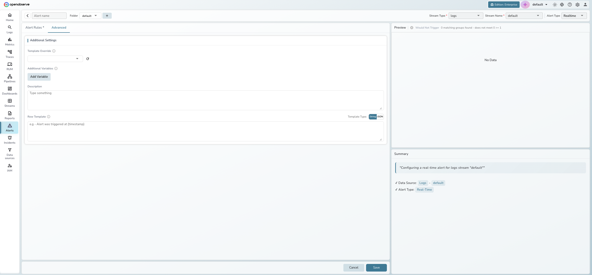

## Create a real-time alert

Real-time alerts trigger immediately when matching data is ingested. Unlike scheduled alerts, they evaluate each event as it arrives rather than running at fixed intervals.

### Prerequisites

- At least one data stream (logs, metrics, or traces) with ingested data
- At least one notification [destination](../../account-administration/management/alert-destinations.md) configured
- Appropriate permissions to create alerts

---

### Step 1: Select real-time type

1. In the left navigation, go to **Reliability > All Alerts**.
2. Click **New alert** in the top-right corner.
3. Change **Alert Type** to **Realtime**. The form simplifies — the condition sentence and evaluation schedule are hidden.

### Step 2: Name the alert and choose the stream

- **Alert name**: The name is the page heading. OpenObserve generates one until you click it and type your own. Alert names cannot contain spaces or the characters `: # ? ' " % & /`. Use underscores (`_`) instead.
- **Folder**: Use the folder selector under the name to choose a folder, or create a **New Folder**
- **Stream Type**: Select **logs**, **metrics**, or **traces**
- **Stream Name**: Select the data stream to monitor

### Step 3: Add filter conditions

Click the **filters** dropdown and define filters that match the events you want to alert on. Every ingested event that matches triggers the alert.

1. Click **+ Condition** to add a filter row.
2. Select a field, operator, and value (e.g., `level = error`).
3. Additional conditions are joined with AND logic.

> **Tip**: See [Alert Conditions and Filters](alert-conditions.md) for a detailed explanation of filter operators and condition groups.

### Step 4: Configure settings and save

- **Cooldown period**: Minimum time between repeated notifications (default: 10 minutes)
- **Destination**: Select one or more notification destinations. Click the refresh icon to reload, or **Add Destination** to create a new one.
- **Creates Incident**: Toggle on to automatically create an incident when the alert triggers. Shown only when [incidents](../incidents/index.md) are enabled.

Click **Save** at the bottom.

:::note[Note]
Real-time alerts do not have a look back window or evaluation frequency since they evaluate each event as it arrives.
:::

---

## Advanced settings

The **Advanced** tab provides additional options for real-time alerts. Click **Advanced** next to the **Alert Rules** tab.

### Additional settings

- **Template Override**: Select a custom notification template to override the default
- **Additional Variables**: Add key-value pairs available in notification templates via the **Add Variable** button
- **Description**: Free-text description for the alert
- **Row Template**: Customize the format of individual data rows in notifications. Toggle between **String** and **JSON** template types
- **Priority** and **Tags**: Triage metadata. See [Advanced Alert Configuration](advanced-alert-configuration.md#alert-priority).

:::note[Note]
Compare with Past and Deduplication are available for scheduled alerts only. See [Scheduled Alerts](scheduled-alerts.md) for those features.
:::

---

## Edit an existing alert

1. Go to **Reliability > All Alerts**.
2. Click **Edit** (pencil icon) in the alert's **Actions** column. Clicking the row instead opens the alert's detail page, which also has an **Edit** button.
3. Modify any fields. Note that **Stream Type**, **Stream Name**, and **Alert Type** are read-only for existing alerts.
4. Click **Save** to apply changes.

---

## Troubleshooting

### Alert not triggering

**Problem**: The alert does not fire when expected.

**Solution**:

1. Verify the **Stream Name** has recent data being ingested.
2. Check that the filter conditions match the incoming data.
3. Ensure the alert is not paused: the **Status** column shows its state, and the pause/start button in the **Actions** column resumes it.

### Too many notifications

**Problem**: The alert fires too frequently, causing notification fatigue.

**Solution**:

1. Increase the **Cooldown period** to reduce notification frequency.
2. Add more specific **Filters** to narrow the data the alert evaluates.

### Destination not appearing

**Problem**: A configured destination does not show in the dropdown.

**Solution**:

1. Click the **refresh** icon next to the destination dropdown.
2. Verify the destination exists on the **Notification Destinations** tab of the Alerts page.
3. Click **Add Destination** to create one directly from the alert form.