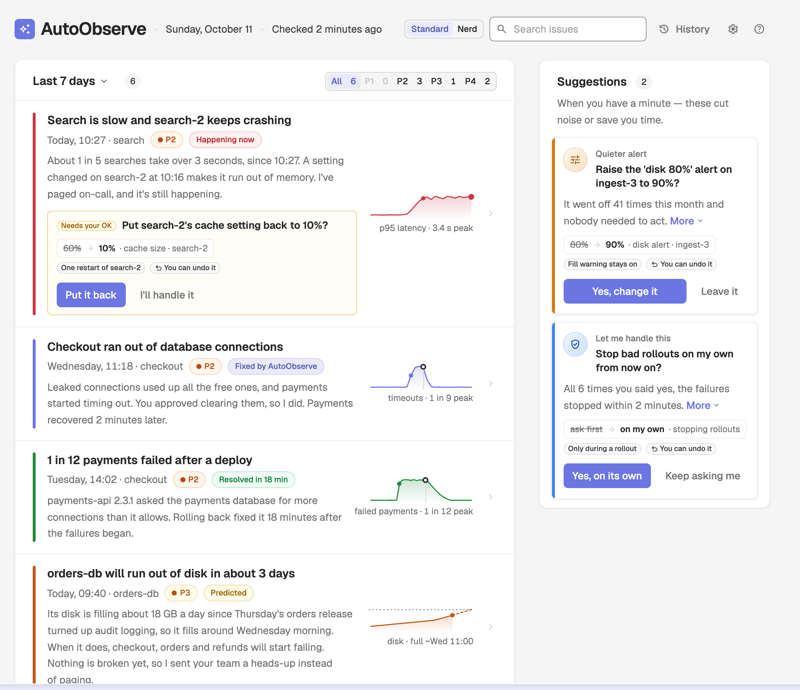
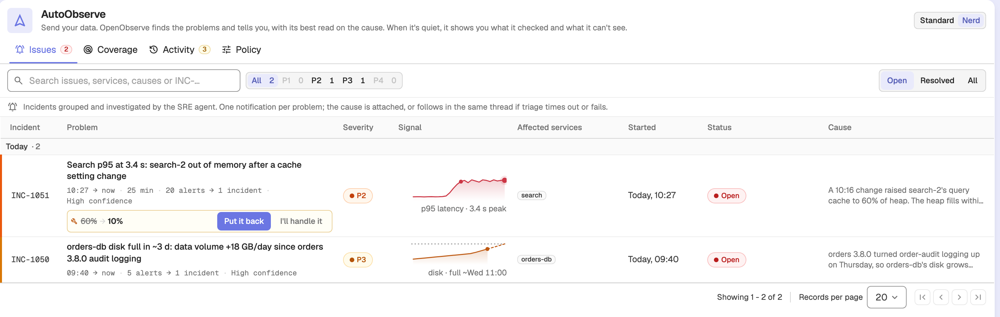
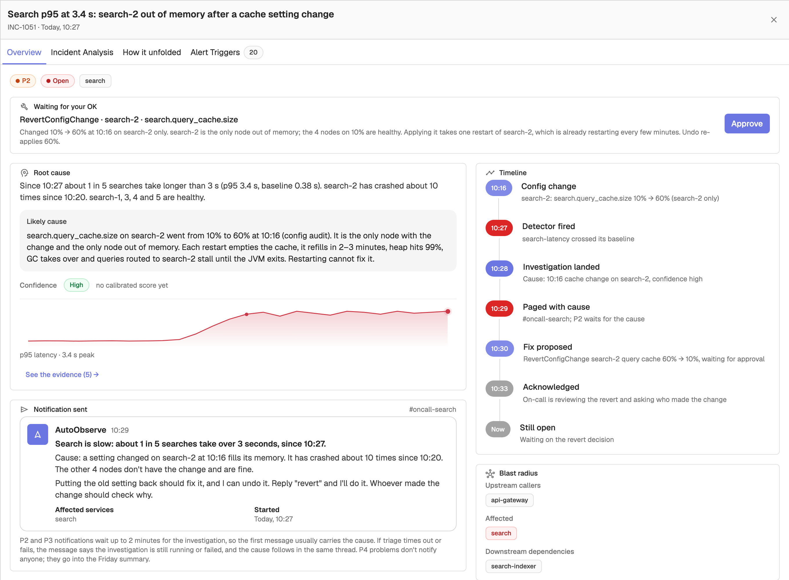
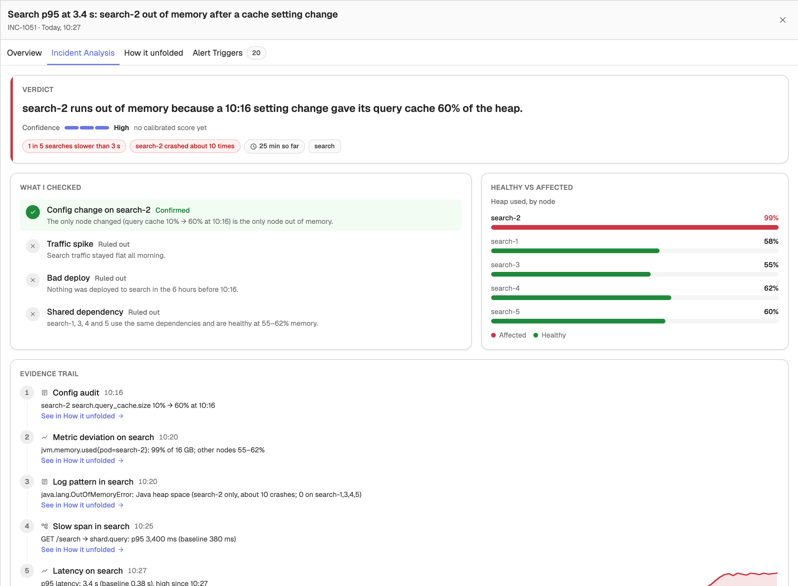
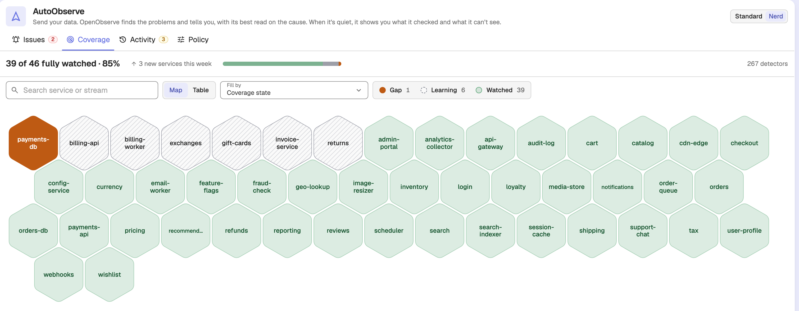
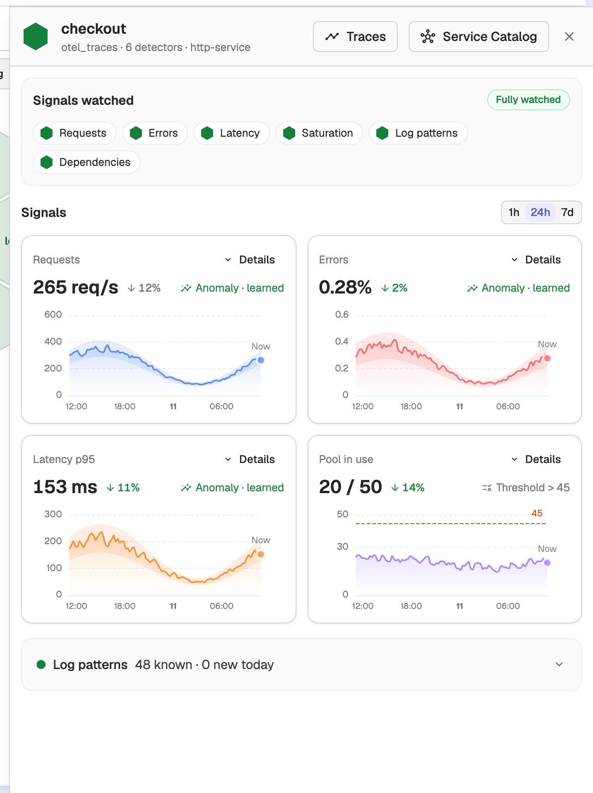
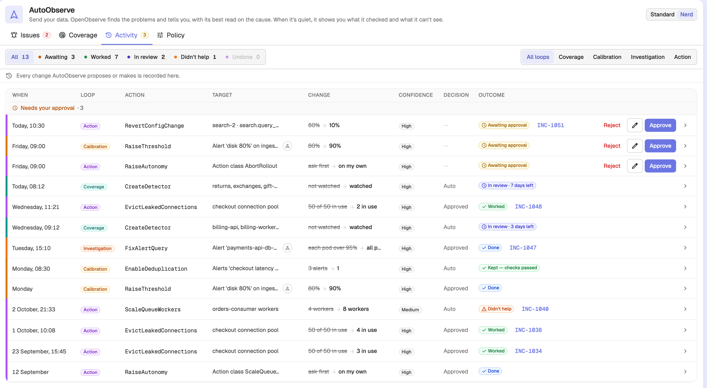
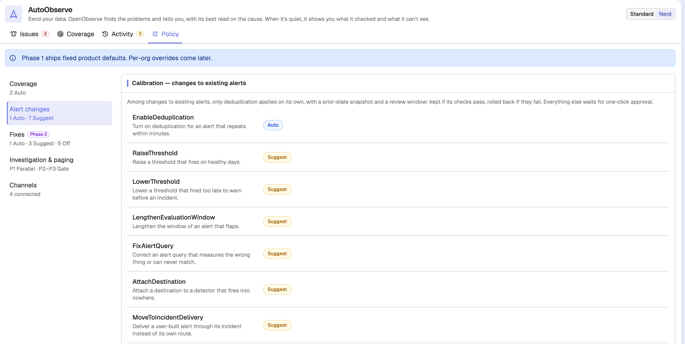
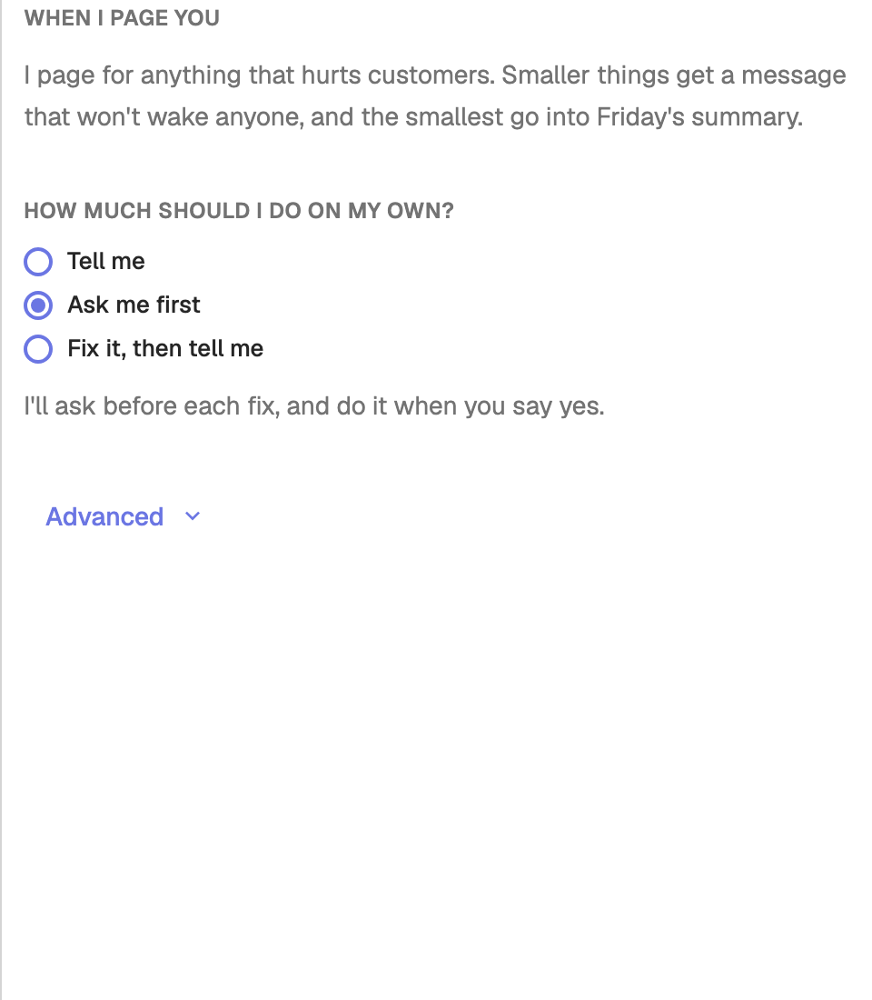

# AutoObserve

AutoObserve is OpenObserve's autonomous SRE agent. It watches every service, learns a baseline for each signal, and raises an issue whenever something drifts. Each issue comes with its best read on the cause, the evidence it checked, and the coverage gaps it cannot see.



:::note[Preview]
AutoObserve is available in **OpenObserve Enterprise builds only** and is an experimental preview. It currently runs on **demo data with no backend**: every problem, chart, and interaction stays within the page, so you can explore the concept before real detection and automation land.
:::

## Enable AutoObserve

The **AutoObserve** menu entry is controlled by the `ZO_EXPERIMENTAL` environment variable (boolean, default `false`). Set it to `true` on the OpenObserve server:

```sh
ZO_EXPERIMENTAL=true
```

The value reaches the UI through the organization config endpoint (`/api/{org}/config`) as `experimental`. Once it is `true`, **AutoObserve** appears in the left navigation just above **Reliability** (the group that holds Alerts) and links to `/autoobserve`. The flag only controls the menu entry; in an enterprise build the `/autoobserve` page itself is always reachable by URL. The older `/auto-observe-2` path redirects to it.

## Standard and Nerd views

AutoObserve has two views, switched with the **Standard** / **Nerd** toggle in the top bar. Your choice is remembered in the browser, and a shared link can force a view with `?view=nerd`.

- **Standard** is the default view: a summary of this week's problems plus a **Suggestions** rail, with **History**, **Settings**, and **How it works** in the top bar.
- **Nerd** is a tabbed workspace with **Issues**, **Coverage**, **Activity**, and **Policy** tabs.

Approvals you make in one view show up in the other.

## Demo scenarios

Because AutoObserve runs on demo data, the Standard view has a **Demo scenario** selector at the bottom of the page. You can also set it with the `?scenario=` query parameter. Switching scenario resets any approvals you made. The Nerd view always shows the **Demo week** scenario.

| Scenario | `?scenario=` | What it shows |
|----------|--------------|---------------|
| **Demo week** | `demo` | A busy, mixed week with active incidents, a known recurring bug, and coverage gaps |
| **All clear** | `allClear` | A quiet system with nothing wrong |
| **Active incident** | `incident` | A single incident in progress |
| **Can't see** | `cantSee` | Services AutoObserve cannot watch (coverage gaps) |
| **No baseline** | `noBaseline` | Services still learning their baseline |

## Issues

The **Issues** tab lists the incidents AutoObserve has raised, newest first and grouped by day. Columns are **Incident**, **Problem**, **Severity** (`P1`–`P4`), **Signal** (a sparkline), **Affected services**, **Started**, **Status**, and **Cause**.



Use the toolbar to narrow the list:

- **Search** filters by title, ID, cause, or service name (written to `?q=`).
- **All** / **P1**–**P4** toggles filter by severity and show a count for each.
- **Open** / **Resolved** / **All** toggles filter by status. The tab opens on **Open**.

Click any row to open the issue drawer.

### Issue details

The issue drawer has four tabs: **Overview**, **Incident Analysis**, **How it unfolded**, and **Alert Triggers**.

The **Overview** tab summarizes the incident:

- Severity, status, and affected services, plus a proposal card when AutoObserve suggests a fix (**Proposed fix**, or **Waiting for your OK** when it needs approval, with an **Approve** button) or a detection change (**What would have caught this earlier**).
- A **Root cause** card with the summary, the likely cause, a **High** / **Medium** / **Low** confidence tag, and a sparkline of the offending signal. **See the evidence** jumps to the evidence trail on the **Incident Analysis** tab.
- A notification card showing the Slack or email message AutoObserve sent (**Notification sent**), or **Held for Friday's summary** for lower-priority items.
- A **Timeline** of what happened, and a **Blast radius** showing upstream callers, affected services, and downstream dependencies.



The **Incident Analysis** tab is AutoObserve's reasoning in full:

- **Verdict**: the impact and how long the problem lasted.
- **What I checked**: each hypothesis it considered, marked **Confirmed**, **Ruled out**, or **Still open**, with a reason.
- **Healthy vs affected**: a comparison table, for example heap usage by node.
- **Evidence trail**: the evidence and signals behind the verdict, in the order they unfolded.
- **Next step**: the proposed action, with **Approve** and **Reject** when it is waiting on you.
- **Full report**: the complete write-up, which you can copy or download.



The **How it unfolded** tab shows the incident as a chain of cards ordered by time: the triggering change, each detector firing, any links in the chain it could not see (unwatched services or forecast harm), and the outcome.

The **Alert Triggers** tab lists the correlated alert firings behind the incident.

## Coverage

The **Coverage** tab shows how completely AutoObserve watches each service across six signals: **Requests**, **Errors**, **Latency**, **Saturation**, **Log patterns**, and **Dependencies**. A summary bar shows how many services are fully watched, the percentage, services added this week, and the total detector count.

Each service-signal cell is in one of four states:

| State | Meaning |
|-------|---------|
| **Watched** | A detector is active. In the table view, a filled dot marks anomaly detection and an outlined ring marks a fixed threshold. |
| **Learning** | The service is new and AutoObserve is building its 7-day baseline. A progress bar shows how many of the 7 days have been learned. |
| **Gap** | AutoObserve cannot watch this yet, typically because metrics lack `service.name` or there is no data at all. |
| **Not applicable** | The signal does not apply to the service, for example a database has no downstream calls. |

### Map view

The default **Map** view draws each service as a hexagon colored by state. Use **Fill by** to color by **Coverage state**, **Learning progress**, **Detector count**, or **Last scanned age**. Select legend chips to highlight the matching services; the rest are dimmed.



### Table view

Switch to **Table** for a matrix with one row per service and a cell per signal. Filter with the **All** / **Watched** / **Learning** / **Gaps** / **Can't watch** toggles, and click any cell to open the service drawer.

### Service drawer

Clicking a service opens a drawer with a chart for each signal it watches. The drawer header links to **Traces** and the **Service Catalog**. Services with a gap also show the reason and a suggested fix.



## Activity

The **Activity** tab is AutoObserve's change ledger: every detector it created, threshold it retuned, and fix it applied or proposed. Proposals that need your approval are grouped at the top under **Needs your approval**. Filter by loop (**Coverage**, **Calibration**, **Investigation**, **Action**) or by outcome.



Each row shows **When**, **Loop**, **Action**, **Target**, **Change** (a `before → after` diff), **Confidence**, **Decision**, and **Outcome**. Expand a row to see the full evidence and the side-by-side diff. Auto-applied changes and changes you already decided also show any review-window timer and an **Undo** button.

For entries awaiting approval, use the **Approve** and **Reject** buttons in the row, or the edit (pencil) button to adjust the change and then **Save and approve**.

## Policy

The **Policy** tab shows how AutoObserve behaves. In this preview it shows fixed product defaults; per-organization overrides come later. It has five sections:

- **Coverage**: action classes that close coverage gaps, such as creating detectors and adding library alerts, each set to **Auto**, **Suggest**, or **Off**.
- **Alert changes**: calibration classes, such as raising or lowering thresholds, extending evaluation windows, fixing alert queries, and attaching destinations. Only deduplication applies on its own; everything else waits for your approval.
- **Fixes**: fix classes such as rollback, reverting config, restarting pods, and scaling services. Marked **Phase 2** and shown disabled.
- **Investigation & paging**: `P1` is investigated in parallel while `P2`–`P3` wait behind a gate. `P1` and `P2` page you, `P3` sends a message, and `P4` goes into the Friday summary.
- **Channels**: the connected notification channels.



## Settings, History, and How it works

The Standard view top bar opens three drawers:

- **Settings**: where AutoObserve can reach you, how much it should do on its own (**Tell me**, **Ask me first**, or **Fix it, then tell me**), and when it pages you. Under **Advanced** you can set autonomy for each kind of fix, the summary day, and services it should ignore.
- **History**: a timeline of problems, changes, fixes, and your decisions, with a link from each entry to the change it relates to.
- **How it works**: a five-step walkthrough (I find your services, I watch them, I stay quiet unless it's real, I explain every page, I fix what you've allowed). It opens automatically on your first visit.


