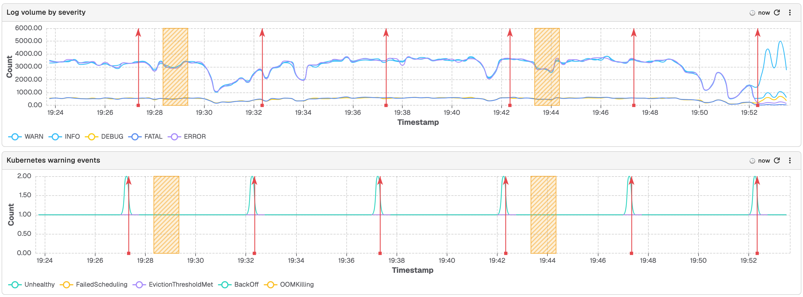
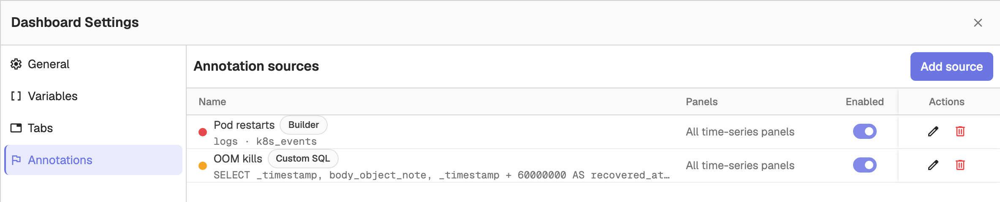
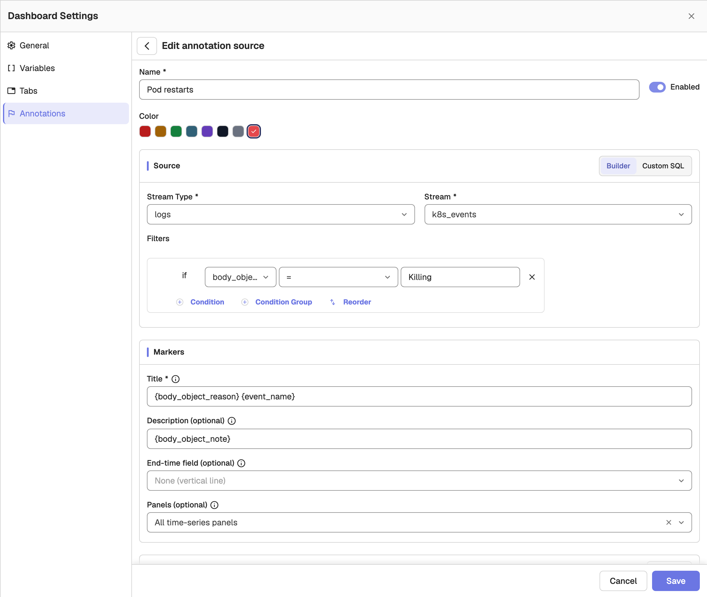
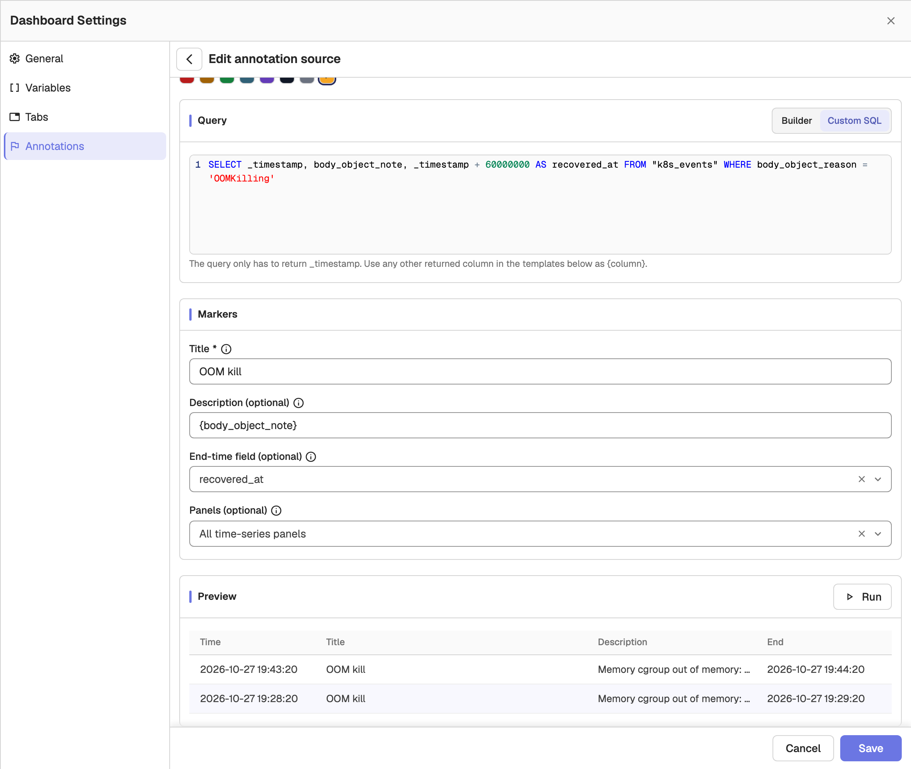

Annotation sources draw markers from a query onto your dashboard's time-series panels. Each enabled source runs one query per dashboard load, and every returned row becomes a marker: a vertical line, or a shaded band when the source defines an end-time field. This is separate from [manual annotations](panels/panel-management.md#annotations), which you add directly on a chart.

## Open the Annotations tab

Open the dashboard, click the **Settings** (gear) icon in the toolbar, and select **Annotations**. The **Annotation sources** list shows every source with its colour, query mode, panel target, and an **Enabled** toggle. Click **Add source** to create one, or use the row actions to edit or delete a source.

## Create a source

Fill in the source form:

- **Name**: a label for the source, shown in the list and in marker tooltips.
- **Enabled**: turn the source on or off without deleting it.
- **Color**: the marker colour, chosen from the swatches.

### Builder or Custom SQL

Choose the query mode with the **Builder** / **Custom SQL** toggle.

**Builder** asks for a **Stream Type**, a **Stream**, and optional **Filters**. Filters use the same condition builder as alerts: add conditions with **Condition**, nest groups with **Condition Group**, and combine them with AND/OR. Dashboard variables are offered in the stream and field pickers.

**Custom SQL** replaces the pickers with a query editor. The query only has to return a `_timestamp` column; each returned row becomes a marker, and any other returned column can be used in the marker templates. Switching from Builder to Custom SQL pre-fills the editor with the generated query. Switching back to Builder after editing the SQL asks you to confirm that the custom SQL will be discarded.

### Markers

- **Title** and **Description (optional)**: templates rendered for each row. Type `{` to insert a field (for example, `{service} deployed`). A `$variable` renders with the dashboard variable's current value.
- **End-time field (optional)**: a field that turns each marker into a shaded band from the row's timestamp to this value. Leave it as **None (vertical line)** to draw a single line.
- **Panels (optional)**: which panels draw the markers. **All time-series panels** (the default) applies to every current and future time-series panel; clear it to pick specific panels. Save is blocked when no panel is selected.

## Run and preview

In the **Preview** section, click **Run** to execute the source against the dashboard's current time range and variables. The preview lists the rows that become markers, with their time, title, description, and end time, and flags problems such as a missing `_timestamp` column or an end-time field that is not in the query result. **Save** runs the same check and is blocked on errors. No rows in the current time range is only a hint, not an error.

## Limits

- A dashboard can define at most 10 annotation sources.
- Markers use the dashboard time range; per-panel time-range overrides are not honoured.
- PromQL horizontal-bar and stacked panels get no markers, the same as manual annotations.
