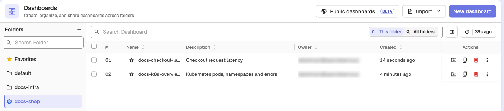
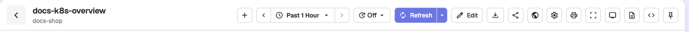
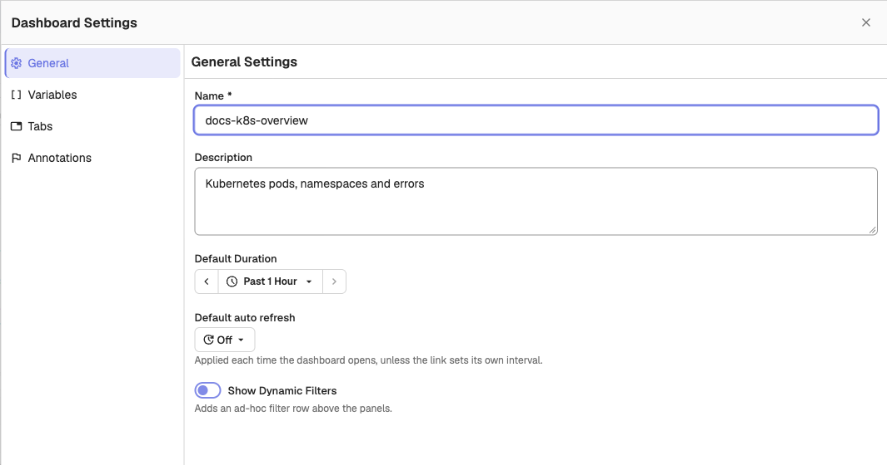
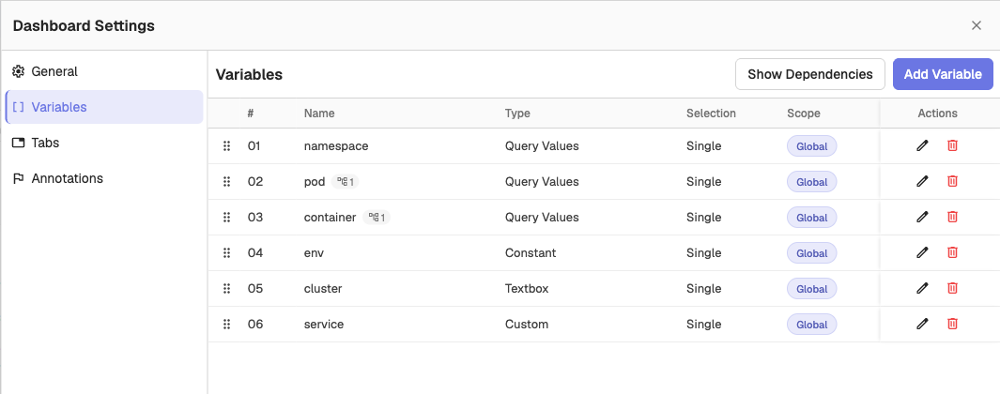
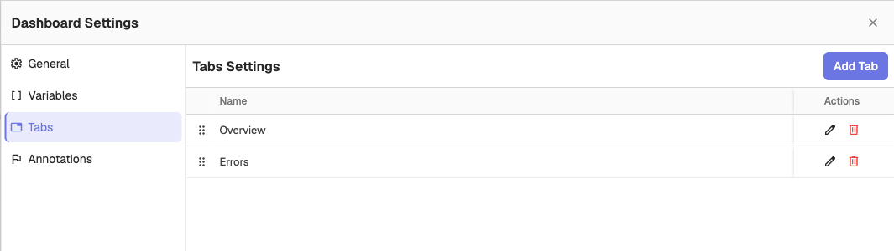
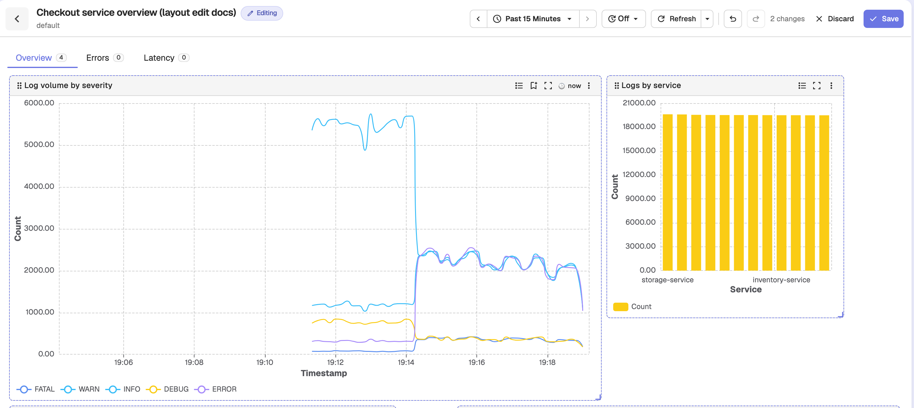

This guide explains how to manage Dashboards and use the Dashboard toolbar. 

## Manage Dashboards

OpenObserve offers the following options for viewing, searching, and performing actions on the Dashboards you have created or imported.

**View Dashboards**

The Dashboards table displays key details about each Dashboard, such as:

- **Name**: The name of the Dashboard. Click the star next to the name to add the Dashboard to **Favorites**, which lists your favorite Dashboards across all folders.  
- **Description**: A brief description of the Dashboard.  
- **Owner**: The user who created the Dashboard.  
- **Created**: The timestamp showing when the Dashboard was created.

When you search across all folders, or open **Favorites**, a **Folder** column shows where each Dashboard lives.

**Perform Actions on Dashboards**

From the **Actions** column, you can move a Dashboard to another folder (**Move to another Folder**), duplicate it (**Duplicate Dashboard**), and delete it (**Delete Dashboard**). The **More actions** (⋮) menu repeats these actions and adds **Pin to home page**, which shows the Dashboard on the home page for everyone in the organization.

Select Dashboards with the checkboxes to act on several at once: **TV playlist**, **Move**, **Export**, and **Delete** appear in the bar at the bottom of the table. See [Move and Export Dashboards in Bulk](bulk-move-and-export-dashboards.md) and [TV Playlist](tv-playlist.md).

**Search Dashboards**

You can search for Dashboards by name, either within a specific folder or across all folders.

- **Search Within a Folder:** Type in the **Search Dashboard** bar at the top of the list with **This folder** selected.  
- **Search Across All Folders:** Select **All folders** inside the search bar, then type your search.

## Dashboard Toolbar

The Dashboard toolbar provides several options for managing your Dashboard’s behavior and interactions:

1. **Add Panel:** Use the **Add Panel** button to add a new Panel to the selected Dashboard.  
2. **Time Range Selection**: You can adjust the time range for which you want to visualize the data on your Dashboard by selecting an **Absolute** or **Relative** time range based on your timezone.   
3. **Auto Refresh Interval**: Set the auto-refresh interval for your Dashboard. This is useful when you want the data to update automatically at specified intervals, such as every 5 minutes.  
4. **Refresh**: Use the **Refresh** button to manually update the Dashboard and all its Panels with the latest data. Its dropdown offers **Refresh cache & reload** and, when available, **Turn on Auto Run** / **Turn off Auto Run**.  
5. **Edit**: Unlock the layout to move, resize, and reorder Panels and Tabs. See [Edit Dashboard Layout](#edit-dashboard-layout).
6. **Export Dashboard**: Export your Dashboard as a JSON file. This is useful for sharing or backing up the Dashboard configuration.   
7. **Share**: Copy a link to the Dashboard to share it with others.  
8. **Publish publicly (beta)**: Create a public, read-only link to the Dashboard. Shown only when public dashboards are enabled. See [Public Dashboards](public-dashboards.md).  
9. **Dashboard Settings**: Use the [**Dashboard Settings**](#dashboard-settings) to adjust **General** settings, and manage **Variables**, **Tabs**, and **Annotations**.  
10. **Print Dashboard**: Use the **Print** button to print the Dashboard or export it as a PDF.  
11. **Go Fullscreen:** Use this button to turn on the fullscreen mode.   
12. **TV mode**: Show the Dashboard on a wall screen. See [TV Mode](tv-mode.md).  
13. **Scheduled Dashboards**: Use the Scheduled Dashboards option to configure Scheduled and Cached Dashboards.  
14. **Edit Dashboard JSON**: This option allows you to directly edit the JSON configuration of your Dashboard, giving you advanced control over its structure and settings.
15. **Pin to home page**: Show this Dashboard on the home page for everyone in the organization. Click it again to unpin.

## Dashboard Settings 

In the Dashboard Settings, you can configure various options to customize the behavior of your Dashboard.

**General**

- **Name**: Use it to modify the name of your Dashboard.  
- **Description**: Modify the description for the Dashboard.  
- **Default Duration**: You can adjust the time range for the entire dashboard by selecting an **Absolute** or **Relative** time range based on your timezone. This allows you to view the data for different periods.  
- **Default auto refresh**: The auto-refresh interval applied each time the Dashboard opens, unless the link sets its own interval.  
- **Show Dynamic Filters**: Adds an ad-hoc filter row above the Panels, so users can interactively filter the data displayed in Panels.

These settings are shared with everyone who can access the Dashboard. Click **Save changes** to apply them.

**Variables**

In the Variables section, you can edit and delete existing variables, add new variables, and view variable dependencies.

**Tabs**

In the Tabs section, you can add, edit, and delete Tabs within the Dashboard.

**Annotations**

In the Annotations section, you can add query-driven annotation sources that draw markers on time-series Panels. See [Annotation Sources](annotation-sources.md).

## Edit Dashboard Layout

Dashboards open with the layout locked. Click **Edit** in the toolbar to drag and resize Panels, reorder Tabs, or set a Panel's height from its **Edit Layout** menu item. Changes stay local until you click **Save**.

While editing, the toolbar shows an **Editing** badge, **Undo**, **Redo**, a count of unsaved changes, **Discard**, and **Save**. Other Panel actions are hidden, and you cannot add, rename, or delete Tabs until you leave edit mode.

**Discard** returns the Dashboard to its last saved layout. If you have unsaved changes, OpenObserve asks you to confirm first.

| Shortcut | Action |
| -------- | ------ |
| `Ctrl+Z` / `Cmd+Z` | Undo |
| `Ctrl+Shift+Z` / `Cmd+Shift+Z` | Redo |
| `Ctrl+S` / `Cmd+S` | Save |
| `Esc` | Discard and exit edit mode |

The Undo, Redo, and Save shortcuts are ignored while you type in an input. If you try to leave the Dashboard with unsaved layout changes, OpenObserve asks you to confirm before discarding them.

:::note[Embedded dashboards]
Dashboards embedded in RUM, traces, and pinned tabs keep saving layout changes automatically.
:::
