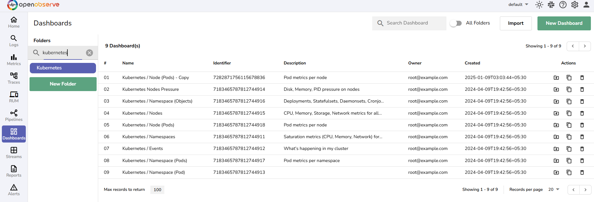
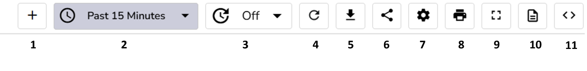
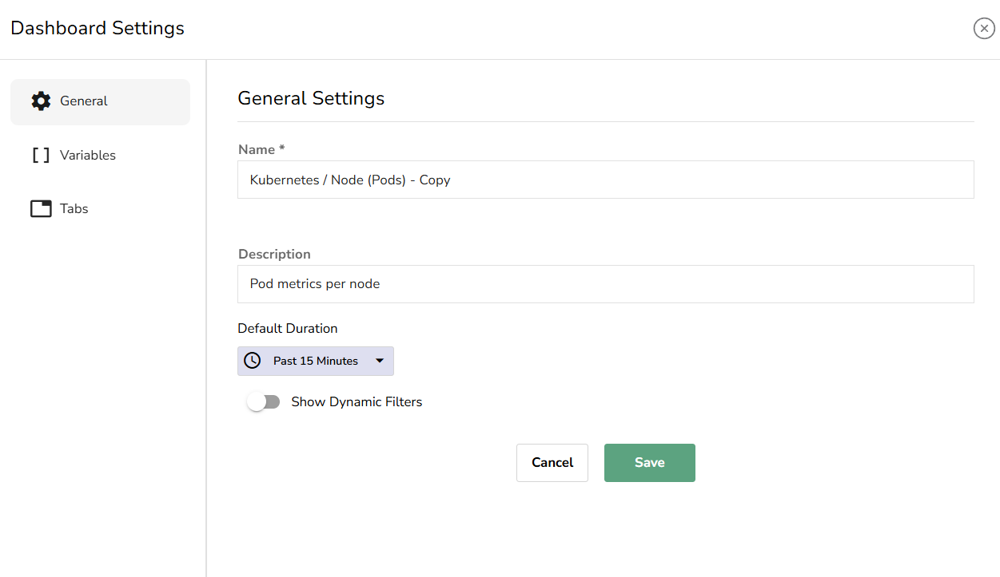
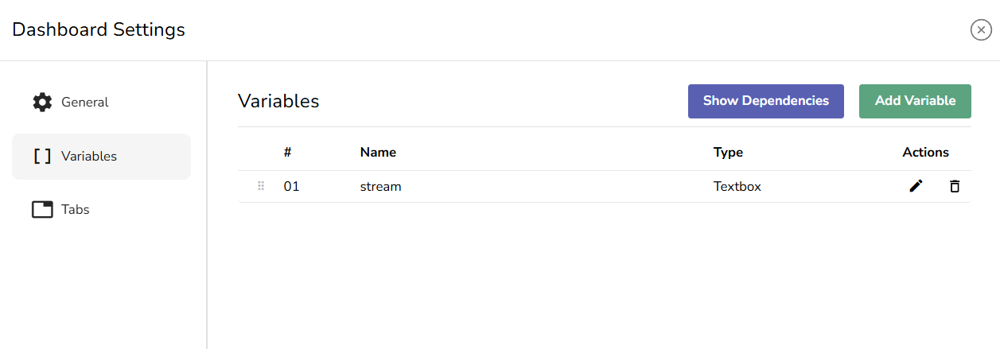
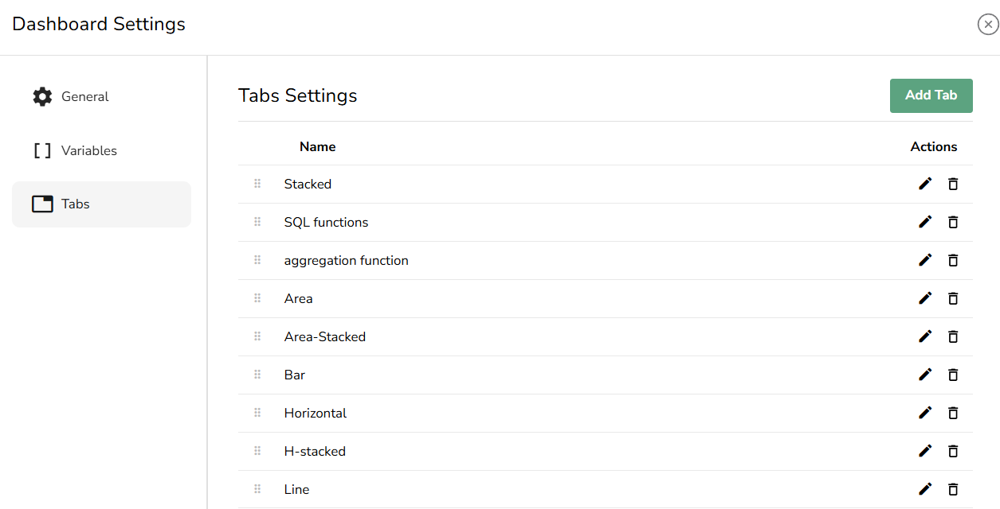

This guide explains how to manage Dashboards and use the Dashboard toolbar. 

## Manage Dashboards

OpenObserve offers the following options for viewing, searching, and performing actions on the Dashboards you have created or imported.

**View Dashboards**

The Dashboards table displays key details about each Dashboard, such as:

- **Name**: The name of the Dashboard.  
- **Identifier**: A unique identifier for each Dashboard.  
- **Description**: A brief description of the Dashboard.  
- **Owner**: The user who created the Dashboard.  
- **Created**: The timestamp showing when the Dashboard was created.

**Perform Actions on Dashboards**

From the **Actions** column, you can move a Dashboard to another folder, duplicate a Dashboard, and delete a Dashboard.

**Search Dashboards**

You can search for Dashboards by name, either within a specific folder or across all folders.

- **Search Within a Folder:** Use the **Search Dashboard** bar at the top of the list..  
- **Search Across All Folders:** Enable the **All Folders** toggle next to the **Search Dashboard** bar before performing a search.

## Dashboard Toolbar

The Dashboard toolbar provides several options for managing your Dashboard’s behavior and interactions:

1. **Add Panel:** Use the **Add Panel** button to add a new Panel to the selected Dashboard**.**  
2. **Time Range Selection**: You can adjust the time range for which you want to visualize the data on your Dashboard by selecting an **Absolute** or **Relative** time range based on your timezone.   
3. **Auto Refresh Interval**: Set the auto-refresh interval for your Dashboard. This is useful when you want the data to update automatically at specified intervals, such as every 5 minutes.  
4. **Manual Refresh**: Use the **Refresh** button to manually update the Dashboard and all its Panels with the latest data.  
5. **Export Dashboard**: Click the **Export** button to export your Dashboard as a JSON file. This is useful for sharing or backing up the Dashboard configuration.   
6. **Share Dashboard**: Use the **Share** button to share a link to the Dashboard with others.  
7. **Dashboard Settings**: Use the [**Dashboard Settings**](#dashboard-settings) to adjust **General Settings**, and manage **Variables** and **Tabs**.  
8. **Print Dashboard**: Use the **Print** button to print the Dashboard or export it as a PDF.  
9. **Go FullScreen:** Use this button to turn on the fullscreen mode.   
10. **Scheduled Dashboards**: Use the Scheduled Dashboards option to configure Scheduled and Cached Dashboards.  
11. **Edit Dashboard JSON**: This option allows you to directly edit the JSON configuration of your Dashboard, giving you advanced control over its structure and settings.
12. **Edit**: Click the **Edit** button to enter layout edit mode, where you can drag, resize, and reorder Panels and Tabs before saving. See [Edit Dashboard Layout](#edit-dashboard-layout).

## Dashboard Settings 

In the Dashboard Settings, you can configure various options to customize the behavior of your Dashboard.

**General Settings**

- **Name**: Use it to modify the name of your Dashboard.  
- **Description**: Modify the description for the Dashboard.  
- **Default Duration**: You can adjust the time range for the entire dashboard by selecting an **Absolute** or **Relative** time range based on your timezone. This allows you to view the data for different periods.  
- **Show Dynamic Filters**: Enable or disable the dynamic filters for the Dashboard. This allows users to interactively filter data displayed in Panels.

**Variables**

In the Variables section, you can edit and delete existing variables, add new variables, and view variable dependencies.

**Tabs**

In the Tabs section, you can add, edit, and delete Tabs within the Dashboard.

## Edit Dashboard Layout

A Dashboard opens with its layout **locked** (view mode), so you cannot accidentally move or resize a Panel, or reorder a Tab, just by interacting with the Dashboard. To change the layout, enter layout edit mode.

**Enter layout edit mode**

Click **Edit** in the Dashboard toolbar. An **Editing** badge appears next to the Dashboard name, and the toolbar swaps to layout controls: **Undo**, **Redo**, a live change count, **Discard**, and **Save**.

While editing, you can drag, resize, and reorder Panels and Tabs as before, but your changes are held locally as a draft — nothing is written back until you click **Save**. Panels show a dashed outline and a resize handle in the bottom-right corner so you can tell the layout is editable at a glance.

While in edit mode:

- Panel actions (**Edit panel**, **Duplicate**, **Delete**, **Move to another tab**, and the others) are hidden. The Panel menu shows only **Edit layout**.

- Tab reordering is enabled, but the tab **+** (add) and rename actions are hidden while editing.
- The **Add Panel** button and the **Export**, **Share**, **Settings**, and **Edit JSON** actions are hidden until you leave edit mode.

**Save, discard, and undo**

- Click **Save** to persist all drafted changes in a single update. If the save fails (for example, the Dashboard was changed elsewhere), your draft is kept so you can retry.
- Click **Discard** to revert to the last saved layout. When there are unsaved changes, a confirmation dialog asks whether to **Discard** or **Keep editing**.

- Use **Undo** and **Redo** to step backwards and forwards through your layout changes; the change count reflects how many unsaved steps remain.

**Keyboard shortcuts**

These shortcuts are active only while you are editing the layout, and **Undo**/**Redo**/**Save** do not fire while you are typing in a text field:

- `Ctrl+Z` / `Cmd+Z`: undo
- `Ctrl+Shift+Z` / `Shift+Cmd+Z`: redo
- `Ctrl+S` / `Cmd+S`: save
- `Esc`: exit layout edit mode

**Leaving with unsaved changes**

OpenObserve asks before you leave the page, reload, or navigate to another Dashboard with unsaved layout changes, so you do not lose your draft by accident.

!!! note "Embedded dashboards"
    Embedded dashboards (such as RUM, traces, and pinned tabs) keep their existing auto-save behavior and are not affected by layout edit mode.

When you adjust a single Panel through **Edit layout**, the dialog now uses an **Apply** button: it records one draft step, and the **Save** button in the toolbar commits all drafted changes together.

