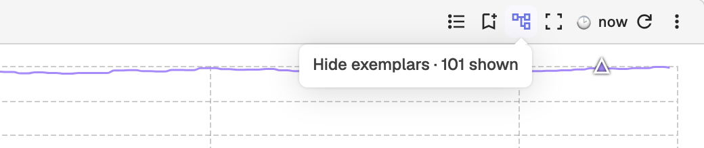
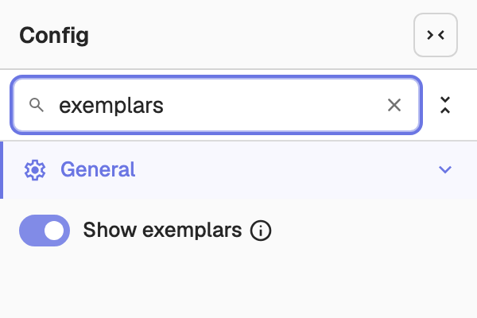
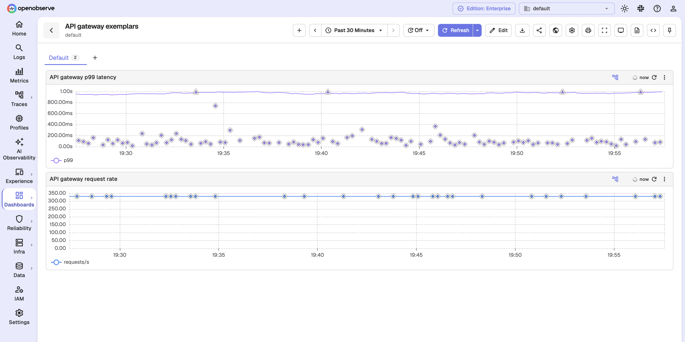
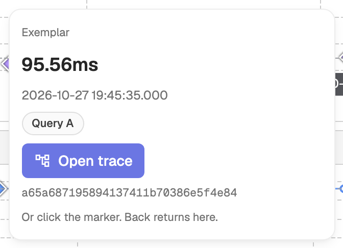
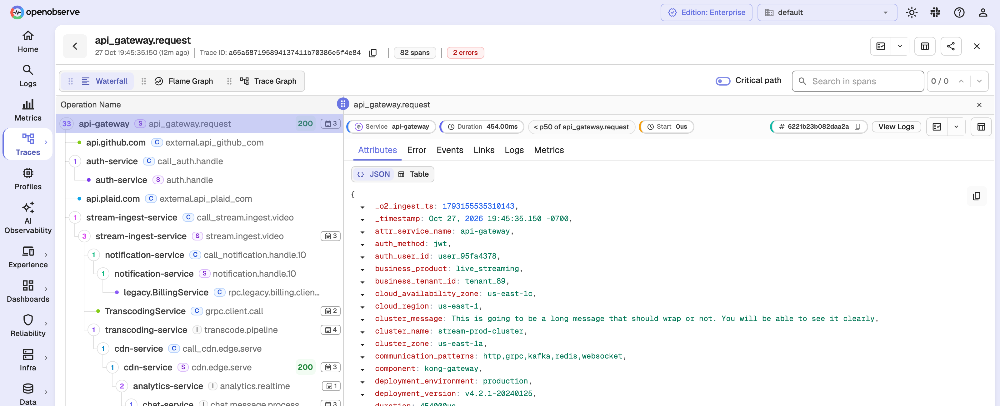
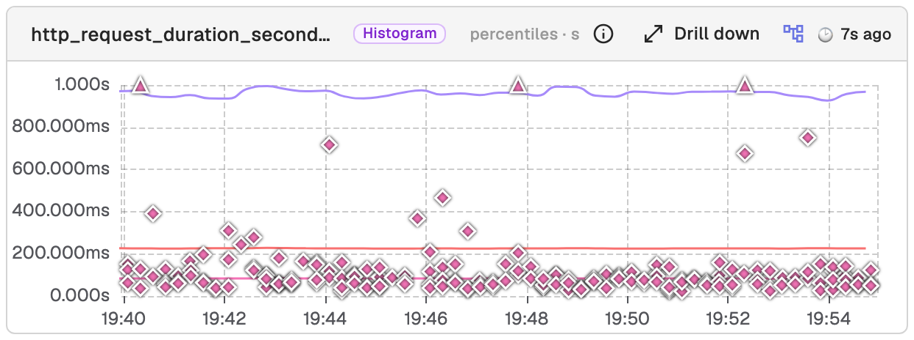

# Exemplars

Exemplars mark individual requests on a PromQL chart, so you can go from a spike straight to the trace that caused it. OpenObserve stores the exemplars that arrive with OTLP metrics and draws them on line, area, bar, scatter and heatmap panels that run a PromQL range query.

## Turn exemplars on

Exemplars are off by default. A panel with exemplars off does not request them.

- **For everyone:** in the panel editor, open the **Config** tab and turn on **Show exemplars**. The setting is saved with the panel, so everyone who opens the dashboard sees the markers.
- **For yourself:** select the exemplars icon in the panel header or in full-screen view. Its tooltip reads **Show exemplars (trace samples)**. This turns exemplars on or off for you only, for the current browser session, and overrides the saved setting.

## Read the markers

On a `histogram_quantile` panel, a marker sits at the exemplar's value. On other charts, such as rates and counters, it sits on its query's line at the exemplar's time. Values beyond the axis are drawn at its edge.

Hover a marker to see the value in the metric's own unit, the time, the query, the `trace_id`, and the exemplar's labels.

## Open the trace

Select **Open trace** in the card, or click the marker, to open the trace with the exemplar's span selected. Browser **Back** returns to the panel. If the trace was not found in any stream, the card shows **Trace not available — sampled out or past retention**. If the lookup could not finish, for example because it timed out, the button reads **Open trace (unverified)**.

## Metrics explorer

Metrics explorer cards have the same icon. A histogram card, which shows a heatmap by default, switches to its percentiles view while exemplars are on.

