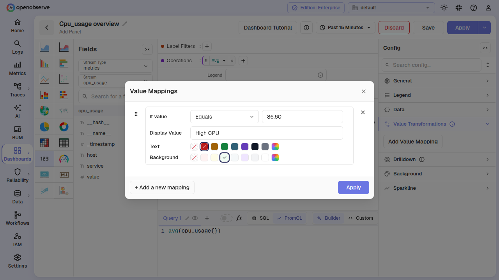
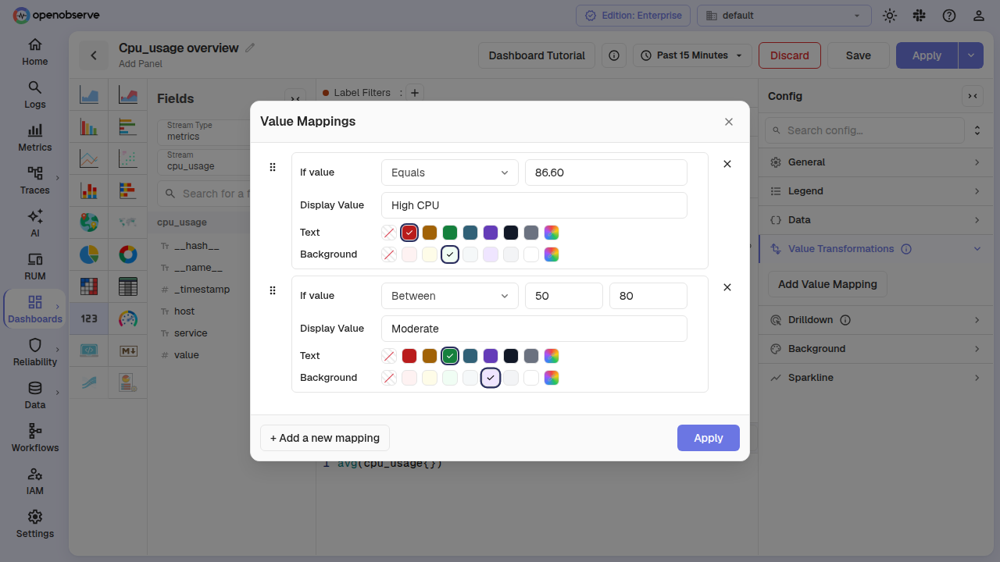
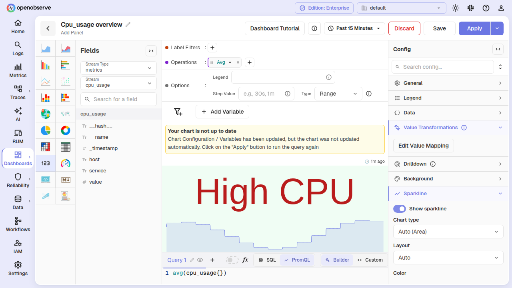
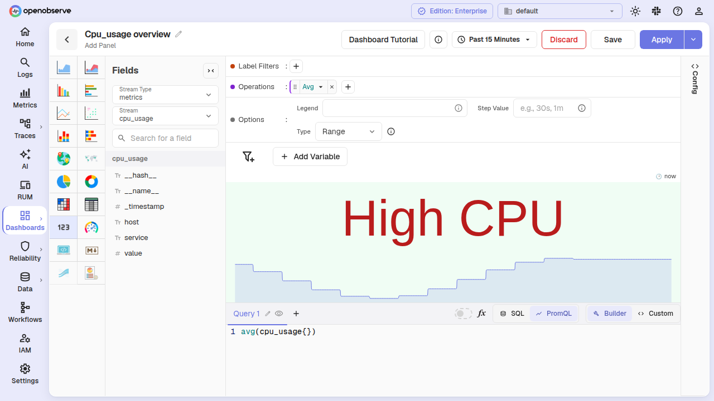

A metric chart shows one aggregated value, which suits KPIs and status indicators. You can add a sparkline that shows the trend, and map values to custom text and colors.

## Value mappings

In the panel **Config** sidebar, expand **Value Transformations** and add a value mapping.

Each mapping has a condition: **Equals**, **Between**, **Matches regex**, **Greater than**, **Less than**, **Greater than or equal**, or **Less than or equal**. When it matches, the panel shows the mapping's display text, text color, and background color. Leave the display text blank to keep the value. If you set only a background color, a readable text color is picked for you.

## Sparkline

In the panel **Config** sidebar, expand **Sparkline** and turn on **Show sparkline**. Then set:

- **Chart type**: **Auto (Area)**, **Line**, **Area**, or **Bar**.
- **Layout**: draw the trend along the bottom of the panel, or across the **Background** behind the value.
- **Color**, **Line width**, and **Area fill opacity**.

For PromQL, the trend uses the values the query already returns. For SQL, the trend comes from an extra histogram query. Queries that cannot be turned into a histogram, such as those with `JOIN`, `UNION`, `DISTINCT`, or `LIMIT`, show a warning icon in the panel header, and the value still displays. In a panel with several queries, each value draws its own sparkline.

