This guide explains how to use and manage panels in the dashboard. It includes features available in the panel toolbar, step-by-step instructions, and troubleshooting tips for common issues.

The panel toolbar offers the following controls to adjust, organize, and customize your panels:

## Viewing and Refresh Controls  
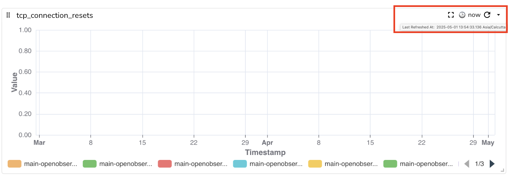

### Full Screen Mode  
Maximizes the panel to cover the entire display, providing an expanded view.  
**How to Use**:

- To expand the view, click the **Full Screen Mode** button in the panel toolbar.  
- To exit **Full Screen Mode**, press **Escape** on your keyboard. 

### Information Icon
The information icon on panel shows the description of the panel.    
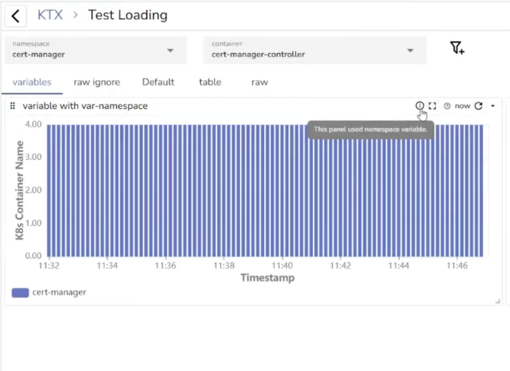  

**To add, edit, or remove a panel description:**

1. In the panel toolbar, open the dropdown menu and select **Edit Panel**.  
2. On the right side of the screen, select the **Config** tab.  
3. Under **Description**, enter, update, or delete the panel description as needed.  
4. Select **Apply** to save your changes.

### Last Refreshed At  
Displays the timestamp of when the panel’s data was last updated.   
**How to Use:** Hover over the timestamp icon to view the time when the panel was last refreshed. 

### Refresh  
Reloads the panel to display the most recent data.   
**How to Use:** Click the **Refresh** icon in the panel toolbar to reload the data.    

### Cached Data Warning
Alerts the user that the displayed data is not up-to-date with the selected time range, and the data may need to be refreshed for accuracy.  
To view the most up-to-date data, click **Refresh** to reload the panel.
 

## Panel Configuration and Layout  

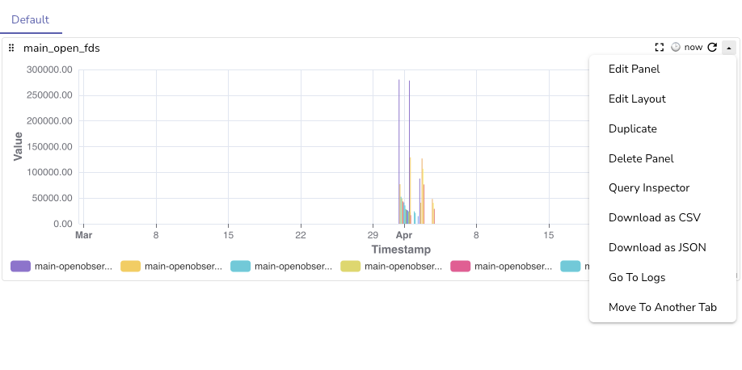 
### Edit Panel  
Allows you to modify the panel’s data, configuration settings, filters, query, and the chart.
### Edit Layout  
Allows you to modify the height of the panel.    
**How to Use:**   
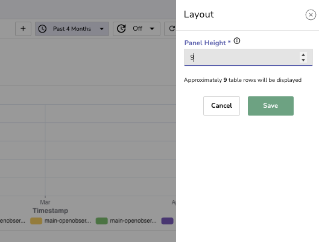

1. Click **Edit Layout** to open the layout configuration option.  
2. Adjust the **Panel Height** as required.  
3. Click **Save** to apply the changes.

### Adjust Size and Position 
Allows you to resize and reposition the panel using the available drag handles.   
**How to Use:**

- To adjust the position, click and drag the option at the top left corner of the panel.  
- To resize the panel, click and drag the arrow at the bottom right corner to adjust the panel’s height and width.

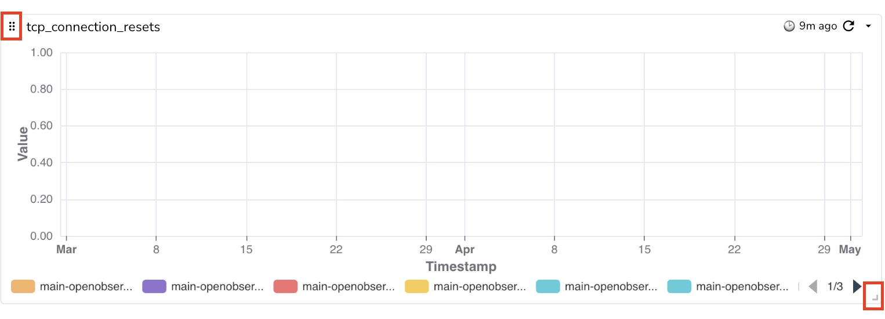

## Live Chart Preview

When you create or edit a panel, the editor renders a chart right away and keeps it in step with the query builder. As you change fields, aggregations, filters, and chart options, the preview re-runs automatically after a short delay — no need to click **Apply** after every edit.

### Default stream for a new panel

A new panel opens on the most useful stream automatically:

1. The stream you last saved a panel on (remembered per organization and stream type).
2. Otherwise, the last stream you explored for that type (Logs, Traces, or Metrics).
3. Otherwise, the most recently ingested non-internal stream.
4. Otherwise, the first stream in the list.

### How live preview runs

- Edits are **debounced** — a burst of changes runs as a single query once you pause (about 600 ms).
- When you make another edit before a run finishes, the earlier query is **cancelled** and the new one runs instead. On enterprise and cloud, the superseded query is also cancelled on the server; OpenObserve OSS has no server-side cancel route.

### When live preview does not run

Live preview re-runs automatically for builder edits, but it deliberately waits for **Apply** (or **Ctrl/Cmd+Enter**) in these cases:

- **Typed query text** — custom SQL, PromQL, or VRL you type by hand.
- **An incomplete builder** — for example, a filter you have added but not finished. It runs once the filter is complete or removed.
- **Apply-only settings** — time shift, PromQL instant/range, a formula, or a newly enabled sparkline.
- **After a slow query** — if a run takes longer than 10 seconds, further auto-runs pause until you click **Apply**.

### Time picker

The time picker applies directly — it has no **Apply** button of its own:

- With **Auto Run** on, picking a range, using the previous/next arrows, or zooming the chart re-runs immediately.
- With **Auto Run** off, the picked range waits for **Apply**.
- Relative ranges are recalculated before every run, so "Past 15 Minutes" always ends at now.

### Apply button

The **Apply** button changes to reflect whether the chart matches the editor:

| State | Appearance |
|-------|------------|
| Chart up to date | Normal theme colour |
| Chart behind the editor | **Yellow** — the tooltip explains why (changes not run, typed query, finish the builder fields, paused after a slow query) |
| Query running (enterprise) | **Red Cancel** |

The **Apply** button stays normal while a live run is queued, so it does not flash yellow before every auto-run. The "chart is not up to date" banner has been removed — pending changes now show on the **Apply** button instead.

### Auto Run

Live preview follows the dashboard's **Auto Run** switch, shared with Logs and Traces:

- With **Auto Run** on, edits run automatically as described above.
- With **Auto Run** off, edits wait for **Apply**.

The **Apply** dropdown carries the same **Auto Run** toggle as the dashboard. On OSS the dropdown appears only when **Auto Run** is available; on enterprise it always appears, alongside **Refresh Cache & Apply**.

The **Refresh** button in full-screen mode is no longer cut off when the panel toolbar is at its widest.

## Panel Lifecycle Management  
### Duplicate  
Creates another version of the panel for parallel usage or testing.

### Delete Panel  
Removes the panel from your dashboard.   

### Move to Another Tab  
Moves the panel to a different tab.  
**How to Use:** Click **Move to Another Tab**, select or create a new tab for the panel, and click **Move**.  
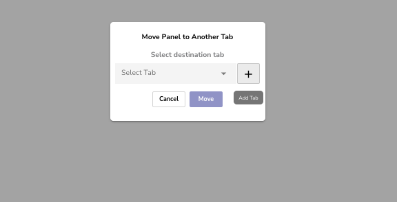  

## Data Analysis and Export   
### Query Inspector
Allows you to view the query, its start and end time, query type, and variables. To modify the query, select the **Edit Panel** option.  
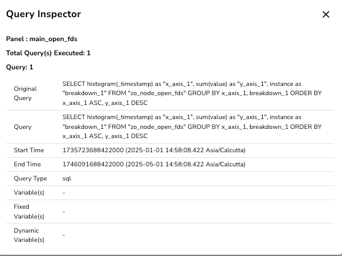

## Download as CSV 
Exports the panel’s data to a CSV file. 

### Download as JSON 
Exports the panel’s data to a JSON file. 
### Go to Logs 
Opens the logs related to the panel’s data.  
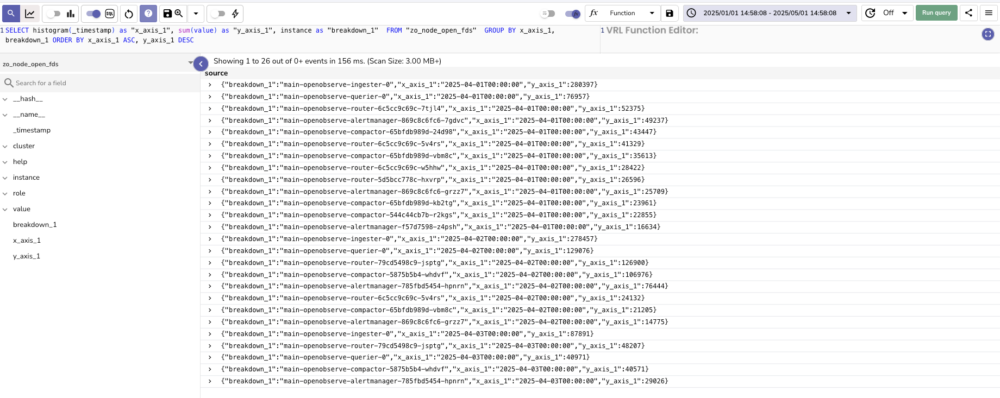  

## Annotations  
Allows you to add notes to selected data points or time ranges across multiple panels. This helps you highlight key insights or events in your data.  

### Add Annotations  
1. **Enable Annotation Mode:** 

    - The annotation button will appear when the panel contains time-series data.  
    - Click the annotation button to enter **Annotation Mode.**

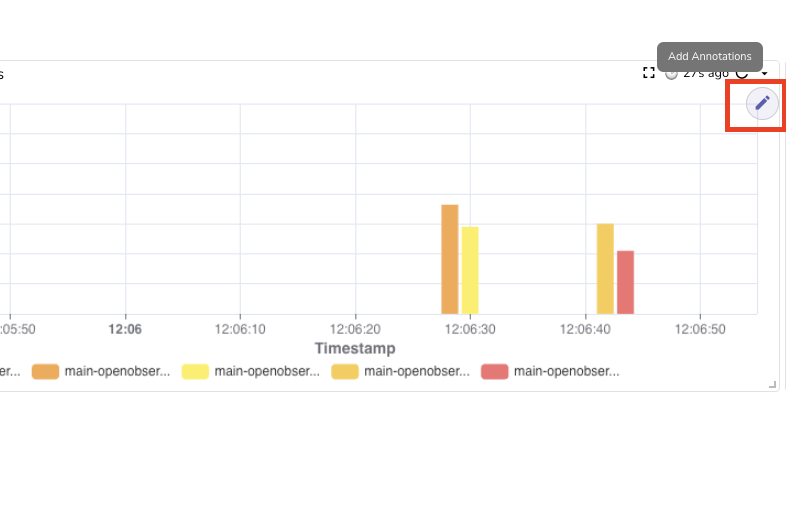

2. **Select Data Points or Time Ranges:** 

    - Click a single data point to place the annotation at that specific point.  
    - Select a range of data points to apply the annotation across the entire selected range.  

3. **Edit the Annotation:** 

    -  In the **Edit Annotation** popup, provide a title (mandatory) and a description (optional) for your annotation.
    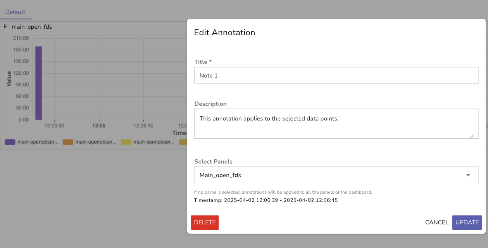

4. **Select Panels:**

    - Use the dropdown menu to select panels. You can apply annotations across multiple panels based on your selection.    
    - If you do not select any panel, the annotation applies to all panels for the selected time range, within the dashboard by default.
    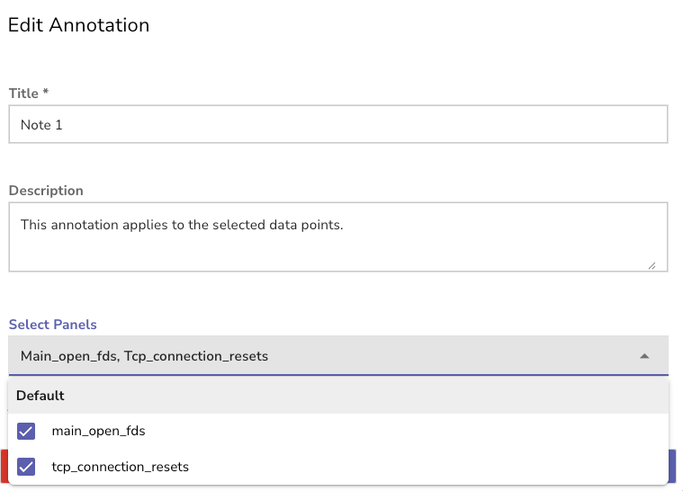

5. **Save Annotation.**
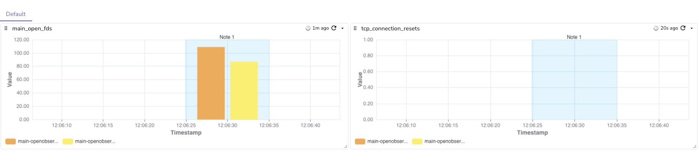

### Delete Annotations
  
1. Enable **Annotation Mode.**  
2. Select the annotation in the panel.   
3. In the **Edit Annotation** pop-up, click **Delete** and confirm.  

  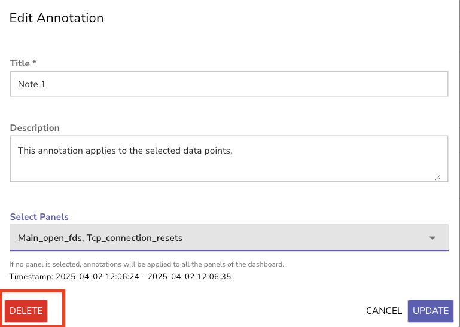

