This guide explains how to use and manage panels in the dashboard. It includes features available in the panel toolbar, step-by-step instructions, and troubleshooting tips for common issues.

The panel toolbar offers the following controls to adjust, organize, and customize your panels:

## Viewing and Refresh Controls  
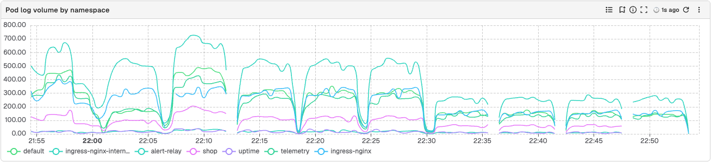

### Full Screen Mode  
Maximizes the panel to cover the entire display, providing an expanded view.  
**How to Use**:

- To expand the view, click the **Full screen** button in the panel toolbar (or press **V** while hovering over the panel).  
- To exit **Full Screen Mode**, press **Escape** on your keyboard. 

### Information Icon
The information icon on panel shows the description of the panel.    
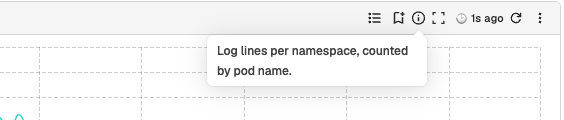  

**To add, edit, or remove a panel description:**

1. In the panel toolbar, open the dropdown menu and select **Edit Panel**.  
2. On the right side of the screen, select the **Config** tab.  
3. Under **Description**, enter, update, or delete the panel description as needed.  
4. Select **Apply** to save your changes.

### Last Refreshed At  
Displays the timestamp of when the panel’s data was last updated.   
**How to Use:** Hover over the timestamp icon to view the time when the panel was last refreshed. 

### Refresh  
Reloads the panel to display the most recent data.   
**How to Use:** Click the **Refresh Panel** icon in the panel toolbar to reload the data. To bypass the cache, select **Refresh Cache & Reload** from the panel's dropdown menu.    

### Cached Data Warning
Alerts the user that the displayed data is not up-to-date with the selected time range, and the data may need to be refreshed for accuracy.  
To view the most up-to-date data, click **Refresh** to reload the panel.
 

## Panel Configuration and Layout  

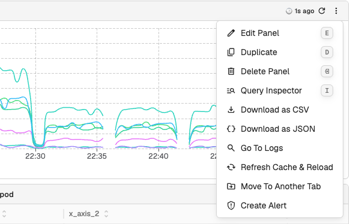 
### Edit Panel  
Allows you to modify the panel’s data, configuration settings, filters, query, and the chart.
### Edit Layout  
Allows you to modify the height of the panel. The **Edit Layout** menu item appears only while the dashboard layout is unlocked: click **Edit** in the dashboard toolbar first (see [Edit Dashboard Layout](../manage-dashboards.md#edit-dashboard-layout)).    
**How to Use:**   
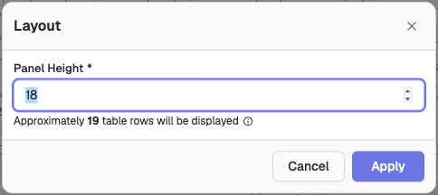

1. Click **Edit Layout** to open the layout configuration option.  
2. Adjust the **Panel Height** as required.  
3. Click **Apply**, then click **Save** in the dashboard toolbar to keep the layout.

### Adjust Size and Position 
Allows you to resize and reposition the panel using the available drag handles. The handles appear only while the dashboard layout is unlocked with **Edit**.   
**How to Use:**

- To adjust the position, click and drag the option at the top left corner of the panel.  
- To resize the panel, click and drag the arrow at the bottom right corner to adjust the panel’s height and width.

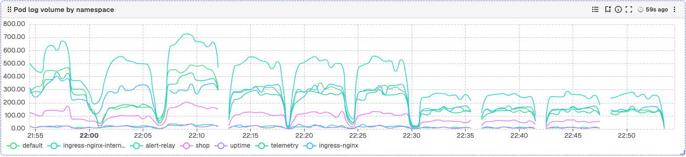

## Live Chart Preview

When you create or edit a panel, the editor renders a chart right away and keeps it in step with the query builder. As you change fields, aggregations, filters, and chart options, the preview re-runs automatically after a short delay, so you do not need to click **Apply** after every edit.

:::note[Note]
Live preview runs only when [Auto Run](../../../data-exploration/auto-run-query.md) is available and turned on. Auto Run is available when the deployment sets `ZO_AUTO_QUERY_ENABLED=true` (default `false`). Without it, every edit waits for **Apply**.
:::

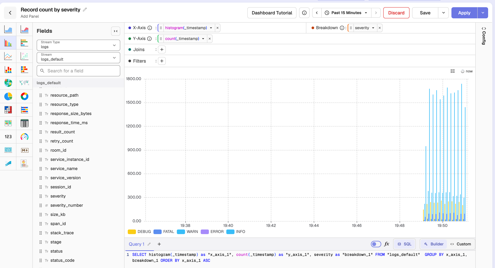

### Default stream for a new panel

A new panel opens on the most useful stream automatically:

1. The stream you last saved a panel on (remembered per organization and stream type).
2. Otherwise, the last stream you explored for that type (Logs, Traces, or Metrics).
3. Otherwise, the most recently ingested stream whose name does not start with an underscore (`_`).
4. Otherwise, the first stream in the list.

### How live preview runs

- Edits are **debounced**: a burst of changes runs as a single query once you pause (about 600 ms).
- When you make another edit before a run finishes, the earlier query is **cancelled** and the new one runs instead. On enterprise and cloud, the superseded query is also cancelled on the server; OpenObserve OSS has no server-side cancel route.

### When live preview does not run

Live preview re-runs automatically for builder edits, but it waits for **Apply** (or **Ctrl/Cmd+Enter**) in these cases:

- **Typed query text**: custom SQL, PromQL, or VRL you type by hand.
- **An incomplete builder**: for example, a filter you have added but not finished. It runs once the filter is complete or removed.
- **Apply-only settings**: time shift, PromQL instant/range, a formula, or a newly enabled sparkline.
- **After a slow query**: if a run takes longer than 10 seconds, further auto-runs pause until you click **Apply**.

### Time picker

The panel editor's time picker applies directly; it has no **Apply** button of its own:

- With **Auto Run** on, picking a range, using the previous/next arrows, or zooming the chart re-runs immediately.
- With **Auto Run** off, the picked range waits for **Apply**.
- Relative ranges are recalculated before every run, so "Past 15 Minutes" always ends at the current time.

### Apply button

The **Apply** button shows whether the chart matches the editor:

| State | Appearance |
|-------|------------|
| Chart up to date | Normal theme colour |
| Chart behind the editor | **Yellow**. The tooltip explains why: changes not run, typed query, builder fields to finish, or paused after a slow query. |
| Query running (enterprise) | **Red Cancel** |

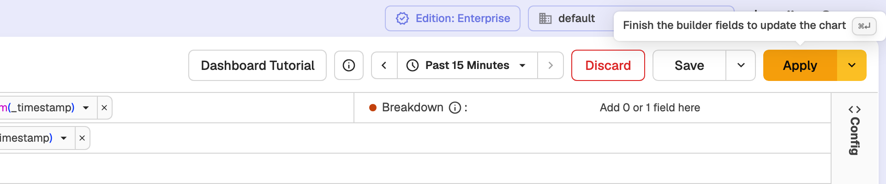

The **Apply** button stays normal while a live run is queued, so it does not flash yellow before every auto-run.

### Auto Run toggle

Live preview follows the same **Auto Run** setting as the dashboard, Logs, and Traces:

- With **Auto Run** on, edits run automatically as described above.
- With **Auto Run** off, edits wait for **Apply**.

The **Apply** dropdown includes a **Turn on Auto Run** / **Turn off Auto Run** item when Auto Run is available. On enterprise the dropdown is always shown and also contains **Refresh Cache & Apply**; on OSS it appears only when Auto Run is available.

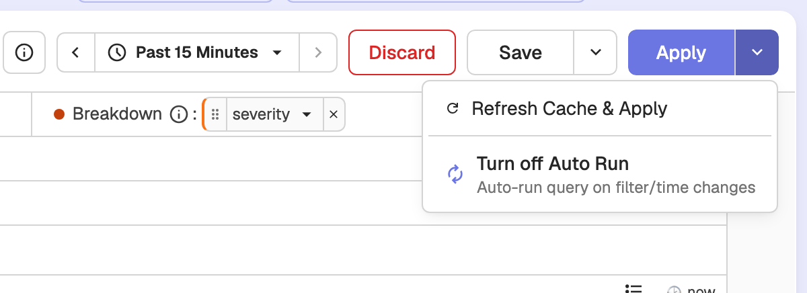

## Panel Lifecycle Management  
### Duplicate  
Creates another version of the panel for parallel usage or testing.

### Delete Panel  
Removes the panel from your dashboard.   

### Move To Another Tab  
Moves the panel to a different tab.  
**How to Use:** Click **Move To Another Tab**, select or create a new tab for the panel, and click **Move**.  
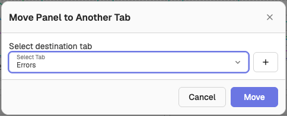  

## Data Analysis and Export   
### Query Inspector
Allows you to view the query, its start and end time, query type, and variables. To modify the query, select the **Edit Panel** option.  
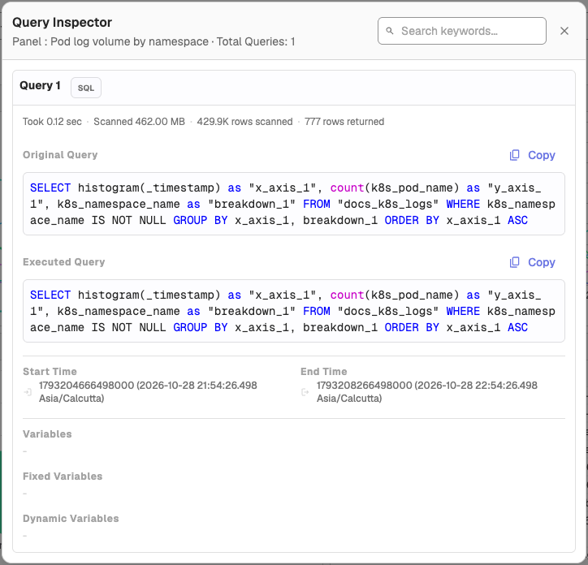

## Download as CSV 
Exports the panel’s data to a CSV file. 

### Download as JSON 
Exports the panel’s data to a JSON file. 
### Go To Logs 
Opens the logs related to the panel’s data.  
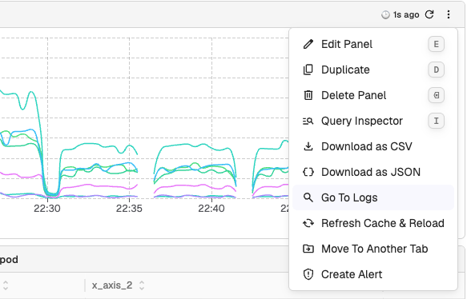  

### Create Alert
Creates an alert from the panel's query. See [Alerts](../../alerts/index.md) for the alert settings.

## Annotations  
Allows you to add notes to selected data points or time ranges across multiple panels. This helps you highlight key insights or events in your data.  

### Add Annotations  
1. **Enable Annotation Mode:** 

    - The **Add Annotations** button will appear in the panel toolbar when the panel contains time-series data.  
    - Click the button to enter **Annotation Mode.** Click it again (**Exit Annotations Mode**) to leave.

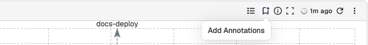

2. **Select Data Points or Time Ranges:** 

    - Click a single data point to place the annotation at that specific point.  
    - Select a range of data points to apply the annotation across the entire selected range.  

3. **Edit the Annotation:** 

    -  In the **Add Annotation** popup, provide a **Title** (mandatory) and a **Description** (optional) for your annotation.
    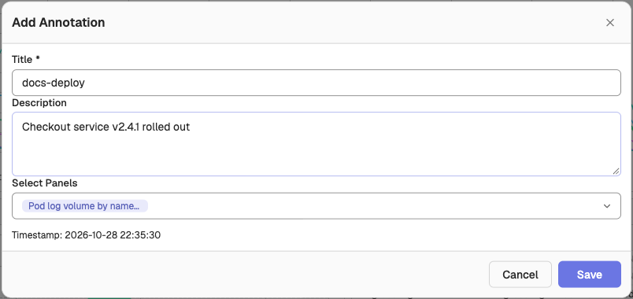

4. **Select Panels:**

    - Use the **Select Panels** dropdown to select panels. You can apply annotations across multiple panels based on your selection.    
    - If you do not select any panel, the annotation applies to all panels for the selected time range, within the dashboard by default.
    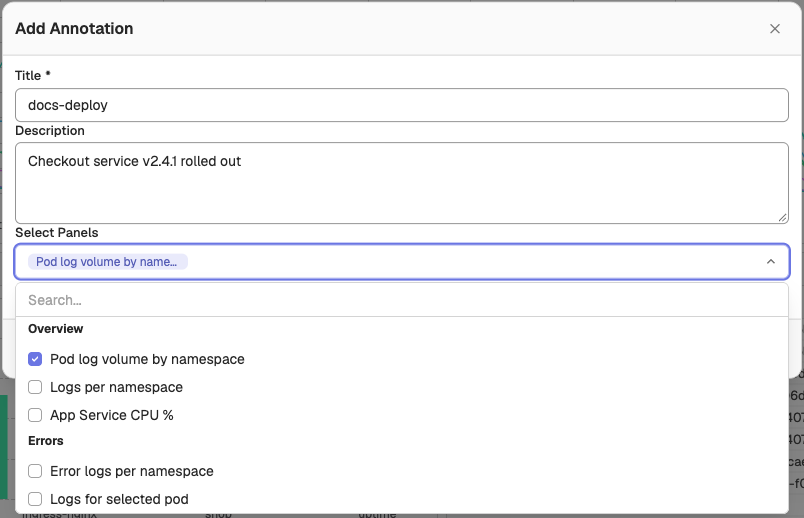

5. Click **Save**.
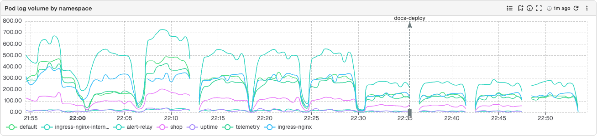

### Delete Annotations
  
1. Enable **Annotation Mode.**  
2. Select the annotation in the panel.   
3. In the **Edit Annotation** pop-up, click **Delete** and confirm.  

  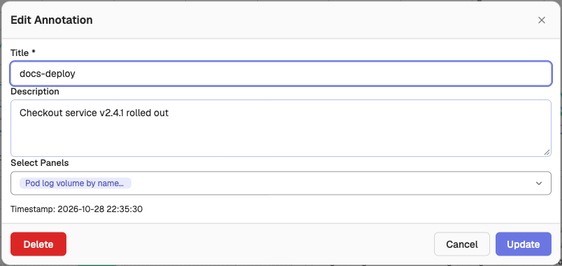

