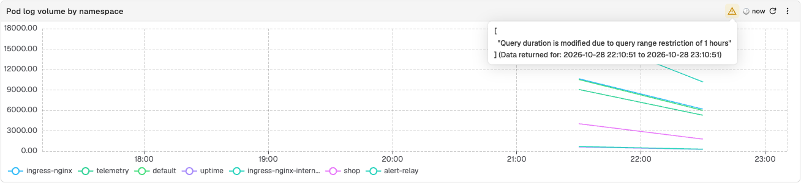
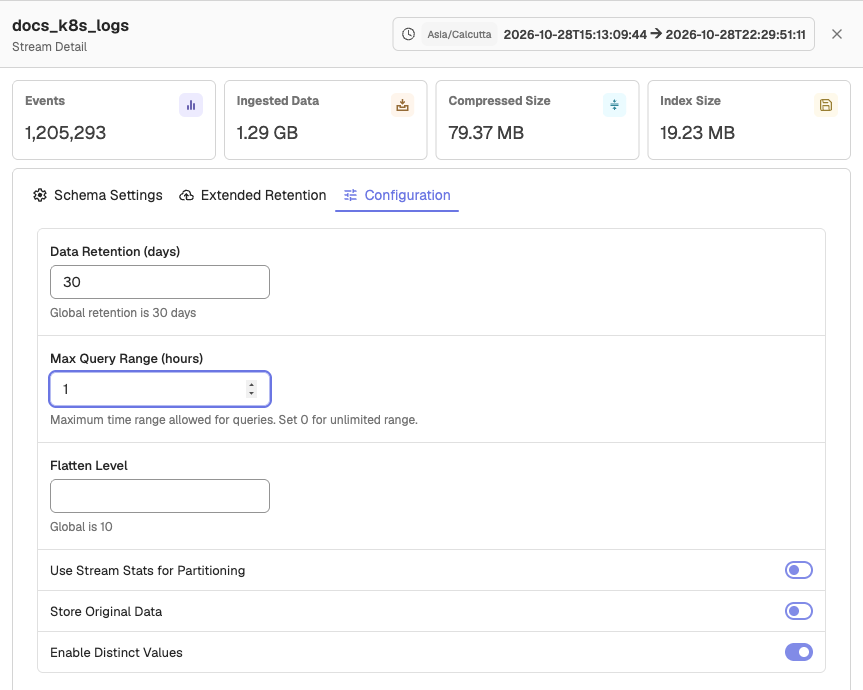
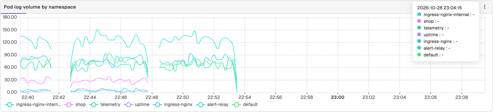
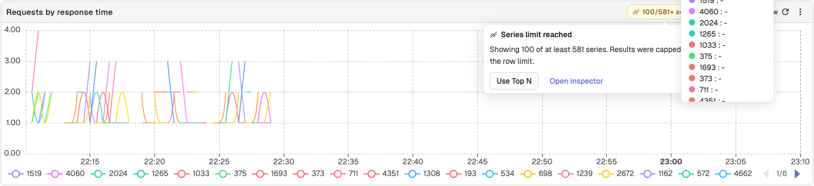
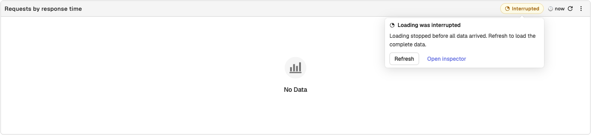

This page provides instructions on the warning or error icons displayed on the panel toolbar, explains how to identify and troubleshoot these warnings. 

:::accordion[1. Error: When the query duration is modified due to the query range is restricted]
## Error: When the query duration is modified due to the query range is restricted   
 

### Cause
This occurs when the time range of your query exceeds the limit set at the **Max Query Range (hours)** field in the stream settings.   
### Resolution   
1. Go to the **Streams** page.  
2. Find the stream you are working with and select **Stream Detail** under the **Actions** column.<br>
 

3. In the stream settings, update the **Max Query Range (hours)** to a value that supports your query duration. Set `0` for an unlimited range. <br>  
:::

:::accordion[Warning: The data shown is cached and is different from the selected time range]

## Warning: The data shown is cached and is different from the selected time range 



### Cause
This warning appears when the selected time range has changed, but the panel did not automatically refresh.  

### Resolution   
Click the **Refresh Panel** button in the panel toolbar (the circular arrow icon) to reload the panel with data that matches the current time range.
:::

::::accordion[Warning: Series limit reached]
## Warning: Series limit reached

 

### Cause
A chart draws at most `ZO_MAX_DASHBOARD_SERIES` series (default `100`). When a query returns more, the panel shows only that many and a chip such as `100/250 series` appears in the panel header. Its message, **Series limit reached**, says how many series are shown. If you can edit the panel, the message also offers **Use Top N** to limit the series in the query instead.

:::note[Note]
- If a panel includes multiple Y-axes, the limit will apply **individually per Y-axis**.  
- The **Comparison Against** feature does not count toward the series limit. However, if enabled, it may not fully display its comparison results due to this cap. The exact behavior is subject to confirmation.
:::

### Resolution  

Update the following environment variable:   
```  
ZO_MAX_DASHBOARD_SERIES=<number_of_series>  
```  
Replace <number_of_series> with the maximum number of time series you want each panel to display.

**Example**  <br>
If you set ZO_MAX_DASHBOARD_SERIES=50:

- A panel with a single Y-axis will display up to 50 series.  
- A panel with two Y-axes will display up to 50 series on each axis.
::::

:::accordion[Warning: The data shown is incomplete because the loading was interrupted]
## Warning: The data shown is incomplete because the loading was interrupted


### Cause
An **Interrupted** chip appears in the panel header, with the message **Loading was interrupted**, when the query execution was interrupted or cancelled. It results in the panel displaying partial or no data while indicating that the data is not fully loaded.

Typical causes include: 

- Query cancellation due to user navigation or timeout
- Backend failed to send the complete result set

### Resolution
Click **Refresh** in the chip's message, or the **Refresh Panel** button in the panel toolbar, to rerun the query. This will attempt to fetch the complete data and remove the warning.
:::
