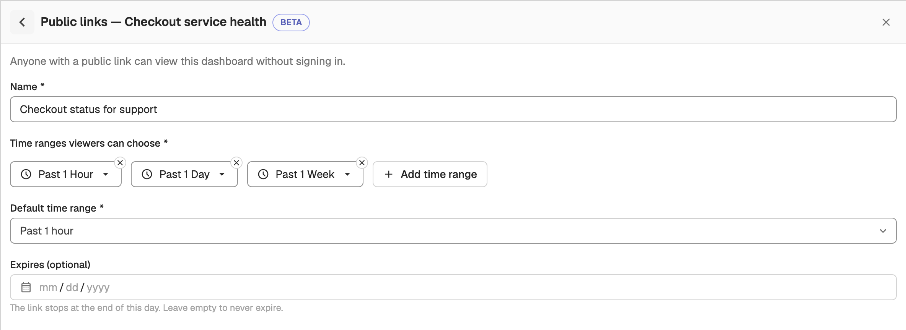
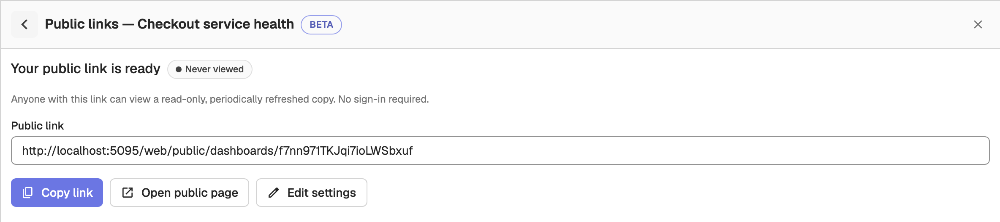
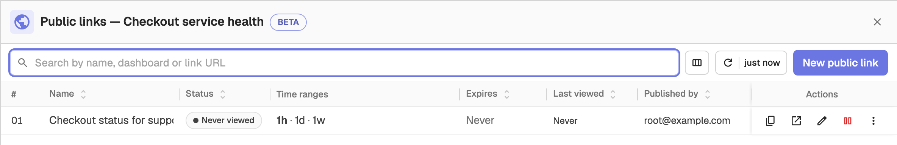
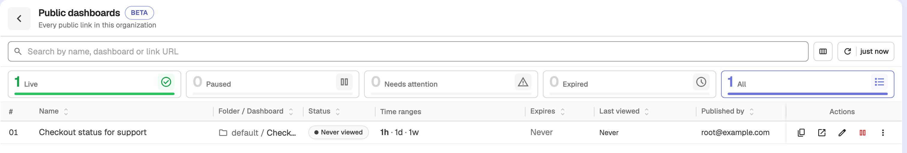
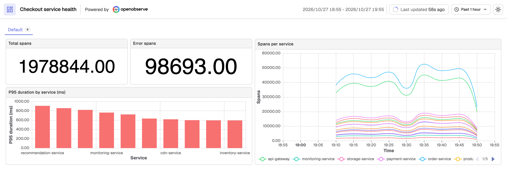

# Public Dashboards

A public link publishes a read-only, periodically refreshed copy of a dashboard. Anyone with the link can open it in a browser without an OpenObserve account or sign-in. Public dashboards are in beta.

## Before you start

- The feature is on by default. A server-wide switch, `ZO_PUBLIC_DASHBOARD_ENABLED`, turns it off. It also needs the disk cache: if `ZO_DISK_CACHE_ENABLED` is off on a querier, public dashboards are turned off. While the feature is off, the public link buttons are hidden and public URLs return 404.
- In Enterprise, you need **edit access to the dashboard**, and a role with the **Public Dashboards** permission. Admins grant it on the **Roles** screen. It is one org-wide permission, not a per-dashboard grant.
- A dashboard can have up to 10 public links, and a public link can show at most 50 panels across all tabs. An organization can have up to 50 links. See [Limits and settings](#limits-and-settings) to change these.

## Create a public link

1. Open the dashboard and save any pending changes.
2. Select the globe button (**Publish publicly (beta)**) in the dashboard toolbar. The **Public links** panel opens.
3. If the dashboard already has links, select **New public link**. Otherwise the form opens directly. Fill in the form:
    - **Name**: a label that tells this dashboard's links apart, for example `Customer status view`.
    - **Time ranges viewers can choose**: up to 10 relative or absolute time ranges. Each range can be at most 365 days, and an absolute range must end in the past.
    - **Default time range**: the range the public page opens with. It must be one of the ranges above.
    - **Default variable values**: shown only when the dashboard has variables. The public page always uses these values. Viewers can see them but cannot change them.
    - **Expires (optional)**: the link stops at the end of this day. Leave it empty to never expire.

    

4. Select **Create link**. OpenObserve shows **Your public link is ready** with the URL. Select **Copy link** to copy it, or **Open public page** to view it.

    

The link looks like this:

```txt
https://<host>/web/public/dashboards/<slug>
```

Treat the URL as a secret: anyone who has it can view the dashboard.

The public page shows data that the link's **publisher** is allowed to see. The publisher is the user who created the link or last took it over.

## Manage a dashboard's links

Select the globe button on a dashboard that has links, and the **Public links** panel lists each link with its status, time ranges, expiry, when it was last viewed, and its publisher. Each link has these actions:

- **Edit settings**: change the name, time ranges, default variable values or expiry. The link's address stays the same, and changes appear on the public page at its next update.
- **Pause** and **Resume**: stop serving the link and start it again. An expired link cannot be paused; extend its expiry instead.
- **Refresh on next view**: rebuild the data the next time someone opens the link, instead of waiting for the regular refresh.
- **Take over**: make yourself the publisher. The public page then shows what you are allowed to see, and the link goes live.
- **Copy link** and **Open public page**.
- **Revoke and delete**: delete the link permanently. Anyone using it loses access immediately. Publishing again creates a new URL.



A link's status is one of **Live**, **Paused**, **Never viewed**, **Needs attention** (the last build failed, or some panels cannot be shown publicly), **Expired**, **Dashboard deleted**, or **Disabled** (public links are turned off for the organization).

Deleting a dashboard also deletes its public links.

## View all public links in the organization

On the **Dashboards** page, select **Public dashboards** to open a list of every public link in the organization. Search by name, dashboard or link URL, and use the same actions as in the dashboard's **Public links** panel. If you cannot view a link's dashboard, its URL shows as **No access**.



## What viewers see

Viewers open the link in any browser and see the dashboard read-only, without signing in. They can switch between the time ranges you offered from the time range menu, and see the frozen variable values. The header shows when the data was last updated.

The data is a copy that OpenObserve refreshes periodically, so it is not live to the second. A panel that cannot be shown publicly displays **This panel isn't available on the public view**.



## Limits and settings

### Organization settings

An organization admin can turn public links off for the organization, or lower its link limit, through the API. No UI screen exists for this yet.

```bash
# Read the current settings
curl -u <user>:<password> https://<host>/api/<org_id>/settings/public_dashboards

# Turn public links on and allow at most 20 links
curl -u <user>:<password> -X PUT \
  -H "Content-Type: application/json" \
  -d '{"enabled": true, "max_links": 20}' \
  https://<host>/api/<org_id>/settings/public_dashboards
```

- `enabled`: while `false`, every link in the organization stops serving and shows **Disabled**. Turning it back on restores them.
- `max_links`: between 1 and the server limit (`ZO_PUBLIC_DASHBOARD_MAX_LINKS_PER_ORG`). Lowering it blocks new links only; existing links keep working.

:::note[OpenObserve Cloud]
On OpenObserve Cloud, the link limit follows your plan: 3 links on free plans and 50 on paid plans. An organization admin can turn public links on or off, but cannot change the limit.
:::

### Server settings

Self-hosted deployments can tune public dashboards with environment variables, including:

| Variable | Default | Description |
| --- | --- | --- |
| `ZO_PUBLIC_DASHBOARD_ENABLED` | `true` | Turns public dashboards on or off for the whole server. |
| `ZO_PUBLIC_DASHBOARD_MAX_LINKS_PER_ORG` | `50` | Public links an organization can have. |
| `ZO_PUBLIC_DASHBOARD_MAX_LINKS_PER_DASHBOARD` | `10` | Public links one dashboard can have. |
| `ZO_PUBLIC_DASHBOARD_MAX_PANELS` | `50` | Panels a public link can show, across all tabs. |
| `ZO_PUBLIC_DASHBOARD_MIN_REFRESH_SECS` | `60` | Shortest refresh interval, in seconds. |
| `ZO_PUBLIC_DASHBOARD_RPM` | `240` | Requests per minute allowed from one IP address on the public routes. `0` disables the limit. |
